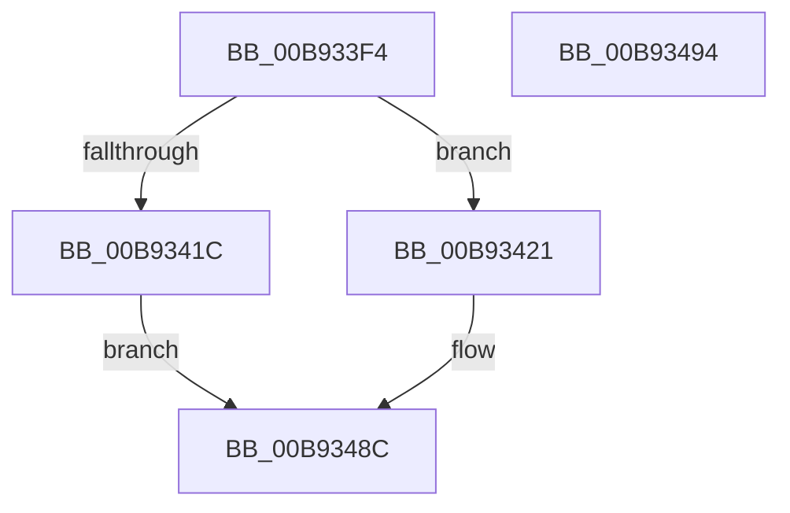

# VfUtilIsLocalSystem

- RVA: `0x00B933F4`–`0x00B93495` (길이 `161` bytes)
- VA: `0x0000000140B933F4`
- 실행 섹션: `PAGEVRFY`
- PDB 이름 있음: `예`; PDB Function 태그: `아니요`
- unwind 정보 RVA: `0x000B5DC4`
- 디코드: `41`개 명령, `161/161` bytes 표시
- 미해석 바이트: `0` (있으면 어셈블리에 `.byte`로 보존)

> 이 문서는 커널 이미지의 기계어와 PDB 기호를 분석해 생성했습니다. 4번과 5번은 함수 원형과 자료형을 바이너리 사용 방식에서 추정한 C 해석이며 원본 소스 복구 결과는 아닙니다.

## 1. Dependencies

- 직접 호출 지점: **5**; 고유 호출 대상: **5**
- 직접 호출자로 확인된 함수: **2**
- RIP 상대 이미지 참조: **1**

### Outgoing calls
- `0x00B93412` → [ViInitializeLocalSystemDescriptor](ViInitializeLocalSystemDescriptor_function_00B936F8.md) (function, `0x00B936F8`)
- `0x00B9342B` → [SeCaptureSubjectContextEx](../../page/8C/SeCaptureSubjectContextEx_function_008C4C90.md) (function, `0x008C4C90`)
- `0x00B93430` → [IoGetFileObjectGenericMapping](../../page/A1/IoGetFileObjectGenericMapping_function_00A11E80.md) (function, `0x00A11E80`)
- `0x00B9347A` → [SeAccessCheck](../../text/3A/SeAccessCheck_function_003A6BC0.md) (function, `0x003A6BC0`)
- `0x00B93487` → [SeReleaseSubjectContext](../../page/86/SeReleaseSubjectContext_function_0086B710.md) (function, `0x0086B710`)

### Direct callers
- [VfRlrsKeInjectStatusAlerted](../BA/VfRlrsKeInjectStatusAlerted_function_00BAF6F4.md) at `0x00BAF73C`
- [VfCheckUserHandle](../BB/VfCheckUserHandle_function_00BB9218.md) at `0x00BB92D9`

### Static image references
- `0x00B9345F` → RVA `0x00FFDBB8` (`PAGEVRFD`; read)

## 2. Other-region calls and transfers

- 다른 실행 섹션으로 향하는 call: **4**
  - `0x00B9342B` → [SeCaptureSubjectContextEx](../../page/8C/SeCaptureSubjectContextEx_function_008C4C90.md) (`PAGEVRFY` → `PAGE`)
  - `0x00B93430` → [IoGetFileObjectGenericMapping](../../page/A1/IoGetFileObjectGenericMapping_function_00A11E80.md) (`PAGEVRFY` → `PAGE`)
  - `0x00B9347A` → [SeAccessCheck](../../text/3A/SeAccessCheck_function_003A6BC0.md) (`PAGEVRFY` → `.text`)
  - `0x00B93487` → [SeReleaseSubjectContext](../../page/86/SeReleaseSubjectContext_function_0086B710.md) (`PAGEVRFY` → `PAGE`)
- 별도 외부 분기/꼬리 이동을 확인하지 못했습니다.

## 3. Assembly (complete function range)

```asm
00B933F4  48 8B C4                        mov rax, rsp
00B933F7  53                              push rbx
00B933F8  48 83 EC 70                     sub rsp, 0x70
00B933FC  83 60 18 00                     and dword ptr [rax + 0x18], 0
00B93400  0F 57 C0                        xorps xmm0, xmm0
00B93403  83 60 10 00                     and dword ptr [rax + 0x10], 0
00B93407  48 8B D9                        mov rbx, rcx
00B9340A  0F 11 40 D8                     movups xmmword ptr [rax - 0x28], xmm0
00B9340E  0F 11 40 E8                     movups xmmword ptr [rax - 0x18], xmm0
00B93412  E8 E1 02 00 00                  call 0x140b936f8
00B93417  48 85 C0                        test rax, rax
00B9341A  75 05                           jne 0x140b93421
00B9341C  8D 58 01                        lea ebx, [rax + 1]
00B9341F  EB 6B                           jmp 0x140b9348c
00B93421  4C 8D 44 24 50                  lea r8, [rsp + 0x50]
00B93426  48 8B D3                        mov rdx, rbx
00B93429  33 C9                           xor ecx, ecx
00B9342B  E8 60 18 D3 FF                  call 0x1408c4c90
00B93430  E8 4B EA E7 FF                  call 0x140a11e80
00B93435  48 8D 8C 24 88 00 00 00         lea rcx, [rsp + 0x88]
00B9343D  BB 01 00 00 00                  mov ebx, 1
00B93442  48 89 4C 24 48                  mov qword ptr [rsp + 0x48], rcx
00B93447  48 8D 54 24 50                  lea rdx, [rsp + 0x50]
00B9344C  48 8D 8C 24 90 00 00 00         lea rcx, [rsp + 0x90]
00B93454  44 8B CB                        mov r9d, ebx
00B93457  48 89 4C 24 40                  mov qword ptr [rsp + 0x40], rcx
00B9345C  45 33 C0                        xor r8d, r8d
00B9345F  48 8B 0D 52 A7 46 00            mov rcx, qword ptr [rip + 0x46a752]
00B93466  88 5C 24 38                     mov byte ptr [rsp + 0x38], bl
00B9346A  48 89 44 24 30                  mov qword ptr [rsp + 0x30], rax
00B9346F  48 83 64 24 28 00               and qword ptr [rsp + 0x28], 0
00B93475  83 64 24 20 00                  and dword ptr [rsp + 0x20], 0
00B9347A  E8 41 37 81 FF                  call 0x1403a6bc0
00B9347F  48 8D 4C 24 50                  lea rcx, [rsp + 0x50]
00B93484  0F B6 D8                        movzx ebx, al
00B93487  E8 84 82 CD FF                  call 0x14086b710
00B9348C  8B C3                           mov eax, ebx
00B9348E  48 83 C4 70                     add rsp, 0x70
00B93492  5B                              pop rbx
00B93493  C3                              ret
00B93494  CC                              int3
```

## 4. C-style interpretation (structured pseudocode)

```c
__int64 __fastcall VfUtilIsLocalSystem(__int64 a1)
{
    __int64 result;
    __int64 v_rsp;
    unsigned __int64 v_stack_m28;
    unsigned __int64 v_stack_m30;
    unsigned __int64 v_stack_m38;
    unsigned __int8 v_stack_m40;
    unsigned __int64 v_stack_m48;
    unsigned __int64 v_stack_m50;
    unsigned int v_stack_m58;
    unsigned __int64 v_stack_p10;
    unsigned __int64 v_stack_p18;

    v_rsp = (v_rsp) - (112);
    *(unsigned __int64 *)(v_rsp - 40) = v_xmm0;
    *(unsigned __int64 *)(v_rsp - 24) = v_xmm0;
    result = ViInitializeLocalSystemDescriptor(a1, a2, a3, a4);
    if (result != 0) goto loc_00B93421;
    goto loc_00B9348C;
loc_00B93421:
    a1 = 0;
    result = SeCaptureSubjectContextEx(a1, result + 1, v_stack_m28, a4);
    result = IoGetFileObjectGenericMapping(a1, result + 1, v_stack_m28, a4);
    v_stack_m30 = v_stack_p10;
    v_stack_m38 = v_stack_p18;
    a3 = 0;
    v_stack_m40 = 1;
    v_stack_m48 = result;
    result = SeAccessCheck(*(unsigned __int64 *)(v_rip + 4630354), v_stack_m28, a3, 1);
    result = SeReleaseSubjectContext(v_stack_m28, v_stack_m28, a3, 1);
loc_00B9348C:
    v_rsp = (v_rsp) + (112);
    return (unsigned int)((unsigned int)((unsigned __int8)(result)));
}
```

## 5. (Beta) C Style

```c
int64_t VfUtilIsLocalSystem(int64_t Arg1)
{
    int64_t result;
    int64_t local_rsp;
    uint64_t v_stack_m28;
    uint64_t v_stack_m30;
    uint64_t v_stack_m38;
    uint8_t v_stack_m40;
    uint64_t v_stack_m48;
    uint64_t v_stack_m50;
    uint32_t v_stack_m58;
    uint64_t v_stack_p10;
    uint64_t v_stack_p18;

    local_rsp = (local_rsp) - (112);
    *(uint64_t *)(local_rsp - 0x28) = v_xmm0;
    *(uint64_t *)(local_rsp - 0x18) = v_xmm0;
    result = ViInitializeLocalSystemDescriptor(Arg1, a2, a3, a4);
    if (result != 0) goto loc_00B93421;
    goto loc_00B9348C;
loc_00B93421:
    Arg1 = 0;
    result = SeCaptureSubjectContextEx(Arg1, result + 1, v_stack_m28, a4);
    result = IoGetFileObjectGenericMapping(Arg1, result + 1, v_stack_m28, a4);
    v_stack_m30 = v_stack_p10;
    v_stack_m38 = v_stack_p18;
    a3 = 0;
    v_stack_m40 = 1;
    v_stack_m48 = result;
    result = SeAccessCheck(*(uint64_t *)(v_rip + 0x46A752), v_stack_m28, a3, 1);
    result = SeReleaseSubjectContext(v_stack_m28, v_stack_m28, a3, 1);
loc_00B9348C:
    local_rsp = (local_rsp) + (112);
    return (uint32_t)((uint32_t)((uint8_t)(result)));
}
```

## 6. Execution-region graph

[열기: 2D/3D 그래프와 함수 탐색 컨트롤 패널](../../../control-panel.html?section=pagevrfy&rva=0x00B933F4&view=graph)

- 2D 그래프는 위에서 아래로 흐르고, 3D 그래프는 빈 공간을 드래그해 회전합니다. Shift+드래그는 이동, 휠은 확대·축소, 함수 노드 선택은 대상 보고서 이동입니다.

### Static fallback


