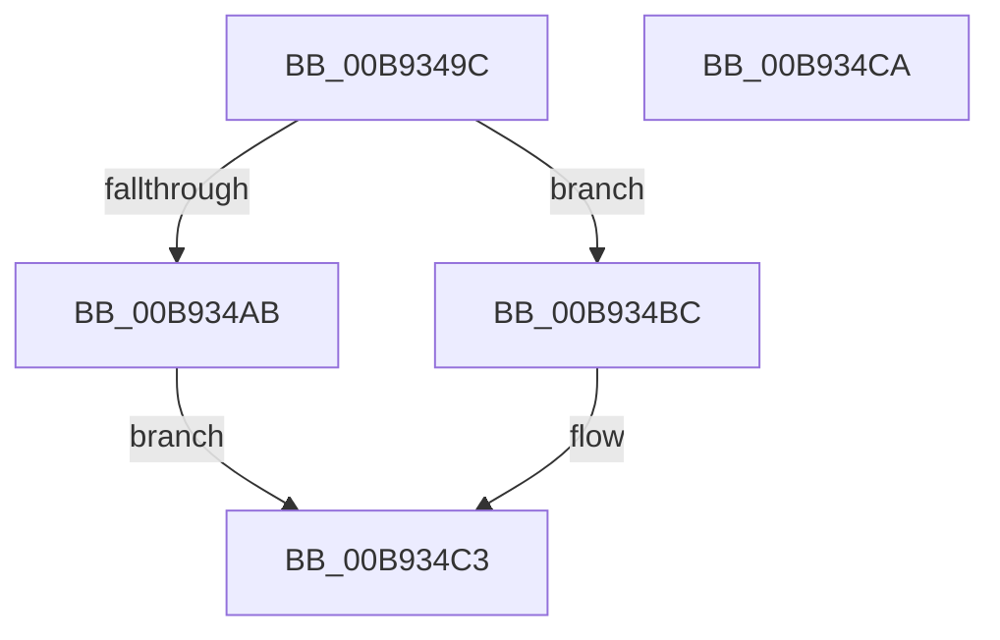

# VfUtilIsProtectedDriver

- RVA: `0x00B9349C`–`0x00B934CB` (길이 `47` bytes)
- VA: `0x0000000140B9349C`
- 실행 섹션: `PAGEVRFY`
- PDB 이름 있음: `예`; PDB Function 태그: `아니요`
- unwind 정보 RVA: `0x0005C788`
- 디코드: `16`개 명령, `47/47` bytes 표시
- 미해석 바이트: `0` (있으면 어셈블리에 `.byte`로 보존)

> 이 문서는 커널 이미지의 기계어와 PDB 기호를 분석해 생성했습니다. 4번과 5번은 함수 원형과 자료형을 바이너리 사용 방식에서 추정한 C 해석이며 원본 소스 복구 결과는 아닙니다.

## 1. Dependencies

- 직접 호출 지점: **2**; 고유 호출 대상: **2**
- 직접 호출자로 확인된 함수: **4**
- RIP 상대 이미지 참조: **0**

### Outgoing calls
- `0x00B934A0` → [KeIsImportOptimizationEnabled](../../text/4A/KeIsImportOptimizationEnabled_function_004A8FB8.md) (function, `0x004A8FB8`)
- `0x00B934BC` → [KeIsImageIATProtected](../../text/5B/KeIsImageIATProtected_function_005B1838.md) (function, `0x005B1838`)

### Direct callers
- [VfDriverApplyDifVerification](VfDriverApplyDifVerification_function_00B9A028.md) at `0x00B9A0F0`
- [VfDriverEnableVerifier](VfDriverEnableVerifier_function_00B9A240.md) at `0x00B9A2F0`
- [VfDriverEnableVerifierForAll](VfDriverEnableVerifierForAll_function_00B9A3A4.md) at `0x00B9A3E3`
- [ViDriverReApplyVerifierForAll](ViDriverReApplyVerifierForAll_function_00B9A8D4.md) at `0x00B9A941`

### Static image references
- 디코드된 RIP-relative 메모리 참조가 없습니다.

## 2. Other-region calls and transfers

- 다른 실행 섹션으로 향하는 call: **2**
  - `0x00B934A0` → [KeIsImportOptimizationEnabled](../../text/4A/KeIsImportOptimizationEnabled_function_004A8FB8.md) (`PAGEVRFY` → `.text`)
  - `0x00B934BC` → [KeIsImageIATProtected](../../text/5B/KeIsImageIATProtected_function_005B1838.md) (`PAGEVRFY` → `.text`)
- 별도 외부 분기/꼬리 이동을 확인하지 못했습니다.

## 3. Assembly (complete function range)

```asm
00B9349C  48 83 EC 28                     sub rsp, 0x28
00B934A0  E8 13 5B 91 FF                  call 0x1404a8fb8
00B934A5  33 D2                           xor edx, edx
00B934A7  84 C0                           test al, al
00B934A9  74 11                           je 0x140b934bc
00B934AB  0F B7 41 6E                     movzx eax, word ptr [rcx + 0x6e]
00B934AF  B9 80 01 00 00                  mov ecx, 0x180
00B934B4  66 85 C1                        test cx, ax
00B934B7  0F 95 C2                        setne dl
00B934BA  EB 07                           jmp 0x140b934c3
00B934BC  E8 77 E3 A1 FF                  call 0x1405b1838
00B934C1  8B D0                           mov edx, eax
00B934C3  8B C2                           mov eax, edx
00B934C5  48 83 C4 28                     add rsp, 0x28
00B934C9  C3                              ret
00B934CA  CC                              int3
```

## 4. C-style interpretation (structured pseudocode)

```c
__int64 __fastcall VfUtilIsProtectedDriver(__int64 a1, int a2)
{
    __int64 result;
    __int64 v_rsp;

    v_rsp = (v_rsp) - (40);
    result = KeIsImportOptimizationEnabled(a1, a2, a3, a4);
    a2 = 0;
    if ((unsigned __int8)(result) == 0) goto loc_00B934BC;
    a2 = (((384) & ((unsigned __int16)(*(unsigned __int16 *)(a1 + 110)))) != 0) ? 1 : 0;
    goto loc_00B934C3;
loc_00B934BC:
    result = KeIsImageIATProtected(384, a2, a3, a4);
loc_00B934C3:
    v_rsp = (v_rsp) + (40);
    return (unsigned int)((unsigned int)((unsigned int)((unsigned int)(result))));
}
```

## 5. (Beta) C Style

```c
int64_t VfUtilIsProtectedDriver(int64_t Arg1, int32_t Arg2)
{
    int64_t result;
    int64_t local_rsp;

    local_rsp = (local_rsp) - (40);
    result = KeIsImportOptimizationEnabled(Arg1, Arg2, a3, a4);
    Arg2 = 0;
    if ((uint8_t)(result) == 0) goto loc_00B934BC;
    Arg2 = (((384) & ((uint16_t)(*(uint16_t *)(Arg1 + 0x6E)))) != 0) ? 1 : 0;
    goto loc_00B934C3;
loc_00B934BC:
    result = KeIsImageIATProtected(384, Arg2, a3, a4);
loc_00B934C3:
    local_rsp = (local_rsp) + (40);
    return (uint32_t)((uint32_t)((uint32_t)((uint32_t)(result))));
}
```

## 6. Execution-region graph

[열기: 2D/3D 그래프와 함수 탐색 컨트롤 패널](../../../control-panel.html?section=pagevrfy&rva=0x00B9349C&view=graph)

- 2D 그래프는 위에서 아래로 흐르고, 3D 그래프는 빈 공간을 드래그해 회전합니다. Shift+드래그는 이동, 휠은 확대·축소, 함수 노드 선택은 대상 보고서 이동입니다.

### Static fallback


