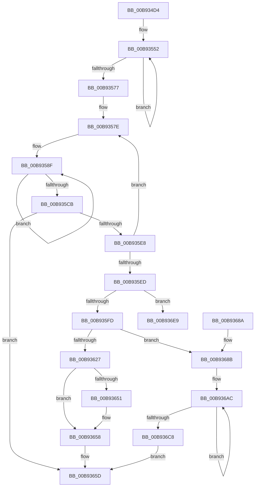

# VfUtilPrintCheckinString

- RVA: `0x00B934D4`–`0x00B936EF` (길이 `539` bytes)
- VA: `0x0000000140B934D4`
- 실행 섹션: `PAGEVRFY`
- PDB 이름 있음: `예`; PDB Function 태그: `아니요`
- unwind 정보 RVA: `0x000D21F4`
- 디코드: `142`개 명령, `539/539` bytes 표시
- 미해석 바이트: `0` (있으면 어셈블리에 `.byte`로 보존)

> 이 문서는 커널 이미지의 기계어와 PDB 기호를 분석해 생성했습니다. 4번과 5번은 함수 원형과 자료형을 바이너리 사용 방식에서 추정한 C 해석이며 원본 소스 복구 결과는 아닙니다.

## 1. Dependencies

- 직접 호출 지점: **7**; 고유 호출 대상: **4**
- 직접 호출자로 확인된 함수: **4**
- RIP 상대 이미지 참조: **11**

### Outgoing calls
- `0x00B93566` → [RtlUpcaseUnicodeChar](../../page/85/RtlUpcaseUnicodeChar_function_0085F0F0.md) (function, `0x0085F0F0`)
- `0x00B93658` → [VfUtilDbgPrint](../../text/61/VfUtilDbgPrint_function_006122AC.md) (function, `0x006122AC`)
- `0x00B93664` → [_security_check_cookie](../../text/6A/_security_check_cookie_function_006AC640.md) (function, `0x006AC640`)
- `0x00B936A0` → [VfUtilDbgPrint](../../text/61/VfUtilDbgPrint_function_006122AC.md) (function, `0x006122AC`)
- `0x00B936B8` → [VfUtilDbgPrint](../../text/61/VfUtilDbgPrint_function_006122AC.md) (function, `0x006122AC`)
- `0x00B936DF` → [VfUtilDbgPrint](../../text/61/VfUtilDbgPrint_function_006122AC.md) (function, `0x006122AC`)
- `0x00B936E9` → [_report_rangecheckfailure](../../text/4F/_report_rangecheckfailure_function_004F5FDC.md) (function, `0x004F5FDC`)

### Direct callers
- [ViThunkApplyPristineCurrentSession](../BA/ViThunkApplyPristineCurrentSession_function_00BA72E4.md) at `0x00BA73EA`
- [ViThunkApplyWdmThunksCurrentSession](../BA/ViThunkApplyWdmThunksCurrentSession_function_00BA7414.md) at `0x00BA74BD`
- [VfSuspectDriversLoadCallback](../BA/VfSuspectDriversLoadCallback_function_00BAAB2C.md) at `0x00BAAE12`
- [VfSuspectDriversUnloadCallback](../BA/VfSuspectDriversUnloadCallback_function_00BAAF34.md) at `0x00BAB093`

### Static image references
- `0x00B934F7` → RVA `0x00E0A740` (`.data`; read)
- `0x00B93505` → RVA `0x00F04A20` (`.data`; read)
- `0x00B93513` → RVA `0x00E0A74C` (`.data`; read)
- `0x00B935CE` → RVA `0x00B8B360` (`Printable`; read)
- `0x00B93606` → RVA `0x00E681A0` (`.data`; read)
- `0x00B93639` → RVA `0x00BB9990` (` ?? ::JKADOLAD::`string'`; read)
- `0x00B93651` → RVA `0x00BB9940` (` ?? ::JKADOLAD::`string'`; read)
- `0x00B9368E` → RVA `0x00BB99E0` (` ?? ::JKADOLAD::`string'`; read)
- `0x00B93695` → RVA `0x00BB9A10` (` ?? ::JKADOLAD::`string'`; read)
- `0x00B936AF` → RVA `0x00BB9930` (` ?? ::JKADOLAD::`string'`; read)
- `0x00B936D8` → RVA `0x00BB9910` (` ?? ::JKADOLAD::`string'`; read)

## 2. Other-region calls and transfers

- 다른 실행 섹션으로 향하는 call: **7**
  - `0x00B93566` → [RtlUpcaseUnicodeChar](../../page/85/RtlUpcaseUnicodeChar_function_0085F0F0.md) (`PAGEVRFY` → `PAGE`)
  - `0x00B93658` → [VfUtilDbgPrint](../../text/61/VfUtilDbgPrint_function_006122AC.md) (`PAGEVRFY` → `.text`)
  - `0x00B93664` → [_security_check_cookie](../../text/6A/_security_check_cookie_function_006AC640.md) (`PAGEVRFY` → `.text`)
  - `0x00B936A0` → [VfUtilDbgPrint](../../text/61/VfUtilDbgPrint_function_006122AC.md) (`PAGEVRFY` → `.text`)
  - `0x00B936B8` → [VfUtilDbgPrint](../../text/61/VfUtilDbgPrint_function_006122AC.md) (`PAGEVRFY` → `.text`)
  - `0x00B936DF` → [VfUtilDbgPrint](../../text/61/VfUtilDbgPrint_function_006122AC.md) (`PAGEVRFY` → `.text`)
  - `0x00B936E9` → [_report_rangecheckfailure](../../text/4F/_report_rangecheckfailure_function_004F5FDC.md) (`PAGEVRFY` → `.text`)
- 별도 외부 분기/꼬리 이동을 확인하지 못했습니다.

## 3. Assembly (complete function range)

```asm
00B934D4  48 8B C4                        mov rax, rsp
00B934D7  48 89 58 10                     mov qword ptr [rax + 0x10], rbx
00B934DB  48 89 70 18                     mov qword ptr [rax + 0x18], rsi
00B934DF  48 89 78 20                     mov qword ptr [rax + 0x20], rdi
00B934E3  55                              push rbp
00B934E4  41 54                           push r12
00B934E6  41 55                           push r13
00B934E8  41 56                           push r14
00B934EA  41 57                           push r15
00B934EC  48 8D 68 A1                     lea rbp, [rax - 0x5f]
00B934F0  48 81 EC C0 00 00 00            sub rsp, 0xc0
00B934F7  48 8B 05 42 72 27 00            mov rax, qword ptr [rip + 0x277242]
00B934FE  48 33 C4                        xor rax, rsp
00B93501  48 89 45 27                     mov qword ptr [rbp + 0x27], rax
00B93505  8B 05 15 15 37 00               mov eax, dword ptr [rip + 0x371515]
00B9350B  33 FF                           xor edi, edi
00B9350D  89 45 C3                        mov dword ptr [rbp - 0x3d], eax
00B93510  48 8B F1                        mov rsi, rcx
00B93513  8B 0D 33 72 27 00               mov ecx, dword ptr [rip + 0x277233]
00B93519  FF C0                           inc eax
00B9351B  0F AF C1                        imul eax, ecx
00B9351E  0F 57 C0                        xorps xmm0, xmm0
00B93521  88 55 A7                        mov byte ptr [rbp - 0x59], dl
00B93524  44 8B F7                        mov r14d, edi
00B93527  44 0F B7 3E                     movzx r15d, word ptr [rsi]
00B9352B  4C 8B 6E 08                     mov r13, qword ptr [rsi + 8]
00B9352F  41 D1 EF                        shr r15d, 1
00B93532  69 C0 15 CD 5B 07               imul eax, eax, 0x75bcd15
00B93538  45 8B E7                        mov r12d, r15d
00B9353B  0F 11 45 AF                     movups xmmword ptr [rbp - 0x51], xmm0
00B9353F  89 4D BF                        mov dword ptr [rbp - 0x41], ecx
00B93542  89 7D C7                        mov dword ptr [rbp - 0x39], edi
00B93545  89 45 CB                        mov dword ptr [rbp - 0x35], eax
00B93548  8D 47 10                        lea eax, [rdi + 0x10]
00B9354B  44 3B F8                        cmp r15d, eax
00B9354E  44 0F 42 E0                     cmovb r12d, eax
00B93552  33 D2                           xor edx, edx
00B93554  41 8B C6                        mov eax, r14d
00B93557  41 F7 F7                        div r15d
00B9355A  41 8B DE                        mov ebx, r14d
00B9355D  83 E3 0F                        and ebx, 0xf
00B93560  41 0F B7 4C 55 00               movzx ecx, word ptr [r13 + rdx*2]
00B93566  E8 85 BB CC FF                  call 0x14085f0f0
00B9356B  30 44 1D BF                     xor byte ptr [rbp + rbx - 0x41], al
00B9356F  41 FF C6                        inc r14d
00B93572  45 3B F4                        cmp r14d, r12d
00B93575  72 DB                           jb 0x140b93552
00B93577  44 8A 6D A7                     mov r13b, byte ptr [rbp - 0x59]
00B9357B  44 8B C7                        mov r8d, edi
00B9357E  41 BA 01 00 00 00               mov r10d, 1
00B93584  4C 8D 5D BF                     lea r11, [rbp - 0x41]
00B93588  44 8B CF                        mov r9d, edi
00B9358B  41 8D 5A 0F                     lea ebx, [r10 + 0xf]
00B9358F  41 0F B6 03                     movzx eax, byte ptr [r11]
00B93593  41 C1 E1 08                     shl r9d, 8
00B93597  44 03 C8                        add r9d, eax
00B9359A  B8 85 10 42 08                  mov eax, 0x8421085
00B9359F  41 F7 E1                        mul r9d
00B935A2  41 8B C9                        mov ecx, r9d
00B935A5  2B CA                           sub ecx, edx
00B935A7  D1 E9                           shr ecx, 1
00B935A9  03 CA                           add ecx, edx
00B935AB  C1 E9 05                        shr ecx, 5
00B935AE  6B C1 3E                        imul eax, ecx, 0x3e
00B935B1  41 88 0B                        mov byte ptr [r11], cl
00B935B4  44 2B C8                        sub r9d, eax
00B935B7  8B C7                           mov eax, edi
00B935B9  84 C9                           test cl, cl
00B935BB  41 0F 44 C2                     cmove eax, r10d
00B935BF  49 FF C3                        inc r11
00B935C2  44 8B D0                        mov r10d, eax
00B935C5  48 83 EB 01                     sub rbx, 1
00B935C9  75 C4                           jne 0x140b9358f
00B935CB  41 8B C8                        mov ecx, r8d
00B935CE  48 8D 15 8B 7D FF FF            lea rdx, [rip - 0x8275]
00B935D5  42 0F B7 04 4A                  movzx eax, word ptr [rdx + r9*2]
00B935DA  41 FF C0                        inc r8d
00B935DD  66 89 44 4D D7                  mov word ptr [rbp + rcx*2 - 0x29], ax
00B935E2  41 83 F8 21                     cmp r8d, 0x21
00B935E6  73 75                           jae 0x140b9365d
00B935E8  45 85 D2                        test r10d, r10d
00B935EB  74 91                           je 0x140b9357e
00B935ED  41 8B C0                        mov eax, r8d
00B935F0  48 03 C0                        add rax, rax
00B935F3  48 83 F8 42                     cmp rax, 0x42
00B935F7  0F 83 EC 00 00 00               jae 0x140b936e9
00B935FD  66 45 03 C0                     add r8w, r8w
00B93601  66 89 7C 05 D7                  mov word ptr [rbp + rax - 0x29], di
00B93606  F7 05 90 4B 2D 00 00 00 10 00   test dword ptr [rip + 0x2d4b90], 0x100000
00B93610  48 8D 45 D7                     lea rax, [rbp - 0x29]
00B93614  48 89 45 B7                     mov qword ptr [rbp - 0x49], rax
00B93618  48 8B D6                        mov rdx, rsi
00B9361B  66 44 89 45 B1                  mov word ptr [rbp - 0x4f], r8w
00B93620  66 44 89 45 AF                  mov word ptr [rbp - 0x51], r8w
00B93625  75 64                           jne 0x140b9368b
00B93627  44 8B 0D 1E 71 27 00            mov r9d, dword ptr [rip + 0x27711e]
00B9362E  48 8D 45 AF                     lea rax, [rbp - 0x51]
00B93632  44 8B 05 E7 13 37 00            mov r8d, dword ptr [rip + 0x3713e7]
00B93639  48 8D 0D 50 63 02 00            lea rcx, [rip + 0x26350]
00B93640  41 81 E1 FF FF FF 0F            and r9d, 0xfffffff
00B93647  48 89 44 24 20                  mov qword ptr [rsp + 0x20], rax
00B9364C  45 84 ED                        test r13b, r13b
00B9364F  74 07                           je 0x140b93658
00B93651  48 8D 0D E8 62 02 00            lea rcx, [rip + 0x262e8]
00B93658  E8 4F EC A7 FF                  call 0x1406122ac
00B9365D  48 8B 4D 27                     mov rcx, qword ptr [rbp + 0x27]
00B93661  48 33 CC                        xor rcx, rsp
00B93664  E8 D7 8F B1 FF                  call 0x1406ac640
00B93669  4C 8D 9C 24 C0 00 00 00         lea r11, [rsp + 0xc0]
00B93671  49 8B 5B 38                     mov rbx, qword ptr [r11 + 0x38]
00B93675  49 8B 73 40                     mov rsi, qword ptr [r11 + 0x40]
00B93679  49 8B 7B 48                     mov rdi, qword ptr [r11 + 0x48]
00B9367D  49 8B E3                        mov rsp, r11
00B93680  41 5F                           pop r15
00B93682  41 5E                           pop r14
00B93684  41 5D                           pop r13
00B93686  41 5C                           pop r12
00B93688  5D                              pop rbp
00B93689  C3                              ret
00B9368A  CC                              int3
00B9368B  45 84 ED                        test r13b, r13b
00B9368E  48 8D 05 4B 63 02 00            lea rax, [rip + 0x2634b]
00B93695  48 8D 0D 74 63 02 00            lea rcx, [rip + 0x26374]
00B9369C  48 0F 45 C8                     cmovne rcx, rax
00B936A0  E8 07 EC A7 FF                  call 0x1406122ac
00B936A5  48 8D 1D F4 4A 2D 00            lea rbx, [rip + 0x2d4af4]
00B936AC  44 8B 03                        mov r8d, dword ptr [rbx]
00B936AF  48 8D 0D 7A 62 02 00            lea rcx, [rip + 0x2627a]
00B936B6  8B D7                           mov edx, edi
00B936B8  E8 EF EB A7 FF                  call 0x1406122ac
00B936BD  FF C7                           inc edi
00B936BF  48 8D 5B 04                     lea rbx, [rbx + 4]
00B936C3  83 FF 02                        cmp edi, 2
00B936C6  72 E4                           jb 0x140b936ac
00B936C8  8B 15 7E 70 27 00               mov edx, dword ptr [rip + 0x27707e]
00B936CE  4C 8D 45 AF                     lea r8, [rbp - 0x51]
00B936D2  81 E2 FF FF FF 0F               and edx, 0xfffffff
00B936D8  48 8D 0D 31 62 02 00            lea rcx, [rip + 0x26231]
00B936DF  E8 C8 EB A7 FF                  call 0x1406122ac
00B936E4  E9 74 FF FF FF                  jmp 0x140b9365d
00B936E9  E8 EE 28 96 FF                  call 0x1404f5fdc
00B936EE  CC                              int3
```

## 4. C-style interpretation (structured pseudocode)

```c
__int64 __fastcall VfUtilPrintCheckinString(__int64 a1, int a2)
{
    __int64 result;
    __int64 v_r11;
    __int64 v_r12;
    __int64 v_r14;
    __int64 v_r15;
    __int64 v_rbx;
    __int64 v_rdi;
    __int64 v_rsp;
    unsigned __int64 v_stack_m28;
    unsigned __int64 v_stack_mC8;

    *(unsigned __int64 *)(v_rsp + 16) = v_rbx;
    *(unsigned __int64 *)(v_rsp + 24) = v_rsi;
    *(unsigned __int64 *)(v_rsp + 32) = v_rdi;
    v_rsp = (v_rsp) - (192);
    result = (*(unsigned __int64 *)(v_rip + 2585154)) ^ (v_rsp);
    *(unsigned __int64 *)(v_rsp - 95 + 39) = result;
    v_rdi = 0;
    *(unsigned int *)(v_rsp - 95 - 61) = (unsigned int)((unsigned int)(*(unsigned int *)(v_rip + 3609877)));
    result = (unsigned int)(((unsigned int)(*(unsigned int *)(v_rip + 3609877))) + 1);
    result = (unsigned int)((result) * ((unsigned int)((unsigned int)(*(unsigned int *)(v_rip + 2585139)))));
    *(unsigned __int8 *)(v_rsp - 95 - 89) = (unsigned __int8)(a2);
    v_r15 = (unsigned int)((*(unsigned __int16 *)(a1)) >> (1));
    result = (unsigned int)((result) * ((unsigned int)(result)));
    *(unsigned __int64 *)(v_rsp - 95 - 81) = v_xmm0;
    *(unsigned int *)(v_rsp - 95 - 65) = (unsigned int)((unsigned int)(*(unsigned int *)(v_rip + 2585139)));
    *(unsigned int *)(v_rsp - 95 - 57) = 0;
    *(unsigned int *)(v_rsp - 95 - 53) = (unsigned int)(result);
    v_r12 = (unsigned int)((unsigned int)(v_r15));
    if (((unsigned int)(v_r15)) < ((unsigned int)(v_rdi + 16))) { v_r12 = (unsigned int)(v_rdi + 16); }
loc_00B93552:
    a2 = 0;
    v_rbx = (unsigned int)((0) & (15));
    result = RtlUpcaseUnicodeChar(*(unsigned __int16 *)(*(unsigned __int64 *)(a1 + 8) + a2 * 2), a2, a3, a4);
    v_r14 = (unsigned int)((0) + 1);
    if (((unsigned int)(v_r14)) < ((unsigned int)(v_r12))) goto loc_00B93552;
loc_00B9357E:
loc_00B9358F:
    a4 = (unsigned int)((0) << (8));
    a4 = (unsigned int)((a4) + ((unsigned int)(*(unsigned __int8 *)(v_rsp - 95 - 65))));
    a1 = (unsigned int)(((unsigned int)((unsigned int)(a4))) - (0));
    a1 = (unsigned int)((a1) >> (1));
    a1 = (unsigned int)((a1) + (0));
    a1 = (unsigned int)((a1) >> (5));
    result = (unsigned int)(((unsigned int)(0x8421085ULL)) * ((unsigned int)(a1)));
    *(unsigned __int8 *)(v_rsp - 95 - 65) = (unsigned __int8)(a1);
    a4 = (unsigned int)((a4) - ((unsigned int)(result)));
    result = 0;
    if ((unsigned __int8)(a1) == 0) { result = 1; }
    v_r11 = (v_rsp - 95 - 65) + 1;
    v_rbx = (1 + 15) - (1);
    if (condition_is_not_equal) goto loc_00B9358F;
    a3 = (unsigned int)((0) + 1);
    *(unsigned __int16 *)(v_rsp - 95 + 0 * 2 - 41) = (unsigned __int16)(*(unsigned __int16 *)(v_rip - 33397 + a4 * 2));
    if (((unsigned int)(a3)) >= 33) goto loc_00B9365D;
    if ((unsigned int)((unsigned int)((unsigned int)(result))) == 0) goto loc_00B9357E;
    result = ((unsigned int)((unsigned int)(a3))) + ((unsigned int)((unsigned int)(a3)));
    if (result >= 66) goto loc_00B936E9;
    a3 = (unsigned __int16)((a3) + ((unsigned __int16)(a3)));
    *(unsigned __int16 *)(v_rsp - 95 + result * 1 - 41) = 0;
    *(unsigned __int64 *)(v_rsp - 95 - 73) = v_rsp - 95 - 41;
    *(unsigned __int16 *)(v_rsp - 95 - 79) = (unsigned __int16)(a3);
    *(unsigned __int16 *)(v_rsp - 95 - 81) = (unsigned __int16)(a3);
    if (((*(unsigned int *)(v_rip + 2968464)) & (0x100000ULL)) != 0) goto loc_00B9368B;
    a4 = (unsigned int)(((unsigned int)(*(unsigned int *)(v_rip + 2584862))) & (0xFFFFFFFULL));
    v_stack_mC8 = v_rsp - 95 - 81;
    if ((unsigned __int8)(*(unsigned __int8 *)(v_rsp - 95 - 89)) != 0) {
        a1 = v_rip + 156392;
    }
    result = VfUtilDbgPrint(a1, a1, (unsigned int)(*(unsigned int *)(v_rip + 3609575)), a4);
loc_00B9365D:
    a1 = (*(unsigned __int64 *)(v_rsp - 95 + 39)) ^ (v_rsp);
    result = _security_check_cookie(a1, a1, (unsigned int)(*(unsigned int *)(v_rip + 3609575)), a4);
    return result;
loc_00B9368B:
    a1 = v_rip + 156532;
    if ((unsigned __int8)(*(unsigned __int8 *)(v_rsp - 95 - 89)) != 0) { a1 = v_rip + 156491; }
    result = VfUtilDbgPrint(a1, a1, (unsigned int)(*(unsigned int *)(v_rip + 3609575)), a4);
loc_00B936AC:
    result = VfUtilDbgPrint(v_rip + 156282, (unsigned int)((unsigned int)(*(unsigned __int64 *)(v_stack_m28 + 72))), (unsigned int)(*(unsigned int *)(v_rip + 2968308)), a4);
    v_rdi = (unsigned int)((*(unsigned __int64 *)(v_stack_m28 + 72)) + 1);
    if (((unsigned int)(v_rdi)) < 2) goto loc_00B936AC;
    a2 = (unsigned int)(((unsigned int)(*(unsigned int *)(v_rip + 2584702))) & (0xFFFFFFFULL));
    result = VfUtilDbgPrint(v_rip + 156209, a2, v_rsp - 95 - 81, a4);
    goto loc_00B9365D;
loc_00B936E9:
    result = _report_rangecheckfailure(v_rip + 156209, a2, v_rsp - 95 - 81, a4);
    return result;
}
```

## 5. (Beta) C Style

```c
int64_t VfUtilPrintCheckinString(void *Arg1, int32_t Arg2)
{
    uint8_t *arg1 = (uint8_t *)Arg1;

    int64_t result;
    int64_t local_r11;
    int64_t local_r12;
    int64_t local_r14;
    int64_t local_r15;
    int64_t local_rbx;
    int64_t local_rdi;
    int64_t local_rsp;
    uint64_t v_stack_m28;
    uint64_t v_stack_mC8;

    *(uint64_t *)(local_rsp + 0x10) = local_rbx;
    *(uint64_t *)(local_rsp + 0x18) = local_rsi;
    *(uint64_t *)(local_rsp + 0x20) = local_rdi;
    local_rsp = (local_rsp) - (192);
    result = (*(uint64_t *)(v_rip + 0x277242)) ^ (local_rsp);
    *(uint64_t *)(local_rsp - 0x5F + 0x27) = result;
    local_rdi = 0;
    *(uint32_t *)(local_rsp - 0x5F - 0x3D) = (uint32_t)((uint32_t)(*(uint32_t *)(v_rip + 0x371515)));
    result = (uint32_t)(((uint32_t)(*(uint32_t *)(v_rip + 0x371515))) + 1);
    result = (uint32_t)((result) * ((uint32_t)((uint32_t)(*(uint32_t *)(v_rip + 0x277233)))));
    *(uint8_t *)(local_rsp - 0x5F - 0x59) = (uint8_t)(Arg2);
    local_r15 = (uint32_t)((*(uint16_t *)(arg1)) >> (1));
    result = (uint32_t)((result) * ((uint32_t)(result)));
    *(uint64_t *)(local_rsp - 0x5F - 0x51) = v_xmm0;
    *(uint32_t *)(local_rsp - 0x5F - 0x41) = (uint32_t)((uint32_t)(*(uint32_t *)(v_rip + 0x277233)));
    *(uint32_t *)(local_rsp - 0x5F - 0x39) = 0;
    *(uint32_t *)(local_rsp - 0x5F - 0x35) = (uint32_t)(result);
    local_r12 = (uint32_t)((uint32_t)(local_r15));
    if (((uint32_t)(local_r15)) < ((uint32_t)(local_rdi + 16))) { local_r12 = (uint32_t)(local_rdi + 16); }
loc_00B93552:
    Arg2 = 0;
    local_rbx = (uint32_t)((0) & (15));
    result = RtlUpcaseUnicodeChar(*(uint16_t *)(*(uint64_t *)(arg1 + 0x8) + Arg2 * 2), Arg2, a3, a4);
    local_r14 = (uint32_t)((0) + 1);
    if (((uint32_t)(local_r14)) < ((uint32_t)(local_r12))) goto loc_00B93552;
loc_00B9357E:
loc_00B9358F:
    a4 = (uint32_t)((0) << (8));
    a4 = (uint32_t)((a4) + ((uint32_t)(*(uint8_t *)(local_rsp - 0x5F - 0x41))));
    Arg1 = (uint32_t)(((uint32_t)((uint32_t)(a4))) - (0));
    Arg1 = (uint32_t)((Arg1) >> (1));
    Arg1 = (uint32_t)((Arg1) + (0));
    Arg1 = (uint32_t)((Arg1) >> (5));
    result = (uint32_t)(((uint32_t)(0x8421085ULL)) * ((uint32_t)(Arg1)));
    *(uint8_t *)(local_rsp - 0x5F - 0x41) = (uint8_t)(Arg1);
    a4 = (uint32_t)((a4) - ((uint32_t)(result)));
    result = 0;
    if ((uint8_t)(Arg1) == 0) { result = 1; }
    local_r11 = (local_rsp - 95 - 65) + 1;
    local_rbx = (1 + 15) - (1);
    if (condition_is_not_equal) goto loc_00B9358F;
    a3 = (uint32_t)((0) + 1);
    *(uint16_t *)(local_rsp - 0x5F + 0x0 * 2 - 0x29) = (uint16_t)(*(uint16_t *)(v_rip - 0x8275 + a4 * 2));
    if (((uint32_t)(a3)) >= 33) goto loc_00B9365D;
    if ((uint32_t)((uint32_t)((uint32_t)(result))) == 0) goto loc_00B9357E;
    result = ((uint32_t)((uint32_t)(a3))) + ((uint32_t)((uint32_t)(a3)));
    if (result >= 66) goto loc_00B936E9;
    a3 = (uint16_t)((a3) + ((uint16_t)(a3)));
    *(uint16_t *)(local_rsp - 0x5F + result * 1 - 0x29) = 0;
    *(uint64_t *)(local_rsp - 0x5F - 0x49) = local_rsp - 95 - 41;
    *(uint16_t *)(local_rsp - 0x5F - 0x4F) = (uint16_t)(a3);
    *(uint16_t *)(local_rsp - 0x5F - 0x51) = (uint16_t)(a3);
    if (((*(uint32_t *)(v_rip + 0x2D4B90)) & (0x100000ULL)) != 0) goto loc_00B9368B;
    a4 = (uint32_t)(((uint32_t)(*(uint32_t *)(v_rip + 0x27711E))) & (0xFFFFFFFULL));
    v_stack_mC8 = local_rsp - 95 - 81;
    if ((uint8_t)(*(uint8_t *)(local_rsp - 0x5F - 0x59)) != 0) {
        Arg1 = v_rip + 156392;
    }
    result = VfUtilDbgPrint(Arg1, Arg1, (uint32_t)(*(uint32_t *)(v_rip + 0x3713E7)), a4);
loc_00B9365D:
    Arg1 = (*(uint64_t *)(local_rsp - 0x5F + 0x27)) ^ (local_rsp);
    result = _security_check_cookie(Arg1, Arg1, (uint32_t)(*(uint32_t *)(v_rip + 0x3713E7)), a4);
    return result;
loc_00B9368B:
    Arg1 = v_rip + 156532;
    if ((uint8_t)(*(uint8_t *)(local_rsp - 0x5F - 0x59)) != 0) { Arg1 = v_rip + 156491; }
    result = VfUtilDbgPrint(Arg1, Arg1, (uint32_t)(*(uint32_t *)(v_rip + 0x3713E7)), a4);
loc_00B936AC:
    result = VfUtilDbgPrint(v_rip + 156282, (uint32_t)((uint32_t)(*(uint64_t *)(v_stack_m28 + 0x48))), (uint32_t)(*(uint32_t *)(v_rip + 0x2D4AF4)), a4);
    local_rdi = (uint32_t)((*(uint64_t *)(v_stack_m28 + 0x48)) + 1);
    if (((uint32_t)(local_rdi)) < 2) goto loc_00B936AC;
    Arg2 = (uint32_t)(((uint32_t)(*(uint32_t *)(v_rip + 0x27707E))) & (0xFFFFFFFULL));
    result = VfUtilDbgPrint(v_rip + 156209, Arg2, local_rsp - 95 - 81, a4);
    goto loc_00B9365D;
loc_00B936E9:
    result = _report_rangecheckfailure(v_rip + 156209, Arg2, local_rsp - 95 - 81, a4);
    return result;
}
```

### 관측된 메모리 오프셋

구조체 형식이 확인되지 않은 접근은 인자 기준의 오프셋으로만 기록했습니다.

| 기준 인자 | 오프셋 표현 | 폭 (bit) | 접근 |
|---|---:|---:|---|
| `Arg1` | `+ 0x0` | `16` | `R` |
| `Arg1` | `+ 0x8` | `64` | `R` |

## 6. Execution-region graph

[열기: 2D/3D 그래프와 함수 탐색 컨트롤 패널](../../../control-panel.html?section=pagevrfy&rva=0x00B934D4&view=graph)

- 2D 그래프는 위에서 아래로 흐르고, 3D 그래프는 빈 공간을 드래그해 회전합니다. Shift+드래그는 이동, 휠은 확대·축소, 함수 노드 선택은 대상 보고서 이동입니다.

### Static fallback


