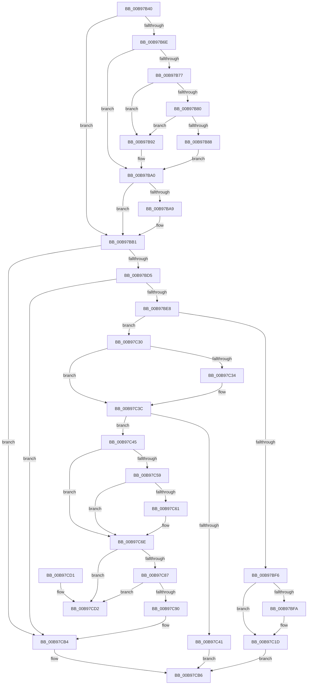

# ViAdapterCallback

- RVA: `0x00B97B40`–`0x00B97CD9` (길이 `409` bytes)
- VA: `0x0000000140B97B40`
- 실행 섹션: `PAGEVRFY`
- PDB 이름 있음: `예`; PDB Function 태그: `아니요`
- unwind 정보 RVA: `0x0008C994`
- 디코드: `109`개 명령, `409/409` bytes 표시
- 미해석 바이트: `0` (있으면 어셈블리에 `.byte`로 보존)

> 이 문서는 커널 이미지의 기계어와 PDB 기호를 분석해 생성했습니다. 4번과 5번은 함수 원형과 자료형을 바이너리 사용 방식에서 추정한 C 해석이며 원본 소스 복구 결과는 아닙니다.

## 1. Dependencies

- 직접 호출 지점: **11**; 고유 호출 대상: **9**
- 직접 호출자로 확인된 함수: **0**
- RIP 상대 이미지 참조: **3**

### Outgoing calls
- `0x00B97BAC` → [DECREMENT_ADAPTER_CHANNELS](DECREMENT_ADAPTER_CHANNELS_function_00B94B14.md) (function, `0x00B94B14`)
- `0x00B97BC5` → [guard_dispatch_icall](../../text/6B/guard_dispatch_icall_function_006BAAD0.md) (function, `0x006BAAD0`)
- `0x00B97BDB` → [ViIsActiveChannelWcb](../../text/61/ViIsActiveChannelWcb_function_00612DE0.md) (function, `0x00612DE0`)
- `0x00B97C0C` → [VfUtilDbgPrint](../../text/61/VfUtilDbgPrint_function_006122AC.md) (function, `0x006122AC`)
- `0x00B97C18` → [VfUtilDbgPrint](../../text/61/VfUtilDbgPrint_function_006122AC.md) (function, `0x006122AC`)
- `0x00B97C37` → [DECREMENT_ADAPTER_CHANNELS](DECREMENT_ADAPTER_CHANNELS_function_00B94B14.md) (function, `0x00B94B14`)
- `0x00B97C4B` → [SUBTRACT_MAP_REGISTERS](SUBTRACT_MAP_REGISTERS_function_00B94E10.md) (function, `0x00B94E10`)
- `0x00B97C64` → [ViFreeMapRegisterFile](ViFreeMapRegisterFile_function_00B98B8C.md) (function, `0x00B98B8C`)
- `0x00B97C75` → [KeAcquireSpinLockRaiseToDpc](../../text/20/KeAcquireSpinLockRaiseToDpc_function_00208470.md) (function, `0x00208470`)
- `0x00B97CA0` → [KeReleaseSpinLock](../../text/39/KeReleaseSpinLock_function_00392BA0.md) (function, `0x00392BA0`)
- `0x00B97CAF` → [ExFreeToNPagedLookasideList](../../text/38/ExFreeToNPagedLookasideList_function_0038D9D0.md) (function, `0x0038D9D0`)

### Direct callers
- 이 함수 시작 RVA로 연결되는 직접 call은 확인되지 않았습니다. 간접 호출은 완전히 역산할 수 없습니다.

### Static image references
- `0x00B97C01` → RVA `0x00BB9C70` (` ?? ::JKADOLAD::`string'`; read)
- `0x00B97C11` → RVA `0x00BB9BE0` (` ?? ::JKADOLAD::`string'`; read)
- `0x00B97CA8` → RVA `0x00E28A80` (`.data`; read)

## 2. Other-region calls and transfers

- 다른 실행 섹션으로 향하는 call: **7**
  - `0x00B97BC5` → [guard_dispatch_icall](../../text/6B/guard_dispatch_icall_function_006BAAD0.md) (`PAGEVRFY` → `.text`)
  - `0x00B97BDB` → [ViIsActiveChannelWcb](../../text/61/ViIsActiveChannelWcb_function_00612DE0.md) (`PAGEVRFY` → `.text`)
  - `0x00B97C0C` → [VfUtilDbgPrint](../../text/61/VfUtilDbgPrint_function_006122AC.md) (`PAGEVRFY` → `.text`)
  - `0x00B97C18` → [VfUtilDbgPrint](../../text/61/VfUtilDbgPrint_function_006122AC.md) (`PAGEVRFY` → `.text`)
  - `0x00B97C75` → [KeAcquireSpinLockRaiseToDpc](../../text/20/KeAcquireSpinLockRaiseToDpc_function_00208470.md) (`PAGEVRFY` → `.text`)
  - `0x00B97CA0` → [KeReleaseSpinLock](../../text/39/KeReleaseSpinLock_function_00392BA0.md) (`PAGEVRFY` → `.text`)
  - `0x00B97CAF` → [ExFreeToNPagedLookasideList](../../text/38/ExFreeToNPagedLookasideList_function_0038D9D0.md) (`PAGEVRFY` → `.text`)
- 별도 외부 분기/꼬리 이동을 확인하지 못했습니다.

## 3. Assembly (complete function range)

```asm
00B97B40  48 8B C4                        mov rax, rsp
00B97B43  48 89 58 08                     mov qword ptr [rax + 8], rbx
00B97B47  48 89 68 10                     mov qword ptr [rax + 0x10], rbp
00B97B4B  48 89 70 18                     mov qword ptr [rax + 0x18], rsi
00B97B4F  48 89 78 20                     mov qword ptr [rax + 0x20], rdi
00B97B53  41 56                           push r14
00B97B55  48 83 EC 30                     sub rsp, 0x30
00B97B59  49 8B 59 38                     mov rbx, qword ptr [r9 + 0x38]
00B97B5D  49 8B F9                        mov rdi, r9
00B97B60  49 8B F0                        mov rsi, r8
00B97B63  48 8B EA                        mov rbp, rdx
00B97B66  4C 8B F1                        mov r14, rcx
00B97B69  48 85 DB                        test rbx, rbx
00B97B6C  74 43                           je 0x140b97bb1
00B97B6E  83 BB E0 00 00 00 03            cmp dword ptr [rbx + 0xe0], 3
00B97B75  73 29                           jae 0x140b97ba0
00B97B77  49 8B 41 60                     mov rax, qword ptr [r9 + 0x60]
00B97B7B  48 85 C0                        test rax, rax
00B97B7E  74 12                           je 0x140b97b92
00B97B80  81 38 0D D0 EF AC               cmp dword ptr [rax], 0xacefd00d
00B97B86  75 0A                           jne 0x140b97b92
00B97B88  4C 89 40 30                     mov qword ptr [rax + 0x30], r8
00B97B8C  49 8B 71 60                     mov rsi, qword ptr [r9 + 0x60]
00B97B90  EB 0E                           jmp 0x140b97ba0
00B97B92  48 85 F6                        test rsi, rsi
00B97B95  48 C7 C0 0D F0 AD DE            mov rax, 0xffffffffdeadf00d
00B97B9C  48 0F 44 F0                     cmove rsi, rax
00B97BA0  80 BB E4 00 00 00 00            cmp byte ptr [rbx + 0xe4], 0
00B97BA7  74 08                           je 0x140b97bb1
00B97BA9  48 8B CB                        mov rcx, rbx
00B97BAC  E8 63 CF FF FF                  call 0x140b94b14
00B97BB1  48 8B 47 08                     mov rax, qword ptr [rdi + 8]
00B97BB5  4C 8B C6                        mov r8, rsi
00B97BB8  4C 8B 0F                        mov r9, qword ptr [rdi]
00B97BBB  48 8B D5                        mov rdx, rbp
00B97BBE  49 8B CE                        mov rcx, r14
00B97BC1  48 89 77 58                     mov qword ptr [rdi + 0x58], rsi
00B97BC5  E8 06 2F B2 FF                  call 0x1406baad0
00B97BCA  8B F0                           mov esi, eax
00B97BCC  48 85 DB                        test rbx, rbx
00B97BCF  0F 84 DF 00 00 00               je 0x140b97cb4
00B97BD5  48 8B D7                        mov rdx, rdi
00B97BD8  48 8B CB                        mov rcx, rbx
00B97BDB  E8 00 B2 A7 FF                  call 0x140612de0
00B97BE0  84 C0                           test al, al
00B97BE2  0F 84 CC 00 00 00               je 0x140b97cb4
00B97BE8  89 77 34                        mov dword ptr [rdi + 0x34], esi
00B97BEB  8A 8B E4 00 00 00               mov cl, byte ptr [rbx + 0xe4]
00B97BF1  83 FE 01                        cmp esi, 1
00B97BF4  75 3A                           jne 0x140b97c30
00B97BF6  84 C9                           test cl, cl
00B97BF8  74 23                           je 0x140b97c1d
00B97BFA  F0 FF 8B D8 00 00 00            lock dec dword ptr [rbx + 0xd8]
00B97C01  48 8D 0D 68 20 02 00            lea rcx, [rip + 0x22068]
00B97C08  48 8B 53 50                     mov rdx, qword ptr [rbx + 0x50]
00B97C0C  E8 9B A6 A7 FF                  call 0x1406122ac
00B97C11  48 8D 0D C8 1F 02 00            lea rcx, [rip + 0x21fc8]
00B97C18  E8 8F A6 A7 FF                  call 0x1406122ac
00B97C1D  8B 47 30                        mov eax, dword ptr [rdi + 0x30]
00B97C20  89 83 20 01 00 00               mov dword ptr [rbx + 0x120], eax
00B97C26  B8 01 00 00 00                  mov eax, 1
00B97C2B  E9 86 00 00 00                  jmp 0x140b97cb6
00B97C30  84 C9                           test cl, cl
00B97C32  75 08                           jne 0x140b97c3c
00B97C34  48 8B CB                        mov rcx, rbx
00B97C37  E8 D8 CE FF FF                  call 0x140b94b14
00B97C3C  83 FE 03                        cmp esi, 3
00B97C3F  75 04                           jne 0x140b97c45
00B97C41  8B C6                           mov eax, esi
00B97C43  EB 71                           jmp 0x140b97cb6
00B97C45  8B 57 30                        mov edx, dword ptr [rdi + 0x30]
00B97C48  48 8B CB                        mov rcx, rbx
00B97C4B  E8 C0 D1 FF FF                  call 0x140b94e10
00B97C50  48 8B 57 60                     mov rdx, qword ptr [rdi + 0x60]
00B97C54  48 85 D2                        test rdx, rdx
00B97C57  74 15                           je 0x140b97c6e
00B97C59  81 3A 0D D0 EF AC               cmp dword ptr [rdx], 0xacefd00d
00B97C5F  75 0D                           jne 0x140b97c6e
00B97C61  48 8B CB                        mov rcx, rbx
00B97C64  E8 23 0F 00 00                  call 0x140b98b8c
00B97C69  48 83 67 60 00                  and qword ptr [rdi + 0x60], 0
00B97C6E  48 8D 8B B0 00 00 00            lea rcx, [rbx + 0xb0]
00B97C75  E8 F6 07 67 FF                  call 0x140208470
00B97C7A  48 8D 57 48                     lea rdx, [rdi + 0x48]
00B97C7E  4C 8B 0A                        mov r9, qword ptr [rdx]
00B97C81  49 39 51 08                     cmp qword ptr [r9 + 8], rdx
00B97C85  75 4B                           jne 0x140b97cd2
00B97C87  4C 8B 42 08                     mov r8, qword ptr [rdx + 8]
00B97C8B  49 39 10                        cmp qword ptr [r8], rdx
00B97C8E  75 42                           jne 0x140b97cd2
00B97C90  4D 89 08                        mov qword ptr [r8], r9
00B97C93  48 8D 8B B0 00 00 00            lea rcx, [rbx + 0xb0]
00B97C9A  8A D0                           mov dl, al
00B97C9C  4D 89 41 08                     mov qword ptr [r9 + 8], r8
00B97CA0  E8 FB AE 7F FF                  call 0x140392ba0
00B97CA5  48 8B D7                        mov rdx, rdi
00B97CA8  48 8D 0D D1 0D 29 00            lea rcx, [rip + 0x290dd1]
00B97CAF  E8 1C 5D 7F FF                  call 0x14038d9d0
00B97CB4  8B C6                           mov eax, esi
00B97CB6  48 8B 5C 24 40                  mov rbx, qword ptr [rsp + 0x40]
00B97CBB  48 8B 6C 24 48                  mov rbp, qword ptr [rsp + 0x48]
00B97CC0  48 8B 74 24 50                  mov rsi, qword ptr [rsp + 0x50]
00B97CC5  48 8B 7C 24 58                  mov rdi, qword ptr [rsp + 0x58]
00B97CCA  48 83 C4 30                     add rsp, 0x30
00B97CCE  41 5E                           pop r14
00B97CD0  C3                              ret
00B97CD1  CC                              int3
00B97CD2  B9 03 00 00 00                  mov ecx, 3
00B97CD7  CD 29                           int 0x29
```

## 4. C-style interpretation (structured pseudocode)

```c
__int64 __fastcall ViAdapterCallback(__int64 a1, __int64 a2, __int64 a3, __int64 a4)
{
    __int64 result;
    __int64 v_rsi;
    __int64 v_rsp;
    unsigned __int64 v_stack_p10;
    unsigned __int64 v_stack_p18;
    unsigned __int64 v_stack_p20;
    unsigned __int64 v_stack_p8;

    *(unsigned __int64 *)(v_rsp + 8) = v_rbx;
    *(unsigned __int64 *)(v_rsp + 16) = v_rbp;
    *(unsigned __int64 *)(v_rsp + 24) = v_rsi;
    *(unsigned __int64 *)(v_rsp + 32) = v_rdi;
    v_rsp = (v_rsp) - (48);
    if (*(unsigned __int64 *)(a4 + 56) == 0) goto loc_00B97BB1;
    if ((*(unsigned int *)(*(unsigned __int64 *)(a4 + 56) + 224)) >= 3) goto loc_00B97BA0;
    if (*(unsigned __int64 *)(a4 + 96) == 0) goto loc_00B97B92;
    if ((*(unsigned int *)(*(unsigned __int64 *)(a4 + 96))) != 0xACEFD00DULL) goto loc_00B97B92;
    *(unsigned __int64 *)(*(unsigned __int64 *)(a4 + 96) + 48) = a3;
    goto loc_00B97BA0;
loc_00B97B92:
    v_rsi = *(unsigned __int64 *)(a4 + 96);
    if (*(unsigned __int64 *)(a4 + 96) == 0) { v_rsi = 0xFFFFFFFFDEADF00DULL; }
loc_00B97BA0:
    result = 0xFFFFFFFFDEADF00DULL;
    if ((*(unsigned __int8 *)(*(unsigned __int64 *)(a4 + 56) + 228)) != 0) {
        a1 = *(unsigned __int64 *)(a4 + 56);
        result = DECREMENT_ADAPTER_CHANNELS(a1, a2, a3, a4);
    }
    *(unsigned __int64 *)(a4 + 88) = v_rsi;
    result = guard_dispatch_icall(a1, a2, v_rsi, *(unsigned __int64 *)(a4));
    if (*(unsigned __int64 *)(a4 + 56) == 0) goto loc_00B97CB4;
    result = ViIsActiveChannelWcb(*(unsigned __int64 *)(a4 + 56), a4, v_rsi, *(unsigned __int64 *)(a4));
    if ((unsigned __int8)(result) == 0) goto loc_00B97CB4;
    *(unsigned int *)(a4 + 52) = (unsigned int)((unsigned int)((unsigned int)(result)));
    if (((unsigned int)((unsigned int)((unsigned int)(result)))) != 1) goto loc_00B97C30;
    if ((unsigned __int8)(*(unsigned __int8 *)(*(unsigned __int64 *)(a4 + 56) + 228)) != 0) {
        a1 = v_rip + 139368;
        a2 = *(unsigned __int64 *)(*(unsigned __int64 *)(a4 + 56) + 80);
        result = VfUtilDbgPrint(a1, a2, v_rsi, *(unsigned __int64 *)(a4));
        a1 = v_rip + 139208;
        result = VfUtilDbgPrint(a1, a2, v_rsi, *(unsigned __int64 *)(a4));
    }
    *(unsigned int *)(*(unsigned __int64 *)(a4 + 56) + 288) = (unsigned int)((unsigned int)(*(unsigned int *)(a4 + 48)));
    goto loc_00B97CB6;
loc_00B97C30:
    result = 1;
    if ((unsigned __int8)(a1) == 0) {
        a1 = *(unsigned __int64 *)(a4 + 56);
        result = DECREMENT_ADAPTER_CHANNELS(a1, a2, v_rsi, *(unsigned __int64 *)(a4));
    }
    if (((unsigned int)((unsigned int)((unsigned int)(result)))) != 3) goto loc_00B97C45;
    goto loc_00B97CB6;
loc_00B97C45:
    result = SUBTRACT_MAP_REGISTERS(*(unsigned __int64 *)(a4 + 56), (unsigned int)(*(unsigned int *)(a4 + 48)), v_rsi, *(unsigned __int64 *)(a4));
    if (*(unsigned __int64 *)(a4 + 96) == 0) goto loc_00B97C6E;
    if ((*(unsigned int *)(*(unsigned __int64 *)(a4 + 96))) == 0xACEFD00DULL) {
        a1 = *(unsigned __int64 *)(a4 + 56);
        result = ViFreeMapRegisterFile(a1, *(unsigned __int64 *)(a4 + 96), v_rsi, *(unsigned __int64 *)(a4));
    }
    result = KeAcquireSpinLockRaiseToDpc(*(unsigned __int64 *)(a4 + 56) + 176, *(unsigned __int64 *)(a4 + 96), v_rsi, *(unsigned __int64 *)(a4));
    if ((*(unsigned __int64 *)(*(unsigned __int64 *)(a4 + 72) + 8)) != (a4 + 72)) goto loc_00B97CD2;
    if ((*(unsigned __int64 *)(*(unsigned __int64 *)(a4 + 72 + 8))) != (a4 + 72)) goto loc_00B97CD2;
    *(unsigned __int64 *)(*(unsigned __int64 *)(a4 + 72 + 8)) = *(unsigned __int64 *)(a4 + 72);
    *(unsigned __int64 *)(*(unsigned __int64 *)(a4 + 72) + 8) = *(unsigned __int64 *)(a4 + 72 + 8);
    result = KeReleaseSpinLock(*(unsigned __int64 *)(a4 + 56) + 176, (unsigned __int8)(result), *(unsigned __int64 *)(a4 + 72 + 8), *(unsigned __int64 *)(a4 + 72));
    result = ExFreeToNPagedLookasideList(v_rip + 2690513, a4, *(unsigned __int64 *)(a4 + 72 + 8), *(unsigned __int64 *)(a4 + 72));
loc_00B97CB4:
loc_00B97CB6:
    v_rsp = (v_rsp) + (48);
    return (unsigned int)((unsigned int)((unsigned int)((unsigned int)(result))));
loc_00B97CD2:
    return (unsigned int)((unsigned int)((unsigned int)((unsigned int)(result))));
}
```

## 5. (Beta) C Style

```c
int64_t ViAdapterCallback(int64_t Arg1, int64_t Arg2, int64_t Arg3, void *Arg4)
{
    uint8_t *arg4 = (uint8_t *)Arg4;

    int64_t result;
    int64_t local_rsi;
    int64_t local_rsp;
    uint64_t v_stack_p10;
    uint64_t v_stack_p18;
    uint64_t v_stack_p20;
    uint64_t v_stack_p8;

    *(uint64_t *)(local_rsp + 0x8) = local_rbx;
    *(uint64_t *)(local_rsp + 0x10) = local_rbp;
    *(uint64_t *)(local_rsp + 0x18) = local_rsi;
    *(uint64_t *)(local_rsp + 0x20) = local_rdi;
    local_rsp = (local_rsp) - (48);
    if (*(uint64_t *)(arg4 + 0x38) == 0) goto loc_00B97BB1;
    if ((*(uint32_t *)(*(uint64_t *)(arg4 + 0x38) + 0xE0)) >= 3) goto loc_00B97BA0;
    if (*(uint64_t *)(arg4 + 0x60) == 0) goto loc_00B97B92;
    if ((*(uint32_t *)(*(uint64_t *)(arg4 + 0x60))) != 0xACEFD00DULL) goto loc_00B97B92;
    *(uint64_t *)(*(uint64_t *)(arg4 + 0x60) + 0x30) = Arg3;
    goto loc_00B97BA0;
loc_00B97B92:
    local_rsi = *(uint64_t *)(arg4 + 0x60);
    if (*(uint64_t *)(arg4 + 0x60) == 0) { local_rsi = 0xFFFFFFFFDEADF00DULL; }
loc_00B97BA0:
    result = 0xFFFFFFFFDEADF00DULL;
    if ((*(uint8_t *)(*(uint64_t *)(arg4 + 0x38) + 0xE4)) != 0) {
        Arg1 = *(uint64_t *)(arg4 + 0x38);
        result = DECREMENT_ADAPTER_CHANNELS(Arg1, Arg2, Arg3, Arg4);
    }
    *(uint64_t *)(arg4 + 0x58) = local_rsi;
    result = guard_dispatch_icall(Arg1, Arg2, local_rsi, *(uint64_t *)(arg4));
    if (*(uint64_t *)(arg4 + 0x38) == 0) goto loc_00B97CB4;
    result = ViIsActiveChannelWcb(*(uint64_t *)(arg4 + 0x38), Arg4, local_rsi, *(uint64_t *)(arg4));
    if ((uint8_t)(result) == 0) goto loc_00B97CB4;
    *(uint32_t *)(arg4 + 0x34) = (uint32_t)((uint32_t)((uint32_t)(result)));
    if (((uint32_t)((uint32_t)((uint32_t)(result)))) != 1) goto loc_00B97C30;
    if ((uint8_t)(*(uint8_t *)(*(uint64_t *)(arg4 + 0x38) + 0xE4)) != 0) {
        Arg1 = v_rip + 139368;
        Arg2 = *(uint64_t *)(*(uint64_t *)(arg4 + 0x38) + 0x50);
        result = VfUtilDbgPrint(Arg1, Arg2, local_rsi, *(uint64_t *)(arg4));
        Arg1 = v_rip + 139208;
        result = VfUtilDbgPrint(Arg1, Arg2, local_rsi, *(uint64_t *)(arg4));
    }
    *(uint32_t *)(*(uint64_t *)(arg4 + 0x38) + 0x120) = (uint32_t)((uint32_t)(*(uint32_t *)(arg4 + 0x30)));
    goto loc_00B97CB6;
loc_00B97C30:
    result = 1;
    if ((uint8_t)(Arg1) == 0) {
        Arg1 = *(uint64_t *)(arg4 + 0x38);
        result = DECREMENT_ADAPTER_CHANNELS(Arg1, Arg2, local_rsi, *(uint64_t *)(arg4));
    }
    if (((uint32_t)((uint32_t)((uint32_t)(result)))) != 3) goto loc_00B97C45;
    goto loc_00B97CB6;
loc_00B97C45:
    result = SUBTRACT_MAP_REGISTERS(*(uint64_t *)(arg4 + 0x38), (uint32_t)(*(uint32_t *)(arg4 + 0x30)), local_rsi, *(uint64_t *)(arg4));
    if (*(uint64_t *)(arg4 + 0x60) == 0) goto loc_00B97C6E;
    if ((*(uint32_t *)(*(uint64_t *)(arg4 + 0x60))) == 0xACEFD00DULL) {
        Arg1 = *(uint64_t *)(arg4 + 0x38);
        result = ViFreeMapRegisterFile(Arg1, *(uint64_t *)(arg4 + 0x60), local_rsi, *(uint64_t *)(arg4));
    }
    result = KeAcquireSpinLockRaiseToDpc(*(uint64_t *)(arg4 + 0x38) + 176, *(uint64_t *)(arg4 + 0x60), local_rsi, *(uint64_t *)(arg4));
    if ((*(uint64_t *)(*(uint64_t *)(arg4 + 0x48) + 0x8)) != (Arg4 + 72)) goto loc_00B97CD2;
    if ((*(uint64_t *)(*(uint64_t *)(arg4 + 0x48 + 0x8))) != (Arg4 + 72)) goto loc_00B97CD2;
    *(uint64_t *)(*(uint64_t *)(arg4 + 0x48 + 0x8)) = *(uint64_t *)(arg4 + 0x48);
    *(uint64_t *)(*(uint64_t *)(arg4 + 0x48) + 0x8) = *(uint64_t *)(arg4 + 0x48 + 0x8);
    result = KeReleaseSpinLock(*(uint64_t *)(arg4 + 0x38) + 176, (uint8_t)(result), *(uint64_t *)(arg4 + 0x48 + 0x8), *(uint64_t *)(arg4 + 0x48));
    result = ExFreeToNPagedLookasideList(v_rip + 2690513, Arg4, *(uint64_t *)(arg4 + 0x48 + 0x8), *(uint64_t *)(arg4 + 0x48));
loc_00B97CB4:
loc_00B97CB6:
    local_rsp = (local_rsp) + (48);
    return (uint32_t)((uint32_t)((uint32_t)((uint32_t)(result))));
loc_00B97CD2:
    return (uint32_t)((uint32_t)((uint32_t)((uint32_t)(result))));
}
```

### 관측된 메모리 오프셋

구조체 형식이 확인되지 않은 접근은 인자 기준의 오프셋으로만 기록했습니다.

| 기준 인자 | 오프셋 표현 | 폭 (bit) | 접근 |
|---|---:|---:|---|
| `Arg4` | `+ 0x0` | `64` | `R` |
| `Arg4` | `+ 0x8` | `64` | `R` |
| `Arg4` | `+ 0x30` | `32` | `R` |
| `Arg4` | `+ 0x34` | `32` | `W` |
| `Arg4` | `+ 0x38` | `64` | `R` |
| `Arg4` | `+ 0x48` | `64` | `R` |
| `Arg4` | `+ 0x58` | `64` | `W` |
| `Arg4` | `+ 0x60` | `64` | `R` |
| `Arg4` | `+ 0x60` | `64` | `R/W` |

## 6. Execution-region graph

[열기: 2D/3D 그래프와 함수 탐색 컨트롤 패널](../../../control-panel.html?section=pagevrfy&rva=0x00B97B40&view=graph)

- 2D 그래프는 위에서 아래로 흐르고, 3D 그래프는 빈 공간을 드래그해 회전합니다. Shift+드래그는 이동, 휠은 확대·축소, 함수 노드 선택은 대상 보고서 이동입니다.

### Static fallback


