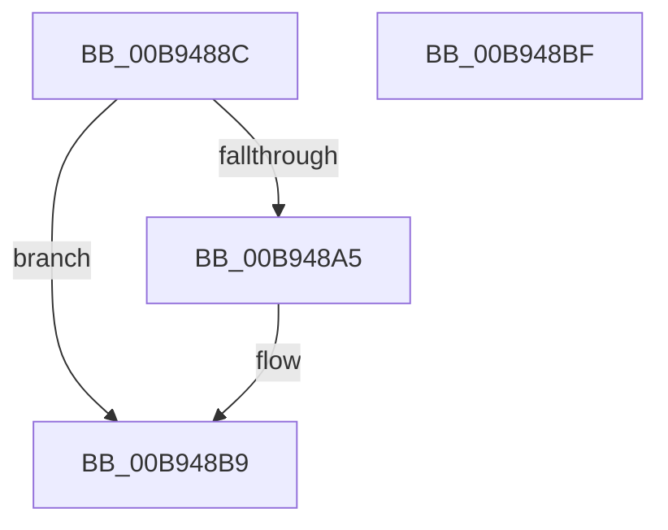

# ViAllocateContextTable

- RVA: `0x00B9488C`–`0x00B948C0` (길이 `52` bytes)
- VA: `0x0000000140B9488C`
- 실행 섹션: `PAGEVRFY`
- PDB 이름 있음: `예`; PDB Function 태그: `아니요`
- unwind 정보 RVA: `0x0005CF00`
- 디코드: `16`개 명령, `52/52` bytes 표시
- 미해석 바이트: `0` (있으면 어셈블리에 `.byte`로 보존)

> 이 문서는 커널 이미지의 기계어와 PDB 기호를 분석해 생성했습니다. 4번과 5번은 함수 원형과 자료형을 바이너리 사용 방식에서 추정한 C 해석이며 원본 소스 복구 결과는 아닙니다.

## 1. Dependencies

- 직접 호출 지점: **1**; 고유 호출 대상: **1**
- 직접 호출자로 확인된 함수: **1**
- RIP 상대 이미지 참조: **1**

### Outgoing calls
- `0x00B9489B` → [ExAllocateFromNPagedLookasideList](../../text/38/ExAllocateFromNPagedLookasideList_function_0038E6C0.md) (function, `0x0038E6C0`)

### Direct callers
- [VfInsertContext](../../text/61/VfInsertContext_function_006127F0.md) at `0x0061285B`

### Static image references
- `0x00B94894` → RVA `0x00FFF600` (`PAGEVRFD`; read)

## 2. Other-region calls and transfers

- 다른 실행 섹션으로 향하는 call: **1**
  - `0x00B9489B` → [ExAllocateFromNPagedLookasideList](../../text/38/ExAllocateFromNPagedLookasideList_function_0038E6C0.md) (`PAGEVRFY` → `.text`)
- 별도 외부 분기/꼬리 이동을 확인하지 못했습니다.

## 3. Assembly (complete function range)

```asm
00B9488C  40 53                           push rbx
00B9488E  48 83 EC 20                     sub rsp, 0x20
00B94892  8B D9                           mov ebx, ecx
00B94894  48 8D 0D 65 AD 46 00            lea rcx, [rip + 0x46ad65]
00B9489B  E8 20 9E 7F FF                  call 0x14038e6c0
00B948A0  48 85 C0                        test rax, rax
00B948A3  74 14                           je 0x140b948b9
00B948A5  83 60 04 00                     and dword ptr [rax + 4], 0
00B948A9  0F 57 C0                        xorps xmm0, xmm0
00B948AC  66 89 18                        mov word ptr [rax], bx
00B948AF  66 C7 40 02 06 00               mov word ptr [rax + 2], 6
00B948B5  0F 11 40 08                     movups xmmword ptr [rax + 8], xmm0
00B948B9  48 83 C4 20                     add rsp, 0x20
00B948BD  5B                              pop rbx
00B948BE  C3                              ret
00B948BF  CC                              int3
```

## 4. C-style interpretation (structured pseudocode)

```c
__int64 __fastcall ViAllocateContextTable(int a1)
{
    __int64 result;
    __int64 v_rsp;

    v_rsp = (v_rsp) - (32);
    result = ExAllocateFromNPagedLookasideList(v_rip + 4631909, a2, a3, a4);
    if (result != 0) {
        *(unsigned __int16 *)(result) = (unsigned __int16)((unsigned int)(a1));
        *(unsigned __int16 *)(result + 2) = 6;
        *(unsigned __int64 *)(result + 8) = v_xmm0;
    }
    v_rsp = (v_rsp) + (32);
    return result;
}
```

## 5. (Beta) C Style

```c
int64_t ViAllocateContextTable(int32_t Arg1)
{
    int64_t result;
    int64_t local_rsp;

    local_rsp = (local_rsp) - (32);
    result = ExAllocateFromNPagedLookasideList(v_rip + 4631909, a2, a3, a4);
    if (result != 0) {
        *(uint16_t *)(result) = (uint16_t)((uint32_t)(Arg1));
        *(uint16_t *)(result + 0x2) = 6;
        *(uint64_t *)(result + 0x8) = v_xmm0;
    }
    local_rsp = (local_rsp) + (32);
    return result;
}
```

## 6. Execution-region graph

[열기: 2D/3D 그래프와 함수 탐색 컨트롤 패널](../../../control-panel.html?section=pagevrfy&rva=0x00B9488C&view=graph)

- 2D 그래프는 위에서 아래로 흐르고, 3D 그래프는 빈 공간을 드래그해 회전합니다. Shift+드래그는 이동, 휠은 확대·축소, 함수 노드 선택은 대상 보고서 이동입니다.

### Static fallback


