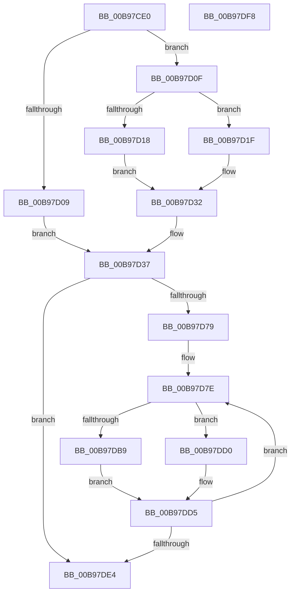

# ViAllocateContiguousMemory

- RVA: `0x00B97CE0`–`0x00B97DF9` (길이 `281` bytes)
- VA: `0x0000000140B97CE0`
- 실행 섹션: `PAGEVRFY`
- PDB 이름 있음: `예`; PDB Function 태그: `아니요`
- unwind 정보 RVA: `0x000D2260`
- 디코드: `69`개 명령, `281/281` bytes 표시
- 미해석 바이트: `0` (있으면 어셈블리에 `.byte`로 보존)

> 이 문서는 커널 이미지의 기계어와 PDB 기호를 분석해 생성했습니다. 4번과 5번은 함수 원형과 자료형을 바이너리 사용 방식에서 추정한 C 해석이며 원본 소스 복구 결과는 아닙니다.

## 1. Dependencies

- 직접 호출 지점: **4**; 고유 호출 대상: **4**
- 직접 호출자로 확인된 함수: **1**
- RIP 상대 이미지 참조: **0**

### Outgoing calls
- `0x00B97D53` → [RtlClearAllBits](../../text/45/RtlClearAllBits_function_00450230.md) (function, `0x00450230`)
- `0x00B97D68` → [ExAllocatePool2](../../poolcode/B8/ExAllocatePool2_function_00B820F0.md) (function, `0x00B820F0`)
- `0x00B97D9B` → [MmAllocateContiguousNodeMemory](../../text/3E/MmAllocateContiguousNodeMemory_function_003E9E40.md) (function, `0x003E9E40`)
- `0x00B97DC4` → [RtlSetBits](../../text/3E/RtlSetBits_function_003E1610.md) (function, `0x003E1610`)

### Direct callers
- [ViHookDmaAdapter](ViHookDmaAdapter_function_00B993D8.md) at `0x00B994EA`

### Static image references
- 디코드된 RIP-relative 메모리 참조가 없습니다.

## 2. Other-region calls and transfers

- 다른 실행 섹션으로 향하는 call: **4**
  - `0x00B97D53` → [RtlClearAllBits](../../text/45/RtlClearAllBits_function_00450230.md) (`PAGEVRFY` → `.text`)
  - `0x00B97D68` → [ExAllocatePool2](../../poolcode/B8/ExAllocatePool2_function_00B820F0.md) (`PAGEVRFY` → `POOLCODE`)
  - `0x00B97D9B` → [MmAllocateContiguousNodeMemory](../../text/3E/MmAllocateContiguousNodeMemory_function_003E9E40.md) (`PAGEVRFY` → `.text`)
  - `0x00B97DC4` → [RtlSetBits](../../text/3E/RtlSetBits_function_003E1610.md) (`PAGEVRFY` → `.text`)
- 별도 외부 분기/꼬리 이동을 확인하지 못했습니다.

## 3. Assembly (complete function range)

```asm
00B97CE0  48 89 6C 24 10                  mov qword ptr [rsp + 0x10], rbp
00B97CE5  48 89 74 24 18                  mov qword ptr [rsp + 0x18], rsi
00B97CEA  57                              push rdi
00B97CEB  41 56                           push r14
00B97CED  41 57                           push r15
00B97CEF  48 83 EC 30                     sub rsp, 0x30
00B97CF3  83 64 24 54 00                  and dword ptr [rsp + 0x54], 0
00B97CF8  48 8B F1                        mov rsi, rcx
00B97CFB  80 B9 EB 00 00 00 00            cmp byte ptr [rcx + 0xeb], 0
00B97D02  B8 FF FF 00 00                  mov eax, 0xffff
00B97D07  74 06                           je 0x140b97d0f
00B97D09  48 83 CF FF                     or rdi, 0xffffffffffffffff
00B97D0D  EB 28                           jmp 0x140b97d37
00B97D0F  80 B9 E8 00 00 00 00            cmp byte ptr [rcx + 0xe8], 0
00B97D16  74 07                           je 0x140b97d1f
00B97D18  83 4C 24 50 FF                  or dword ptr [rsp + 0x50], 0xffffffff
00B97D1D  EB 13                           jmp 0x140b97d32
00B97D1F  83 BE F4 00 00 00 01            cmp dword ptr [rsi + 0xf4], 1
00B97D26  B9 FF FF FF 00                  mov ecx, 0xffffff
00B97D2B  0F 44 C1                        cmove eax, ecx
00B97D2E  89 44 24 50                     mov dword ptr [rsp + 0x50], eax
00B97D32  48 8B 7C 24 50                  mov rdi, qword ptr [rsp + 0x50]
00B97D37  4C 8D BE 48 01 00 00            lea r15, [rsi + 0x148]
00B97D3E  48 8D 86 40 01 00 00            lea rax, [rsi + 0x140]
00B97D45  41 C7 07 20 00 00 00            mov dword ptr [r15], 0x20
00B97D4C  49 8B CF                        mov rcx, r15
00B97D4F  49 89 47 08                     mov qword ptr [r15 + 8], rax
00B97D53  E8 D8 84 8B FF                  call 0x140450230
00B97D58  BA 00 01 00 00                  mov edx, 0x100
00B97D5D  B9 40 00 00 00                  mov ecx, 0x40
00B97D62  41 B8 48 61 6C 56               mov r8d, 0x566c6148
00B97D68  E8 83 A3 FE FF                  call 0x140b820f0
00B97D6D  48 89 86 28 01 00 00            mov qword ptr [rsi + 0x128], rax
00B97D74  48 85 C0                        test rax, rax
00B97D77  74 6B                           je 0x140b97de4
00B97D79  33 ED                           xor ebp, ebp
00B97D7B  45 33 F6                        xor r14d, r14d
00B97D7E  C7 44 24 28 00 00 00 80         mov dword ptr [rsp + 0x28], 0x80000000
00B97D86  45 33 C9                        xor r9d, r9d
00B97D89  4C 8B C7                        mov r8, rdi
00B97D8C  C7 44 24 20 04 00 00 00         mov dword ptr [rsp + 0x20], 4
00B97D94  33 D2                           xor edx, edx
00B97D96  B9 00 30 00 00                  mov ecx, 0x3000
00B97D9B  E8 A0 20 85 FF                  call 0x1403e9e40
00B97DA0  48 8B 8E 28 01 00 00            mov rcx, qword ptr [rsi + 0x128]
00B97DA7  49 89 04 0E                     mov qword ptr [r14 + rcx], rax
00B97DAB  48 8B 86 28 01 00 00            mov rax, qword ptr [rsi + 0x128]
00B97DB2  49 83 3C 06 00                  cmp qword ptr [r14 + rax], 0
00B97DB7  75 17                           jne 0x140b97dd0
00B97DB9  41 B8 01 00 00 00               mov r8d, 1
00B97DBF  8B D5                           mov edx, ebp
00B97DC1  49 8B CF                        mov rcx, r15
00B97DC4  E8 47 98 84 FF                  call 0x1403e1610
00B97DC9  B8 34 01 00 00                  mov eax, 0x134
00B97DCE  EB 05                           jmp 0x140b97dd5
00B97DD0  B8 30 01 00 00                  mov eax, 0x130
00B97DD5  F0 FF 04 30                     lock inc dword ptr [rax + rsi]
00B97DD9  FF C5                           inc ebp
00B97DDB  49 83 C6 08                     add r14, 8
00B97DDF  83 FD 20                        cmp ebp, 0x20
00B97DE2  72 9A                           jb 0x140b97d7e
00B97DE4  48 8B 6C 24 58                  mov rbp, qword ptr [rsp + 0x58]
00B97DE9  48 8B 74 24 60                  mov rsi, qword ptr [rsp + 0x60]
00B97DEE  48 83 C4 30                     add rsp, 0x30
00B97DF2  41 5F                           pop r15
00B97DF4  41 5E                           pop r14
00B97DF6  5F                              pop rdi
00B97DF7  C3                              ret
00B97DF8  CC                              int3
```

## 4. C-style interpretation (structured pseudocode)

```c
__int64 __fastcall ViAllocateContiguousMemory(__int64 a1, __int64 a2, __int64 a3, int a4)
{
    __int64 result;
    __int64 v_r14;
    __int64 v_rbp;
    __int64 v_rdi;
    __int64 v_rsp;
    unsigned int v_stack_m20;
    unsigned int v_stack_m28;
    unsigned __int64 v_stack_p10;
    unsigned __int64 v_stack_p18;
    unsigned int v_stack_p8;
    unsigned int v_stack_pC;

    v_stack_p10 = v_rbp;
    v_stack_p18 = v_rsi;
    v_rsp = (v_rsp) - (48);
    if ((*(unsigned __int8 *)(a1 + 235)) == 0) goto loc_00B97D0F;
    v_rdi = (v_rdi) | (-1);
    goto loc_00B97D37;
loc_00B97D0F:
    if ((*(unsigned __int8 *)(a1 + 232)) == 0) goto loc_00B97D1F;
    goto loc_00B97D32;
loc_00B97D1F:
    result = (unsigned int)(0xFFFFULL);
    if ((*(unsigned int *)(a1 + 244)) == 1) { result = (unsigned int)((unsigned int)(0xFFFFFFULL)); }
    v_stack_p8 = (unsigned int)(result);
loc_00B97D32:
loc_00B97D37:
    *(unsigned int *)(a1 + 328) = 32;
    *(unsigned __int64 *)(a1 + 328 + 8) = a1 + 320;
    result = RtlClearAllBits(a1 + 328, a2, a3, a4);
    result = ExAllocatePool2(64, 256, (unsigned int)(0x566C6148ULL), a4);
    *(unsigned __int64 *)(a1 + 296) = result;
    if (result == 0) goto loc_00B97DE4;
    v_rbp = 0;
    v_r14 = 0;
loc_00B97D7E:
    v_stack_m20 = 0x80000000ULL;
    a4 = 0;
    v_stack_m28 = 4;
    a2 = 0;
    result = MmAllocateContiguousNodeMemory((unsigned int)(0x3000ULL), a2, v_stack_p8, a4);
    *(unsigned __int64 *)(v_r14 + *(unsigned __int64 *)(a1 + 296) * 1) = result;
    if ((*(unsigned __int64 *)(v_r14 + *(unsigned __int64 *)(a1 + 296) * 1)) != 0) goto loc_00B97DD0;
    result = RtlSetBits(a1 + 328, 0, 1, a4);
    goto loc_00B97DD5;
loc_00B97DD0:
loc_00B97DD5:
    v_rbp = (unsigned int)((v_rbp) + 1);
    v_r14 = (v_r14) + (8);
    if (((unsigned int)(v_rbp)) < 32) goto loc_00B97D7E;
loc_00B97DE4:
    v_rsp = (v_rsp) + (48);
    return 304;
}
```

## 5. (Beta) C Style

```c
int64_t ViAllocateContiguousMemory(void *Arg1, int64_t Arg2, int64_t Arg3, int32_t Arg4)
{
    uint8_t *arg1 = (uint8_t *)Arg1;

    int64_t result;
    int64_t local_r14;
    int64_t local_rbp;
    int64_t local_rdi;
    int64_t local_rsp;
    uint32_t v_stack_m20;
    uint32_t v_stack_m28;
    uint64_t v_stack_p10;
    uint64_t v_stack_p18;
    uint32_t v_stack_p8;
    uint32_t v_stack_pC;

    v_stack_p10 = local_rbp;
    v_stack_p18 = local_rsi;
    local_rsp = (local_rsp) - (48);
    if ((*(uint8_t *)(arg1 + 0xEB)) == 0) goto loc_00B97D0F;
    local_rdi = (local_rdi) | (-1);
    goto loc_00B97D37;
loc_00B97D0F:
    if ((*(uint8_t *)(arg1 + 0xE8)) == 0) goto loc_00B97D1F;
    goto loc_00B97D32;
loc_00B97D1F:
    result = (uint32_t)(0xFFFFULL);
    if ((*(uint32_t *)(arg1 + 0xF4)) == 1) { result = (uint32_t)((uint32_t)(0xFFFFFFULL)); }
    v_stack_p8 = (uint32_t)(result);
loc_00B97D32:
loc_00B97D37:
    *(uint32_t *)(arg1 + 0x148) = 32;
    *(void **)(arg1 + 0x148 + 0x8) = Arg1 + 320;
    result = RtlClearAllBits(Arg1 + 328, Arg2, Arg3, Arg4);
    result = ExAllocatePool2(64, 256, (uint32_t)(0x566C6148ULL), Arg4);
    *(uint64_t *)(arg1 + 0x128) = result;
    if (result == 0) goto loc_00B97DE4;
    local_rbp = 0;
    local_r14 = 0;
loc_00B97D7E:
    v_stack_m20 = 0x80000000ULL;
    Arg4 = 0;
    v_stack_m28 = 4;
    Arg2 = 0;
    result = MmAllocateContiguousNodeMemory((uint32_t)(0x3000ULL), Arg2, v_stack_p8, Arg4);
    *(uint64_t *)(local_r14 + *(uint64_t *)(arg1 + 0x128) * 1) = result;
    if ((*(uint64_t *)(local_r14 + *(uint64_t *)(arg1 + 0x128) * 1)) != 0) goto loc_00B97DD0;
    result = RtlSetBits(Arg1 + 328, 0, 1, Arg4);
    goto loc_00B97DD5;
loc_00B97DD0:
loc_00B97DD5:
    local_rbp = (uint32_t)((local_rbp) + 1);
    local_r14 = (local_r14) + (8);
    if (((uint32_t)(local_rbp)) < 32) goto loc_00B97D7E;
loc_00B97DE4:
    local_rsp = (local_rsp) + (48);
    return 304;
}
```

### 관측된 메모리 오프셋

구조체 형식이 확인되지 않은 접근은 인자 기준의 오프셋으로만 기록했습니다.

| 기준 인자 | 오프셋 표현 | 폭 (bit) | 접근 |
|---|---:|---:|---|
| `Arg1` | `+ 0x0` | `32` | `W` |
| `Arg1` | `+ 0x8` | `64` | `W` |
| `Arg1` | `+ 0xE8` | `8` | `R` |
| `Arg1` | `+ 0xEB` | `8` | `R` |
| `Arg1` | `+ 0xF4` | `32` | `R` |
| `Arg1` | `+ 0x128` | `64` | `R` |
| `Arg1` | `+ 0x128` | `64` | `W` |
| `Arg1` | `+ 0x140` | `64` | `R` |
| `Arg1` | `+ 0x148` | `64` | `R` |

## 6. Execution-region graph

[열기: 2D/3D 그래프와 함수 탐색 컨트롤 패널](../../../control-panel.html?section=pagevrfy&rva=0x00B97CE0&view=graph)

- 2D 그래프는 위에서 아래로 흐르고, 3D 그래프는 빈 공간을 드래그해 회전합니다. Shift+드래그는 이동, 휠은 확대·축소, 함수 노드 선택은 대상 보고서 이동입니다.

### Static fallback


