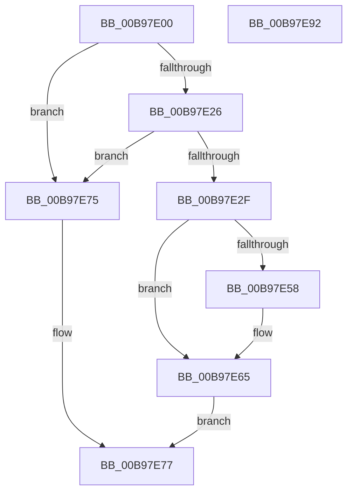

# ViAllocateFromContiguousMemory

- RVA: `0x00B97E00`–`0x00B97E93` (길이 `147` bytes)
- VA: `0x0000000140B97E00`
- 실행 섹션: `PAGEVRFY`
- PDB 이름 있음: `예`; PDB Function 태그: `아니요`
- unwind 정보 RVA: `0x0005E6B4`
- 디코드: `41`개 명령, `147/147` bytes 표시
- 미해석 바이트: `0` (있으면 어셈블리에 `.byte`로 보존)

> 이 문서는 커널 이미지의 기계어와 PDB 기호를 분석해 생성했습니다. 4번과 5번은 함수 원형과 자료형을 바이너리 사용 방식에서 추정한 C 해석이며 원본 소스 복구 결과는 아닙니다.

## 1. Dependencies

- 직접 호출 지점: **3**; 고유 호출 대상: **3**
- 직접 호출자로 확인된 함수: **1**
- RIP 상대 이미지 참조: **0**

### Outgoing calls
- `0x00B97E39` → [KeAcquireSpinLockRaiseToDpc](../../text/20/KeAcquireSpinLockRaiseToDpc_function_00208470.md) (function, `0x00208470`)
- `0x00B97E4E` → [RtlFindClearBitsAndSet](../../text/3E/RtlFindClearBitsAndSet_function_003E0CD0.md) (function, `0x003E0CD0`)
- `0x00B97E6B` → [KeReleaseSpinLock](../../text/39/KeReleaseSpinLock_function_00392BA0.md) (function, `0x00392BA0`)

### Direct callers
- [ViAllocateMapRegisterFile](ViAllocateMapRegisterFile_function_00B97E9C.md) at `0x00B97F5A`

### Static image references
- 디코드된 RIP-relative 메모리 참조가 없습니다.

## 2. Other-region calls and transfers

- 다른 실행 섹션으로 향하는 call: **3**
  - `0x00B97E39` → [KeAcquireSpinLockRaiseToDpc](../../text/20/KeAcquireSpinLockRaiseToDpc_function_00208470.md) (`PAGEVRFY` → `.text`)
  - `0x00B97E4E` → [RtlFindClearBitsAndSet](../../text/3E/RtlFindClearBitsAndSet_function_003E0CD0.md) (`PAGEVRFY` → `.text`)
  - `0x00B97E6B` → [KeReleaseSpinLock](../../text/39/KeReleaseSpinLock_function_00392BA0.md) (`PAGEVRFY` → `.text`)
- 별도 외부 분기/꼬리 이동을 확인하지 못했습니다.

## 3. Assembly (complete function range)

```asm
00B97E00  48 8B C4                        mov rax, rsp
00B97E03  48 89 58 08                     mov qword ptr [rax + 8], rbx
00B97E07  48 89 68 10                     mov qword ptr [rax + 0x10], rbp
00B97E0B  48 89 70 18                     mov qword ptr [rax + 0x18], rsi
00B97E0F  48 89 78 20                     mov qword ptr [rax + 0x20], rdi
00B97E13  41 56                           push r14
00B97E15  48 83 EC 20                     sub rsp, 0x20
00B97E19  33 DB                           xor ebx, ebx
00B97E1B  44 8B F2                        mov r14d, edx
00B97E1E  48 8B F9                        mov rdi, rcx
00B97E21  48 85 C9                        test rcx, rcx
00B97E24  74 4F                           je 0x140b97e75
00B97E26  48 39 99 28 01 00 00            cmp qword ptr [rcx + 0x128], rbx
00B97E2D  74 46                           je 0x140b97e75
00B97E2F  48 8D B1 38 01 00 00            lea rsi, [rcx + 0x138]
00B97E36  48 8B CE                        mov rcx, rsi
00B97E39  E8 32 06 67 FF                  call 0x140208470
00B97E3E  48 8D 8F 48 01 00 00            lea rcx, [rdi + 0x148]
00B97E45  45 8B C6                        mov r8d, r14d
00B97E48  8D 53 01                        lea edx, [rbx + 1]
00B97E4B  40 8A E8                        mov bpl, al
00B97E4E  E8 7D 8E 84 FF                  call 0x1403e0cd0
00B97E53  83 F8 FF                        cmp eax, -1
00B97E56  74 0D                           je 0x140b97e65
00B97E58  8B D0                           mov edx, eax
00B97E5A  48 8B 87 28 01 00 00            mov rax, qword ptr [rdi + 0x128]
00B97E61  48 8B 1C D0                     mov rbx, qword ptr [rax + rdx*8]
00B97E65  40 8A D5                        mov dl, bpl
00B97E68  48 8B CE                        mov rcx, rsi
00B97E6B  E8 30 AD 7F FF                  call 0x140392ba0
00B97E70  48 8B C3                        mov rax, rbx
00B97E73  EB 02                           jmp 0x140b97e77
00B97E75  33 C0                           xor eax, eax
00B97E77  48 8B 5C 24 30                  mov rbx, qword ptr [rsp + 0x30]
00B97E7C  48 8B 6C 24 38                  mov rbp, qword ptr [rsp + 0x38]
00B97E81  48 8B 74 24 40                  mov rsi, qword ptr [rsp + 0x40]
00B97E86  48 8B 7C 24 48                  mov rdi, qword ptr [rsp + 0x48]
00B97E8B  48 83 C4 20                     add rsp, 0x20
00B97E8F  41 5E                           pop r14
00B97E91  C3                              ret
00B97E92  CC                              int3
```

## 4. C-style interpretation (structured pseudocode)

```c
__int64 __fastcall ViAllocateFromContiguousMemory(__int64 a1, int a2)
{
    __int64 result;
    __int64 v_rbx;
    __int64 v_rsp;
    unsigned __int64 v_stack_p10;
    unsigned __int64 v_stack_p18;
    unsigned __int64 v_stack_p20;
    unsigned __int64 v_stack_p8;

    *(unsigned __int64 *)(v_rsp + 8) = v_rbx;
    *(unsigned __int64 *)(v_rsp + 16) = v_rbp;
    *(unsigned __int64 *)(v_rsp + 24) = v_rsi;
    *(unsigned __int64 *)(v_rsp + 32) = v_rdi;
    v_rsp = (v_rsp) - (32);
    v_rbx = 0;
    if (a1 == 0) goto loc_00B97E75;
    if ((*(unsigned __int64 *)(a1 + 296)) == 0) goto loc_00B97E75;
    result = KeAcquireSpinLockRaiseToDpc(a1 + 312, a2, a3, a4);
    result = RtlFindClearBitsAndSet(a1 + 328, v_rbx + 1, (unsigned int)((unsigned int)((unsigned int)(a2))), a4);
    if (((unsigned int)(result)) != -1) {
        a2 = (unsigned int)(result);
        result = *(unsigned __int64 *)(a1 + 296);
        v_rbx = *(unsigned __int64 *)(result + a2 * 8);
    }
    result = KeReleaseSpinLock(a1 + 312, (unsigned __int8)((unsigned __int8)(result)), (unsigned int)((unsigned int)((unsigned int)(a2))), a4);
    goto loc_00B97E77;
loc_00B97E75:
    result = 0;
loc_00B97E77:
    v_rsp = (v_rsp) + (32);
    return result;
}
```

## 5. (Beta) C Style

```c
int64_t ViAllocateFromContiguousMemory(void *Arg1, int32_t Arg2)
{
    uint8_t *arg1 = (uint8_t *)Arg1;

    int64_t result;
    int64_t local_rbx;
    int64_t local_rsp;
    uint64_t v_stack_p10;
    uint64_t v_stack_p18;
    uint64_t v_stack_p20;
    uint64_t v_stack_p8;

    *(uint64_t *)(local_rsp + 0x8) = local_rbx;
    *(uint64_t *)(local_rsp + 0x10) = local_rbp;
    *(uint64_t *)(local_rsp + 0x18) = local_rsi;
    *(uint64_t *)(local_rsp + 0x20) = local_rdi;
    local_rsp = (local_rsp) - (32);
    local_rbx = 0;
    if (Arg1 == NULL) goto loc_00B97E75;
    if ((*(uint64_t *)(arg1 + 0x128)) == 0) goto loc_00B97E75;
    result = KeAcquireSpinLockRaiseToDpc(Arg1 + 312, Arg2, a3, a4);
    result = RtlFindClearBitsAndSet(Arg1 + 328, local_rbx + 1, (uint32_t)((uint32_t)((uint32_t)(Arg2))), a4);
    if (((uint32_t)(result)) != -1) {
        Arg2 = (uint32_t)(result);
        result = *(uint64_t *)(arg1 + 0x128);
        local_rbx = *(uint64_t *)(result + Arg2 * 8);
    }
    result = KeReleaseSpinLock(Arg1 + 312, (uint8_t)((uint8_t)(result)), (uint32_t)((uint32_t)((uint32_t)(Arg2))), a4);
    goto loc_00B97E77;
loc_00B97E75:
    result = 0;
loc_00B97E77:
    local_rsp = (local_rsp) + (32);
    return result;
}
```

### 관측된 메모리 오프셋

구조체 형식이 확인되지 않은 접근은 인자 기준의 오프셋으로만 기록했습니다.

| 기준 인자 | 오프셋 표현 | 폭 (bit) | 접근 |
|---|---:|---:|---|
| `Arg1` | `+ 0x128` | `64` | `R` |
| `Arg1` | `+ 0x148` | `64` | `R` |

## 6. Execution-region graph

[열기: 2D/3D 그래프와 함수 탐색 컨트롤 패널](../../../control-panel.html?section=pagevrfy&rva=0x00B97E00&view=graph)

- 2D 그래프는 위에서 아래로 흐르고, 3D 그래프는 빈 공간을 드래그해 회전합니다. Shift+드래그는 이동, 휠은 확대·축소, 함수 노드 선택은 대상 보고서 이동입니다.

### Static fallback


