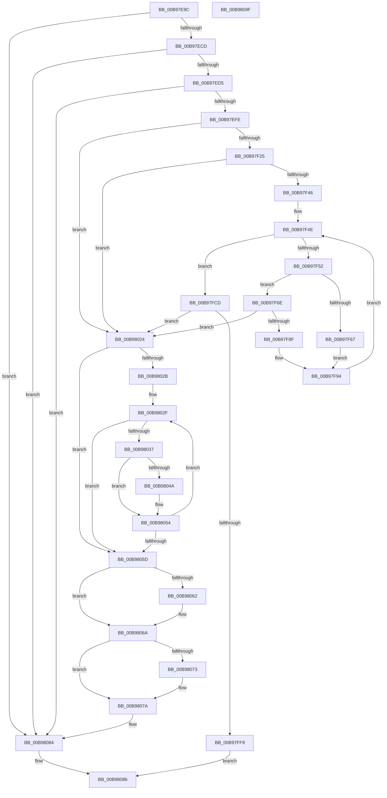

# ViAllocateMapRegisterFile

- RVA: `0x00B97E9C`–`0x00B980A0` (길이 `516` bytes)
- VA: `0x0000000140B97E9C`
- 실행 섹션: `PAGEVRFY`
- PDB 이름 있음: `예`; PDB Function 태그: `아니요`
- unwind 정보 RVA: `0x00084C9C`
- 디코드: `141`개 명령, `516/516` bytes 표시
- 미해석 바이트: `0` (있으면 어셈블리에 `.byte`로 보존)

> 이 문서는 커널 이미지의 기계어와 PDB 기호를 분석해 생성했습니다. 4번과 5번은 함수 원형과 자료형을 바이너리 사용 방식에서 추정한 C 해석이며 원본 소스 복구 결과는 아닙니다.

## 1. Dependencies

- 직접 호출 지점: **14**; 고유 호출 대상: **10**
- 직접 호출자로 확인된 함수: **4**
- RIP 상대 이미지 참조: **0**

### Outgoing calls
- `0x00B97EED` → [ExAllocatePool2](../../poolcode/B8/ExAllocatePool2_function_00B820F0.md) (function, `0x00B820F0`)
- `0x00B97F14` → [IoAllocateMdl](../../text/29/IoAllocateMdl_function_0029EBF0.md) (function, `0x0029EBF0`)
- `0x00B97F34` → [ExAllocatePool2](../../poolcode/B8/ExAllocatePool2_function_00B820F0.md) (function, `0x00B820F0`)
- `0x00B97F5A` → [ViAllocateFromContiguousMemory](ViAllocateFromContiguousMemory_function_00B97E00.md) (function, `0x00B97E00`)
- `0x00B97F7E` → [ExAllocatePool2](../../poolcode/B8/ExAllocatePool2_function_00B820F0.md) (function, `0x00B820F0`)
- `0x00B97FA6` → [ViInitializePadding](ViInitializePadding_function_00B99598.md) (function, `0x00B99598`)
- `0x00B97FB5` → [MmGetPhysicalAddress](../../text/23/MmGetPhysicalAddress_function_0023A500.md) (function, `0x0023A500`)
- `0x00B97FEB` → [MmMapLockedPagesSpecifyCache](../../text/31/MmMapLockedPagesSpecifyCache_function_00318800.md) (function, `0x00318800`)
- `0x00B9801A` → [ExInterlockedInsertHeadList](../../text/38/ExInterlockedInsertHeadList_function_00386680.md) (function, `0x00386680`)
- `0x00B98041` → [ViFreeToContiguousMemory](ViFreeToContiguousMemory_function_00B98DD8.md) (function, `0x00B98DD8`)
- `0x00B9804F` → [ExFreePoolWithTag](../../poolcode/B8/ExFreePoolWithTag_function_00B82870.md) (function, `0x00B82870`)
- `0x00B98065` → [IoFreeMdl](../../text/29/IoFreeMdl_function_0029EA80.md) (function, `0x0029EA80`)
- `0x00B98075` → [ExFreePoolWithTag](../../poolcode/B8/ExFreePoolWithTag_function_00B82870.md) (function, `0x00B82870`)
- `0x00B9807F` → [ExFreePoolWithTag](../../poolcode/B8/ExFreePoolWithTag_function_00B82870.md) (function, `0x00B82870`)

### Direct callers
- [VfAllocateAdapterChannel](VfAllocateAdapterChannel_function_00B95180.md) at `0x00B95226`
- [VfBuildScatterGatherList](VfBuildScatterGatherList_function_00B95AA0.md) at `0x00B95BFA`
- [VfGetScatterGatherList](VfGetScatterGatherList_function_00B96BD0.md) at `0x00B96D99`
- [VfHalAllocateMapRegisters](VfHalAllocateMapRegisters_function_00B970B0.md) at `0x00B9712A`

### Static image references
- 디코드된 RIP-relative 메모리 참조가 없습니다.

## 2. Other-region calls and transfers

- 다른 실행 섹션으로 향하는 call: **11**
  - `0x00B97EED` → [ExAllocatePool2](../../poolcode/B8/ExAllocatePool2_function_00B820F0.md) (`PAGEVRFY` → `POOLCODE`)
  - `0x00B97F14` → [IoAllocateMdl](../../text/29/IoAllocateMdl_function_0029EBF0.md) (`PAGEVRFY` → `.text`)
  - `0x00B97F34` → [ExAllocatePool2](../../poolcode/B8/ExAllocatePool2_function_00B820F0.md) (`PAGEVRFY` → `POOLCODE`)
  - `0x00B97F7E` → [ExAllocatePool2](../../poolcode/B8/ExAllocatePool2_function_00B820F0.md) (`PAGEVRFY` → `POOLCODE`)
  - `0x00B97FB5` → [MmGetPhysicalAddress](../../text/23/MmGetPhysicalAddress_function_0023A500.md) (`PAGEVRFY` → `.text`)
  - `0x00B97FEB` → [MmMapLockedPagesSpecifyCache](../../text/31/MmMapLockedPagesSpecifyCache_function_00318800.md) (`PAGEVRFY` → `.text`)
  - `0x00B9801A` → [ExInterlockedInsertHeadList](../../text/38/ExInterlockedInsertHeadList_function_00386680.md) (`PAGEVRFY` → `.text`)
  - `0x00B9804F` → [ExFreePoolWithTag](../../poolcode/B8/ExFreePoolWithTag_function_00B82870.md) (`PAGEVRFY` → `POOLCODE`)
  - `0x00B98065` → [IoFreeMdl](../../text/29/IoFreeMdl_function_0029EA80.md) (`PAGEVRFY` → `.text`)
  - `0x00B98075` → [ExFreePoolWithTag](../../poolcode/B8/ExFreePoolWithTag_function_00B82870.md) (`PAGEVRFY` → `POOLCODE`)
  - `0x00B9807F` → [ExFreePoolWithTag](../../poolcode/B8/ExFreePoolWithTag_function_00B82870.md) (`PAGEVRFY` → `POOLCODE`)
- 별도 외부 분기/꼬리 이동을 확인하지 못했습니다.

## 3. Assembly (complete function range)

```asm
00B97E9C  48 89 5C 24 08                  mov qword ptr [rsp + 8], rbx
00B97EA1  48 89 6C 24 10                  mov qword ptr [rsp + 0x10], rbp
00B97EA6  48 89 74 24 18                  mov qword ptr [rsp + 0x18], rsi
00B97EAB  57                              push rdi
00B97EAC  41 56                           push r14
00B97EAE  41 57                           push r15
00B97EB0  48 83 EC 30                     sub rsp, 0x30
00B97EB4  44 8B 81 C0 00 00 00            mov r8d, dword ptr [rcx + 0xc0]
00B97EBB  48 8B E9                        mov rbp, rcx
00B97EBE  44 03 C2                        add r8d, edx
00B97EC1  8B FA                           mov edi, edx
00B97EC3  41 83 F8 20                     cmp r8d, 0x20
00B97EC7  0F 87 B7 01 00 00               ja 0x140b98084
00B97ECD  85 D2                           test edx, edx
00B97ECF  0F 84 AF 01 00 00               je 0x140b98084
00B97ED5  8D 57 FF                        lea edx, [rdi - 1]
00B97ED8  41 BE 40 00 00 00               mov r14d, 0x40
00B97EDE  C1 E2 05                        shl edx, 5
00B97EE1  41 B8 48 61 6C 56               mov r8d, 0x566c6148
00B97EE7  83 C2 78                        add edx, 0x78
00B97EEA  41 8B CE                        mov ecx, r14d
00B97EED  E8 FE A1 FE FF                  call 0x140b820f0
00B97EF2  48 8B D8                        mov rbx, rax
00B97EF5  48 85 C0                        test rax, rax
00B97EF8  0F 84 86 01 00 00               je 0x140b98084
00B97EFE  48 83 64 24 20 00               and qword ptr [rsp + 0x20], 0
00B97F04  8B D7                           mov edx, edi
00B97F06  C1 E2 0C                        shl edx, 0xc
00B97F09  45 33 C9                        xor r9d, r9d
00B97F0C  45 33 C0                        xor r8d, r8d
00B97F0F  89 78 1C                        mov dword ptr [rax + 0x1c], edi
00B97F12  33 C9                           xor ecx, ecx
00B97F14  E8 D7 6C 70 FF                  call 0x14029ebf0
00B97F19  48 8B F0                        mov rsi, rax
00B97F1C  48 85 C0                        test rax, rax
00B97F1F  0F 84 FF 00 00 00               je 0x140b98024
00B97F25  8B D7                           mov edx, edi
00B97F27  41 B8 48 61 6C 56               mov r8d, 0x566c6148
00B97F2D  48 C1 E2 0C                     shl rdx, 0xc
00B97F31  41 8B CE                        mov ecx, r14d
00B97F34  E8 B7 A1 FE FF                  call 0x140b820f0
00B97F39  48 89 43 48                     mov qword ptr [rbx + 0x48], rax
00B97F3D  48 85 C0                        test rax, rax
00B97F40  0F 84 DE 00 00 00               je 0x140b98024
00B97F46  4C 8D 7E 30                     lea r15, [rsi + 0x30]
00B97F4A  4C 8D 73 68                     lea r14, [rbx + 0x68]
00B97F4E  85 FF                           test edi, edi
00B97F50  74 7B                           je 0x140b97fcd
00B97F52  8B 53 1C                        mov edx, dword ptr [rbx + 0x1c]
00B97F55  48 8B CD                        mov rcx, rbp
00B97F58  2B D7                           sub edx, edi
00B97F5A  E8 A1 FE FF FF                  call 0x140b97e00
00B97F5F  49 89 06                        mov qword ptr [r14], rax
00B97F62  48 85 C0                        test rax, rax
00B97F65  74 07                           je 0x140b97f6e
00B97F67  B8 58 01 00 00                  mov eax, 0x158
00B97F6C  EB 26                           jmp 0x140b97f94
00B97F6E  BA 00 30 00 00                  mov edx, 0x3000
00B97F73  B9 48 00 00 00                  mov ecx, 0x48
00B97F78  41 B8 48 61 6C 56               mov r8d, 0x566c6148
00B97F7E  E8 6D A1 FE FF                  call 0x140b820f0
00B97F83  49 89 06                        mov qword ptr [r14], rax
00B97F86  48 85 C0                        test rax, rax
00B97F89  0F 84 95 00 00 00               je 0x140b98024
00B97F8F  B8 5C 01 00 00                  mov eax, 0x15c
00B97F94  F0 FF 04 28                     lock inc dword ptr [rax + rbp]
00B97F98  49 8B 0E                        mov rcx, qword ptr [r14]
00B97F9B  45 33 C9                        xor r9d, r9d
00B97F9E  45 33 C0                        xor r8d, r8d
00B97FA1  BA 00 30 00 00                  mov edx, 0x3000
00B97FA6  E8 ED 15 00 00                  call 0x140b99598
00B97FAB  49 8B 0E                        mov rcx, qword ptr [r14]
00B97FAE  48 81 C1 00 10 00 00            add rcx, 0x1000
00B97FB5  E8 46 25 6A FF                  call 0x14023a500
00B97FBA  48 C1 E8 0C                     shr rax, 0xc
00B97FBE  FF CF                           dec edi
00B97FC0  49 83 C6 20                     add r14, 0x20
00B97FC4  49 89 07                        mov qword ptr [r15], rax
00B97FC7  49 83 C7 08                     add r15, 8
00B97FCB  EB 81                           jmp 0x140b97f4e
00B97FCD  66 83 4E 0A 02                  or word ptr [rsi + 0xa], 2
00B97FD2  45 33 C9                        xor r9d, r9d
00B97FD5  C7 44 24 28 10 00 00 40         mov dword ptr [rsp + 0x28], 0x40000010
00B97FDD  33 D2                           xor edx, edx
00B97FDF  83 64 24 20 00                  and dword ptr [rsp + 0x20], 0
00B97FE4  48 8B CE                        mov rcx, rsi
00B97FE7  45 8D 41 01                     lea r8d, [r9 + 1]
00B97FEB  E8 10 08 78 FF                  call 0x140318800
00B97FF0  48 89 43 40                     mov qword ptr [rbx + 0x40], rax
00B97FF4  48 85 C0                        test rax, rax
00B97FF7  74 2B                           je 0x140b98024
00B97FF9  48 83 63 50 00                  and qword ptr [rbx + 0x50], 0
00B97FFE  4C 8D 85 98 00 00 00            lea r8, [rbp + 0x98]
00B98005  48 8D 53 08                     lea rdx, [rbx + 8]
00B98009  48 89 73 38                     mov qword ptr [rbx + 0x38], rsi
00B9800D  48 8D 8D 88 00 00 00            lea rcx, [rbp + 0x88]
00B98014  C7 03 0D D0 EF AC               mov dword ptr [rbx], 0xacefd00d
00B9801A  E8 61 E6 7E FF                  call 0x140386680
00B9801F  48 8B C3                        mov rax, rbx
00B98022  EB 62                           jmp 0x140b98086
00B98024  8B 7B 1C                        mov edi, dword ptr [rbx + 0x1c]
00B98027  85 FF                           test edi, edi
00B98029  74 32                           je 0x140b9805d
00B9802B  4C 8D 73 68                     lea r14, [rbx + 0x68]
00B9802F  49 8B 16                        mov rdx, qword ptr [r14]
00B98032  48 85 D2                        test rdx, rdx
00B98035  74 26                           je 0x140b9805d
00B98037  44 8B 43 1C                     mov r8d, dword ptr [rbx + 0x1c]
00B9803B  48 8B CD                        mov rcx, rbp
00B9803E  44 2B C7                        sub r8d, edi
00B98041  E8 92 0D 00 00                  call 0x140b98dd8
00B98046  85 C0                           test eax, eax
00B98048  75 0A                           jne 0x140b98054
00B9804A  49 8B 0E                        mov rcx, qword ptr [r14]
00B9804D  33 D2                           xor edx, edx
00B9804F  E8 1C A8 FE FF                  call 0x140b82870
00B98054  49 83 C6 20                     add r14, 0x20
00B98058  83 C7 FF                        add edi, -1
00B9805B  75 D2                           jne 0x140b9802f
00B9805D  48 85 F6                        test rsi, rsi
00B98060  74 08                           je 0x140b9806a
00B98062  48 8B CE                        mov rcx, rsi
00B98065  E8 16 6A 70 FF                  call 0x14029ea80
00B9806A  48 8B 4B 48                     mov rcx, qword ptr [rbx + 0x48]
00B9806E  48 85 C9                        test rcx, rcx
00B98071  74 07                           je 0x140b9807a
00B98073  33 D2                           xor edx, edx
00B98075  E8 F6 A7 FE FF                  call 0x140b82870
00B9807A  33 D2                           xor edx, edx
00B9807C  48 8B CB                        mov rcx, rbx
00B9807F  E8 EC A7 FE FF                  call 0x140b82870
00B98084  33 C0                           xor eax, eax
00B98086  48 8B 5C 24 50                  mov rbx, qword ptr [rsp + 0x50]
00B9808B  48 8B 6C 24 58                  mov rbp, qword ptr [rsp + 0x58]
00B98090  48 8B 74 24 60                  mov rsi, qword ptr [rsp + 0x60]
00B98095  48 83 C4 30                     add rsp, 0x30
00B98099  41 5F                           pop r15
00B9809B  41 5E                           pop r14
00B9809D  5F                              pop rdi
00B9809E  C3                              ret
00B9809F  CC                              int3
```

## 4. C-style interpretation (structured pseudocode)

```c
__int64 __fastcall ViAllocateMapRegisterFile(__int64 a1, int a2, __int64 a3, int a4)
{
    __int64 result;
    __int64 v_r14;
    __int64 v_r15;
    __int64 v_rdi;
    __int64 v_rsp;
    unsigned int v_stack_m20;
    unsigned __int64 v_stack_m28;
    unsigned __int64 v_stack_p10;
    unsigned __int64 v_stack_p18;
    unsigned __int64 v_stack_p8;

    v_stack_p8 = v_rbx;
    v_stack_p10 = v_rbp;
    v_stack_p18 = v_rsi;
    v_rsp = (v_rsp) - (48);
    a3 = (unsigned int)(((unsigned int)(*(unsigned int *)(a1 + 192))) + (a2));
    if (((unsigned int)(a3)) > 32) goto loc_00B98084;
    if (a2 == 0) goto loc_00B98084;
    a2 = (unsigned int)(((unsigned int)(a2) - 1) << (5));
    a2 = (unsigned int)((a2) + (120));
    result = ExAllocatePool2(64, a2, (unsigned int)(0x566C6148ULL), a4);
    if (result == 0) goto loc_00B98084;
    a2 = (unsigned int)(((unsigned int)((unsigned int)((unsigned int)(a2)))) << (12));
    a4 = 0;
    a3 = 0;
    *(unsigned int *)(result + 28) = (unsigned int)((unsigned int)(a2));
    a1 = 0;
    result = IoAllocateMdl(a1, a2, a3, a4);
    if (result == 0) goto loc_00B98024;
    a2 = ((unsigned int)((unsigned int)((unsigned int)(a2)))) << (12);
    result = ExAllocatePool2(64, a2, (unsigned int)(0x566C6148ULL), a4);
    *(unsigned __int64 *)(result + 72) = result;
    if (result == 0) goto loc_00B98024;
loc_00B97F4E:
    if ((unsigned int)((unsigned int)(a2)) == 0) goto loc_00B97FCD;
    a2 = (unsigned int)(((unsigned int)(*(unsigned int *)(result + 28))) - ((unsigned int)((unsigned int)(a2))));
    result = ViAllocateFromContiguousMemory(0, a2, (unsigned int)(0x566C6148ULL), a4);
    *(unsigned __int64 *)(result + 104) = result;
    if (result == 0) goto loc_00B97F6E;
    goto loc_00B97F94;
loc_00B97F6E:
    result = ExAllocatePool2(72, (unsigned int)(0x3000ULL), (unsigned int)(0x566C6148ULL), a4);
    *(unsigned __int64 *)(result + 104) = result;
    if (result == 0) goto loc_00B98024;
loc_00B97F94:
    a4 = 0;
    a3 = 0;
    result = ViInitializePadding(*(unsigned __int64 *)(result + 104), (unsigned int)(0x3000ULL), a3, a4);
    a1 = (*(unsigned __int64 *)(result + 104)) + (0x1000ULL);
    result = MmGetPhysicalAddress(a1, (unsigned int)(0x3000ULL), a3, a4);
    result = (result) >> (12);
    v_rdi = (unsigned int)(((unsigned int)(a2)) - 1);
    v_r14 = (result + 104) + (32);
    *(unsigned __int64 *)(result + 48) = result;
    v_r15 = (result + 48) + (8);
    goto loc_00B97F4E;
loc_00B97FCD:
    a4 = 0;
    v_stack_m20 = 0x40000010ULL;
    a2 = 0;
    result = MmMapLockedPagesSpecifyCache(result, a2, a4 + 1, a4);
    *(unsigned __int64 *)(result + 64) = result;
    if (result == 0) goto loc_00B98024;
    *(unsigned __int64 *)(result + 56) = result;
    *(unsigned int *)(result) = 0xACEFD00DULL;
    result = ExInterlockedInsertHeadList(a1 + 136, result + 8, a1 + 152, a4);
    goto loc_00B98086;
loc_00B98024:
    if ((unsigned int)((unsigned int)(*(unsigned int *)(result + 28))) == 0) goto loc_00B9805D;
loc_00B9802F:
    if (*(unsigned __int64 *)(result + 104) == 0) goto loc_00B9805D;
    a3 = (unsigned int)(((unsigned int)(*(unsigned int *)(result + 28))) - ((unsigned int)((unsigned int)(*(unsigned int *)(result + 28)))));
    result = ViFreeToContiguousMemory(a1, *(unsigned __int64 *)(result + 104), a3, a4);
    if ((unsigned int)(result) == 0) {
        a1 = *(unsigned __int64 *)(result + 104);
        a2 = 0;
        result = ExFreePoolWithTag(a1, a2, a3, a4);
    }
    v_r14 = (result + 104) + (32);
    v_rdi = (unsigned int)(((unsigned int)(*(unsigned int *)(result + 28))) + (-1));
    if (condition_is_not_equal) goto loc_00B9802F;
loc_00B9805D:
    if (result != 0) {
        a1 = result;
        result = IoFreeMdl(a1, a2, a3, a4);
    }
    if (*(unsigned __int64 *)(result + 72) != 0) {
        a2 = 0;
        result = ExFreePoolWithTag(*(unsigned __int64 *)(result + 72), a2, a3, a4);
    }
    a2 = 0;
    result = ExFreePoolWithTag(result, a2, a3, a4);
loc_00B98084:
    result = 0;
loc_00B98086:
    v_rsp = (v_rsp) + (48);
    return result;
}
```

## 5. (Beta) C Style

```c
int64_t ViAllocateMapRegisterFile(void *Arg1, void *Arg2, int64_t Arg3, int32_t Arg4)
{
    uint8_t *arg1 = (uint8_t *)Arg1;
    uint8_t *arg2 = (uint8_t *)Arg2;

    int64_t result;
    int64_t local_r14;
    int64_t local_r15;
    int64_t local_rdi;
    int64_t local_rsp;
    uint32_t v_stack_m20;
    uint64_t v_stack_m28;
    uint64_t v_stack_p10;
    uint64_t v_stack_p18;
    uint64_t v_stack_p8;

    v_stack_p8 = local_rbx;
    v_stack_p10 = local_rbp;
    v_stack_p18 = local_rsi;
    local_rsp = (local_rsp) - (48);
    Arg3 = (uint32_t)(((uint32_t)(*(uint32_t *)(arg1 + 0xC0))) + (Arg2));
    if (((uint32_t)(Arg3)) > 32) goto loc_00B98084;
    if (Arg2 == NULL) goto loc_00B98084;
    Arg2 = (uint32_t)(((uint32_t)(Arg2) - 1) << (5));
    Arg2 = (uint32_t)((Arg2) + (120));
    result = ExAllocatePool2(64, Arg2, (uint32_t)(0x566C6148ULL), Arg4);
    if (result == 0) goto loc_00B98084;
    Arg2 = (uint32_t)(((uint32_t)((uint32_t)((uint32_t)(Arg2)))) << (12));
    Arg4 = 0;
    Arg3 = 0;
    *(uint32_t *)(result + 0x1C) = (uint32_t)((uint32_t)(Arg2));
    Arg1 = 0;
    result = IoAllocateMdl(Arg1, Arg2, Arg3, Arg4);
    if (result == 0) goto loc_00B98024;
    Arg2 = ((uint32_t)((uint32_t)((uint32_t)(Arg2)))) << (12);
    result = ExAllocatePool2(64, Arg2, (uint32_t)(0x566C6148ULL), Arg4);
    *(uint64_t *)(result + 0x48) = result;
    if (result == 0) goto loc_00B98024;
loc_00B97F4E:
    if ((uint32_t)((uint32_t)(Arg2)) == 0) goto loc_00B97FCD;
    Arg2 = (uint32_t)(((uint32_t)(*(uint32_t *)(result + 0x1C))) - ((uint32_t)((uint32_t)(Arg2))));
    result = ViAllocateFromContiguousMemory(0, Arg2, (uint32_t)(0x566C6148ULL), Arg4);
    *(uint64_t *)(result + 0x68) = result;
    if (result == 0) goto loc_00B97F6E;
    goto loc_00B97F94;
loc_00B97F6E:
    result = ExAllocatePool2(72, (uint32_t)(0x3000ULL), (uint32_t)(0x566C6148ULL), Arg4);
    *(uint64_t *)(result + 0x68) = result;
    if (result == 0) goto loc_00B98024;
loc_00B97F94:
    Arg4 = 0;
    Arg3 = 0;
    result = ViInitializePadding(*(uint64_t *)(result + 0x68), (uint32_t)(0x3000ULL), Arg3, Arg4);
    Arg1 = (*(uint64_t *)(result + 0x68)) + (0x1000ULL);
    result = MmGetPhysicalAddress(Arg1, (uint32_t)(0x3000ULL), Arg3, Arg4);
    result = (result) >> (12);
    local_rdi = (uint32_t)(((uint32_t)(Arg2)) - 1);
    local_r14 = (result + 104) + (32);
    *(uint64_t *)(result + 0x30) = result;
    local_r15 = (result + 48) + (8);
    goto loc_00B97F4E;
loc_00B97FCD:
    Arg4 = 0;
    v_stack_m20 = 0x40000010ULL;
    Arg2 = 0;
    result = MmMapLockedPagesSpecifyCache(result, Arg2, Arg4 + 1, Arg4);
    *(uint64_t *)(result + 0x40) = result;
    if (result == 0) goto loc_00B98024;
    *(uint64_t *)(result + 0x38) = result;
    *(uint32_t *)(result) = 0xACEFD00DULL;
    result = ExInterlockedInsertHeadList(Arg1 + 136, result + 8, Arg1 + 152, Arg4);
    goto loc_00B98086;
loc_00B98024:
    if ((uint32_t)((uint32_t)(*(uint32_t *)(result + 0x1C))) == 0) goto loc_00B9805D;
loc_00B9802F:
    if (*(uint64_t *)(result + 0x68) == 0) goto loc_00B9805D;
    Arg3 = (uint32_t)(((uint32_t)(*(uint32_t *)(result + 0x1C))) - ((uint32_t)((uint32_t)(*(uint32_t *)(result + 0x1C)))));
    result = ViFreeToContiguousMemory(Arg1, *(uint64_t *)(result + 0x68), Arg3, Arg4);
    if ((uint32_t)(result) == 0) {
        Arg1 = *(uint64_t *)(result + 0x68);
        Arg2 = 0;
        result = ExFreePoolWithTag(Arg1, Arg2, Arg3, Arg4);
    }
    local_r14 = (result + 104) + (32);
    local_rdi = (uint32_t)(((uint32_t)(*(uint32_t *)(result + 0x1C))) + (-1));
    if (condition_is_not_equal) goto loc_00B9802F;
loc_00B9805D:
    if (result != 0) {
        Arg1 = result;
        result = IoFreeMdl(Arg1, Arg2, Arg3, Arg4);
    }
    if (*(uint64_t *)(result + 0x48) != 0) {
        Arg2 = 0;
        result = ExFreePoolWithTag(*(uint64_t *)(result + 0x48), Arg2, Arg3, Arg4);
    }
    Arg2 = 0;
    result = ExFreePoolWithTag(result, Arg2, Arg3, Arg4);
loc_00B98084:
    result = 0;
loc_00B98086:
    local_rsp = (local_rsp) + (48);
    return result;
}
```

### 관측된 메모리 오프셋

구조체 형식이 확인되지 않은 접근은 인자 기준의 오프셋으로만 기록했습니다.

| 기준 인자 | 오프셋 표현 | 폭 (bit) | 접근 |
|---|---:|---:|---|
| `Arg1` | `+ 0x88` | `64` | `R` |
| `Arg1` | `+ 0x98` | `64` | `R` |
| `Arg1` | `+ 0xC0` | `32` | `R` |
| `Arg2` | `- 0x1` | `32` | `R` |

## 6. Execution-region graph

[열기: 2D/3D 그래프와 함수 탐색 컨트롤 패널](../../../control-panel.html?section=pagevrfy&rva=0x00B97E9C&view=graph)

- 2D 그래프는 위에서 아래로 흐르고, 3D 그래프는 빈 공간을 드래그해 회전합니다. Shift+드래그는 이동, 휠은 확대·축소, 함수 노드 선택은 대상 보고서 이동입니다.

### Static fallback


