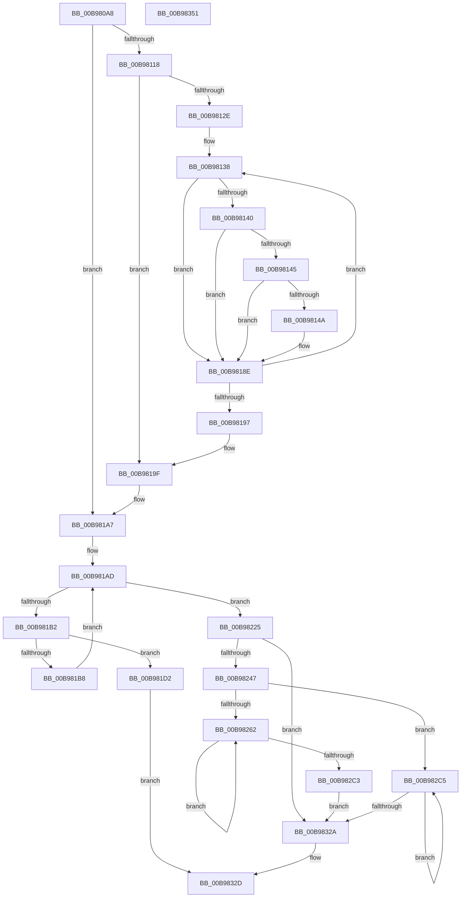

# ViAllocateMapRegistersFromFile

- RVA: `0x00B980A8`–`0x00B98352` (길이 `682` bytes)
- VA: `0x0000000140B980A8`
- 실행 섹션: `PAGEVRFY`
- PDB 이름 있음: `예`; PDB Function 태그: `아니요`
- unwind 정보 RVA: `0x000BECA4`
- 디코드: `181`개 명령, `682/682` bytes 표시
- 미해석 바이트: `0` (있으면 어셈블리에 `.byte`로 보존)

> 이 문서는 커널 이미지의 기계어와 PDB 기호를 분석해 생성했습니다. 4번과 5번은 함수 원형과 자료형을 바이너리 사용 방식에서 추정한 C 해석이며 원본 소스 복구 결과는 아닙니다.

## 1. Dependencies

- 직접 호출 지점: **8**; 고유 호출 대상: **5**
- 직접 호출자로 확인된 함수: **1**
- RIP 상대 이미지 참조: **4**

### Outgoing calls
- `0x00B98103` → [KeAcquireSpinLockRaiseToDpc](../../text/20/KeAcquireSpinLockRaiseToDpc_function_00208470.md) (function, `0x00208470`)
- `0x00B98167` → [ViHalPreprocessOptions](ViHalPreprocessOptions_function_00B9920C.md) (function, `0x00B9920C`)
- `0x00B98189` → [VfReportIssueWithOptions](../../text/61/VfReportIssueWithOptions_function_00614444.md) (function, `0x00614444`)
- `0x00B981FE` → [ViHalPreprocessOptions](ViHalPreprocessOptions_function_00B9920C.md) (function, `0x00B9920C`)
- `0x00B9821B` → [VfReportIssueWithOptions](../../text/61/VfReportIssueWithOptions_function_00614444.md) (function, `0x00614444`)
- `0x00B982A4` → [ViTagBuffer](ViTagBuffer_function_00B99F04.md) (function, `0x00B99F04`)
- `0x00B9830B` → [ViTagBuffer](ViTagBuffer_function_00B99F04.md) (function, `0x00B99F04`)
- `0x00B98339` → [KeReleaseSpinLock](../../text/39/KeReleaseSpinLock_function_00392BA0.md) (function, `0x00392BA0`)

### Direct callers
- [ViMapDoubleBuffer](ViMapDoubleBuffer_function_00B99640.md) at `0x00B99818`

### Static image references
- `0x00B9812E` → RVA `0x00E0E980` (`.data`; read)
- `0x00B9814F` → RVA `0x00BB9F80` (` ?? ::JKADOLAD::`string'`; read)
- `0x00B981D5` → RVA `0x00E0E97C` (`.data`; read)
- `0x00B981DE` → RVA `0x00BB9E40` (` ?? ::JKADOLAD::`string'`; read)

## 2. Other-region calls and transfers

- 다른 실행 섹션으로 향하는 call: **4**
  - `0x00B98103` → [KeAcquireSpinLockRaiseToDpc](../../text/20/KeAcquireSpinLockRaiseToDpc_function_00208470.md) (`PAGEVRFY` → `.text`)
  - `0x00B98189` → [VfReportIssueWithOptions](../../text/61/VfReportIssueWithOptions_function_00614444.md) (`PAGEVRFY` → `.text`)
  - `0x00B9821B` → [VfReportIssueWithOptions](../../text/61/VfReportIssueWithOptions_function_00614444.md) (`PAGEVRFY` → `.text`)
  - `0x00B98339` → [KeReleaseSpinLock](../../text/39/KeReleaseSpinLock_function_00392BA0.md) (`PAGEVRFY` → `.text`)
- 별도 외부 분기/꼬리 이동을 확인하지 못했습니다.

## 3. Assembly (complete function range)

```asm
00B980A8  44 88 4C 24 20                  mov byte ptr [rsp + 0x20], r9b
00B980AD  44 89 44 24 18                  mov dword ptr [rsp + 0x18], r8d
00B980B2  48 89 4C 24 08                  mov qword ptr [rsp + 8], rcx
00B980B7  53                              push rbx
00B980B8  55                              push rbp
00B980B9  56                              push rsi
00B980BA  57                              push rdi
00B980BB  41 54                           push r12
00B980BD  41 55                           push r13
00B980BF  41 56                           push r14
00B980C1  41 57                           push r15
00B980C3  48 83 EC 58                     sub rsp, 0x58
00B980C7  48 8B C2                        mov rax, rdx
00B980CA  45 8B F0                        mov r14d, r8d
00B980CD  25 FF 0F 00 00                  and eax, 0xfff
00B980D2  4C 8D 79 58                     lea r15, [rcx + 0x58]
00B980D6  48 8B E9                        mov rbp, rcx
00B980D9  33 F6                           xor esi, esi
00B980DB  48 8B DA                        mov rbx, rdx
00B980DE  44 8B E6                        mov r12d, esi
00B980E1  49 8D BE FF 0F 00 00            lea rdi, [r14 + 0xfff]
00B980E8  44 8B EE                        mov r13d, esi
00B980EB  48 03 F8                        add rdi, rax
00B980EE  48 8D 41 50                     lea rax, [rcx + 0x50]
00B980F2  48 C1 EF 0C                     shr rdi, 0xc
00B980F6  48 8B C8                        mov rcx, rax
00B980F9  48 89 7C 24 40                  mov qword ptr [rsp + 0x40], rdi
00B980FE  48 89 44 24 48                  mov qword ptr [rsp + 0x48], rax
00B98103  E8 68 03 67 FF                  call 0x140208470
00B98108  88 84 24 A8 00 00 00            mov byte ptr [rsp + 0xa8], al
00B9810F  39 75 20                        cmp dword ptr [rbp + 0x20], esi
00B98112  0F 84 8F 00 00 00               je 0x140b981a7
00B98118  8B 6D 1C                        mov ebp, dword ptr [rbp + 0x1c]
00B9811B  49 8D 04 1E                     lea rax, [r14 + rbx]
00B9811F  48 C1 E5 05                     shl rbp, 5
00B98123  4D 8B F7                        mov r14, r15
00B98126  49 03 EF                        add rbp, r15
00B98129  4C 3B FD                        cmp r15, rbp
00B9812C  73 71                           jae 0x140b9819f
00B9812E  4C 8D 25 4B 68 27 00            lea r12, [rip + 0x27684b]
00B98135  48 8B F8                        mov rdi, rax
00B98138  49 8B 06                        mov rax, qword ptr [r14]
00B9813B  48 85 C0                        test rax, rax
00B9813E  74 4E                           je 0x140b9818e
00B98140  48 3B C3                        cmp rax, rbx
00B98143  72 49                           jb 0x140b9818e
00B98145  48 3B C7                        cmp rax, rdi
00B98148  73 44                           jae 0x140b9818e
00B9814A  48 89 44 24 28                  mov qword ptr [rsp + 0x28], rax
00B9814F  48 8D 15 2A 1E 02 00            lea rdx, [rip + 0x21e2a]
00B98156  4C 8B CB                        mov r9, rbx
00B98159  48 89 7C 24 20                  mov qword ptr [rsp + 0x20], rdi
00B9815E  41 B8 1D 00 00 00               mov r8d, 0x1d
00B98164  49 8B CC                        mov rcx, r12
00B98167  E8 A0 10 00 00                  call 0x140b9920c
00B9816C  49 8B 06                        mov rax, qword ptr [r14]
00B9816F  4C 8B CF                        mov r9, rdi
00B98172  4C 89 64 24 28                  mov qword ptr [rsp + 0x28], r12
00B98177  4C 8B C3                        mov r8, rbx
00B9817A  BA 1D 00 00 00                  mov edx, 0x1d
00B9817F  48 89 44 24 20                  mov qword ptr [rsp + 0x20], rax
00B98184  B9 E6 00 00 00                  mov ecx, 0xe6
00B98189  E8 B6 C2 A7 FF                  call 0x140614444
00B9818E  49 83 C6 20                     add r14, 0x20
00B98192  4C 3B F5                        cmp r14, rbp
00B98195  72 A1                           jb 0x140b98138
00B98197  48 8B 7C 24 40                  mov rdi, qword ptr [rsp + 0x40]
00B9819C  44 8B E6                        mov r12d, esi
00B9819F  48 8B AC 24 A0 00 00 00         mov rbp, qword ptr [rsp + 0xa0]
00B981A7  41 BB 01 00 00 00               mov r11d, 1
00B981AD  44 3B EF                        cmp r13d, edi
00B981B0  73 73                           jae 0x140b98225
00B981B2  44 3B 65 1C                     cmp r12d, dword ptr [rbp + 0x1c]
00B981B6  74 1A                           je 0x140b981d2
00B981B8  49 8B 0F                        mov rcx, qword ptr [r15]
00B981BB  41 8D 45 01                     lea eax, [r13 + 1]
00B981BF  49 83 C7 20                     add r15, 0x20
00B981C3  45 03 E3                        add r12d, r11d
00B981C6  48 85 C9                        test rcx, rcx
00B981C9  44 8B EE                        mov r13d, esi
00B981CC  44 0F 44 E8                     cmove r13d, eax
00B981D0  EB DB                           jmp 0x140b981ad
00B981D2  41 8B DD                        mov ebx, r13d
00B981D5  48 8D 2D A0 67 27 00            lea rbp, [rip + 0x2767a0]
00B981DC  8B FF                           mov edi, edi
00B981DE  48 8D 15 5B 1C 02 00            lea rdx, [rip + 0x21c5b]
00B981E5  48 89 5C 24 28                  mov qword ptr [rsp + 0x28], rbx
00B981EA  48 8B CD                        mov rcx, rbp
00B981ED  41 B9 02 00 00 00               mov r9d, 2
00B981F3  48 89 7C 24 20                  mov qword ptr [rsp + 0x20], rdi
00B981F8  41 B8 00 00 00 10               mov r8d, 0x10000000
00B981FE  E8 09 10 00 00                  call 0x140b9920c
00B98203  33 D2                           xor edx, edx
00B98205  48 89 6C 24 28                  mov qword ptr [rsp + 0x28], rbp
00B9820A  44 8B CF                        mov r9d, edi
00B9820D  48 89 5C 24 20                  mov qword ptr [rsp + 0x20], rbx
00B98212  B9 E6 00 00 00                  mov ecx, 0xe6
00B98217  44 8D 42 02                     lea r8d, [rdx + 2]
00B9821B  E8 24 C2 A7 FF                  call 0x140614444
00B98220  E9 08 01 00 00                  jmp 0x140b9832d
00B98225  44 2B E7                        sub r12d, edi
00B98228  8B C7                           mov eax, edi
00B9822A  48 F7 D8                        neg rax
00B9822D  48 C1 E0 05                     shl rax, 5
00B98231  4C 03 F8                        add r15, rax
00B98234  48 8B 84 24 C0 00 00 00         mov rax, qword ptr [rsp + 0xc0]
00B9823C  44 89 20                        mov dword ptr [rax], r12d
00B9823F  85 FF                           test edi, edi
00B98241  0F 84 E3 00 00 00               je 0x140b9832a
00B98247  40 38 B4 24 B8 00 00 00         cmp byte ptr [rsp + 0xb8], sil
00B9824F  4D 8D 4F 08                     lea r9, [r15 + 8]
00B98253  44 8B 94 24 B0 00 00 00         mov r10d, dword ptr [rsp + 0xb0]
00B9825B  BE FF 0F 00 00                  mov esi, 0xfff
00B98260  74 63                           je 0x140b982c5
00B98262  8B C3                           mov eax, ebx
00B98264  49 89 59 F8                     mov qword ptr [r9 - 8], rbx
00B98268  23 C6                           and eax, esi
00B9826A  49 89 59 10                     mov qword ptr [r9 + 0x10], rbx
00B9826E  B9 00 10 00 00                  mov ecx, 0x1000
00B98273  45 89 59 04                     mov dword ptr [r9 + 4], r11d
00B98277  2B C8                           sub ecx, eax
00B98279  8B D3                           mov edx, ebx
00B9827B  41 3B CA                        cmp ecx, r10d
00B9827E  41 0F 43 CA                     cmovae ecx, r10d
00B98282  41 89 09                        mov dword ptr [r9], ecx
00B98285  F0 44 01 5D 20                  lock add dword ptr [rbp + 0x20], r11d
00B9828A  49 8B 49 08                     mov rcx, qword ptr [r9 + 8]
00B9828E  48 23 D6                        and rdx, rsi
00B98291  48 81 C1 00 10 00 00            add rcx, 0x1000
00B98298  41 B8 03 00 00 00               mov r8d, 3
00B9829E  48 03 CA                        add rcx, rdx
00B982A1  41 8B 11                        mov edx, dword ptr [r9]
00B982A4  E8 5B 1C 00 00                  call 0x140b99f04
00B982A9  45 2B 11                        sub r10d, dword ptr [r9]
00B982AC  48 81 C3 00 10 00 00            add rbx, 0x1000
00B982B3  48 81 E3 00 F0 FF FF            and rbx, 0xfffffffffffff000
00B982BA  4D 8D 49 20                     lea r9, [r9 + 0x20]
00B982BE  83 C7 FF                        add edi, -1
00B982C1  75 9F                           jne 0x140b98262
00B982C3  EB 65                           jmp 0x140b9832a
00B982C5  8B C3                           mov eax, ebx
00B982C7  49 89 59 F8                     mov qword ptr [r9 - 8], rbx
00B982CB  23 C6                           and eax, esi
00B982CD  49 89 59 10                     mov qword ptr [r9 + 0x10], rbx
00B982D1  B9 00 10 00 00                  mov ecx, 0x1000
00B982D6  41 C7 41 04 02 00 00 00         mov dword ptr [r9 + 4], 2
00B982DE  2B C8                           sub ecx, eax
00B982E0  8B D3                           mov edx, ebx
00B982E2  41 3B CA                        cmp ecx, r10d
00B982E5  41 0F 43 CA                     cmovae ecx, r10d
00B982E9  41 89 09                        mov dword ptr [r9], ecx
00B982EC  F0 44 01 5D 20                  lock add dword ptr [rbp + 0x20], r11d
00B982F1  49 8B 49 08                     mov rcx, qword ptr [r9 + 8]
00B982F5  48 23 D6                        and rdx, rsi
00B982F8  48 81 C1 00 10 00 00            add rcx, 0x1000
00B982FF  41 B8 03 00 00 00               mov r8d, 3
00B98305  48 03 CA                        add rcx, rdx
00B98308  41 8B 11                        mov edx, dword ptr [r9]
00B9830B  E8 F4 1B 00 00                  call 0x140b99f04
00B98310  45 2B 11                        sub r10d, dword ptr [r9]
00B98313  48 81 C3 00 10 00 00            add rbx, 0x1000
00B9831A  48 81 E3 00 F0 FF FF            and rbx, 0xfffffffffffff000
00B98321  4D 8D 49 20                     lea r9, [r9 + 0x20]
00B98325  83 C7 FF                        add edi, -1
00B98328  75 9B                           jne 0x140b982c5
00B9832A  41 8B F3                        mov esi, r11d
00B9832D  8A 94 24 A8 00 00 00            mov dl, byte ptr [rsp + 0xa8]
00B98334  48 8B 4C 24 48                  mov rcx, qword ptr [rsp + 0x48]
00B98339  E8 62 A8 7F FF                  call 0x140392ba0
00B9833E  8B C6                           mov eax, esi
00B98340  48 83 C4 58                     add rsp, 0x58
00B98344  41 5F                           pop r15
00B98346  41 5E                           pop r14
00B98348  41 5D                           pop r13
00B9834A  41 5C                           pop r12
00B9834C  5F                              pop rdi
00B9834D  5E                              pop rsi
00B9834E  5D                              pop rbp
00B9834F  5B                              pop rbx
00B98350  C3                              ret
00B98351  CC                              int3
```

## 4. C-style interpretation (structured pseudocode)

```c
__int64 __fastcall ViAllocateMapRegistersFromFile(__int64 a1, __int64 a2, int a3, unsigned __int8 a4, __int64 a5)
{
    __int64 result;
    __int64 v_r10;
    __int64 v_r12;
    __int64 v_r13;
    __int64 v_r14;
    __int64 v_r15;
    __int64 v_rbp;
    __int64 v_rbx;
    __int64 v_rdi;
    __int64 v_rsi;
    __int64 v_rsp;
    unsigned __int64 v_stack_m50;
    unsigned __int64 v_stack_m58;
    unsigned __int64 v_stack_m70;
    unsigned __int64 v_stack_m78;
    unsigned __int8 v_stack_p10;
    unsigned int v_stack_p18;
    unsigned __int8 v_stack_p20;
    unsigned __int64 v_stack_p8;

    v_stack_p20 = a4;
    v_stack_p18 = a3;
    v_stack_p8 = a1;
    v_rsp = (v_rsp) - (88);
    result = (unsigned int)((a2) & (0xFFFULL));
    v_rsi = 0;
    v_rdi = ((unsigned int)(a3) + 4095) + (result);
    v_rdi = (v_rdi) >> (12);
    v_stack_m58 = v_rdi;
    v_stack_m50 = a1 + 80;
    result = KeAcquireSpinLockRaiseToDpc(a1 + 80, a2, a3, a4);
    v_stack_p10 = (unsigned __int8)(result);
    if ((*(unsigned int *)(a1 + 32)) == 0) goto loc_00B981A7;
    v_rbp = ((unsigned int)(*(unsigned int *)(a1 + 28))) << (5);
    v_rbp = (v_rbp) + (a1 + 88);
    if ((a1 + 88) >= v_rbp) goto loc_00B9819F;
loc_00B98138:
    if (*(unsigned __int64 *)(a1 + 88) == 0) goto loc_00B9818E;
    if ((*(unsigned __int64 *)(a1 + 88)) < a2) goto loc_00B9818E;
    result = *(unsigned __int64 *)(a1 + 88);
    if ((*(unsigned __int64 *)(a1 + 88)) < ((unsigned int)(a3) + a2 * 1)) {
        v_stack_m70 = *(unsigned __int64 *)(a1 + 88);
        a2 = v_rip + 138794;
        a4 = a2;
        v_stack_m78 = (unsigned int)(a3) + a2 * 1;
        a3 = 29;
        a1 = v_rip + 2582603;
        result = ViHalPreprocessOptions(a1, a2, a3, a4);
        result = *(unsigned __int64 *)(a1 + 88);
        a4 = (unsigned int)(a3) + a2 * 1;
        v_stack_m70 = v_rip + 2582603;
        a3 = a2;
        a2 = 29;
        v_stack_m78 = result;
        a1 = 230;
        result = VfReportIssueWithOptions(a1, a2, a3, a4);
    }
    v_r14 = (a1 + 88) + (32);
    if (v_r14 < v_rbp) goto loc_00B98138;
loc_00B9819F:
loc_00B981A7:
loc_00B981AD:
    if (0 >= ((unsigned int)(v_stack_m58))) goto loc_00B98225;
    if (0 == (*(unsigned int *)(v_stack_p8 + 28))) goto loc_00B981D2;
    v_r15 = (a1 + 88) + (32);
    v_r12 = (unsigned int)((0) + (1));
    v_r13 = 0;
    if (*(unsigned __int64 *)(a1 + 88) == 0) { v_r13 = (unsigned int)(0 + 1); }
    goto loc_00B981AD;
loc_00B981D2:
    v_stack_m70 = (unsigned int)((unsigned int)(v_r13));
    v_stack_m78 = (unsigned int)((unsigned int)(v_stack_m58));
    result = ViHalPreprocessOptions(v_rip + 2582432, v_rip + 138331, (unsigned int)(0x10000000ULL), 2);
    a2 = 0;
    v_stack_m70 = v_rip + 2582432;
    v_stack_m78 = (unsigned int)((unsigned int)(v_r13));
    result = VfReportIssueWithOptions(230, a2, a2 + 2, (unsigned int)((unsigned int)((unsigned int)((unsigned int)(v_stack_m58)))));
    goto loc_00B9832D;
loc_00B98225:
    v_r12 = (unsigned int)((v_r12) - ((unsigned int)((unsigned int)((unsigned int)(v_stack_m58)))));
    result = -((unsigned int)((unsigned int)((unsigned int)((unsigned int)(v_stack_m58)))));
    result = (result) << (5);
    v_r15 = (v_r15) + (result);
    *(unsigned int *)(a5) = (unsigned int)(v_r12);
    if ((unsigned int)((unsigned int)((unsigned int)(v_stack_m58))) == 0) goto loc_00B9832A;
    if (v_stack_p20 == 0) goto loc_00B982C5;
loc_00B98262:
    *(unsigned __int64 *)(v_r15 + 8 - 8) = (unsigned int)((unsigned int)(v_r13));
    result = (unsigned int)(((unsigned int)((unsigned int)((unsigned int)((unsigned int)(v_r13))))) & ((unsigned int)((unsigned int)(0xFFFULL))));
    *(unsigned __int64 *)(v_r15 + 8 + 16) = (unsigned int)((unsigned int)(v_r13));
    *(unsigned int *)(v_r15 + 8 + 4) = 1;
    a1 = (unsigned int)(((unsigned int)(0x1000ULL)) - ((unsigned int)(result)));
    if (((unsigned int)(a1)) >= ((unsigned int)((unsigned int)(v_stack_p18)))) { a1 = (unsigned int)((unsigned int)(v_stack_p18)); }
    *(unsigned int *)(v_r15 + 8) = (unsigned int)(a1);
    a2 = ((unsigned int)((unsigned int)((unsigned int)((unsigned int)(v_r13))))) & ((unsigned int)(0xFFFULL));
    a1 = (*(unsigned __int64 *)(v_r15 + 8 + 8)) + (0x1000ULL);
    a1 = (a1) + (a2);
    result = ViTagBuffer(a1, (unsigned int)(*(unsigned int *)(v_r15 + 8)), 3, v_r15 + 8);
    v_r10 = (unsigned int)(((unsigned int)(v_stack_p18)) - (*(unsigned int *)(v_r15 + 8)));
    v_rbx = ((unsigned int)((unsigned int)(v_r13))) + (0x1000ULL);
    v_rbx = (v_rbx) & (0xFFFFFFFFFFFFF000ULL);
    v_rdi = (unsigned int)(((unsigned int)((unsigned int)(v_stack_m58))) + (-1));
    if (condition_is_not_equal) goto loc_00B98262;
    goto loc_00B9832A;
loc_00B982C5:
    *(unsigned __int64 *)(v_r15 + 8 + 32 - 8) = v_rbx;
    result = (unsigned int)(((unsigned int)((unsigned int)(v_rbx))) & ((unsigned int)((unsigned int)(0xFFFULL))));
    *(unsigned __int64 *)(v_r15 + 8 + 32 + 16) = v_rbx;
    *(unsigned int *)(v_r15 + 8 + 32 + 4) = 2;
    a1 = (unsigned int)(((unsigned int)(0x1000ULL)) - ((unsigned int)(result)));
    if (((unsigned int)(a1)) >= ((unsigned int)(v_r10))) { a1 = (unsigned int)(v_r10); }
    *(unsigned int *)(v_r15 + 8 + 32) = (unsigned int)(a1);
    a2 = ((unsigned int)((unsigned int)(v_rbx))) & ((unsigned int)(0xFFFULL));
    a1 = (*(unsigned __int64 *)(v_r15 + 8 + 32 + 8)) + (0x1000ULL);
    a1 = (a1) + (a2);
    result = ViTagBuffer(a1, (unsigned int)(*(unsigned int *)(v_r15 + 8 + 32)), 3, v_r15 + 8 + 32);
    v_r10 = (unsigned int)((v_r10) - (*(unsigned int *)(v_r15 + 8 + 32)));
    v_rbx = (v_rbx) + (0x1000ULL);
    v_rbx = (v_rbx) & (0xFFFFFFFFFFFFF000ULL);
    v_rdi = (unsigned int)((v_rdi) + (-1));
    if (condition_is_not_equal) goto loc_00B982C5;
loc_00B9832A:
loc_00B9832D:
    result = KeReleaseSpinLock(v_stack_m50, v_stack_p10, 3, v_r15 + 8 + 32 + 32);
    v_rsp = (v_rsp) + (88);
    return 1;
}
```

## 5. (Beta) C Style

```c
int64_t ViAllocateMapRegistersFromFile(void *Arg1, int64_t Arg2, void *Arg3, uint8_t Arg4, void *Arg5)
{
    uint8_t *arg1 = (uint8_t *)Arg1;
    uint8_t *arg3 = (uint8_t *)Arg3;
    uint8_t *arg5 = (uint8_t *)Arg5;

    int64_t result;
    int64_t local_r10;
    int64_t local_r12;
    int64_t local_r13;
    int64_t local_r14;
    int64_t local_r15;
    int64_t local_rbp;
    int64_t local_rbx;
    int64_t local_rdi;
    int64_t local_rsi;
    int64_t local_rsp;
    uint64_t v_stack_m50;
    uint64_t v_stack_m58;
    uint64_t v_stack_m70;
    uint64_t v_stack_m78;
    uint8_t v_stack_p10;
    uint32_t v_stack_p18;
    uint8_t v_stack_p20;
    uint64_t v_stack_p8;

    v_stack_p20 = Arg4;
    v_stack_p18 = Arg3;
    v_stack_p8 = Arg1;
    local_rsp = (local_rsp) - (88);
    result = (uint32_t)((Arg2) & (0xFFFULL));
    local_rsi = 0;
    local_rdi = ((uint32_t)(Arg3) + 4095) + (result);
    local_rdi = (local_rdi) >> (12);
    v_stack_m58 = local_rdi;
    v_stack_m50 = Arg1 + 80;
    result = KeAcquireSpinLockRaiseToDpc(Arg1 + 80, Arg2, Arg3, Arg4);
    v_stack_p10 = (uint8_t)(result);
    if ((*(uint32_t *)(arg1 + 0x20)) == 0) goto loc_00B981A7;
    local_rbp = ((uint32_t)(*(uint32_t *)(arg1 + 0x1C))) << (5);
    local_rbp = (local_rbp) + (Arg1 + 88);
    if ((Arg1 + 88) >= local_rbp) goto loc_00B9819F;
loc_00B98138:
    if (*(uint64_t *)(arg1 + 0x58) == 0) goto loc_00B9818E;
    if ((*(uint64_t *)(arg1 + 0x58)) < Arg2) goto loc_00B9818E;
    result = *(uint64_t *)(arg1 + 0x58);
    if ((*(uint64_t *)(arg1 + 0x58)) < ((uint32_t)(Arg3) + Arg2 * 1)) {
        v_stack_m70 = *(uint64_t *)(arg1 + 0x58);
        Arg2 = v_rip + 138794;
        Arg4 = Arg2;
        v_stack_m78 = (uint32_t)(Arg3) + Arg2 * 1;
        Arg3 = 29;
        Arg1 = v_rip + 2582603;
        result = ViHalPreprocessOptions(Arg1, Arg2, Arg3, Arg4);
        result = *(uint64_t *)(arg1 + 0x58);
        Arg4 = (uint32_t)(Arg3) + Arg2 * 1;
        v_stack_m70 = v_rip + 2582603;
        Arg3 = Arg2;
        Arg2 = 29;
        v_stack_m78 = result;
        Arg1 = 230;
        result = VfReportIssueWithOptions(Arg1, Arg2, Arg3, Arg4);
    }
    local_r14 = (Arg1 + 88) + (32);
    if (local_r14 < local_rbp) goto loc_00B98138;
loc_00B9819F:
loc_00B981A7:
loc_00B981AD:
    if (0 >= ((uint32_t)(v_stack_m58))) goto loc_00B98225;
    if (0 == (*(uint32_t *)(v_stack_p8 + 0x1C))) goto loc_00B981D2;
    local_r15 = (Arg1 + 88) + (32);
    local_r12 = (uint32_t)((0) + (1));
    local_r13 = 0;
    if (*(uint64_t *)(arg1 + 0x58) == 0) { local_r13 = (uint32_t)(0 + 1); }
    goto loc_00B981AD;
loc_00B981D2:
    v_stack_m70 = (uint32_t)((uint32_t)(local_r13));
    v_stack_m78 = (uint32_t)((uint32_t)(v_stack_m58));
    result = ViHalPreprocessOptions(v_rip + 2582432, v_rip + 138331, (uint32_t)(0x10000000ULL), 2);
    Arg2 = 0;
    v_stack_m70 = v_rip + 2582432;
    v_stack_m78 = (uint32_t)((uint32_t)(local_r13));
    result = VfReportIssueWithOptions(230, Arg2, Arg2 + 2, (uint32_t)((uint32_t)((uint32_t)((uint32_t)(v_stack_m58)))));
    goto loc_00B9832D;
loc_00B98225:
    local_r12 = (uint32_t)((local_r12) - ((uint32_t)((uint32_t)((uint32_t)(v_stack_m58)))));
    result = -((uint32_t)((uint32_t)((uint32_t)((uint32_t)(v_stack_m58)))));
    result = (result) << (5);
    local_r15 = (local_r15) + (result);
    *(uint32_t *)(arg5) = (uint32_t)(local_r12);
    if ((uint32_t)((uint32_t)((uint32_t)(v_stack_m58))) == 0) goto loc_00B9832A;
    if (v_stack_p20 == 0) goto loc_00B982C5;
loc_00B98262:
    *(uint64_t *)(local_r15 + 0x8 - 0x8) = (uint32_t)((uint32_t)(local_r13));
    result = (uint32_t)(((uint32_t)((uint32_t)((uint32_t)((uint32_t)(local_r13))))) & ((uint32_t)((uint32_t)(0xFFFULL))));
    *(uint64_t *)(local_r15 + 0x8 + 0x10) = (uint32_t)((uint32_t)(local_r13));
    *(uint32_t *)(local_r15 + 0x8 + 0x4) = 1;
    Arg1 = (uint32_t)(((uint32_t)(0x1000ULL)) - ((uint32_t)(result)));
    if (((uint32_t)(Arg1)) >= ((uint32_t)((uint32_t)(v_stack_p18)))) { Arg1 = (uint32_t)((uint32_t)(v_stack_p18)); }
    *(uint32_t *)(local_r15 + 0x8) = (uint32_t)(Arg1);
    Arg2 = ((uint32_t)((uint32_t)((uint32_t)((uint32_t)(local_r13))))) & ((uint32_t)(0xFFFULL));
    Arg1 = (*(uint64_t *)(local_r15 + 0x8 + 0x8)) + (0x1000ULL);
    Arg1 = (Arg1) + (Arg2);
    result = ViTagBuffer(Arg1, (uint32_t)(*(uint32_t *)(local_r15 + 0x8)), 3, local_r15 + 8);
    local_r10 = (uint32_t)(((uint32_t)(v_stack_p18)) - (*(uint32_t *)(local_r15 + 0x8)));
    local_rbx = ((uint32_t)((uint32_t)(local_r13))) + (0x1000ULL);
    local_rbx = (local_rbx) & (0xFFFFFFFFFFFFF000ULL);
    local_rdi = (uint32_t)(((uint32_t)((uint32_t)(v_stack_m58))) + (-1));
    if (condition_is_not_equal) goto loc_00B98262;
    goto loc_00B9832A;
loc_00B982C5:
    *(uint64_t *)(local_r15 + 0x8 + 0x20 - 0x8) = local_rbx;
    result = (uint32_t)(((uint32_t)((uint32_t)(local_rbx))) & ((uint32_t)((uint32_t)(0xFFFULL))));
    *(uint64_t *)(local_r15 + 0x8 + 0x20 + 0x10) = local_rbx;
    *(uint32_t *)(local_r15 + 0x8 + 0x20 + 0x4) = 2;
    Arg1 = (uint32_t)(((uint32_t)(0x1000ULL)) - ((uint32_t)(result)));
    if (((uint32_t)(Arg1)) >= ((uint32_t)(local_r10))) { Arg1 = (uint32_t)(local_r10); }
    *(uint32_t *)(local_r15 + 0x8 + 0x20) = (uint32_t)(Arg1);
    Arg2 = ((uint32_t)((uint32_t)(local_rbx))) & ((uint32_t)(0xFFFULL));
    Arg1 = (*(uint64_t *)(local_r15 + 0x8 + 0x20 + 0x8)) + (0x1000ULL);
    Arg1 = (Arg1) + (Arg2);
    result = ViTagBuffer(Arg1, (uint32_t)(*(uint32_t *)(local_r15 + 0x8 + 0x20)), 3, local_r15 + 8 + 32);
    local_r10 = (uint32_t)((local_r10) - (*(uint32_t *)(local_r15 + 0x8 + 0x20)));
    local_rbx = (local_rbx) + (0x1000ULL);
    local_rbx = (local_rbx) & (0xFFFFFFFFFFFFF000ULL);
    local_rdi = (uint32_t)((local_rdi) + (-1));
    if (condition_is_not_equal) goto loc_00B982C5;
loc_00B9832A:
loc_00B9832D:
    result = KeReleaseSpinLock(v_stack_m50, v_stack_p10, 3, local_r15 + 8 + 32 + 32);
    local_rsp = (local_rsp) + (88);
    return 1;
}
```

### 관측된 메모리 오프셋

구조체 형식이 확인되지 않은 접근은 인자 기준의 오프셋으로만 기록했습니다.

| 기준 인자 | 오프셋 표현 | 폭 (bit) | 접근 |
|---|---:|---:|---|
| `Arg1` | `+ 0x1C` | `32` | `R` |
| `Arg1` | `+ 0x20` | `32` | `R` |
| `Arg1` | `+ 0x50` | `64` | `R` |
| `Arg1` | `+ 0x58` | `64` | `R` |
| `Arg3` | `+ 0x0 + rbx*1` | `64` | `R` |
| `Arg3` | `+ 0xFFF` | `64` | `R` |
| `Arg5` | `+ 0x0` | `32` | `W` |

## 6. Execution-region graph

[열기: 2D/3D 그래프와 함수 탐색 컨트롤 패널](../../../control-panel.html?section=pagevrfy&rva=0x00B980A8&view=graph)

- 2D 그래프는 위에서 아래로 흐르고, 3D 그래프는 빈 공간을 드래그해 회전합니다. Shift+드래그는 이동, 휠은 확대·축소, 함수 노드 선택은 대상 보고서 이동입니다.

### Static fallback


