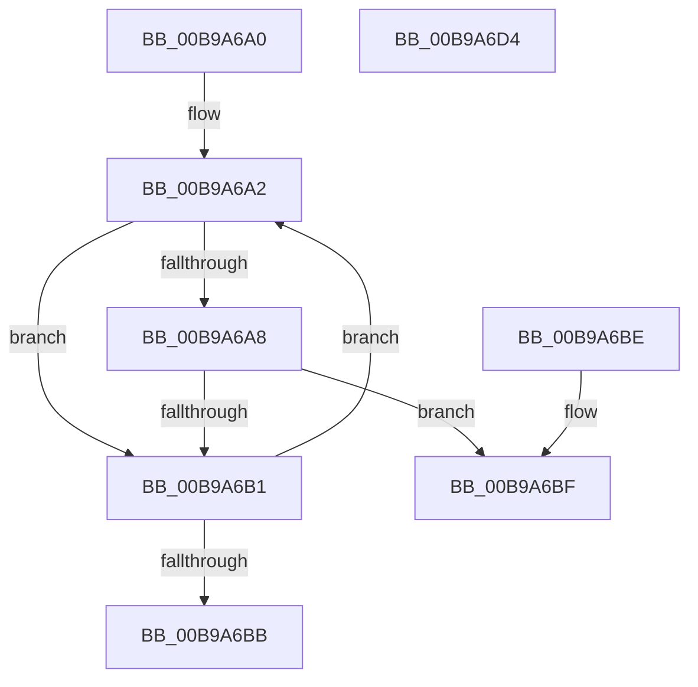

# ViBindDifThunkNormal

- RVA: `0x00B9A6A0`–`0x00B9A6D5` (길이 `53` bytes)
- VA: `0x0000000140B9A6A0`
- 실행 섹션: `PAGEVRFY`
- PDB 이름 있음: `예`; PDB Function 태그: `아니요`
- unwind 정보 RVA: `0x000DB714`
- 디코드: `20`개 명령, `53/53` bytes 표시
- 미해석 바이트: `0` (있으면 어셈블리에 `.byte`로 보존)

> 이 문서는 커널 이미지의 기계어와 PDB 기호를 분석해 생성했습니다. 4번과 5번은 함수 원형과 자료형을 바이너리 사용 방식에서 추정한 C 해석이며 원본 소스 복구 결과는 아닙니다.

## 1. Dependencies

- 직접 호출 지점: **0**; 고유 호출 대상: **0**
- 직접 호출자로 확인된 함수: **1**
- RIP 상대 이미지 참조: **0**

### Outgoing calls
- 직접 디코드된 call 명령이 없습니다.

### Direct callers
- [VfBindDifDDIWrappers](VfBindDifDDIWrappers_function_00B99F70.md) at `0x00B99F89`
- [VfBindDifDDIWrappers](VfBindDifDDIWrappers_function_00B99F70.md) at `0x00B99F9E`
- [VfBindDifDDIWrappers](VfBindDifDDIWrappers_function_00B99F70.md) at `0x00B99FB3`

### Static image references
- 디코드된 RIP-relative 메모리 참조가 없습니다.

## 2. Other-region calls and transfers

- 다른 실행 섹션으로 향하는 call: **0**
- 별도 외부 분기/꼬리 이동을 확인하지 못했습니다.

## 3. Assembly (complete function range)

```asm
00B9A6A0  66 90                           nop
00B9A6A2  44 39 41 30                     cmp dword ptr [rcx + 0x30], r8d
00B9A6A6  75 09                           jne 0x140b9a6b1
00B9A6A8  48 8B 41 28                     mov rax, qword ptr [rcx + 0x28]
00B9A6AC  48 85 C0                        test rax, rax
00B9A6AF  75 0E                           jne 0x140b9a6bf
00B9A6B1  48 83 C1 38                     add rcx, 0x38
00B9A6B5  48 83 39 00                     cmp qword ptr [rcx], 0
00B9A6B9  75 E7                           jne 0x140b9a6a2
00B9A6BB  32 C0                           xor al, al
00B9A6BD  C3                              ret
00B9A6BE  CC                              int3
00B9A6BF  4C 89 08                        mov qword ptr [rax], r9
00B9A6C2  B0 01                           mov al, 1
00B9A6C4  83 49 20 01                     or dword ptr [rcx + 0x20], 1
00B9A6C8  8B 51 20                        mov edx, dword ptr [rcx + 0x20]
00B9A6CB  48 8B 4C 24 28                  mov rcx, qword ptr [rsp + 0x28]
00B9A6D0  09 51 0C                        or dword ptr [rcx + 0xc], edx
00B9A6D3  C3                              ret
00B9A6D4  CC                              int3
```

## 4. C-style interpretation (structured pseudocode)

```c
__int64 __fastcall ViBindDifThunkNormal(__int64 a1, __int64 a2, int a3, __int64 a4, __int64 a5)
{
    __int64 result;

loc_00B9A6A2:
    if ((*(unsigned int *)(a1 + 48)) != a3) goto loc_00B9A6B1;
    if (*(unsigned __int64 *)(a1 + 40) != 0) goto loc_00B9A6BF;
loc_00B9A6B1:
    a1 = (a1) + (56);
    if ((*(unsigned __int64 *)(a1)) != 0) goto loc_00B9A6A2;
    result = 0;
    return result;
loc_00B9A6BF:
    *(unsigned __int64 *)(result) = a4;
    return 1;
}
```

## 5. (Beta) C Style

```c
int64_t ViBindDifThunkNormal(void *Arg1, int64_t Arg2, int32_t Arg3, int64_t Arg4, void *Arg5)
{
    uint8_t *arg1 = (uint8_t *)Arg1;
    uint8_t *arg5 = (uint8_t *)Arg5;

    int64_t result;

loc_00B9A6A2:
    if ((*(uint32_t *)(arg1 + 0x30)) != Arg3) goto loc_00B9A6B1;
    if (*(uint64_t *)(arg1 + 0x28) != 0) goto loc_00B9A6BF;
loc_00B9A6B1:
    Arg1 = (Arg1) + (56);
    if ((*(uint64_t *)(arg1)) != 0) goto loc_00B9A6A2;
    result = 0;
    return result;
loc_00B9A6BF:
    *(uint64_t *)(result) = Arg4;
    return 1;
}
```

### 관측된 메모리 오프셋

구조체 형식이 확인되지 않은 접근은 인자 기준의 오프셋으로만 기록했습니다.

| 기준 인자 | 오프셋 표현 | 폭 (bit) | 접근 |
|---|---:|---:|---|
| `Arg1` | `+ 0x0` | `64` | `R` |
| `Arg1` | `+ 0x20` | `32` | `R` |
| `Arg1` | `+ 0x20` | `32` | `R/W` |
| `Arg1` | `+ 0x28` | `64` | `R` |
| `Arg1` | `+ 0x30` | `32` | `R` |
| `Arg5` | `+ 0xC` | `32` | `R/W` |

## 6. Execution-region graph

[열기: 2D/3D 그래프와 함수 탐색 컨트롤 패널](../../../control-panel.html?section=pagevrfy&rva=0x00B9A6A0&view=graph)

- 2D 그래프는 위에서 아래로 흐르고, 3D 그래프는 빈 공간을 드래그해 회전합니다. Shift+드래그는 이동, 휠은 확대·축소, 함수 노드 선택은 대상 보고서 이동입니다.

### Static fallback


