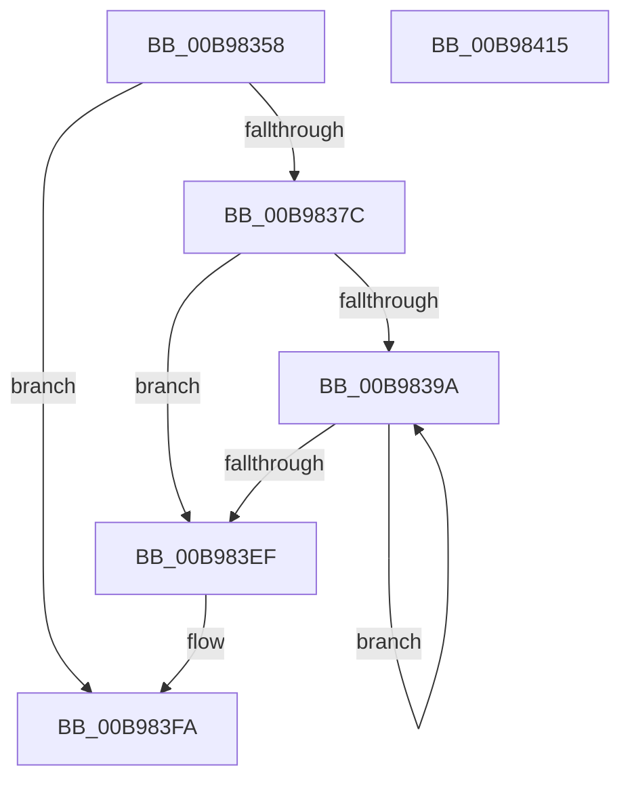

# ViCheckAdapterBuffers

- RVA: `0x00B98358`–`0x00B98416` (길이 `190` bytes)
- VA: `0x0000000140B98358`
- 실행 섹션: `PAGEVRFY`
- PDB 이름 있음: `예`; PDB Function 태그: `아니요`
- unwind 정보 RVA: `0x0005E6B4`
- 디코드: `52`개 명령, `190/190` bytes 표시
- 미해석 바이트: `0` (있으면 어셈블리에 `.byte`로 보존)

> 이 문서는 커널 이미지의 기계어와 PDB 기호를 분석해 생성했습니다. 4번과 5번은 함수 원형과 자료형을 바이너리 사용 방식에서 추정한 C 해석이며 원본 소스 복구 결과는 아닙니다.

## 1. Dependencies

- 직접 호출 지점: **3**; 고유 호출 대상: **3**
- 직접 호출자로 확인된 함수: **2**
- RIP 상대 이미지 참조: **0**

### Outgoing calls
- `0x00B98386` → [KeAcquireSpinLockRaiseToDpc](../../text/20/KeAcquireSpinLockRaiseToDpc_function_00208470.md) (function, `0x00208470`)
- `0x00B983DD` → [ViCheckTag](ViCheckTag_function_00B98614.md) (function, `0x00B98614`)
- `0x00B983F5` → [KeReleaseSpinLock](../../text/39/KeReleaseSpinLock_function_00392BA0.md) (function, `0x00392BA0`)

### Direct callers
- [VfMapTransfer](VfMapTransfer_function_00B97300.md) at `0x00B9736C`
- [VfMapTransferEx](VfMapTransferEx_function_00B974B0.md) at `0x00B9750A`

### Static image references
- 디코드된 RIP-relative 메모리 참조가 없습니다.

## 2. Other-region calls and transfers

- 다른 실행 섹션으로 향하는 call: **2**
  - `0x00B98386` → [KeAcquireSpinLockRaiseToDpc](../../text/20/KeAcquireSpinLockRaiseToDpc_function_00208470.md) (`PAGEVRFY` → `.text`)
  - `0x00B983F5` → [KeReleaseSpinLock](../../text/39/KeReleaseSpinLock_function_00392BA0.md) (`PAGEVRFY` → `.text`)
- 별도 외부 분기/꼬리 이동을 확인하지 못했습니다.

## 3. Assembly (complete function range)

```asm
00B98358  48 8B C4                        mov rax, rsp
00B9835B  48 89 58 08                     mov qword ptr [rax + 8], rbx
00B9835F  48 89 68 10                     mov qword ptr [rax + 0x10], rbp
00B98363  48 89 70 18                     mov qword ptr [rax + 0x18], rsi
00B98367  48 89 78 20                     mov qword ptr [rax + 0x20], rdi
00B9836B  41 56                           push r14
00B9836D  48 83 EC 20                     sub rsp, 0x20
00B98371  33 DB                           xor ebx, ebx
00B98373  48 8D 79 70                     lea rdi, [rcx + 0x70]
00B98377  48 39 3F                        cmp qword ptr [rdi], rdi
00B9837A  74 7E                           je 0x140b983fa
00B9837C  48 8D B1 80 00 00 00            lea rsi, [rcx + 0x80]
00B98383  48 8B CE                        mov rcx, rsi
00B98386  E8 E5 00 67 FF                  call 0x140208470
00B9838B  48 8B 0F                        mov rcx, qword ptr [rdi]
00B9838E  40 8A E8                        mov bpl, al
00B98391  4C 8D 71 D0                     lea r14, [rcx - 0x30]
00B98395  48 3B F9                        cmp rdi, rcx
00B98398  74 55                           je 0x140b983ef
00B9839A  49 8B 4E 18                     mov rcx, qword ptr [r14 + 0x18]
00B9839E  44 0F B7 CB                     movzx r9d, bx
00B983A2  41 8B 56 08                     mov edx, dword ptr [r14 + 8]
00B983A6  66 41 83 C9 01                  or r9w, 1
00B983AB  41 8B 46 04                     mov eax, dword ptr [r14 + 4]
00B983AF  4C 8B C1                        mov r8, rcx
00B983B2  4D 2B 46 10                     sub r8, qword ptr [r14 + 0x10]
00B983B6  49 83 F8 08                     cmp r8, 8
00B983BA  66 44 0F 42 CB                  cmovb r9w, bx
00B983BF  49 83 C0 08                     add r8, 8
00B983C3  41 0F B7 D9                     movzx ebx, r9w
00B983C7  4C 03 C2                        add r8, rdx
00B983CA  66 83 CB 02                     or bx, 2
00B983CE  4C 3B C0                        cmp r8, rax
00B983D1  66 41 0F 47 D9                  cmova bx, r9w
00B983D6  45 33 C0                        xor r8d, r8d
00B983D9  44 0F B7 CB                     movzx r9d, bx
00B983DD  E8 32 02 00 00                  call 0x140b98614
00B983E2  49 8B 46 30                     mov rax, qword ptr [r14 + 0x30]
00B983E6  4C 8D 70 D0                     lea r14, [rax - 0x30]
00B983EA  48 3B F8                        cmp rdi, rax
00B983ED  75 AB                           jne 0x140b9839a
00B983EF  40 8A D5                        mov dl, bpl
00B983F2  48 8B CE                        mov rcx, rsi
00B983F5  E8 A6 A7 7F FF                  call 0x140392ba0
00B983FA  48 8B 5C 24 30                  mov rbx, qword ptr [rsp + 0x30]
00B983FF  48 8B 6C 24 38                  mov rbp, qword ptr [rsp + 0x38]
00B98404  48 8B 74 24 40                  mov rsi, qword ptr [rsp + 0x40]
00B98409  48 8B 7C 24 48                  mov rdi, qword ptr [rsp + 0x48]
00B9840E  48 83 C4 20                     add rsp, 0x20
00B98412  41 5E                           pop r14
00B98414  C3                              ret
00B98415  CC                              int3
```

## 4. C-style interpretation (structured pseudocode)

```c
__int64 __fastcall ViCheckAdapterBuffers(__int64 a1)
{
    __int64 result;
    __int64 v_rbx;
    __int64 v_rsp;
    unsigned __int64 v_stack_p10;
    unsigned __int64 v_stack_p18;
    unsigned __int64 v_stack_p20;
    unsigned __int64 v_stack_p8;

    *(unsigned __int64 *)(v_rsp + 8) = v_rbx;
    *(unsigned __int64 *)(v_rsp + 16) = v_rbp;
    *(unsigned __int64 *)(v_rsp + 24) = v_rsi;
    *(unsigned __int64 *)(v_rsp + 32) = v_rdi;
    v_rsp = (v_rsp) - (32);
    v_rbx = 0;
    if ((*(unsigned __int64 *)(a1 + 112)) == (a1 + 112)) goto loc_00B983FA;
    result = KeAcquireSpinLockRaiseToDpc(a1 + 128, a2, a3, a4);
    if ((a1 + 112) == (*(unsigned __int64 *)(a1 + 112))) goto loc_00B983EF;
loc_00B9839A:
    a4 = (unsigned __int16)((0) | (1));
    a3 = (*(unsigned __int64 *)(*(unsigned __int64 *)(a1 + 112) - 48 + 24)) - (*(unsigned __int64 *)(*(unsigned __int64 *)(a1 + 112) - 48 + 16));
    if (a3 < 8) { a4 = 0; }
    a3 = (a3) + (8);
    a3 = (a3) + ((unsigned int)(*(unsigned int *)(*(unsigned __int64 *)(a1 + 112) - 48 + 8)));
    v_rbx = (unsigned __int16)(((unsigned __int16)(a4)) | (2));
    if (a3 > ((unsigned int)(*(unsigned int *)(*(unsigned __int64 *)(a1 + 112) - 48 + 4)))) { v_rbx = (unsigned __int16)(a4); }
    a3 = 0;
    result = ViCheckTag(*(unsigned __int64 *)(*(unsigned __int64 *)(a1 + 112) - 48 + 24), (unsigned int)(*(unsigned int *)(*(unsigned __int64 *)(a1 + 112) - 48 + 8)), a3, (unsigned __int16)(v_rbx));
    if ((a1 + 112) != (*(unsigned __int64 *)(*(unsigned __int64 *)(a1 + 112) - 48 + 48))) goto loc_00B9839A;
loc_00B983EF:
    result = KeReleaseSpinLock(a1 + 128, (unsigned __int8)((unsigned __int8)(result)), a3, (unsigned __int16)(v_rbx));
loc_00B983FA:
    v_rsp = (v_rsp) + (32);
    return result;
}
```

## 5. (Beta) C Style

```c
int64_t ViCheckAdapterBuffers(void *Arg1)
{
    uint8_t *arg1 = (uint8_t *)Arg1;

    int64_t result;
    int64_t local_rbx;
    int64_t local_rsp;
    uint64_t v_stack_p10;
    uint64_t v_stack_p18;
    uint64_t v_stack_p20;
    uint64_t v_stack_p8;

    *(uint64_t *)(local_rsp + 0x8) = local_rbx;
    *(uint64_t *)(local_rsp + 0x10) = local_rbp;
    *(uint64_t *)(local_rsp + 0x18) = local_rsi;
    *(uint64_t *)(local_rsp + 0x20) = local_rdi;
    local_rsp = (local_rsp) - (32);
    local_rbx = 0;
    if ((*(uint64_t *)(arg1 + 0x70)) == (Arg1 + 112)) goto loc_00B983FA;
    result = KeAcquireSpinLockRaiseToDpc(Arg1 + 128, a2, a3, a4);
    if ((Arg1 + 112) == (*(uint64_t *)(arg1 + 0x70))) goto loc_00B983EF;
loc_00B9839A:
    a4 = (uint16_t)((0) | (1));
    a3 = (*(uint64_t *)(*(uint64_t *)(arg1 + 0x70) - 0x30 + 0x18)) - (*(uint64_t *)(*(uint64_t *)(arg1 + 0x70) - 0x30 + 0x10));
    if (a3 < 8) { a4 = 0; }
    a3 = (a3) + (8);
    a3 = (a3) + ((uint32_t)(*(uint32_t *)(*(uint64_t *)(arg1 + 0x70) - 0x30 + 0x8)));
    local_rbx = (uint16_t)(((uint16_t)(a4)) | (2));
    if (a3 > ((uint32_t)(*(uint32_t *)(*(uint64_t *)(arg1 + 0x70) - 0x30 + 0x4)))) { local_rbx = (uint16_t)(a4); }
    a3 = 0;
    result = ViCheckTag(*(uint64_t *)(*(uint64_t *)(arg1 + 0x70) - 0x30 + 0x18), (uint32_t)(*(uint32_t *)(*(uint64_t *)(arg1 + 0x70) - 0x30 + 0x8)), a3, (uint16_t)(local_rbx));
    if ((Arg1 + 112) != (*(uint64_t *)(*(uint64_t *)(arg1 + 0x70) - 0x30 + 0x30))) goto loc_00B9839A;
loc_00B983EF:
    result = KeReleaseSpinLock(Arg1 + 128, (uint8_t)((uint8_t)(result)), a3, (uint16_t)(local_rbx));
loc_00B983FA:
    local_rsp = (local_rsp) + (32);
    return result;
}
```

### 관측된 메모리 오프셋

구조체 형식이 확인되지 않은 접근은 인자 기준의 오프셋으로만 기록했습니다.

| 기준 인자 | 오프셋 표현 | 폭 (bit) | 접근 |
|---|---:|---:|---|
| `Arg1` | `+ 0x0` | `64` | `R` |
| `Arg1` | `+ 0x70` | `64` | `R` |
| `Arg1` | `+ 0x80` | `64` | `R` |

## 6. Execution-region graph

[열기: 2D/3D 그래프와 함수 탐색 컨트롤 패널](../../../control-panel.html?section=pagevrfy&rva=0x00B98358&view=graph)

- 2D 그래프는 위에서 아래로 흐르고, 3D 그래프는 빈 공간을 드래그해 회전합니다. Shift+드래그는 이동, 휠은 확대·축소, 함수 노드 선택은 대상 보고서 이동입니다.

### Static fallback


