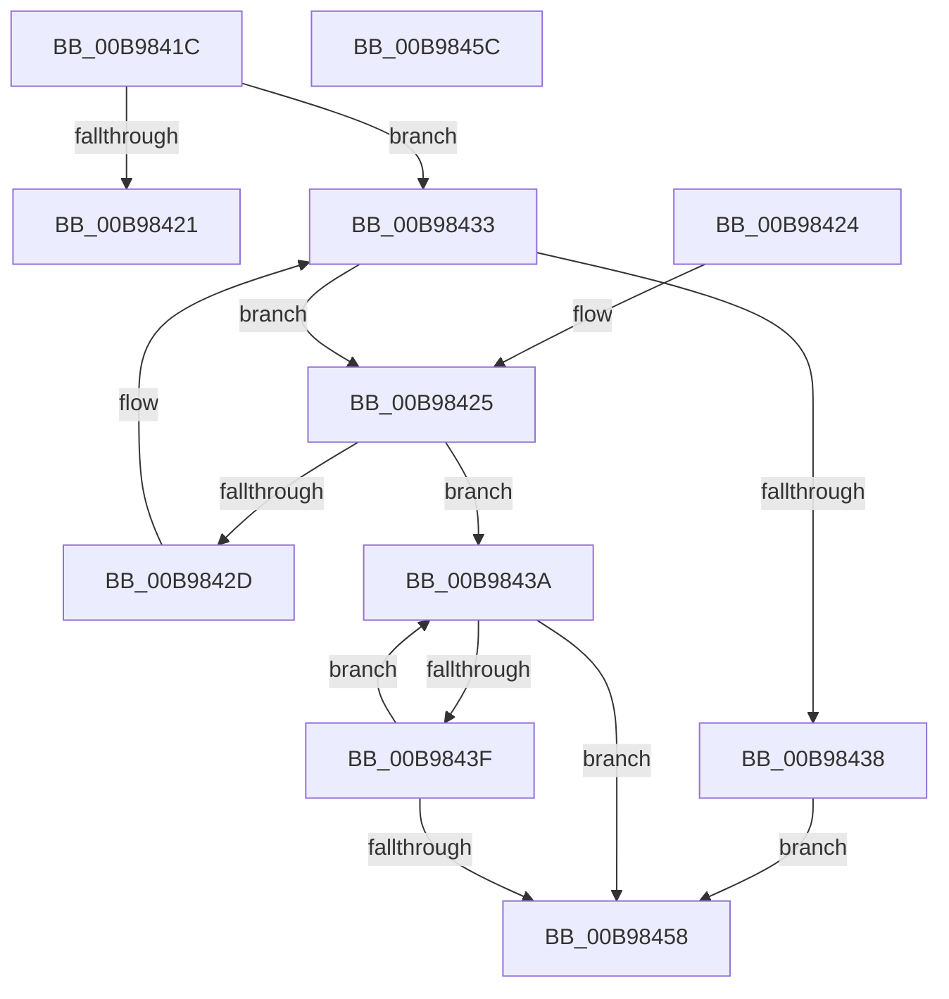

# ViCheckMdlLength

- RVA: `0x00B9841C`–`0x00B9845D` (길이 `65` bytes)
- VA: `0x0000000140B9841C`
- 실행 섹션: `PAGEVRFY`
- PDB 이름 있음: `예`; PDB Function 태그: `아니요`
- unwind 정보 RVA: `0x000DB714`
- 디코드: `27`개 명령, `65/65` bytes 표시
- 미해석 바이트: `0` (있으면 어셈블리에 `.byte`로 보존)

> 이 문서는 커널 이미지의 기계어와 PDB 기호를 분석해 생성했습니다. 4번과 5번은 함수 원형과 자료형을 바이너리 사용 방식에서 추정한 C 해석이며 원본 소스 복구 결과는 아닙니다.

## 1. Dependencies

- 직접 호출 지점: **0**; 고유 호출 대상: **0**
- 직접 호출자로 확인된 함수: **6**
- RIP 상대 이미지 참조: **0**

### Outgoing calls
- 직접 디코드된 call 명령이 없습니다.

### Direct callers
- [VfBuildScatterGatherList](VfBuildScatterGatherList_function_00B95AA0.md) at `0x00B95B3A`
- [VfBuildScatterGatherListEx](VfBuildScatterGatherListEx_function_00B95DA0.md) at `0x00B95E2D`
- [VfGetScatterGatherList](VfGetScatterGatherList_function_00B96BD0.md) at `0x00B96C67`
- [VfGetScatterGatherListEx](VfGetScatterGatherListEx_function_00B96F20.md) at `0x00B96F95`
- [VfMapTransfer](VfMapTransfer_function_00B97300.md) at `0x00B97382`
- [VfMapTransferEx](VfMapTransferEx_function_00B974B0.md) at `0x00B97518`

### Static image references
- 디코드된 RIP-relative 메모리 참조가 없습니다.

## 2. Other-region calls and transfers

- 다른 실행 섹션으로 향하는 call: **0**
- 별도 외부 분기/꼬리 이동을 확인하지 못했습니다.

## 3. Assembly (complete function range)

```asm
00B9841C  45 85 C0                        test r8d, r8d
00B9841F  75 12                           jne 0x140b98433
00B98421  33 C0                           xor eax, eax
00B98423  C3                              ret
00B98424  CC                              int3
00B98425  8B 41 28                        mov eax, dword ptr [rcx + 0x28]
00B98428  48 3B D0                        cmp rdx, rax
00B9842B  76 0D                           jbe 0x140b9843a
00B9842D  48 8B 09                        mov rcx, qword ptr [rcx]
00B98430  48 2B D0                        sub rdx, rax
00B98433  48 85 C9                        test rcx, rcx
00B98436  75 ED                           jne 0x140b98425
00B98438  EB 1E                           jmp 0x140b98458
00B9843A  45 85 C0                        test r8d, r8d
00B9843D  74 19                           je 0x140b98458
00B9843F  8B 41 28                        mov eax, dword ptr [rcx + 0x28]
00B98442  48 8B 09                        mov rcx, qword ptr [rcx]
00B98445  2B C2                           sub eax, edx
00B98447  41 3B C0                        cmp eax, r8d
00B9844A  41 0F 43 C0                     cmovae eax, r8d
00B9844E  33 D2                           xor edx, edx
00B98450  44 2B C0                        sub r8d, eax
00B98453  48 85 C9                        test rcx, rcx
00B98456  75 E2                           jne 0x140b9843a
00B98458  41 8B C0                        mov eax, r8d
00B9845B  C3                              ret
00B9845C  CC                              int3
```

## 4. C-style interpretation (structured pseudocode)

```c
__int64 __fastcall ViCheckMdlLength(__int64 a1, __int64 a2, int a3)
{
    __int64 result;

    if (a3 != 0) goto loc_00B98433;
    result = 0;
    return result;
loc_00B98425:
    if (a2 <= ((unsigned int)(*(unsigned int *)(a1 + 40)))) goto loc_00B9843A;
    a2 = (a2) - ((unsigned int)(*(unsigned int *)(a1 + 40)));
loc_00B98433:
    if (*(unsigned __int64 *)(a1) != 0) goto loc_00B98425;
    goto loc_00B98458;
loc_00B9843A:
    if (a3 == 0) goto loc_00B98458;
    result = (unsigned int)(((unsigned int)(*(unsigned int *)(*(unsigned __int64 *)(a1) + 40))) - ((unsigned int)(a2)));
    if (((unsigned int)(result)) >= a3) { result = a3; }
    a2 = 0;
    a3 = (unsigned int)((a3) - ((unsigned int)(result)));
    if (*(unsigned __int64 *)(*(unsigned __int64 *)(a1)) != 0) goto loc_00B9843A;
loc_00B98458:
    return (unsigned int)(a3);
}
```

## 5. (Beta) C Style

```c
int64_t ViCheckMdlLength(int64_t Arg1, int64_t Arg2, int32_t Arg3)
{
    int64_t result;

    if (Arg3 != 0) goto loc_00B98433;
    result = 0;
    return result;
loc_00B98425:
    if (Arg2 <= ((uint32_t)(*(uint32_t *)(Arg1 + 0x28)))) goto loc_00B9843A;
    Arg2 = (Arg2) - ((uint32_t)(*(uint32_t *)(Arg1 + 0x28)));
loc_00B98433:
    if (*(uint64_t *)(Arg1) != 0) goto loc_00B98425;
    goto loc_00B98458;
loc_00B9843A:
    if (Arg3 == 0) goto loc_00B98458;
    result = (uint32_t)(((uint32_t)(*(uint32_t *)(*(uint64_t *)(Arg1) + 0x28))) - ((uint32_t)(Arg2)));
    if (((uint32_t)(result)) >= Arg3) { result = Arg3; }
    Arg2 = 0;
    Arg3 = (uint32_t)((Arg3) - ((uint32_t)(result)));
    if (*(uint64_t *)(*(uint64_t *)(Arg1)) != 0) goto loc_00B9843A;
loc_00B98458:
    return (uint32_t)(Arg3);
}
```

## 6. Execution-region graph

[열기: 2D/3D 그래프와 함수 탐색 컨트롤 패널](../../../control-panel.html?section=pagevrfy&rva=0x00B9841C&view=graph)

- 2D 그래프는 위에서 아래로 흐르고, 3D 그래프는 빈 공간을 드래그해 회전합니다. Shift+드래그는 이동, 휠은 확대·축소, 함수 노드 선택은 대상 보고서 이동입니다.

### Static fallback


