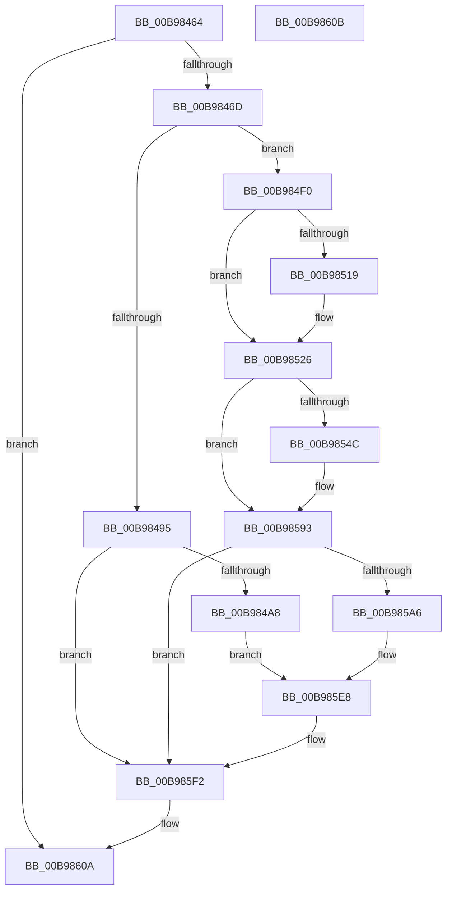

# ViCheckPadding

- RVA: `0x00B98464`–`0x00B9860C` (길이 `424` bytes)
- VA: `0x0000000140B98464`
- 실행 섹션: `PAGEVRFY`
- PDB 이름 있음: `예`; PDB Function 태그: `아니요`
- unwind 정보 RVA: `0x000D2278`
- 디코드: `107`개 명령, `424/424` bytes 표시
- 미해석 바이트: `0` (있으면 어셈블리에 `.byte`로 보존)

> 이 문서는 커널 이미지의 기계어와 PDB 기호를 분석해 생성했습니다. 4번과 5번은 함수 원형과 자료형을 바이너리 사용 방식에서 추정한 C 해석이며 원본 소스 복구 결과는 아닙니다.

## 1. Dependencies

- 직접 호출 지점: **9**; 고유 호출 대상: **4**
- 직접 호출자로 확인된 함수: **2**
- RIP 상대 이미지 참조: **6**

### Outgoing calls
- `0x00B98497` → [ViHasBufferBeenTouched](ViHasBufferBeenTouched_function_00B99360.md) (function, `0x00B99360`)
- `0x00B984D2` → [ViHalPreprocessOptions](ViHalPreprocessOptions_function_00B9920C.md) (function, `0x00B9920C`)
- `0x00B9852F` → [ViCheckTag](ViCheckTag_function_00B98614.md) (function, `0x00B98614`)
- `0x00B9853A` → [ViHasBufferBeenTouched](ViHasBufferBeenTouched_function_00B99360.md) (function, `0x00B99360`)
- `0x00B98571` → [ViHalPreprocessOptions](ViHalPreprocessOptions_function_00B9920C.md) (function, `0x00B9920C`)
- `0x00B9858E` → [VfReportIssueWithOptions](../../text/61/VfReportIssueWithOptions_function_00614444.md) (function, `0x00614444`)
- `0x00B98599` → [ViHasBufferBeenTouched](ViHasBufferBeenTouched_function_00B99360.md) (function, `0x00B99360`)
- `0x00B985D0` → [ViHalPreprocessOptions](ViHalPreprocessOptions_function_00B9920C.md) (function, `0x00B9920C`)
- `0x00B985ED` → [VfReportIssueWithOptions](../../text/61/VfReportIssueWithOptions_function_00614444.md) (function, `0x00614444`)

### Direct callers
- [ViFreeMapRegisterFile](ViFreeMapRegisterFile_function_00B98B8C.md) at `0x00B98C73`
- [ViSpecialFreeCommonBuffer](ViSpecialFreeCommonBuffer_function_00B99D2C.md) at `0x00B99DC6`

### Static image references
- `0x00B984AE` → RVA `0x00E0E96C` (`.data`; read)
- `0x00B984C2` → RVA `0x00BB9E70` (` ?? ::JKADOLAD::`string'`; read)
- `0x00B98551` → RVA `0x00E0E978` (`.data`; read)
- `0x00B9856A` → RVA `0x00BBA380` (` ?? ::JKADOLAD::`string'`; read)
- `0x00B985AB` → RVA `0x00E0E974` (`.data`; read)
- `0x00B985C0` → RVA `0x00BBA330` (` ?? ::JKADOLAD::`string'`; read)

## 2. Other-region calls and transfers

- 다른 실행 섹션으로 향하는 call: **2**
  - `0x00B9858E` → [VfReportIssueWithOptions](../../text/61/VfReportIssueWithOptions_function_00614444.md) (`PAGEVRFY` → `.text`)
  - `0x00B985ED` → [VfReportIssueWithOptions](../../text/61/VfReportIssueWithOptions_function_00614444.md) (`PAGEVRFY` → `.text`)
- 별도 외부 분기/꼬리 이동을 확인하지 못했습니다.

## 3. Assembly (complete function range)

```asm
00B98464  44 3B CA                        cmp r9d, edx
00B98467  0F 84 9D 01 00 00               je 0x140b9860a
00B9846D  48 89 5C 24 08                  mov qword ptr [rsp + 8], rbx
00B98472  48 89 6C 24 10                  mov qword ptr [rsp + 0x10], rbp
00B98477  48 89 74 24 18                  mov qword ptr [rsp + 0x18], rsi
00B9847C  57                              push rdi
00B9847D  41 56                           push r14
00B9847F  41 57                           push r15
00B98481  48 83 EC 30                     sub rsp, 0x30
00B98485  45 8B D1                        mov r10d, r9d
00B98488  49 8B F8                        mov rdi, r8
00B9848B  8B DA                           mov ebx, edx
00B9848D  48 8B E9                        mov rbp, rcx
00B98490  45 85 C9                        test r9d, r9d
00B98493  75 5B                           jne 0x140b984f0
00B98495  8B D3                           mov edx, ebx
00B98497  E8 C4 0E 00 00                  call 0x140b99360
00B9849C  48 8B D8                        mov rbx, rax
00B9849F  48 85 C0                        test rax, rax
00B984A2  0F 84 4A 01 00 00               je 0x140b985f2
00B984A8  48 83 64 24 28 00               and qword ptr [rsp + 0x28], 0
00B984AE  48 8D 3D B7 64 27 00            lea rdi, [rip + 0x2764b7]
00B984B5  BE 03 00 00 00                  mov esi, 3
00B984BA  48 89 44 24 20                  mov qword ptr [rsp + 0x20], rax
00B984BF  44 8B CE                        mov r9d, esi
00B984C2  48 8D 15 A7 19 02 00            lea rdx, [rip + 0x219a7]
00B984C9  48 8B CF                        mov rcx, rdi
00B984CC  41 B8 0F 00 00 10               mov r8d, 0x1000000f
00B984D2  E8 35 0D 00 00                  call 0x140b9920c
00B984D7  48 89 7C 24 28                  mov qword ptr [rsp + 0x28], rdi
00B984DC  8D 56 0C                        lea edx, [rsi + 0xc]
00B984DF  48 83 64 24 20 00               and qword ptr [rsp + 0x20], 0
00B984E5  4C 8B CB                        mov r9, rbx
00B984E8  44 8B C6                        mov r8d, esi
00B984EB  E9 F8 00 00 00                  jmp 0x140b985e8
00B984F0  45 33 C9                        xor r9d, r9d
00B984F3  4B 8D 34 10                     lea rsi, [r8 + r10]
00B984F7  48 2B DE                        sub rbx, rsi
00B984FA  48 8B C7                        mov rax, rdi
00B984FD  48 2B C5                        sub rax, rbp
00B98500  48 03 DD                        add rbx, rbp
00B98503  48 83 F8 08                     cmp rax, 8
00B98507  41 0F 93 C1                     setae r9b
00B9850B  4C 8D 70 F8                     lea r14, [rax - 8]
00B9850F  4C 0F 42 F0                     cmovb r14, rax
00B98513  48 83 FB 08                     cmp rbx, 8
00B98517  72 0D                           jb 0x140b98526
00B98519  48 83 EB 08                     sub rbx, 8
00B9851D  48 83 C6 08                     add rsi, 8
00B98521  66 41 83 C9 02                  or r9w, 2
00B98526  45 33 C0                        xor r8d, r8d
00B98529  41 8B D2                        mov edx, r10d
00B9852C  48 8B CF                        mov rcx, rdi
00B9852F  E8 E0 00 00 00                  call 0x140b98614
00B98534  49 8B D6                        mov rdx, r14
00B98537  48 8B CD                        mov rcx, rbp
00B9853A  E8 21 0E 00 00                  call 0x140b99360
00B9853F  4C 8B F0                        mov r14, rax
00B98542  BD 0F 00 00 00                  mov ebp, 0xf
00B98547  48 85 C0                        test rax, rax
00B9854A  74 47                           je 0x140b98593
00B9854C  48 89 44 24 28                  mov qword ptr [rsp + 0x28], rax
00B98551  4C 8D 3D 20 64 27 00            lea r15, [rip + 0x276420]
00B98558  49 8B CF                        mov rcx, r15
00B9855B  48 89 7C 24 20                  mov qword ptr [rsp + 0x20], rdi
00B98560  44 8D 4D F5                     lea r9d, [rbp - 0xb]
00B98564  41 B8 0F 00 00 10               mov r8d, 0x1000000f
00B9856A  48 8D 15 0F 1E 02 00            lea rdx, [rip + 0x21e0f]
00B98571  E8 96 0C 00 00                  call 0x140b9920c
00B98576  4C 8B CF                        mov r9, rdi
00B98579  4C 89 7C 24 28                  mov qword ptr [rsp + 0x28], r15
00B9857E  44 8D 45 F5                     lea r8d, [rbp - 0xb]
00B98582  4C 89 74 24 20                  mov qword ptr [rsp + 0x20], r14
00B98587  8B D5                           mov edx, ebp
00B98589  B9 E6 00 00 00                  mov ecx, 0xe6
00B9858E  E8 B1 BE A7 FF                  call 0x140614444
00B98593  48 8B D3                        mov rdx, rbx
00B98596  48 8B CE                        mov rcx, rsi
00B98599  E8 C2 0D 00 00                  call 0x140b99360
00B9859E  48 8B D8                        mov rbx, rax
00B985A1  48 85 C0                        test rax, rax
00B985A4  74 4C                           je 0x140b985f2
00B985A6  48 89 44 24 28                  mov qword ptr [rsp + 0x28], rax
00B985AB  48 8D 35 C2 63 27 00            lea rsi, [rip + 0x2763c2]
00B985B2  41 BE 05 00 00 00               mov r14d, 5
00B985B8  48 89 7C 24 20                  mov qword ptr [rsp + 0x20], rdi
00B985BD  45 8B CE                        mov r9d, r14d
00B985C0  48 8D 15 69 1D 02 00            lea rdx, [rip + 0x21d69]
00B985C7  48 8B CE                        mov rcx, rsi
00B985CA  41 B8 0F 00 00 10               mov r8d, 0x1000000f
00B985D0  E8 37 0C 00 00                  call 0x140b9920c
00B985D5  48 89 74 24 28                  mov qword ptr [rsp + 0x28], rsi
00B985DA  4C 8B CF                        mov r9, rdi
00B985DD  48 89 5C 24 20                  mov qword ptr [rsp + 0x20], rbx
00B985E2  45 8B C6                        mov r8d, r14d
00B985E5  48 8B D5                        mov rdx, rbp
00B985E8  B9 E6 00 00 00                  mov ecx, 0xe6
00B985ED  E8 52 BE A7 FF                  call 0x140614444
00B985F2  48 8B 5C 24 50                  mov rbx, qword ptr [rsp + 0x50]
00B985F7  48 8B 6C 24 58                  mov rbp, qword ptr [rsp + 0x58]
00B985FC  48 8B 74 24 60                  mov rsi, qword ptr [rsp + 0x60]
00B98601  48 83 C4 30                     add rsp, 0x30
00B98605  41 5F                           pop r15
00B98607  41 5E                           pop r14
00B98609  5F                              pop rdi
00B9860A  C3                              ret
00B9860B  CC                              int3
```

## 4. C-style interpretation (structured pseudocode)

```c
__int64 __fastcall ViCheckPadding(__int64 a1, int a2, __int64 a3, int a4)
{
    __int64 result;
    __int64 v_r14;
    __int64 v_r15;
    __int64 v_rbx;
    __int64 v_rsi;
    __int64 v_rsp;
    unsigned __int64 v_stack_m20;
    unsigned __int64 v_stack_m28;
    unsigned __int64 v_stack_p10;
    unsigned __int64 v_stack_p18;
    unsigned __int64 v_stack_p8;

    if (a4 == a2) goto loc_00B9860A;
    v_stack_p8 = v_rbx;
    v_stack_p10 = v_rbp;
    v_stack_p18 = v_rsi;
    v_rsp = (v_rsp) - (48);
    if (a4 != 0) goto loc_00B984F0;
    result = ViHasBufferBeenTouched(a1, (unsigned int)((unsigned int)((unsigned int)(a2))), a3, a4);
    if (result == 0) goto loc_00B985F2;
    v_stack_m28 = result;
    result = ViHalPreprocessOptions(v_rip + 2581687, v_rip + 137639, (unsigned int)(0x1000000FULL), 3);
    v_stack_m20 = v_rip + 2581687;
    goto loc_00B985E8;
loc_00B984F0:
    a4 = 0;
    v_rbx = (result) - (3 + (unsigned int)(a4) * 1);
    result = (v_rip + 2581687) - (a1);
    v_rbx = (v_rbx) + (a1);
    a4 = (result >= 8) ? 1 : 0;
    v_r14 = result - 8;
    if (result < 8) { v_r14 = result; }
    v_rsi = 3 + (unsigned int)(a4) * 1;
    if (v_rbx >= 8) {
        v_rbx = (v_rbx) - (8);
        v_rsi = (3 + (unsigned int)(a4) * 1) + (8);
        a4 = (unsigned __int16)((a4) | (2));
    }
    a3 = 0;
    result = ViCheckTag(v_rip + 2581687, (unsigned int)((unsigned int)((unsigned int)(a4))), a3, a4);
    result = ViHasBufferBeenTouched(a1, v_r14, a3, a4);
    if (result != 0) {
        v_stack_m20 = result;
        v_r15 = v_rip + 2581536;
        a1 = v_r15;
        v_stack_m28 = v_rip + 2581687;
        a4 = 15 - 11;
        a3 = 0x1000000FULL;
        a2 = v_rip + 138767;
        result = ViHalPreprocessOptions(a1, a2, a3, a4);
        a4 = v_rip + 2581687;
        v_stack_m20 = v_r15;
        a3 = 15 - 11;
        v_stack_m28 = result;
        a2 = 15;
        a1 = 230;
        result = VfReportIssueWithOptions(a1, a2, a3, a4);
    }
    result = ViHasBufferBeenTouched(v_rsi, v_rbx, a3, a4);
    if (result == 0) goto loc_00B985F2;
    v_stack_m20 = result;
    v_stack_m28 = v_rip + 2581687;
    result = ViHalPreprocessOptions(v_rip + 2581442, v_rip + 138601, (unsigned int)(0x1000000FULL), 5);
    v_stack_m20 = v_rip + 2581442;
    v_stack_m28 = result;
loc_00B985E8:
    result = VfReportIssueWithOptions(230, 15, 5, v_rip + 2581687);
loc_00B985F2:
    v_rsp = (v_rsp) + (48);
loc_00B9860A:
    return result;
}
```

## 5. (Beta) C Style

```c
int64_t ViCheckPadding(int64_t Arg1, int32_t Arg2, void *Arg3, int32_t Arg4)
{
    uint8_t *arg3 = (uint8_t *)Arg3;

    int64_t result;
    int64_t local_r14;
    int64_t local_r15;
    int64_t local_rbx;
    int64_t local_rsi;
    int64_t local_rsp;
    uint64_t v_stack_m20;
    uint64_t v_stack_m28;
    uint64_t v_stack_p10;
    uint64_t v_stack_p18;
    uint64_t v_stack_p8;

    if (Arg4 == Arg2) goto loc_00B9860A;
    v_stack_p8 = local_rbx;
    v_stack_p10 = local_rbp;
    v_stack_p18 = local_rsi;
    local_rsp = (local_rsp) - (48);
    if (Arg4 != 0) goto loc_00B984F0;
    result = ViHasBufferBeenTouched(Arg1, (uint32_t)((uint32_t)((uint32_t)(Arg2))), Arg3, Arg4);
    if (result == 0) goto loc_00B985F2;
    v_stack_m28 = result;
    result = ViHalPreprocessOptions(v_rip + 2581687, v_rip + 137639, (uint32_t)(0x1000000FULL), 3);
    v_stack_m20 = v_rip + 2581687;
    goto loc_00B985E8;
loc_00B984F0:
    Arg4 = 0;
    local_rbx = (result) - (3 + (uint32_t)(Arg4) * 1);
    result = (v_rip + 2581687) - (Arg1);
    local_rbx = (local_rbx) + (Arg1);
    Arg4 = (result >= 8) ? 1 : 0;
    local_r14 = result - 8;
    if (result < 8) { local_r14 = result; }
    local_rsi = 3 + (uint32_t)(Arg4) * 1;
    if (local_rbx >= 8) {
        local_rbx = (local_rbx) - (8);
        local_rsi = (3 + (uint32_t)(Arg4) * 1) + (8);
        Arg4 = (uint16_t)((Arg4) | (2));
    }
    Arg3 = 0;
    result = ViCheckTag(v_rip + 2581687, (uint32_t)((uint32_t)((uint32_t)(Arg4))), Arg3, Arg4);
    result = ViHasBufferBeenTouched(Arg1, local_r14, Arg3, Arg4);
    if (result != 0) {
        v_stack_m20 = result;
        local_r15 = v_rip + 2581536;
        Arg1 = local_r15;
        v_stack_m28 = v_rip + 2581687;
        Arg4 = 15 - 11;
        Arg3 = 0x1000000FULL;
        Arg2 = v_rip + 138767;
        result = ViHalPreprocessOptions(Arg1, Arg2, Arg3, Arg4);
        Arg4 = v_rip + 2581687;
        v_stack_m20 = local_r15;
        Arg3 = 15 - 11;
        v_stack_m28 = result;
        Arg2 = 15;
        Arg1 = 230;
        result = VfReportIssueWithOptions(Arg1, Arg2, Arg3, Arg4);
    }
    result = ViHasBufferBeenTouched(local_rsi, local_rbx, Arg3, Arg4);
    if (result == 0) goto loc_00B985F2;
    v_stack_m20 = result;
    v_stack_m28 = v_rip + 2581687;
    result = ViHalPreprocessOptions(v_rip + 2581442, v_rip + 138601, (uint32_t)(0x1000000FULL), 5);
    v_stack_m20 = v_rip + 2581442;
    v_stack_m28 = result;
loc_00B985E8:
    result = VfReportIssueWithOptions(230, 15, 5, v_rip + 2581687);
loc_00B985F2:
    local_rsp = (local_rsp) + (48);
loc_00B9860A:
    return result;
}
```

### 관측된 메모리 오프셋

구조체 형식이 확인되지 않은 접근은 인자 기준의 오프셋으로만 기록했습니다.

| 기준 인자 | 오프셋 표현 | 폭 (bit) | 접근 |
|---|---:|---:|---|
| `Arg3` | `+ 0x0 + r10*1` | `64` | `R` |

## 6. Execution-region graph

[열기: 2D/3D 그래프와 함수 탐색 컨트롤 패널](../../../control-panel.html?section=pagevrfy&rva=0x00B98464&view=graph)

- 2D 그래프는 위에서 아래로 흐르고, 3D 그래프는 빈 공간을 드래그해 회전합니다. Shift+드래그는 이동, 휠은 확대·축소, 함수 노드 선택은 대상 보고서 이동입니다.

### Static fallback


