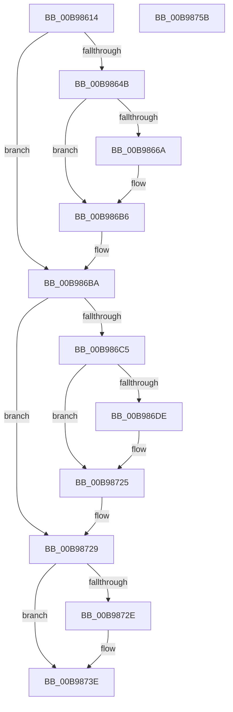

# ViCheckTag

- RVA: `0x00B98614`–`0x00B9875C` (길이 `328` bytes)
- VA: `0x0000000140B98614`
- 실행 섹션: `PAGEVRFY`
- PDB 이름 있음: `예`; PDB Function 태그: `아니요`
- unwind 정보 RVA: `0x0008C20C`
- 디코드: `83`개 명령, `328/328` bytes 표시
- 미해석 바이트: `0` (있으면 어셈블리에 `.byte`로 보존)

> 이 문서는 커널 이미지의 기계어와 PDB 기호를 분석해 생성했습니다. 4번과 5번은 함수 원형과 자료형을 바이너리 사용 방식에서 추정한 C 해석이며 원본 소스 복구 결과는 아닙니다.

## 1. Dependencies

- 직접 호출 지점: **7**; 고유 호출 대상: **4**
- 직접 호출자로 확인된 함수: **3**
- RIP 상대 이미지 참조: **5**

### Outgoing calls
- `0x00B9865F` → [RtlCompareMemory](../../text/6B/RtlCompareMemory_function_006BA670.md) (function, `0x006BA670`)
- `0x00B98691` → [ViHalPreprocessOptions](ViHalPreprocessOptions_function_00B9920C.md) (function, `0x00B9920C`)
- `0x00B986B1` → [VfReportIssueWithOptions](../../text/61/VfReportIssueWithOptions_function_00614444.md) (function, `0x00614444`)
- `0x00B986D3` → [RtlCompareMemory](../../text/6B/RtlCompareMemory_function_006BA670.md) (function, `0x006BA670`)
- `0x00B98702` → [ViHalPreprocessOptions](ViHalPreprocessOptions_function_00B9920C.md) (function, `0x00B9920C`)
- `0x00B98720` → [VfReportIssueWithOptions](../../text/61/VfReportIssueWithOptions_function_00614444.md) (function, `0x00614444`)
- `0x00B98739` → [memset](../../text/6C/memset_function_006C6C40.md) (function, `0x006C6C40`)

### Direct callers
- [ViCheckAdapterBuffers](ViCheckAdapterBuffers_function_00B98358.md) at `0x00B983DD`
- [ViCheckPadding](ViCheckPadding_function_00B98464.md) at `0x00B9852F`
- [ViFreeMapRegistersToFile](ViFreeMapRegistersToFile_function_00B98D04.md) at `0x00B98D97`

### Static image references
- `0x00B98658` → RVA `0x00B8B020` (`ViDmaVerifierTag`; read)
- `0x00B9866A` → RVA `0x00E0E984` (`.data`; read)
- `0x00B98684` → RVA `0x00BB9E00` (` ?? ::JKADOLAD::`string'`; read)
- `0x00B986DE` → RVA `0x00E0E970` (`.data`; read)
- `0x00B986F5` → RVA `0x00BB9EB0` (` ?? ::JKADOLAD::`string'`; read)

## 2. Other-region calls and transfers

- 다른 실행 섹션으로 향하는 call: **5**
  - `0x00B9865F` → [RtlCompareMemory](../../text/6B/RtlCompareMemory_function_006BA670.md) (`PAGEVRFY` → `.text`)
  - `0x00B986B1` → [VfReportIssueWithOptions](../../text/61/VfReportIssueWithOptions_function_00614444.md) (`PAGEVRFY` → `.text`)
  - `0x00B986D3` → [RtlCompareMemory](../../text/6B/RtlCompareMemory_function_006BA670.md) (`PAGEVRFY` → `.text`)
  - `0x00B98720` → [VfReportIssueWithOptions](../../text/61/VfReportIssueWithOptions_function_00614444.md) (`PAGEVRFY` → `.text`)
  - `0x00B98739` → [memset](../../text/6C/memset_function_006C6C40.md) (`PAGEVRFY` → `.text`)
- 별도 외부 분기/꼬리 이동을 확인하지 못했습니다.

## 3. Assembly (complete function range)

```asm
00B98614  48 89 5C 24 08                  mov qword ptr [rsp + 8], rbx
00B98619  48 89 6C 24 10                  mov qword ptr [rsp + 0x10], rbp
00B9861E  48 89 74 24 18                  mov qword ptr [rsp + 0x18], rsi
00B98623  57                              push rdi
00B98624  41 54                           push r12
00B98626  41 55                           push r13
00B98628  41 56                           push r14
00B9862A  41 57                           push r15
00B9862C  48 83 EC 30                     sub rsp, 0x30
00B98630  8B F2                           mov esi, edx
00B98632  45 0F B7 F1                     movzx r14d, r9w
00B98636  8B DA                           mov ebx, edx
00B98638  45 8B F8                        mov r15d, r8d
00B9863B  48 8B F9                        mov rdi, rcx
00B9863E  48 8B E9                        mov rbp, rcx
00B98641  4C 8D 24 0E                     lea r12, [rsi + rcx]
00B98645  41 F6 C1 01                     test r9b, 1
00B98649  74 6F                           je 0x140b986ba
00B9864B  48 8D 69 F8                     lea rbp, [rcx - 8]
00B9864F  41 B8 08 00 00 00               mov r8d, 8
00B98655  48 8B CD                        mov rcx, rbp
00B98658  48 8D 15 C1 29 FF FF            lea rdx, [rip - 0xd63f]
00B9865F  E8 0C 20 B2 FF                  call 0x1406ba670
00B98664  48 83 F8 08                     cmp rax, 8
00B98668  74 4C                           je 0x140b986b6
00B9866A  4C 8D 2D 13 63 27 00            lea r13, [rip + 0x276313]
00B98671  48 89 7C 24 28                  mov qword ptr [rsp + 0x28], rdi
00B98676  49 8B CD                        mov rcx, r13
00B98679  48 89 74 24 20                  mov qword ptr [rsp + 0x20], rsi
00B9867E  41 B9 01 00 00 00               mov r9d, 1
00B98684  48 8D 15 75 17 02 00            lea rdx, [rip + 0x21775]
00B9868B  41 B8 0F 00 00 10               mov r8d, 0x1000000f
00B98691  E8 76 0B 00 00                  call 0x140b9920c
00B98696  BA 0F 00 00 00                  mov edx, 0xf
00B9869B  4C 89 6C 24 28                  mov qword ptr [rsp + 0x28], r13
00B986A0  44 8B CE                        mov r9d, esi
00B986A3  48 89 7C 24 20                  mov qword ptr [rsp + 0x20], rdi
00B986A8  B9 E6 00 00 00                  mov ecx, 0xe6
00B986AD  44 8D 42 F2                     lea r8d, [rdx - 0xe]
00B986B1  E8 8E BD A7 FF                  call 0x140614444
00B986B6  48 83 C3 08                     add rbx, 8
00B986BA  41 BD 02 00 00 00               mov r13d, 2
00B986C0  45 84 F5                        test r13b, r14b
00B986C3  74 64                           je 0x140b98729
00B986C5  45 8D 45 06                     lea r8d, [r13 + 6]
00B986C9  49 8B CC                        mov rcx, r12
00B986CC  48 8D 15 4D 29 FF FF            lea rdx, [rip - 0xd6b3]
00B986D3  E8 98 1F B2 FF                  call 0x1406ba670
00B986D8  48 83 F8 08                     cmp rax, 8
00B986DC  74 47                           je 0x140b98725
00B986DE  4C 8D 35 8B 62 27 00            lea r14, [rip + 0x27628b]
00B986E5  48 89 7C 24 28                  mov qword ptr [rsp + 0x28], rdi
00B986EA  49 8B CE                        mov rcx, r14
00B986ED  48 89 74 24 20                  mov qword ptr [rsp + 0x20], rsi
00B986F2  45 8B CD                        mov r9d, r13d
00B986F5  48 8D 15 B4 17 02 00            lea rdx, [rip + 0x217b4]
00B986FC  41 B8 0F 00 00 10               mov r8d, 0x1000000f
00B98702  E8 05 0B 00 00                  call 0x140b9920c
00B98707  4C 8B CE                        mov r9, rsi
00B9870A  4C 89 74 24 28                  mov qword ptr [rsp + 0x28], r14
00B9870F  45 8B C5                        mov r8d, r13d
00B98712  48 89 7C 24 20                  mov qword ptr [rsp + 0x20], rdi
00B98717  41 8D 55 0D                     lea edx, [r13 + 0xd]
00B9871B  B9 E6 00 00 00                  mov ecx, 0xe6
00B98720  E8 1F BD A7 FF                  call 0x140614444
00B98725  48 83 C3 08                     add rbx, 8
00B98729  45 85 FF                        test r15d, r15d
00B9872C  74 10                           je 0x140b9873e
00B9872E  4C 8B C3                        mov r8, rbx
00B98731  BA 0F 00 00 00                  mov edx, 0xf
00B98736  48 8B CD                        mov rcx, rbp
00B98739  E8 02 E5 B2 FF                  call 0x1406c6c40
00B9873E  48 8B 5C 24 60                  mov rbx, qword ptr [rsp + 0x60]
00B98743  48 8B 6C 24 68                  mov rbp, qword ptr [rsp + 0x68]
00B98748  48 8B 74 24 70                  mov rsi, qword ptr [rsp + 0x70]
00B9874D  48 83 C4 30                     add rsp, 0x30
00B98751  41 5F                           pop r15
00B98753  41 5E                           pop r14
00B98755  41 5D                           pop r13
00B98757  41 5C                           pop r12
00B98759  5F                              pop rdi
00B9875A  C3                              ret
00B9875B  CC                              int3
```

## 4. C-style interpretation (structured pseudocode)

```c
__int64 __fastcall ViCheckTag(__int64 a1, int a2, int a3, unsigned __int16 a4)
{
    __int64 result;
    __int64 v_r13;
    __int64 v_r14;
    __int64 v_rbx;
    __int64 v_rsp;
    unsigned __int64 v_stack_m30;
    unsigned __int64 v_stack_m38;
    unsigned __int64 v_stack_p10;
    unsigned __int64 v_stack_p18;
    unsigned __int64 v_stack_p8;

    v_stack_p8 = v_rbx;
    v_stack_p10 = v_rbp;
    v_stack_p18 = v_rsi;
    v_rsp = (v_rsp) - (48);
    if ((((unsigned __int8)(a4)) & (1)) == 0) goto loc_00B986BA;
    result = RtlCompareMemory(a1 - 8, v_rip - 54847, 8, a4);
    if (result != 8) {
        v_r13 = v_rip + 2581267;
        v_stack_m30 = a1;
        a1 = v_r13;
        v_stack_m38 = (unsigned int)(a2);
        a4 = 1;
        a2 = v_rip + 137077;
        a3 = 0x1000000FULL;
        result = ViHalPreprocessOptions(a1, a2, a3, a4);
        a2 = 15;
        v_stack_m30 = v_r13;
        a4 = (unsigned int)((unsigned int)(a2));
        v_stack_m38 = a1;
        a1 = 230;
        a3 = a2 - 14;
        result = VfReportIssueWithOptions(a1, a2, a3, a4);
    }
    v_rbx = ((unsigned int)(a2)) + (8);
loc_00B986BA:
    if (((2) & ((unsigned __int8)(a4))) == 0) goto loc_00B98729;
    result = RtlCompareMemory((unsigned int)(a2) + a1 * 1, v_rip - 54963, 2 + 6, a4);
    v_r14 = a4;
    if (result != 8) {
        v_r14 = v_rip + 2581131;
        v_stack_m30 = a1;
        a1 = v_r14;
        v_stack_m38 = (unsigned int)(a2);
        a4 = 2;
        a2 = v_rip + 137140;
        a3 = 0x1000000FULL;
        result = ViHalPreprocessOptions(a1, a2, a3, a4);
        a4 = (unsigned int)(a2);
        v_stack_m30 = v_r14;
        a3 = 2;
        v_stack_m38 = a1;
        a2 = 2 + 13;
        a1 = 230;
        result = VfReportIssueWithOptions(a1, a2, a3, a4);
    }
    v_rbx = (v_rbx) + (8);
loc_00B98729:
    if ((unsigned int)((unsigned int)(a3)) != 0) {
        a3 = v_rbx;
        a2 = 15;
        a1 = a1 - 8;
        result = memset(a1, a2, a3, a4);
    }
    v_rsp = (v_rsp) + (48);
    return result;
}
```

## 5. (Beta) C Style

```c
int64_t ViCheckTag(void *Arg1, void *Arg2, int32_t Arg3, uint16_t Arg4)
{
    uint8_t *arg1 = (uint8_t *)Arg1;
    uint8_t *arg2 = (uint8_t *)Arg2;

    int64_t result;
    int64_t local_r13;
    int64_t local_r14;
    int64_t local_rbx;
    int64_t local_rsp;
    uint64_t v_stack_m30;
    uint64_t v_stack_m38;
    uint64_t v_stack_p10;
    uint64_t v_stack_p18;
    uint64_t v_stack_p8;

    v_stack_p8 = local_rbx;
    v_stack_p10 = local_rbp;
    v_stack_p18 = local_rsi;
    local_rsp = (local_rsp) - (48);
    if ((((uint8_t)(Arg4)) & (1)) == 0) goto loc_00B986BA;
    result = RtlCompareMemory(Arg1 - 8, v_rip - 54847, 8, Arg4);
    if (result != 8) {
        local_r13 = v_rip + 2581267;
        v_stack_m30 = Arg1;
        Arg1 = local_r13;
        v_stack_m38 = (uint32_t)(Arg2);
        Arg4 = 1;
        Arg2 = v_rip + 137077;
        Arg3 = 0x1000000FULL;
        result = ViHalPreprocessOptions(Arg1, Arg2, Arg3, Arg4);
        Arg2 = 15;
        v_stack_m30 = local_r13;
        Arg4 = (uint32_t)((uint32_t)(Arg2));
        v_stack_m38 = Arg1;
        Arg1 = 230;
        Arg3 = Arg2 - 14;
        result = VfReportIssueWithOptions(Arg1, Arg2, Arg3, Arg4);
    }
    local_rbx = ((uint32_t)(Arg2)) + (8);
loc_00B986BA:
    if (((2) & ((uint8_t)(Arg4))) == 0) goto loc_00B98729;
    result = RtlCompareMemory((uint32_t)(Arg2) + Arg1 * 1, v_rip - 54963, 2 + 6, Arg4);
    local_r14 = Arg4;
    if (result != 8) {
        local_r14 = v_rip + 2581131;
        v_stack_m30 = Arg1;
        Arg1 = local_r14;
        v_stack_m38 = (uint32_t)(Arg2);
        Arg4 = 2;
        Arg2 = v_rip + 137140;
        Arg3 = 0x1000000FULL;
        result = ViHalPreprocessOptions(Arg1, Arg2, Arg3, Arg4);
        Arg4 = (uint32_t)(Arg2);
        v_stack_m30 = local_r14;
        Arg3 = 2;
        v_stack_m38 = Arg1;
        Arg2 = 2 + 13;
        Arg1 = 230;
        result = VfReportIssueWithOptions(Arg1, Arg2, Arg3, Arg4);
    }
    local_rbx = (local_rbx) + (8);
loc_00B98729:
    if ((uint32_t)((uint32_t)(Arg3)) != 0) {
        Arg3 = local_rbx;
        Arg2 = 15;
        Arg1 = Arg1 - 8;
        result = memset(Arg1, Arg2, Arg3, Arg4);
    }
    local_rsp = (local_rsp) + (48);
    return result;
}
```

### 관측된 메모리 오프셋

구조체 형식이 확인되지 않은 접근은 인자 기준의 오프셋으로만 기록했습니다.

| 기준 인자 | 오프셋 표현 | 폭 (bit) | 접근 |
|---|---:|---:|---|
| `Arg1` | `- 0x8` | `64` | `R` |
| `Arg2` | `+ 0x0 + rcx*1` | `64` | `R` |

## 6. Execution-region graph

[열기: 2D/3D 그래프와 함수 탐색 컨트롤 패널](../../../control-panel.html?section=pagevrfy&rva=0x00B98614&view=graph)

- 2D 그래프는 위에서 아래로 흐르고, 3D 그래프는 빈 공간을 드래그해 회전합니다. Shift+드래그는 이동, 휠은 확대·축소, 함수 노드 선택은 대상 보고서 이동입니다.

### Static fallback


