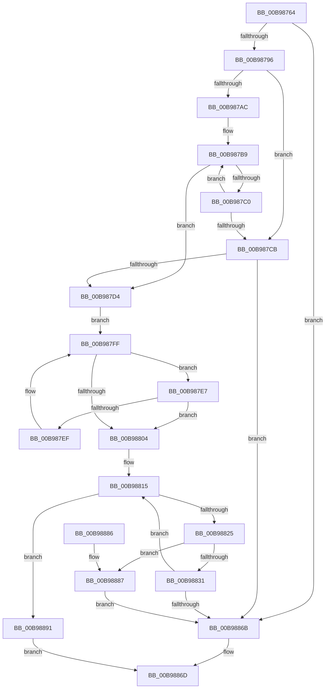

# ViCopyBackModifiedBuffer

- RVA: `0x00B98764`–`0x00B98898` (길이 `308` bytes)
- VA: `0x0000000140B98764`
- 실행 섹션: `PAGEVRFY`
- PDB 이름 있음: `예`; PDB Function 태그: `아니요`
- unwind 정보 RVA: `0x000B6264`
- 디코드: `98`개 명령, `308/308` bytes 표시
- 미해석 바이트: `0` (있으면 어셈블리에 `.byte`로 보존)

> 이 문서는 커널 이미지의 기계어와 PDB 기호를 분석해 생성했습니다. 4번과 5번은 함수 원형과 자료형을 바이너리 사용 방식에서 추정한 C 해석이며 원본 소스 복구 결과는 아닙니다.

## 1. Dependencies

- 직접 호출 지점: **4**; 고유 호출 대상: **3**
- 직접 호출자로 확인된 함수: **1**
- RIP 상대 이미지 참조: **0**

### Outgoing calls
- `0x00B9879F` → [RtlCompareMemory](../../text/6B/RtlCompareMemory_function_006BA670.md) (function, `0x006BA670`)
- `0x00B9881B` → [ViGetMdlBufferSa](ViGetMdlBufferSa_function_00B98FC8.md) (function, `0x00B98FC8`)
- `0x00B9883E` → [memcpy](../../text/6C/memcpy_function_006C6840.md) (function, `0x006C6840`)
- `0x00B9888A` → [memcpy](../../text/6C/memcpy_function_006C6840.md) (function, `0x006C6840`)

### Direct callers
- [ViFlushDoubleBuffer](ViFlushDoubleBuffer_function_00B989D0.md) at `0x00B98B3D`

### Static image references
- 디코드된 RIP-relative 메모리 참조가 없습니다.

## 2. Other-region calls and transfers

- 다른 실행 섹션으로 향하는 call: **3**
  - `0x00B9879F` → [RtlCompareMemory](../../text/6B/RtlCompareMemory_function_006BA670.md) (`PAGEVRFY` → `.text`)
  - `0x00B9883E` → [memcpy](../../text/6C/memcpy_function_006C6840.md) (`PAGEVRFY` → `.text`)
  - `0x00B9888A` → [memcpy](../../text/6C/memcpy_function_006C6840.md) (`PAGEVRFY` → `.text`)
- 별도 외부 분기/꼬리 이동을 확인하지 못했습니다.

## 3. Assembly (complete function range)

```asm
00B98764  48 89 5C 24 08                  mov qword ptr [rsp + 8], rbx
00B98769  48 89 6C 24 10                  mov qword ptr [rsp + 0x10], rbp
00B9876E  48 89 74 24 18                  mov qword ptr [rsp + 0x18], rsi
00B98773  57                              push rdi
00B98774  41 56                           push r14
00B98776  41 57                           push r15
00B98778  48 83 EC 20                     sub rsp, 0x20
00B9877C  48 8B 7C 24 60                  mov rdi, qword ptr [rsp + 0x60]
00B98781  49 8B D9                        mov rbx, r9
00B98784  4D 8B F0                        mov r14, r8
00B98787  48 8B EA                        mov rbp, rdx
00B9878A  48 8B F1                        mov rsi, rcx
00B9878D  48 85 FF                        test rdi, rdi
00B98790  0F 84 D5 00 00 00               je 0x140b9886b
00B98796  4C 8B C7                        mov r8, rdi
00B98799  48 8B D3                        mov rdx, rbx
00B9879C  49 8B CE                        mov rcx, r14
00B9879F  E8 CC 1E B2 FF                  call 0x1406ba670
00B987A4  4C 8B D0                        mov r10, rax
00B987A7  48 3B F8                        cmp rdi, rax
00B987AA  76 1F                           jbe 0x140b987cb
00B987AC  48 8D 47 FF                     lea rax, [rdi - 1]
00B987B0  49 8B D6                        mov rdx, r14
00B987B3  48 03 C3                        add rax, rbx
00B987B6  48 2B D3                        sub rdx, rbx
00B987B9  8A 08                           mov cl, byte ptr [rax]
00B987BB  38 0C 02                        cmp byte ptr [rdx + rax], cl
00B987BE  75 14                           jne 0x140b987d4
00B987C0  48 FF CF                        dec rdi
00B987C3  48 FF C8                        dec rax
00B987C6  49 3B FA                        cmp rdi, r10
00B987C9  77 EE                           ja 0x140b987b9
00B987CB  49 3B FA                        cmp rdi, r10
00B987CE  0F 84 97 00 00 00               je 0x140b9886b
00B987D4  8B 4E 2C                        mov ecx, dword ptr [rsi + 0x2c]
00B987D7  49 2B FA                        sub rdi, r10
00B987DA  03 4E 28                        add ecx, dword ptr [rsi + 0x28]
00B987DD  4D 03 F2                        add r14, r10
00B987E0  03 4E 20                        add ecx, dword ptr [rsi + 0x20]
00B987E3  2B CD                           sub ecx, ebp
00B987E5  EB 18                           jmp 0x140b987ff
00B987E7  48 8B 06                        mov rax, qword ptr [rsi]
00B987EA  48 85 C0                        test rax, rax
00B987ED  74 15                           je 0x140b98804
00B987EF  8B 68 2C                        mov ebp, dword ptr [rax + 0x2c]
00B987F2  4C 2B D1                        sub r10, rcx
00B987F5  48 03 68 20                     add rbp, qword ptr [rax + 0x20]
00B987F9  48 8B F0                        mov rsi, rax
00B987FC  8B 48 28                        mov ecx, dword ptr [rax + 0x28]
00B987FF  4C 3B D1                        cmp r10, rcx
00B98802  73 E3                           jae 0x140b987e7
00B98804  49 2B CA                        sub rcx, r10
00B98807  49 03 EA                        add rbp, r10
00B9880A  48 83 3E 00                     cmp qword ptr [rsi], 0
00B9880E  4C 8B FF                        mov r15, rdi
00B98811  4C 0F 45 F9                     cmovne r15, rcx
00B98815  48 8B D5                        mov rdx, rbp
00B98818  48 8B CE                        mov rcx, rsi
00B9881B  E8 A8 07 00 00                  call 0x140b98fc8
00B98820  48 85 C0                        test rax, rax
00B98823  74 6C                           je 0x140b98891
00B98825  48 83 3E 00                     cmp qword ptr [rsi], 0
00B98829  49 8B D6                        mov rdx, r14
00B9882C  48 8B C8                        mov rcx, rax
00B9882F  74 56                           je 0x140b98887
00B98831  4C 3B FF                        cmp r15, rdi
00B98834  48 8B DF                        mov rbx, rdi
00B98837  49 0F 46 DF                     cmovbe rbx, r15
00B9883B  4C 8B C3                        mov r8, rbx
00B9883E  E8 FD DF B2 FF                  call 0x1406c6840
00B98843  48 8B 36                        mov rsi, qword ptr [rsi]
00B98846  48 8B CF                        mov rcx, rdi
00B98849  48 8B C7                        mov rax, rdi
00B9884C  48 2B CB                        sub rcx, rbx
00B9884F  33 FF                           xor edi, edi
00B98851  4C 03 F3                        add r14, rbx
00B98854  8B 6E 2C                        mov ebp, dword ptr [rsi + 0x2c]
00B98857  48 03 6E 20                     add rbp, qword ptr [rsi + 0x20]
00B9885B  44 8B 7E 28                     mov r15d, dword ptr [rsi + 0x28]
00B9885F  48 3B D8                        cmp rbx, rax
00B98862  48 0F 46 F9                     cmovbe rdi, rcx
00B98866  48 85 FF                        test rdi, rdi
00B98869  75 AA                           jne 0x140b98815
00B9886B  33 C0                           xor eax, eax
00B9886D  48 8B 5C 24 40                  mov rbx, qword ptr [rsp + 0x40]
00B98872  48 8B 6C 24 48                  mov rbp, qword ptr [rsp + 0x48]
00B98877  48 8B 74 24 50                  mov rsi, qword ptr [rsp + 0x50]
00B9887C  48 83 C4 20                     add rsp, 0x20
00B98880  41 5F                           pop r15
00B98882  41 5E                           pop r14
00B98884  5F                              pop rdi
00B98885  C3                              ret
00B98886  CC                              int3
00B98887  4C 8B C7                        mov r8, rdi
00B9888A  E8 B1 DF B2 FF                  call 0x1406c6840
00B9888F  EB DA                           jmp 0x140b9886b
00B98891  B8 01 00 00 C0                  mov eax, 0xc0000001
00B98896  EB D5                           jmp 0x140b9886d
```

## 4. C-style interpretation (structured pseudocode)

```c
__int64 __fastcall ViCopyBackModifiedBuffer(__int64 a1, __int64 a2, __int64 a3, __int64 a4, __int64 a5)
{
    __int64 result;
    __int64 v_r10;
    __int64 v_r14;
    __int64 v_r15;
    __int64 v_rbp;
    __int64 v_rbx;
    __int64 v_rdi;
    __int64 v_rsp;
    unsigned __int64 v_stack_p10;
    unsigned __int64 v_stack_p18;
    unsigned __int64 v_stack_p8;

    v_stack_p8 = v_rbx;
    v_stack_p10 = v_rbp;
    v_stack_p18 = v_rsi;
    v_rsp = (v_rsp) - (32);
    if (a5 == 0) goto loc_00B9886B;
    result = RtlCompareMemory(a3, a4, a5, a4);
    if (a5 <= result) goto loc_00B987CB;
    result = (a5 - 1) + (a4);
    a2 = (a3) - (a4);
loc_00B987B9:
    if ((*(unsigned __int8 *)(a2 + result * 1)) != ((unsigned __int8)(*(unsigned __int8 *)(result)))) goto loc_00B987D4;
    v_rdi = (a5) - 1;
    result = (result) - 1;
    if (v_rdi > result) goto loc_00B987B9;
loc_00B987CB:
    if (v_rdi == result) goto loc_00B9886B;
loc_00B987D4:
    v_rdi = (v_rdi) - (result);
    a1 = (unsigned int)(((unsigned int)(*(unsigned int *)(a1 + 44))) + (*(unsigned int *)(a1 + 40)));
    v_r14 = (a3) + (result);
    a1 = (unsigned int)((a1) + (*(unsigned int *)(a1 + 32)));
    a1 = (unsigned int)((a1) - ((unsigned int)(a2)));
    goto loc_00B987FF;
loc_00B987E7:
    if (*(unsigned __int64 *)(a1) == 0) goto loc_00B98804;
    v_r10 = (result) - (a1);
    v_rbp = ((unsigned int)(*(unsigned int *)(*(unsigned __int64 *)(a1) + 44))) + (*(unsigned __int64 *)(*(unsigned __int64 *)(a1) + 32));
loc_00B987FF:
    if (v_r10 >= ((unsigned int)(*(unsigned int *)(*(unsigned __int64 *)(a1) + 40)))) goto loc_00B987E7;
loc_00B98804:
    a1 = ((unsigned int)(*(unsigned int *)(*(unsigned __int64 *)(a1) + 40))) - (v_r10);
    v_rbp = (v_rbp) + (v_r10);
    v_r15 = v_rdi;
    if ((*(unsigned __int64 *)(*(unsigned __int64 *)(a1))) != 0) { v_r15 = a1; }
loc_00B98815:
    result = ViGetMdlBufferSa(*(unsigned __int64 *)(a1), v_rbp, a5, a4);
    if (result == 0) goto loc_00B98891;
    if ((*(unsigned __int64 *)(*(unsigned __int64 *)(a1))) == 0) goto loc_00B98887;
    v_rbx = v_rdi;
    if (v_r15 <= v_rdi) { v_rbx = v_r15; }
    result = memcpy(result, v_r14, v_rbx, a4);
    a1 = (v_rdi) - (v_rbx);
    v_rdi = 0;
    v_r14 = (v_r14) + (v_rbx);
    v_rbp = ((unsigned int)(*(unsigned int *)(*(unsigned __int64 *)(*(unsigned __int64 *)(a1)) + 44))) + (*(unsigned __int64 *)(*(unsigned __int64 *)(*(unsigned __int64 *)(a1)) + 32));
    if (v_rbx <= 0) { v_rdi = a1; }
    if (v_rdi != 0) goto loc_00B98815;
loc_00B9886B:
    result = 0;
loc_00B9886D:
    v_rsp = (v_rsp) + (32);
    return result;
loc_00B98887:
    result = memcpy(a1, v_r14, v_rdi, a4);
    goto loc_00B9886B;
loc_00B98891:
    goto loc_00B9886D;
}
```

## 5. (Beta) C Style

```c
int64_t ViCopyBackModifiedBuffer(void *Arg1, int64_t Arg2, void *Arg3, int64_t Arg4, int64_t Arg5)
{
    uint8_t *arg1 = (uint8_t *)Arg1;
    uint8_t *arg3 = (uint8_t *)Arg3;

    int64_t result;
    int64_t local_r10;
    int64_t local_r14;
    int64_t local_r15;
    int64_t local_rbp;
    int64_t local_rbx;
    int64_t local_rdi;
    int64_t local_rsp;
    uint64_t v_stack_p10;
    uint64_t v_stack_p18;
    uint64_t v_stack_p8;

    v_stack_p8 = local_rbx;
    v_stack_p10 = local_rbp;
    v_stack_p18 = local_rsi;
    local_rsp = (local_rsp) - (32);
    if (Arg5 == 0) goto loc_00B9886B;
    result = RtlCompareMemory(Arg3, Arg4, Arg5, Arg4);
    if (Arg5 <= result) goto loc_00B987CB;
    result = (Arg5 - 1) + (Arg4);
    Arg2 = (Arg3) - (Arg4);
loc_00B987B9:
    if ((*(uint8_t *)(Arg2 + result * 1)) != ((uint8_t)(*(uint8_t *)(result)))) goto loc_00B987D4;
    local_rdi = (Arg5) - 1;
    result = (result) - 1;
    if (local_rdi > result) goto loc_00B987B9;
loc_00B987CB:
    if (local_rdi == result) goto loc_00B9886B;
loc_00B987D4:
    local_rdi = (local_rdi) - (result);
    Arg1 = (uint32_t)(((uint32_t)(*(uint32_t *)(arg1 + 0x2C))) + (*(uint32_t *)(arg1 + 0x28)));
    local_r14 = (Arg3) + (result);
    Arg1 = (uint32_t)((Arg1) + (*(uint32_t *)(arg1 + 0x20)));
    Arg1 = (uint32_t)((Arg1) - ((uint32_t)(Arg2)));
    goto loc_00B987FF;
loc_00B987E7:
    if (*(uint64_t *)(arg1) == 0) goto loc_00B98804;
    local_r10 = (result) - (Arg1);
    local_rbp = ((uint32_t)(*(uint32_t *)(*(uint64_t *)(arg1) + 0x2C))) + (*(uint64_t *)(*(uint64_t *)(arg1) + 0x20));
loc_00B987FF:
    if (local_r10 >= ((uint32_t)(*(uint32_t *)(*(uint64_t *)(arg1) + 0x28)))) goto loc_00B987E7;
loc_00B98804:
    Arg1 = ((uint32_t)(*(uint32_t *)(*(uint64_t *)(arg1) + 0x28))) - (local_r10);
    local_rbp = (local_rbp) + (local_r10);
    local_r15 = local_rdi;
    if ((*(uint64_t *)(*(uint64_t *)(arg1))) != 0) { local_r15 = Arg1; }
loc_00B98815:
    result = ViGetMdlBufferSa(*(uint64_t *)(arg1), local_rbp, Arg5, Arg4);
    if (result == 0) goto loc_00B98891;
    if ((*(uint64_t *)(*(uint64_t *)(arg1))) == 0) goto loc_00B98887;
    local_rbx = local_rdi;
    if (local_r15 <= local_rdi) { local_rbx = local_r15; }
    result = memcpy(result, local_r14, local_rbx, Arg4);
    Arg1 = (local_rdi) - (local_rbx);
    local_rdi = 0;
    local_r14 = (local_r14) + (local_rbx);
    local_rbp = ((uint32_t)(*(uint32_t *)(*(uint64_t *)(*(uint64_t *)(arg1)) + 0x2C))) + (*(uint64_t *)(*(uint64_t *)(*(uint64_t *)(arg1)) + 0x20));
    if (local_rbx <= 0) { local_rdi = Arg1; }
    if (local_rdi != 0) goto loc_00B98815;
loc_00B9886B:
    result = 0;
loc_00B9886D:
    local_rsp = (local_rsp) + (32);
    return result;
loc_00B98887:
    result = memcpy(Arg1, local_r14, local_rdi, Arg4);
    goto loc_00B9886B;
loc_00B98891:
    goto loc_00B9886D;
}
```

### 관측된 메모리 오프셋

구조체 형식이 확인되지 않은 접근은 인자 기준의 오프셋으로만 기록했습니다.

| 기준 인자 | 오프셋 표현 | 폭 (bit) | 접근 |
|---|---:|---:|---|
| `Arg1` | `+ 0x20` | `32` | `R` |
| `Arg1` | `+ 0x28` | `32` | `R` |
| `Arg1` | `+ 0x2C` | `32` | `R` |
| `Arg3` | `+ 0x0 + rax*1` | `8` | `R` |

## 6. Execution-region graph

[열기: 2D/3D 그래프와 함수 탐색 컨트롤 패널](../../../control-panel.html?section=pagevrfy&rva=0x00B98764&view=graph)

- 2D 그래프는 위에서 아래로 흐르고, 3D 그래프는 빈 공간을 드래그해 회전합니다. Shift+드래그는 이동, 휠은 확대·축소, 함수 노드 선택은 대상 보고서 이동입니다.

### Static fallback


