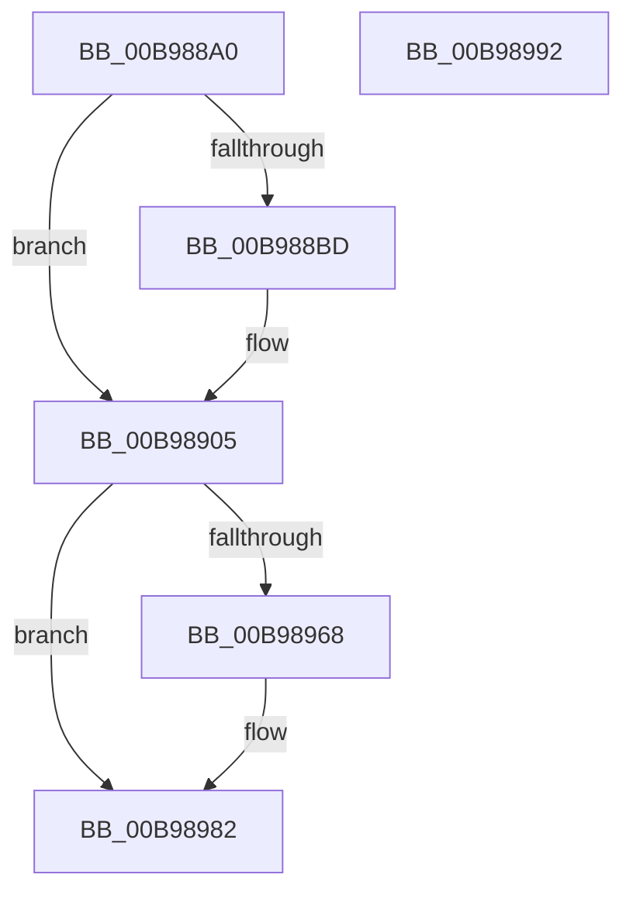

# ViCopyDeviceDescription

- RVA: `0x00B988A0`–`0x00B98993` (길이 `243` bytes)
- VA: `0x0000000140B988A0`
- 실행 섹션: `PAGEVRFY`
- PDB 이름 있음: `예`; PDB Function 태그: `아니요`
- unwind 정보 RVA: `0x000733E4`
- 디코드: `73`개 명령, `243/243` bytes 표시
- 미해석 바이트: `0` (있으면 어셈블리에 `.byte`로 보존)

> 이 문서는 커널 이미지의 기계어와 PDB 기호를 분석해 생성했습니다. 4번과 5번은 함수 원형과 자료형을 바이너리 사용 방식에서 추정한 C 해석이며 원본 소스 복구 결과는 아닙니다.

## 1. Dependencies

- 직접 호출 지점: **2**; 고유 호출 대상: **2**
- 직접 호출자로 확인된 함수: **1**
- RIP 상대 이미지 참조: **2**

### Outgoing calls
- `0x00B988E0` → [ViHalPreprocessOptions](ViHalPreprocessOptions_function_00B9920C.md) (function, `0x00B9920C`)
- `0x00B98900` → [VfReportIssueWithOptions](../../text/61/VfReportIssueWithOptions_function_00614444.md) (function, `0x00614444`)

### Direct callers
- [ViHookDmaAdapter](ViHookDmaAdapter_function_00B993D8.md) at `0x00B994A1`

### Static image references
- `0x00B988C2` → RVA `0x00E0E9B8` (`.data`; read)
- `0x00B988D0` → RVA `0x00BBA430` (` ?? ::JKADOLAD::`string'`; read)

## 2. Other-region calls and transfers

- 다른 실행 섹션으로 향하는 call: **1**
  - `0x00B98900` → [VfReportIssueWithOptions](../../text/61/VfReportIssueWithOptions_function_00614444.md) (`PAGEVRFY` → `.text`)
- 별도 외부 분기/꼬리 이동을 확인하지 못했습니다.

## 3. Assembly (complete function range)

```asm
00B988A0  4C 8B DC                        mov r11, rsp
00B988A3  49 89 5B 08                     mov qword ptr [r11 + 8], rbx
00B988A7  49 89 73 10                     mov qword ptr [r11 + 0x10], rsi
00B988AB  57                              push rdi
00B988AC  48 83 EC 30                     sub rsp, 0x30
00B988B0  8B 02                           mov eax, dword ptr [rdx]
00B988B2  48 8B DA                        mov rbx, rdx
00B988B5  48 8B F9                        mov rdi, rcx
00B988B8  83 F8 03                        cmp eax, 3
00B988BB  76 48                           jbe 0x140b98905
00B988BD  49 83 63 F0 00                  and qword ptr [r11 - 0x10], 0
00B988C2  48 8D 35 EF 60 27 00            lea rsi, [rip + 0x2760ef]
00B988C9  49 89 53 E8                     mov qword ptr [r11 - 0x18], rdx
00B988CD  48 8B CE                        mov rcx, rsi
00B988D0  48 8D 15 59 1B 02 00            lea rdx, [rip + 0x21b59]
00B988D7  44 8B C8                        mov r9d, eax
00B988DA  41 B8 25 00 00 00               mov r8d, 0x25
00B988E0  E8 27 09 00 00                  call 0x140b9920c
00B988E5  44 8B 03                        mov r8d, dword ptr [rbx]
00B988E8  4C 8B CB                        mov r9, rbx
00B988EB  48 89 74 24 28                  mov qword ptr [rsp + 0x28], rsi
00B988F0  BA 25 00 00 00                  mov edx, 0x25
00B988F5  48 83 64 24 20 00               and qword ptr [rsp + 0x20], 0
00B988FB  B9 E6 00 00 00                  mov ecx, 0xe6
00B98900  E8 3F BB A7 FF                  call 0x140614444
00B98905  8A 43 04                        mov al, byte ptr [rbx + 4]
00B98908  88 47 04                        mov byte ptr [rdi + 4], al
00B9890B  8A 43 05                        mov al, byte ptr [rbx + 5]
00B9890E  88 47 05                        mov byte ptr [rdi + 5], al
00B98911  8A 43 06                        mov al, byte ptr [rbx + 6]
00B98914  88 47 06                        mov byte ptr [rdi + 6], al
00B98917  8A 43 07                        mov al, byte ptr [rbx + 7]
00B9891A  88 47 07                        mov byte ptr [rdi + 7], al
00B9891D  8A 43 08                        mov al, byte ptr [rbx + 8]
00B98920  88 47 08                        mov byte ptr [rdi + 8], al
00B98923  8A 43 09                        mov al, byte ptr [rbx + 9]
00B98926  88 47 09                        mov byte ptr [rdi + 9], al
00B98929  8A 43 0A                        mov al, byte ptr [rbx + 0xa]
00B9892C  88 47 0A                        mov byte ptr [rdi + 0xa], al
00B9892F  8A 43 0B                        mov al, byte ptr [rbx + 0xb]
00B98932  88 47 0B                        mov byte ptr [rdi + 0xb], al
00B98935  8B 43 0C                        mov eax, dword ptr [rbx + 0xc]
00B98938  89 47 0C                        mov dword ptr [rdi + 0xc], eax
00B9893B  8B 43 10                        mov eax, dword ptr [rbx + 0x10]
00B9893E  89 47 10                        mov dword ptr [rdi + 0x10], eax
00B98941  8B 43 14                        mov eax, dword ptr [rbx + 0x14]
00B98944  89 47 14                        mov dword ptr [rdi + 0x14], eax
00B98947  8B 43 18                        mov eax, dword ptr [rbx + 0x18]
00B9894A  89 47 18                        mov dword ptr [rdi + 0x18], eax
00B9894D  8B 43 1C                        mov eax, dword ptr [rbx + 0x1c]
00B98950  89 47 1C                        mov dword ptr [rdi + 0x1c], eax
00B98953  8B 43 20                        mov eax, dword ptr [rbx + 0x20]
00B98956  89 47 20                        mov dword ptr [rdi + 0x20], eax
00B98959  8B 43 24                        mov eax, dword ptr [rbx + 0x24]
00B9895C  89 47 24                        mov dword ptr [rdi + 0x24], eax
00B9895F  8B 03                           mov eax, dword ptr [rbx]
00B98961  89 07                           mov dword ptr [rdi], eax
00B98963  83 3B 03                        cmp dword ptr [rbx], 3
00B98966  75 1A                           jne 0x140b98982
00B98968  8B 43 28                        mov eax, dword ptr [rbx + 0x28]
00B9896B  89 47 28                        mov dword ptr [rdi + 0x28], eax
00B9896E  8B 43 2C                        mov eax, dword ptr [rbx + 0x2c]
00B98971  89 47 2C                        mov dword ptr [rdi + 0x2c], eax
00B98974  8B 43 30                        mov eax, dword ptr [rbx + 0x30]
00B98977  89 47 30                        mov dword ptr [rdi + 0x30], eax
00B9897A  48 8B 43 38                     mov rax, qword ptr [rbx + 0x38]
00B9897E  48 89 47 38                     mov qword ptr [rdi + 0x38], rax
00B98982  48 8B 5C 24 40                  mov rbx, qword ptr [rsp + 0x40]
00B98987  48 8B 74 24 48                  mov rsi, qword ptr [rsp + 0x48]
00B9898C  48 83 C4 30                     add rsp, 0x30
00B98990  5F                              pop rdi
00B98991  C3                              ret
00B98992  CC                              int3
```

## 4. C-style interpretation (structured pseudocode)

```c
__int64 __fastcall ViCopyDeviceDescription(__int64 a1, __int64 a2)
{
    __int64 result;
    __int64 v_rsi;
    __int64 v_rsp;
    unsigned __int64 v_stack_m10;
    unsigned __int64 v_stack_m18;
    unsigned __int64 v_stack_p10;
    unsigned __int64 v_stack_p8;

    *(unsigned __int64 *)(v_rsp + 8) = v_rbx;
    *(unsigned __int64 *)(v_rsp + 16) = v_rsi;
    v_rsp = (v_rsp) - (48);
    result = (unsigned int)(*(unsigned int *)(a2));
    if (((unsigned int)((unsigned int)(*(unsigned int *)(a2)))) >= = 3) {
        v_rsi = v_rip + 2580719;
        *(unsigned __int64 *)(v_rsp - 24) = a2;
        a1 = v_rsi;
        a2 = v_rip + 138073;
        a4 = (unsigned int)((unsigned int)(*(unsigned int *)(a2)));
        a3 = 37;
        result = ViHalPreprocessOptions(a1, a2, a3, a4);
        a3 = *(unsigned int *)(a2);
        a4 = a2;
        v_stack_m10 = v_rsi;
        a2 = 37;
        a1 = 230;
        result = VfReportIssueWithOptions(a1, a2, a3, a4);
    }
    *(unsigned __int8 *)(a1 + 4) = (unsigned __int8)(*(unsigned __int8 *)(a2 + 4));
    *(unsigned __int8 *)(a1 + 5) = (unsigned __int8)(*(unsigned __int8 *)(a2 + 5));
    *(unsigned __int8 *)(a1 + 6) = (unsigned __int8)(*(unsigned __int8 *)(a2 + 6));
    *(unsigned __int8 *)(a1 + 7) = (unsigned __int8)(*(unsigned __int8 *)(a2 + 7));
    *(unsigned __int8 *)(a1 + 8) = (unsigned __int8)(*(unsigned __int8 *)(a2 + 8));
    *(unsigned __int8 *)(a1 + 9) = (unsigned __int8)(*(unsigned __int8 *)(a2 + 9));
    *(unsigned __int8 *)(a1 + 10) = (unsigned __int8)(*(unsigned __int8 *)(a2 + 10));
    *(unsigned __int8 *)(a1 + 11) = (unsigned __int8)(*(unsigned __int8 *)(a2 + 11));
    *(unsigned int *)(a1 + 12) = (unsigned int)((unsigned int)(*(unsigned int *)(a2 + 12)));
    *(unsigned int *)(a1 + 16) = (unsigned int)((unsigned int)(*(unsigned int *)(a2 + 16)));
    *(unsigned int *)(a1 + 20) = (unsigned int)((unsigned int)(*(unsigned int *)(a2 + 20)));
    *(unsigned int *)(a1 + 24) = (unsigned int)((unsigned int)(*(unsigned int *)(a2 + 24)));
    *(unsigned int *)(a1 + 28) = (unsigned int)((unsigned int)(*(unsigned int *)(a2 + 28)));
    *(unsigned int *)(a1 + 32) = (unsigned int)((unsigned int)(*(unsigned int *)(a2 + 32)));
    *(unsigned int *)(a1 + 36) = (unsigned int)((unsigned int)(*(unsigned int *)(a2 + 36)));
    *(unsigned int *)(a1) = (unsigned int)((unsigned int)(*(unsigned int *)(a2)));
    result = (unsigned int)(*(unsigned int *)(a2));
    if ((*(unsigned int *)(a2)) == 3) {
        result = *(unsigned int *)(a2 + 40);
        *(unsigned int *)(a1 + 40) = (unsigned int)(result);
        result = *(unsigned int *)(a2 + 44);
        *(unsigned int *)(a1 + 44) = (unsigned int)(result);
        result = *(unsigned int *)(a2 + 48);
        *(unsigned int *)(a1 + 48) = (unsigned int)(result);
        result = *(unsigned __int64 *)(a2 + 56);
        *(unsigned __int64 *)(a1 + 56) = result;
    }
    v_rsp = (v_rsp) + (48);
    return result;
}
```

## 5. (Beta) C Style

```c
int64_t ViCopyDeviceDescription(void *Arg1, void *Arg2)
{
    uint8_t *arg1 = (uint8_t *)Arg1;
    uint8_t *arg2 = (uint8_t *)Arg2;

    int64_t result;
    int64_t local_rsi;
    int64_t local_rsp;
    uint64_t v_stack_m10;
    uint64_t v_stack_m18;
    uint64_t v_stack_p10;
    uint64_t v_stack_p8;

    *(uint64_t *)(local_rsp + 0x8) = local_rbx;
    *(uint64_t *)(local_rsp + 0x10) = local_rsi;
    local_rsp = (local_rsp) - (48);
    result = (uint32_t)(*(uint32_t *)(arg2));
    if (((uint32_t)((uint32_t)(*(uint32_t *)(arg2)))) >= = 3) {
        local_rsi = v_rip + 2580719;
        *(void **)(local_rsp - 0x18) = Arg2;
        Arg1 = local_rsi;
        Arg2 = v_rip + 138073;
        a4 = (uint32_t)((uint32_t)(*(uint32_t *)(arg2)));
        a3 = 37;
        result = ViHalPreprocessOptions(Arg1, Arg2, a3, a4);
        a3 = *(uint32_t *)(arg2);
        a4 = Arg2;
        v_stack_m10 = local_rsi;
        Arg2 = 37;
        Arg1 = 230;
        result = VfReportIssueWithOptions(Arg1, Arg2, a3, a4);
    }
    *(uint8_t *)(arg1 + 0x4) = (uint8_t)(*(uint8_t *)(arg2 + 0x4));
    *(uint8_t *)(arg1 + 0x5) = (uint8_t)(*(uint8_t *)(arg2 + 0x5));
    *(uint8_t *)(arg1 + 0x6) = (uint8_t)(*(uint8_t *)(arg2 + 0x6));
    *(uint8_t *)(arg1 + 0x7) = (uint8_t)(*(uint8_t *)(arg2 + 0x7));
    *(uint8_t *)(arg1 + 0x8) = (uint8_t)(*(uint8_t *)(arg2 + 0x8));
    *(uint8_t *)(arg1 + 0x9) = (uint8_t)(*(uint8_t *)(arg2 + 0x9));
    *(uint8_t *)(arg1 + 0xA) = (uint8_t)(*(uint8_t *)(arg2 + 0xA));
    *(uint8_t *)(arg1 + 0xB) = (uint8_t)(*(uint8_t *)(arg2 + 0xB));
    *(uint32_t *)(arg1 + 0xC) = (uint32_t)((uint32_t)(*(uint32_t *)(arg2 + 0xC)));
    *(uint32_t *)(arg1 + 0x10) = (uint32_t)((uint32_t)(*(uint32_t *)(arg2 + 0x10)));
    *(uint32_t *)(arg1 + 0x14) = (uint32_t)((uint32_t)(*(uint32_t *)(arg2 + 0x14)));
    *(uint32_t *)(arg1 + 0x18) = (uint32_t)((uint32_t)(*(uint32_t *)(arg2 + 0x18)));
    *(uint32_t *)(arg1 + 0x1C) = (uint32_t)((uint32_t)(*(uint32_t *)(arg2 + 0x1C)));
    *(uint32_t *)(arg1 + 0x20) = (uint32_t)((uint32_t)(*(uint32_t *)(arg2 + 0x20)));
    *(uint32_t *)(arg1 + 0x24) = (uint32_t)((uint32_t)(*(uint32_t *)(arg2 + 0x24)));
    *(uint32_t *)(arg1) = (uint32_t)((uint32_t)(*(uint32_t *)(arg2)));
    result = (uint32_t)(*(uint32_t *)(arg2));
    if ((*(uint32_t *)(arg2)) == 3) {
        result = *(uint32_t *)(arg2 + 0x28);
        *(uint32_t *)(arg1 + 0x28) = (uint32_t)(result);
        result = *(uint32_t *)(arg2 + 0x2C);
        *(uint32_t *)(arg1 + 0x2C) = (uint32_t)(result);
        result = *(uint32_t *)(arg2 + 0x30);
        *(uint32_t *)(arg1 + 0x30) = (uint32_t)(result);
        result = *(uint64_t *)(arg2 + 0x38);
        *(uint64_t *)(arg1 + 0x38) = result;
    }
    local_rsp = (local_rsp) + (48);
    return result;
}
```

### 관측된 메모리 오프셋

구조체 형식이 확인되지 않은 접근은 인자 기준의 오프셋으로만 기록했습니다.

| 기준 인자 | 오프셋 표현 | 폭 (bit) | 접근 |
|---|---:|---:|---|
| `Arg1` | `+ 0x0` | `32` | `W` |
| `Arg1` | `+ 0x4` | `8` | `W` |
| `Arg1` | `+ 0x5` | `8` | `W` |
| `Arg1` | `+ 0x6` | `8` | `W` |
| `Arg1` | `+ 0x7` | `8` | `W` |
| `Arg1` | `+ 0x8` | `8` | `W` |
| `Arg1` | `+ 0x9` | `8` | `W` |
| `Arg1` | `+ 0xA` | `8` | `W` |
| `Arg1` | `+ 0xB` | `8` | `W` |
| `Arg1` | `+ 0xC` | `32` | `W` |
| `Arg1` | `+ 0x10` | `32` | `W` |
| `Arg1` | `+ 0x14` | `32` | `W` |
| `Arg1` | `+ 0x18` | `32` | `W` |
| `Arg1` | `+ 0x1C` | `32` | `W` |
| `Arg1` | `+ 0x20` | `32` | `W` |
| `Arg1` | `+ 0x24` | `32` | `W` |
| `Arg1` | `+ 0x28` | `32` | `W` |
| `Arg1` | `+ 0x2C` | `32` | `W` |
| `Arg1` | `+ 0x30` | `32` | `W` |
| `Arg1` | `+ 0x38` | `64` | `W` |
| `Arg2` | `+ 0x0` | `32` | `R` |
| `Arg2` | `+ 0x4` | `8` | `R` |
| `Arg2` | `+ 0x5` | `8` | `R` |
| `Arg2` | `+ 0x6` | `8` | `R` |
| `Arg2` | `+ 0x7` | `8` | `R` |
| `Arg2` | `+ 0x8` | `8` | `R` |
| `Arg2` | `+ 0x9` | `8` | `R` |
| `Arg2` | `+ 0xA` | `8` | `R` |
| `Arg2` | `+ 0xB` | `8` | `R` |
| `Arg2` | `+ 0xC` | `32` | `R` |
| `Arg2` | `+ 0x10` | `32` | `R` |
| `Arg2` | `+ 0x14` | `32` | `R` |

추가 오프셋 8개는 표에서 생략했습니다.

## 6. Execution-region graph

[열기: 2D/3D 그래프와 함수 탐색 컨트롤 패널](../../../control-panel.html?section=pagevrfy&rva=0x00B988A0&view=graph)

- 2D 그래프는 위에서 아래로 흐르고, 3D 그래프는 빈 공간을 드래그해 회전합니다. Shift+드래그는 이동, 휠은 확대·축소, 함수 노드 선택은 대상 보고서 이동입니다.

### Static fallback


