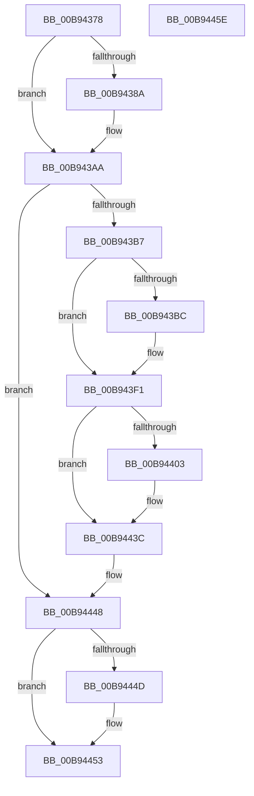

# ViDdiBuildWmiRegInfoData

- RVA: `0x00B94378`–`0x00B9445F` (길이 `231` bytes)
- VA: `0x0000000140B94378`
- 실행 섹션: `PAGEVRFY`
- PDB 이름 있음: `예`; PDB Function 태그: `아니요`
- unwind 정보 RVA: `0x0005CAAC`
- 디코드: `56`개 명령, `231/231` bytes 표시
- 미해석 바이트: `0` (있으면 어셈블리에 `.byte`로 보존)

> 이 문서는 커널 이미지의 기계어와 PDB 기호를 분석해 생성했습니다. 4번과 5번은 함수 원형과 자료형을 바이너리 사용 방식에서 추정한 C 해석이며 원본 소스 복구 결과는 아닙니다.

## 1. Dependencies

- 직접 호출 지점: **2**; 고유 호출 대상: **1**
- 직접 호출자로 확인된 함수: **1**
- RIP 상대 이미지 참조: **5**

### Outgoing calls
- `0x00B943EC` → [memcpy](../../text/6C/memcpy_function_006C6840.md) (function, `0x006C6840`)
- `0x00B94437` → [memcpy](../../text/6C/memcpy_function_006C6840.md) (function, `0x006C6840`)

### Direct callers
- [ViDdiDispatchWmiRegInfoEx](ViDdiDispatchWmiRegInfoEx_function_00B946A8.md) at `0x00B946DD`
- [ViDdiDispatchWmiRegInfoEx](ViDdiDispatchWmiRegInfoEx_function_00B946A8.md) at `0x00B94705`

### Static image references
- `0x00B94391` → RVA `0x00B8C0E8` (`GUID_VERIFIER_WMI_INTERFACE`; read)
- `0x00B943C3` → RVA `0x00FFF040` (`PAGEVRFD`; read)
- `0x00B943E5` → RVA `0x00FFF048` (`PAGEVRFD`; read)
- `0x00B94406` → RVA `0x00FFF030` (`PAGEVRFD`; read)
- `0x00B94430` → RVA `0x00FFF038` (`PAGEVRFD`; read)

## 2. Other-region calls and transfers

- 다른 실행 섹션으로 향하는 call: **2**
  - `0x00B943EC` → [memcpy](../../text/6C/memcpy_function_006C6840.md) (`PAGEVRFY` → `.text`)
  - `0x00B94437` → [memcpy](../../text/6C/memcpy_function_006C6840.md) (`PAGEVRFY` → `.text`)
- 별도 외부 분기/꼬리 이동을 확인하지 못했습니다.

## 3. Assembly (complete function range)

```asm
00B94378  48 89 5C 24 08                  mov qword ptr [rsp + 8], rbx
00B9437D  57                              push rdi
00B9437E  48 83 EC 20                     sub rsp, 0x20
00B94382  48 8B DA                        mov rbx, rdx
00B94385  48 85 D2                        test rdx, rdx
00B94388  74 20                           je 0x140b943aa
00B9438A  C7 42 10 01 00 00 00            mov dword ptr [rdx + 0x10], 1
00B94391  0F 10 05 50 7D FF FF            movups xmm0, xmmword ptr [rip - 0x82b0]
00B94398  83 62 28 00                     and dword ptr [rdx + 0x28], 0
00B9439C  83 62 2C 00                     and dword ptr [rdx + 0x2c], 0
00B943A0  48 83 62 30 00                  and qword ptr [rdx + 0x30], 0
00B943A5  F3 0F 7F 42 18                  movdqu xmmword ptr [rdx + 0x18], xmm0
00B943AA  B8 38 00 00 00                  mov eax, 0x38
00B943AF  85 C9                           test ecx, ecx
00B943B1  0F 85 91 00 00 00               jne 0x140b94448
00B943B7  48 85 DB                        test rbx, rbx
00B943BA  74 35                           je 0x140b943f1
00B943BC  89 42 08                        mov dword ptr [rdx + 8], eax
00B943BF  48 8D 4A 48                     lea rcx, [rdx + 0x48]
00B943C3  0F B7 05 76 AC 46 00            movzx eax, word ptr [rip + 0x46ac76]
00B943CA  66 89 42 38                     mov word ptr [rdx + 0x38], ax
00B943CE  0F B7 05 6B AC 46 00            movzx eax, word ptr [rip + 0x46ac6b]
00B943D5  66 89 42 3A                     mov word ptr [rdx + 0x3a], ax
00B943D9  48 89 4A 40                     mov qword ptr [rdx + 0x40], rcx
00B943DD  44 0F B7 05 5B AC 46 00         movzx r8d, word ptr [rip + 0x46ac5b]
00B943E5  48 8B 15 5C AC 46 00            mov rdx, qword ptr [rip + 0x46ac5c]
00B943EC  E8 4F 24 B3 FF                  call 0x1406c6840
00B943F1  0F B7 3D 48 AC 46 00            movzx edi, word ptr [rip + 0x46ac48]
00B943F8  83 C7 49                        add edi, 0x49
00B943FB  83 E7 FE                        and edi, 0xfffffffe
00B943FE  48 85 DB                        test rbx, rbx
00B94401  74 39                           je 0x140b9443c
00B94403  89 7B 0C                        mov dword ptr [rbx + 0xc], edi
00B94406  0F B7 05 23 AC 46 00            movzx eax, word ptr [rip + 0x46ac23]
00B9440D  8B D7                           mov edx, edi
00B9440F  48 03 D3                        add rdx, rbx
00B94412  66 89 02                        mov word ptr [rdx], ax
00B94415  48 8D 4A 10                     lea rcx, [rdx + 0x10]
00B94419  0F B7 05 10 AC 46 00            movzx eax, word ptr [rip + 0x46ac10]
00B94420  66 89 42 02                     mov word ptr [rdx + 2], ax
00B94424  48 89 4A 08                     mov qword ptr [rdx + 8], rcx
00B94428  44 0F B7 05 00 AC 46 00         movzx r8d, word ptr [rip + 0x46ac00]
00B94430  48 8B 15 01 AC 46 00            mov rdx, qword ptr [rip + 0x46ac01]
00B94437  E8 04 24 B3 FF                  call 0x1406c6840
00B9443C  0F B7 05 ED AB 46 00            movzx eax, word ptr [rip + 0x46abed]
00B94443  83 C0 10                        add eax, 0x10
00B94446  03 C7                           add eax, edi
00B94448  48 85 DB                        test rbx, rbx
00B9444B  74 06                           je 0x140b94453
00B9444D  83 63 04 00                     and dword ptr [rbx + 4], 0
00B94451  89 03                           mov dword ptr [rbx], eax
00B94453  48 8B 5C 24 30                  mov rbx, qword ptr [rsp + 0x30]
00B94458  48 83 C4 20                     add rsp, 0x20
00B9445C  5F                              pop rdi
00B9445D  C3                              ret
00B9445E  CC                              int3
```

## 4. C-style interpretation (structured pseudocode)

```c
__int64 __fastcall ViDdiBuildWmiRegInfoData(int a1, __int64 a2)
{
    __int64 result;
    __int64 v_rdi;
    __int64 v_rsp;
    unsigned __int64 v_stack_p8;

    v_stack_p8 = v_rbx;
    v_rsp = (v_rsp) - (32);
    if (a2 != 0) {
        *(unsigned int *)(a2 + 16) = 1;
        *(unsigned __int64 *)(a2 + 24) = v_xmm0;
    }
    if (a1 != 0) goto loc_00B94448;
    result = 56;
    if (a2 != 0) {
        *(unsigned int *)(a2 + 8) = 56;
        a1 = a2 + 72;
        result = *(unsigned __int16 *)(v_rip + 4631670);
        *(unsigned __int16 *)(a2 + 56) = (unsigned __int16)(result);
        result = *(unsigned __int16 *)(v_rip + 4631659);
        *(unsigned __int16 *)(a2 + 58) = (unsigned __int16)(result);
        *(unsigned __int64 *)(a2 + 64) = a1;
        a3 = *(unsigned __int16 *)(v_rip + 4631643);
        a2 = *(unsigned __int64 *)(v_rip + 4631644);
        result = memcpy(a1, a2, a3, a4);
    }
    v_rdi = (unsigned int)((*(unsigned __int16 *)(v_rip + 4631624)) + (73));
    v_rdi = (unsigned int)((v_rdi) & (0xFFFFFFFEULL));
    if (a2 != 0) {
        *(unsigned int *)(a2 + 12) = (unsigned int)(v_rdi);
        result = *(unsigned __int16 *)(v_rip + 4631587);
        a2 = (unsigned int)(v_rdi);
        a2 = (a2) + (a2);
        *(unsigned __int16 *)(a2) = (unsigned __int16)(result);
        a1 = a2 + 16;
        result = *(unsigned __int16 *)(v_rip + 4631568);
        *(unsigned __int16 *)(a2 + 2) = (unsigned __int16)(result);
        *(unsigned __int64 *)(a2 + 8) = a1;
        a3 = *(unsigned __int16 *)(v_rip + 4631552);
        a2 = *(unsigned __int64 *)(v_rip + 4631553);
        result = memcpy(a1, a2, a3, a4);
    }
    result = (unsigned int)((*(unsigned __int16 *)(v_rip + 4631533)) + (16));
    result = (unsigned int)((result) + ((unsigned int)(v_rdi)));
loc_00B94448:
    if (a2 != 0) {
        *(unsigned int *)(a2) = (unsigned int)(result);
    }
    v_rsp = (v_rsp) + (32);
    return result;
}
```

## 5. (Beta) C Style

```c
int64_t ViDdiBuildWmiRegInfoData(int32_t Arg1, int64_t Arg2)
{
    int64_t result;
    int64_t local_rdi;
    int64_t local_rsp;
    uint64_t v_stack_p8;

    v_stack_p8 = local_rbx;
    local_rsp = (local_rsp) - (32);
    if (Arg2 != 0) {
        *(uint32_t *)(Arg2 + 0x10) = 1;
        *(uint64_t *)(Arg2 + 0x18) = v_xmm0;
    }
    if (Arg1 != 0) goto loc_00B94448;
    result = 56;
    if (Arg2 != 0) {
        *(uint32_t *)(Arg2 + 0x8) = 56;
        Arg1 = Arg2 + 72;
        result = *(uint16_t *)(v_rip + 0x46AC76);
        *(uint16_t *)(Arg2 + 0x38) = (uint16_t)(result);
        result = *(uint16_t *)(v_rip + 0x46AC6B);
        *(uint16_t *)(Arg2 + 0x3A) = (uint16_t)(result);
        *(uint64_t *)(Arg2 + 0x40) = Arg1;
        a3 = *(uint16_t *)(v_rip + 0x46AC5B);
        Arg2 = *(uint64_t *)(v_rip + 0x46AC5C);
        result = memcpy(Arg1, Arg2, a3, a4);
    }
    local_rdi = (uint32_t)((*(uint16_t *)(v_rip + 0x46AC48)) + (73));
    local_rdi = (uint32_t)((local_rdi) & (0xFFFFFFFEULL));
    if (Arg2 != 0) {
        *(uint32_t *)(Arg2 + 0xC) = (uint32_t)(local_rdi);
        result = *(uint16_t *)(v_rip + 0x46AC23);
        Arg2 = (uint32_t)(local_rdi);
        Arg2 = (Arg2) + (Arg2);
        *(uint16_t *)(Arg2) = (uint16_t)(result);
        Arg1 = Arg2 + 16;
        result = *(uint16_t *)(v_rip + 0x46AC10);
        *(uint16_t *)(Arg2 + 0x2) = (uint16_t)(result);
        *(uint64_t *)(Arg2 + 0x8) = Arg1;
        a3 = *(uint16_t *)(v_rip + 0x46AC00);
        Arg2 = *(uint64_t *)(v_rip + 0x46AC01);
        result = memcpy(Arg1, Arg2, a3, a4);
    }
    result = (uint32_t)((*(uint16_t *)(v_rip + 0x46ABED)) + (16));
    result = (uint32_t)((result) + ((uint32_t)(local_rdi)));
loc_00B94448:
    if (Arg2 != 0) {
        *(uint32_t *)(Arg2) = (uint32_t)(result);
    }
    local_rsp = (local_rsp) + (32);
    return result;
}
```

## 6. Execution-region graph

[열기: 2D/3D 그래프와 함수 탐색 컨트롤 패널](../../../control-panel.html?section=pagevrfy&rva=0x00B94378&view=graph)

- 2D 그래프는 위에서 아래로 흐르고, 3D 그래프는 빈 공간을 드래그해 회전합니다. Shift+드래그는 이동, 휠은 확대·축소, 함수 노드 선택은 대상 보고서 이동입니다.

### Static fallback


