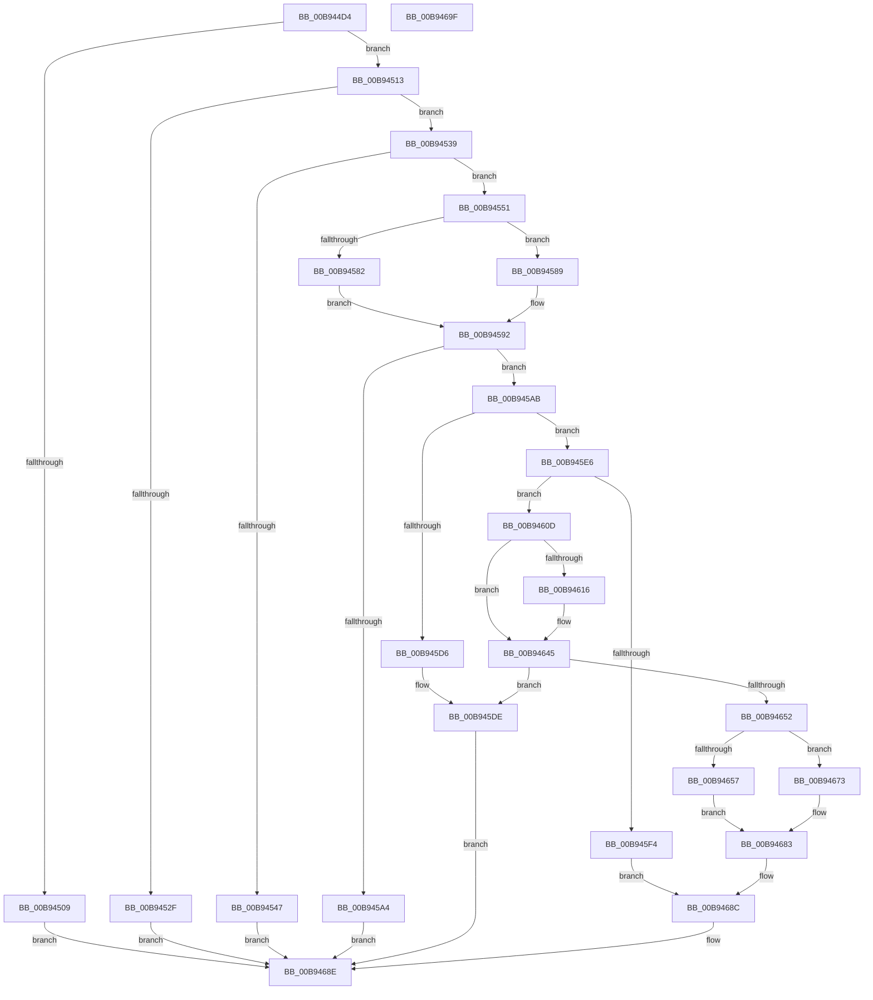

# ViDdiDispatchWmiQueryAllData

- RVA: `0x00B944D4`–`0x00B946A0` (길이 `460` bytes)
- VA: `0x0000000140B944D4`
- 실행 섹션: `PAGEVRFY`
- PDB 이름 있음: `예`; PDB Function 태그: `아니요`
- unwind 정보 RVA: `0x000D1634`
- 디코드: `135`개 명령, `460/460` bytes 표시
- 미해석 바이트: `0` (있으면 어셈블리에 `.byte`로 보존)

> 이 문서는 커널 이미지의 기계어와 PDB 기호를 분석해 생성했습니다. 4번과 5번은 함수 원형과 자료형을 바이너리 사용 방식에서 추정한 C 해석이며 원본 소스 복구 결과는 아닙니다.

## 1. Dependencies

- 직접 호출 지점: **8**; 고유 호출 대상: **5**
- 직접 호출자로 확인된 함수: **1**
- RIP 상대 이미지 참조: **3**

### Outgoing calls
- `0x00B94524` → [RtlCompareMemory](../../text/6B/RtlCompareMemory_function_006BA670.md) (function, `0x006BA670`)
- `0x00B9456D` → [KeAcquireSpinLockRaiseToDpc](../../text/20/KeAcquireSpinLockRaiseToDpc_function_00208470.md) (function, `0x00208470`)
- `0x00B9459B` → [KeReleaseSpinLock](../../text/39/KeReleaseSpinLock_function_00392BA0.md) (function, `0x00392BA0`)
- `0x00B945CA` → [VfIrpLogRetrieveWmiData](../BA/VfIrpLogRetrieveWmiData_function_00BAB864.md) (function, `0x00BAB864`)
- `0x00B945D9` → [VfIrpLogUnlockDatabase](../BA/VfIrpLogUnlockDatabase_function_00BABB44.md) (function, `0x00BABB44`)
- `0x00B945F7` → [VfIrpLogUnlockDatabase](../BA/VfIrpLogUnlockDatabase_function_00BABB44.md) (function, `0x00BABB44`)
- `0x00B94636` → [VfIrpLogRetrieveWmiData](../BA/VfIrpLogRetrieveWmiData_function_00BAB864.md) (function, `0x00BAB864`)
- `0x00B94648` → [VfIrpLogUnlockDatabase](../BA/VfIrpLogUnlockDatabase_function_00BABB44.md) (function, `0x00BABB44`)

### Direct callers
- [ViDdiDispatchWmi](ViDdiDispatchWmi_function_00B94470.md) at `0x00B9449D`

### Static image references
- `0x00B94517` → RVA `0x00B8C0E8` (`GUID_VERIFIER_WMI_INTERFACE`; read)
- `0x00B9455B` → RVA `0x00F04870` (`.data`; read)
- `0x00B94572` → RVA `0x00F04868` (`.data`; read)

## 2. Other-region calls and transfers

- 다른 실행 섹션으로 향하는 call: **3**
  - `0x00B94524` → [RtlCompareMemory](../../text/6B/RtlCompareMemory_function_006BA670.md) (`PAGEVRFY` → `.text`)
  - `0x00B9456D` → [KeAcquireSpinLockRaiseToDpc](../../text/20/KeAcquireSpinLockRaiseToDpc_function_00208470.md) (`PAGEVRFY` → `.text`)
  - `0x00B9459B` → [KeReleaseSpinLock](../../text/39/KeReleaseSpinLock_function_00392BA0.md) (`PAGEVRFY` → `.text`)
- 별도 외부 분기/꼬리 이동을 확인하지 못했습니다.

## 3. Assembly (complete function range)

```asm
00B944D4  40 55                           push rbp
00B944D6  53                              push rbx
00B944D7  56                              push rsi
00B944D8  57                              push rdi
00B944D9  41 54                           push r12
00B944DB  41 55                           push r13
00B944DD  41 56                           push r14
00B944DF  41 57                           push r15
00B944E1  48 8B EC                        mov rbp, rsp
00B944E4  48 83 EC 38                     sub rsp, 0x38
00B944E8  48 8B B2 B8 00 00 00            mov rsi, qword ptr [rdx + 0xb8]
00B944EF  33 FF                           xor edi, edi
00B944F1  4C 8B EA                        mov r13, rdx
00B944F4  89 7D 60                        mov dword ptr [rbp + 0x60], edi
00B944F7  4C 8B F1                        mov r14, rcx
00B944FA  89 7D 50                        mov dword ptr [rbp + 0x50], edi
00B944FD  89 7D 58                        mov dword ptr [rbp + 0x58], edi
00B94500  89 7D 48                        mov dword ptr [rbp + 0x48], edi
00B94503  48 39 4E 08                     cmp qword ptr [rsi + 8], rcx
00B94507  74 0A                           je 0x140b94513
00B94509  B8 BB 00 00 C0                  mov eax, 0xc00000bb
00B9450E  E9 7B 01 00 00                  jmp 0x140b9468e
00B94513  48 8B 4E 10                     mov rcx, qword ptr [rsi + 0x10]
00B94517  48 8D 15 CA 7B FF FF            lea rdx, [rip - 0x8436]
00B9451E  41 B8 10 00 00 00               mov r8d, 0x10
00B94524  E8 47 61 B2 FF                  call 0x1406ba670
00B94529  48 83 F8 10                     cmp rax, 0x10
00B9452D  74 0A                           je 0x140b94539
00B9452F  B8 95 02 00 C0                  mov eax, 0xc0000295
00B94534  E9 55 01 00 00                  jmp 0x140b9468e
00B94539  44 8B 66 18                     mov r12d, dword ptr [rsi + 0x18]
00B9453D  4D 8B 76 40                     mov r14, qword ptr [r14 + 0x40]
00B94541  41 83 FC 38                     cmp r12d, 0x38
00B94545  73 0A                           jae 0x140b94551
00B94547  B8 23 00 00 C0                  mov eax, 0xc0000023
00B9454C  E9 3D 01 00 00                  jmp 0x140b9468e
00B94551  48 A1 14 00 00 00 80 F7 FF FF   movabs rax, qword ptr [0xfffff78000000014]
00B9455B  48 8D 0D 0E 03 37 00            lea rcx, [rip + 0x37030e]
00B94562  48 8B 76 20                     mov rsi, qword ptr [rsi + 0x20]
00B94566  48 89 46 10                     mov qword ptr [rsi + 0x10], rax
00B9456A  41 8B 1E                        mov ebx, dword ptr [r14]
00B9456D  E8 FE 3E 67 FF                  call 0x140208470
00B94572  48 8B 0D EF 02 37 00            mov rcx, qword ptr [rip + 0x3702ef]
00B94579  48 8D 14 5B                     lea rdx, [rbx + rbx*2]
00B9457D  39 3C D1                        cmp dword ptr [rcx + rdx*8], edi
00B94580  74 07                           je 0x140b94589
00B94582  BB 2D 02 00 C0                  mov ebx, 0xc000022d
00B94587  EB 09                           jmp 0x140b94592
00B94589  C7 04 D1 01 00 00 00            mov dword ptr [rcx + rdx*8], 1
00B94590  8B DF                           mov ebx, edi
00B94592  8A D0                           mov dl, al
00B94594  48 8D 0D D5 02 37 00            lea rcx, [rip + 0x3702d5]
00B9459B  E8 00 E6 7F FF                  call 0x140392ba0
00B945A0  85 DB                           test ebx, ebx
00B945A2  79 07                           jns 0x140b945ab
00B945A4  8B C3                           mov eax, ebx
00B945A6  E9 E3 00 00 00                  jmp 0x140b9468e
00B945AB  41 8B 0E                        mov ecx, dword ptr [r14]
00B945AE  48 8D 45 48                     lea rax, [rbp + 0x48]
00B945B2  48 89 44 24 28                  mov qword ptr [rsp + 0x28], rax
00B945B7  4C 8D 4D 50                     lea r9, [rbp + 0x50]
00B945BB  48 8D 45 58                     lea rax, [rbp + 0x58]
00B945BF  33 D2                           xor edx, edx
00B945C1  4C 8D 45 60                     lea r8, [rbp + 0x60]
00B945C5  48 89 44 24 20                  mov qword ptr [rsp + 0x20], rax
00B945CA  E8 95 72 01 00                  call 0x140bab864
00B945CF  44 8B F8                        mov r15d, eax
00B945D2  85 C0                           test eax, eax
00B945D4  79 10                           jns 0x140b945e6
00B945D6  41 8B 0E                        mov ecx, dword ptr [r14]
00B945D9  E8 66 75 01 00                  call 0x140babb44
00B945DE  41 8B C7                        mov eax, r15d
00B945E1  E9 A8 00 00 00                  jmp 0x140b9468e
00B945E6  8B 5D 48                        mov ebx, dword ptr [rbp + 0x48]
00B945E9  83 C3 48                        add ebx, 0x48
00B945EC  89 5D 48                        mov dword ptr [rbp + 0x48], ebx
00B945EF  41 3B DC                        cmp ebx, r12d
00B945F2  76 19                           jbe 0x140b9460d
00B945F4  41 8B 0E                        mov ecx, dword ptr [r14]
00B945F7  E8 48 75 01 00                  call 0x140babb44
00B945FC  83 4E 2C 20                     or dword ptr [rsi + 0x2c], 0x20
00B94600  89 5E 30                        mov dword ptr [rsi + 0x30], ebx
00B94603  49 C7 45 38 38 00 00 00         mov qword ptr [r13 + 0x38], 0x38
00B9460B  EB 7F                           jmp 0x140b9468c
00B9460D  44 8B 65 50                     mov r12d, dword ptr [rbp + 0x50]
00B94611  45 85 E4                        test r12d, r12d
00B94614  74 2F                           je 0x140b94645
00B94616  41 8B 0E                        mov ecx, dword ptr [r14]
00B94619  48 8D 45 48                     lea rax, [rbp + 0x48]
00B9461D  48 89 44 24 28                  mov qword ptr [rsp + 0x28], rax
00B94622  4C 8D 4D 50                     lea r9, [rbp + 0x50]
00B94626  48 8D 45 58                     lea rax, [rbp + 0x58]
00B9462A  48 8B D6                        mov rdx, rsi
00B9462D  4C 8D 45 60                     lea r8, [rbp + 0x60]
00B94631  48 89 44 24 20                  mov qword ptr [rsp + 0x20], rax
00B94636  E8 29 72 01 00                  call 0x140bab864
00B9463B  44 8B 65 50                     mov r12d, dword ptr [rbp + 0x50]
00B9463F  44 8B F8                        mov r15d, eax
00B94642  8B 5D 48                        mov ebx, dword ptr [rbp + 0x48]
00B94645  41 8B 0E                        mov ecx, dword ptr [r14]
00B94648  E8 F7 74 01 00                  call 0x140babb44
00B9464D  45 85 FF                        test r15d, r15d
00B94650  78 8C                           js 0x140b945de
00B94652  45 85 E4                        test r12d, r12d
00B94655  75 1C                           jne 0x140b94673
00B94657  8B 46 2C                        mov eax, dword ptr [rsi + 0x2c]
00B9465A  83 E0 EF                        and eax, 0xffffffef
00B9465D  89 1E                           mov dword ptr [rsi], ebx
00B9465F  83 C8 01                        or eax, 1
00B94662  89 46 2C                        mov dword ptr [rsi + 0x2c], eax
00B94665  8B 45 58                        mov eax, dword ptr [rbp + 0x58]
00B94668  89 46 30                        mov dword ptr [rsi + 0x30], eax
00B9466B  8B 45 60                        mov eax, dword ptr [rbp + 0x60]
00B9466E  89 46 38                        mov dword ptr [rsi + 0x38], eax
00B94671  EB 10                           jmp 0x140b94683
00B94673  B8 48 00 00 00                  mov eax, 0x48
00B94678  89 06                           mov dword ptr [rsi], eax
00B9467A  8B D8                           mov ebx, eax
00B9467C  48 89 7E 38                     mov qword ptr [rsi + 0x38], rdi
00B94680  89 7E 30                        mov dword ptr [rsi + 0x30], edi
00B94683  8B C3                           mov eax, ebx
00B94685  89 7E 34                        mov dword ptr [rsi + 0x34], edi
00B94688  49 89 45 38                     mov qword ptr [r13 + 0x38], rax
00B9468C  33 C0                           xor eax, eax
00B9468E  48 83 C4 38                     add rsp, 0x38
00B94692  41 5F                           pop r15
00B94694  41 5E                           pop r14
00B94696  41 5D                           pop r13
00B94698  41 5C                           pop r12
00B9469A  5F                              pop rdi
00B9469B  5E                              pop rsi
00B9469C  5B                              pop rbx
00B9469D  5D                              pop rbp
00B9469E  C3                              ret
00B9469F  CC                              int3
```

## 4. C-style interpretation (structured pseudocode)

```c
__int64 __fastcall ViDdiDispatchWmiQueryAllData(__int64 a1, __int64 a2)
{
    __int64 result;
    __int64 v_r12;
    __int64 v_r15;
    __int64 v_rbx;
    __int64 v_rdi;
    __int64 v_rsp;
    unsigned __int64 v_stack_m50;
    unsigned __int64 v_stack_m58;
    unsigned int v_stack_p10;
    unsigned int v_stack_p18;
    unsigned int v_stack_p20;
    unsigned int v_stack_p8;

    v_rsp = (v_rsp) - (56);
    v_rdi = 0;
    v_stack_p20 = 0;
    v_stack_p10 = 0;
    v_stack_p18 = 0;
    v_stack_p8 = 0;
    if ((*(unsigned __int64 *)(*(unsigned __int64 *)(a2 + 184) + 8)) == a1) goto loc_00B94513;
    goto loc_00B9468E;
loc_00B94513:
    result = RtlCompareMemory(*(unsigned __int64 *)(*(unsigned __int64 *)(a2 + 184) + 16), v_rip - 33846, 16, a4);
    if (result == 16) goto loc_00B94539;
    goto loc_00B9468E;
loc_00B94539:
    if (((unsigned int)((unsigned int)(*(unsigned int *)(*(unsigned __int64 *)(a2 + 184) + 24)))) >= 56) goto loc_00B94551;
    goto loc_00B9468E;
loc_00B94551:
    *(unsigned __int64 *)(*(unsigned __int64 *)(*(unsigned __int64 *)(a2 + 184) + 32) + 16) = (unsigned int)(0xC0000023ULL);
    result = KeAcquireSpinLockRaiseToDpc(v_rip + 3605262, v_rip - 33846, 16, a4);
    if ((*(unsigned int *)(*(unsigned __int64 *)(v_rip + 3605231) + (unsigned int)(*(unsigned int *)(*(unsigned __int64 *)(a1 + 64))) + (unsigned int)(*(unsigned int *)(*(unsigned __int64 *)(a1 + 64))) * 2 * 8)) == 0) goto loc_00B94589;
    goto loc_00B94592;
loc_00B94589:
    *(unsigned int *)(*(unsigned __int64 *)(v_rip + 3605231) + (unsigned int)(*(unsigned int *)(*(unsigned __int64 *)(a1 + 64))) + (unsigned int)(*(unsigned int *)(*(unsigned __int64 *)(a1 + 64))) * 2 * 8) = 1;
loc_00B94592:
    result = KeReleaseSpinLock(v_rip + 3605205, (unsigned __int8)(result), 16, a4);
    if (!sign_flag) goto loc_00B945AB;
    goto loc_00B9468E;
loc_00B945AB:
    v_stack_m50 = v_stack_p8;
    a2 = 0;
    v_stack_m58 = v_stack_p18;
    result = VfIrpLogRetrieveWmiData((unsigned int)(*(unsigned int *)(*(unsigned __int64 *)(a1 + 64))), a2, v_stack_p20, v_stack_p10);
    if (!sign_flag) goto loc_00B945E6;
    result = VfIrpLogUnlockDatabase((unsigned int)(*(unsigned int *)(*(unsigned __int64 *)(a1 + 64))), a2, v_stack_p20, v_stack_p10);
loc_00B945DE:
    goto loc_00B9468E;
loc_00B945E6:
    v_rbx = (unsigned int)(((unsigned int)(v_stack_p8)) + (72));
    v_stack_p8 = (unsigned int)(v_rbx);
    if (((unsigned int)(v_rbx)) <= ((unsigned int)((unsigned int)(*(unsigned int *)(*(unsigned __int64 *)(a2 + 184) + 24))))) goto loc_00B9460D;
    result = VfIrpLogUnlockDatabase((unsigned int)(*(unsigned int *)(*(unsigned __int64 *)(a1 + 64))), a2, v_stack_p20, v_stack_p10);
    *(unsigned int *)(*(unsigned __int64 *)(*(unsigned __int64 *)(a2 + 184) + 32) + 48) = (unsigned int)(v_rbx);
    *(unsigned __int64 *)(a2 + 56) = 56;
    goto loc_00B9468C;
loc_00B9460D:
    v_r12 = (unsigned int)(v_stack_p10);
    v_r15 = (unsigned int)((unsigned int)(result));
    if ((unsigned int)((unsigned int)(v_stack_p10)) != 0) {
        a1 = *(unsigned int *)(*(unsigned __int64 *)(a1 + 64));
        result = v_stack_p8;
        v_stack_m50 = result;
        a4 = v_stack_p10;
        result = v_stack_p18;
        a2 = *(unsigned __int64 *)(*(unsigned __int64 *)(a2 + 184) + 32);
        a3 = v_stack_p20;
        v_stack_m58 = result;
        result = VfIrpLogRetrieveWmiData(a1, a2, a3, a4);
        v_r12 = v_stack_p10;
        v_r15 = (unsigned int)(result);
        v_rbx = v_stack_p8;
    }
    result = VfIrpLogUnlockDatabase((unsigned int)(*(unsigned int *)(*(unsigned __int64 *)(a1 + 64))), a2, a3, a4);
    if (sign_flag) goto loc_00B945DE;
    if ((unsigned int)(v_r12) != 0) goto loc_00B94673;
    result = (unsigned int)(((unsigned int)(*(unsigned int *)(*(unsigned __int64 *)(*(unsigned __int64 *)(a2 + 184) + 32) + 44))) & (0xFFFFFFEFULL));
    *(unsigned int *)(*(unsigned __int64 *)(*(unsigned __int64 *)(a2 + 184) + 32)) = (unsigned int)(v_rbx);
    result = (unsigned int)((result) | (1));
    *(unsigned int *)(*(unsigned __int64 *)(*(unsigned __int64 *)(a2 + 184) + 32) + 44) = (unsigned int)(result);
    *(unsigned int *)(*(unsigned __int64 *)(*(unsigned __int64 *)(a2 + 184) + 32) + 48) = (unsigned int)((unsigned int)(v_stack_p18));
    *(unsigned int *)(*(unsigned __int64 *)(*(unsigned __int64 *)(a2 + 184) + 32) + 56) = (unsigned int)((unsigned int)(v_stack_p20));
    goto loc_00B94683;
loc_00B94673:
    *(unsigned int *)(*(unsigned __int64 *)(*(unsigned __int64 *)(a2 + 184) + 32)) = 72;
    *(unsigned __int64 *)(*(unsigned __int64 *)(*(unsigned __int64 *)(a2 + 184) + 32) + 56) = 0;
    *(unsigned int *)(*(unsigned __int64 *)(*(unsigned __int64 *)(a2 + 184) + 32) + 48) = 0;
loc_00B94683:
    *(unsigned int *)(*(unsigned __int64 *)(*(unsigned __int64 *)(a2 + 184) + 32) + 52) = 0;
    *(unsigned __int64 *)(a2 + 56) = 72;
loc_00B9468C:
    result = 0;
loc_00B9468E:
    v_rsp = (v_rsp) + (56);
    return result;
}
```

## 5. (Beta) C Style

```c
int64_t ViDdiDispatchWmiQueryAllData(void *Arg1, void *Arg2)
{
    uint8_t *arg1 = (uint8_t *)Arg1;
    uint8_t *arg2 = (uint8_t *)Arg2;

    int64_t result;
    int64_t local_r12;
    int64_t local_r15;
    int64_t local_rbx;
    int64_t local_rdi;
    int64_t local_rsp;
    uint64_t v_stack_m50;
    uint64_t v_stack_m58;
    uint32_t v_stack_p10;
    uint32_t v_stack_p18;
    uint32_t v_stack_p20;
    uint32_t v_stack_p8;

    local_rsp = (local_rsp) - (56);
    local_rdi = 0;
    v_stack_p20 = 0;
    v_stack_p10 = 0;
    v_stack_p18 = 0;
    v_stack_p8 = 0;
    if ((*(uint64_t *)(*(uint64_t *)(arg2 + 0xB8) + 0x8)) == Arg1) goto loc_00B94513;
    goto loc_00B9468E;
loc_00B94513:
    result = RtlCompareMemory(*(uint64_t *)(*(uint64_t *)(arg2 + 0xB8) + 0x10), v_rip - 33846, 16, a4);
    if (result == 16) goto loc_00B94539;
    goto loc_00B9468E;
loc_00B94539:
    if (((uint32_t)((uint32_t)(*(uint32_t *)(*(uint64_t *)(arg2 + 0xB8) + 0x18)))) >= 56) goto loc_00B94551;
    goto loc_00B9468E;
loc_00B94551:
    *(uint64_t *)(*(uint64_t *)(*(uint64_t *)(arg2 + 0xB8) + 0x20) + 0x10) = (uint32_t)(0xC0000023ULL);
    result = KeAcquireSpinLockRaiseToDpc(v_rip + 3605262, v_rip - 33846, 16, a4);
    if ((*(uint32_t *)(*(uint64_t *)(v_rip + 0x3702EF) + (uint32_t)(*(uint32_t *)(*(uint64_t *)(arg1 + 0x40))) + (uint32_t)(*(uint32_t *)(*(uint64_t *)(arg1 + 0x40))) * 2 * 8)) == 0) goto loc_00B94589;
    goto loc_00B94592;
loc_00B94589:
    *(uint32_t *)(*(uint64_t *)(v_rip + 0x3702EF) + (uint32_t)(*(uint32_t *)(*(uint64_t *)(arg1 + 0x40))) + (uint32_t)(*(uint32_t *)(*(uint64_t *)(arg1 + 0x40))) * 2 * 8) = 1;
loc_00B94592:
    result = KeReleaseSpinLock(v_rip + 3605205, (uint8_t)(result), 16, a4);
    if (!sign_flag) goto loc_00B945AB;
    goto loc_00B9468E;
loc_00B945AB:
    v_stack_m50 = v_stack_p8;
    Arg2 = 0;
    v_stack_m58 = v_stack_p18;
    result = VfIrpLogRetrieveWmiData((uint32_t)(*(uint32_t *)(*(uint64_t *)(arg1 + 0x40))), Arg2, v_stack_p20, v_stack_p10);
    if (!sign_flag) goto loc_00B945E6;
    result = VfIrpLogUnlockDatabase((uint32_t)(*(uint32_t *)(*(uint64_t *)(arg1 + 0x40))), Arg2, v_stack_p20, v_stack_p10);
loc_00B945DE:
    goto loc_00B9468E;
loc_00B945E6:
    local_rbx = (uint32_t)(((uint32_t)(v_stack_p8)) + (72));
    v_stack_p8 = (uint32_t)(local_rbx);
    if (((uint32_t)(local_rbx)) <= ((uint32_t)((uint32_t)(*(uint32_t *)(*(uint64_t *)(arg2 + 0xB8) + 0x18))))) goto loc_00B9460D;
    result = VfIrpLogUnlockDatabase((uint32_t)(*(uint32_t *)(*(uint64_t *)(arg1 + 0x40))), Arg2, v_stack_p20, v_stack_p10);
    *(uint32_t *)(*(uint64_t *)(*(uint64_t *)(arg2 + 0xB8) + 0x20) + 0x30) = (uint32_t)(local_rbx);
    *(uint64_t *)(arg2 + 0x38) = 56;
    goto loc_00B9468C;
loc_00B9460D:
    local_r12 = (uint32_t)(v_stack_p10);
    local_r15 = (uint32_t)((uint32_t)(result));
    if ((uint32_t)((uint32_t)(v_stack_p10)) != 0) {
        Arg1 = *(uint32_t *)(*(uint64_t *)(arg1 + 0x40));
        result = v_stack_p8;
        v_stack_m50 = result;
        a4 = v_stack_p10;
        result = v_stack_p18;
        Arg2 = *(uint64_t *)(*(uint64_t *)(arg2 + 0xB8) + 0x20);
        a3 = v_stack_p20;
        v_stack_m58 = result;
        result = VfIrpLogRetrieveWmiData(Arg1, Arg2, a3, a4);
        local_r12 = v_stack_p10;
        local_r15 = (uint32_t)(result);
        local_rbx = v_stack_p8;
    }
    result = VfIrpLogUnlockDatabase((uint32_t)(*(uint32_t *)(*(uint64_t *)(arg1 + 0x40))), Arg2, a3, a4);
    if (sign_flag) goto loc_00B945DE;
    if ((uint32_t)(local_r12) != 0) goto loc_00B94673;
    result = (uint32_t)(((uint32_t)(*(uint32_t *)(*(uint64_t *)(*(uint64_t *)(arg2 + 0xB8) + 0x20) + 0x2C))) & (0xFFFFFFEFULL));
    *(uint32_t *)(*(uint64_t *)(*(uint64_t *)(arg2 + 0xB8) + 0x20)) = (uint32_t)(local_rbx);
    result = (uint32_t)((result) | (1));
    *(uint32_t *)(*(uint64_t *)(*(uint64_t *)(arg2 + 0xB8) + 0x20) + 0x2C) = (uint32_t)(result);
    *(uint32_t *)(*(uint64_t *)(*(uint64_t *)(arg2 + 0xB8) + 0x20) + 0x30) = (uint32_t)((uint32_t)(v_stack_p18));
    *(uint32_t *)(*(uint64_t *)(*(uint64_t *)(arg2 + 0xB8) + 0x20) + 0x38) = (uint32_t)((uint32_t)(v_stack_p20));
    goto loc_00B94683;
loc_00B94673:
    *(uint32_t *)(*(uint64_t *)(*(uint64_t *)(arg2 + 0xB8) + 0x20)) = 72;
    *(uint64_t *)(*(uint64_t *)(*(uint64_t *)(arg2 + 0xB8) + 0x20) + 0x38) = 0;
    *(uint32_t *)(*(uint64_t *)(*(uint64_t *)(arg2 + 0xB8) + 0x20) + 0x30) = 0;
loc_00B94683:
    *(uint32_t *)(*(uint64_t *)(*(uint64_t *)(arg2 + 0xB8) + 0x20) + 0x34) = 0;
    *(uint64_t *)(arg2 + 0x38) = 72;
loc_00B9468C:
    result = 0;
loc_00B9468E:
    local_rsp = (local_rsp) + (56);
    return result;
}
```

### 관측된 메모리 오프셋

구조체 형식이 확인되지 않은 접근은 인자 기준의 오프셋으로만 기록했습니다.

| 기준 인자 | 오프셋 표현 | 폭 (bit) | 접근 |
|---|---:|---:|---|
| `Arg1` | `+ 0x40` | `64` | `R` |
| `Arg2` | `+ 0x38` | `64` | `W` |
| `Arg2` | `+ 0xB8` | `64` | `R` |

## 6. Execution-region graph

[열기: 2D/3D 그래프와 함수 탐색 컨트롤 패널](../../../control-panel.html?section=pagevrfy&rva=0x00B944D4&view=graph)

- 2D 그래프는 위에서 아래로 흐르고, 3D 그래프는 빈 공간을 드래그해 회전합니다. Shift+드래그는 이동, 휠은 확대·축소, 함수 노드 선택은 대상 보고서 이동입니다.

### Static fallback


