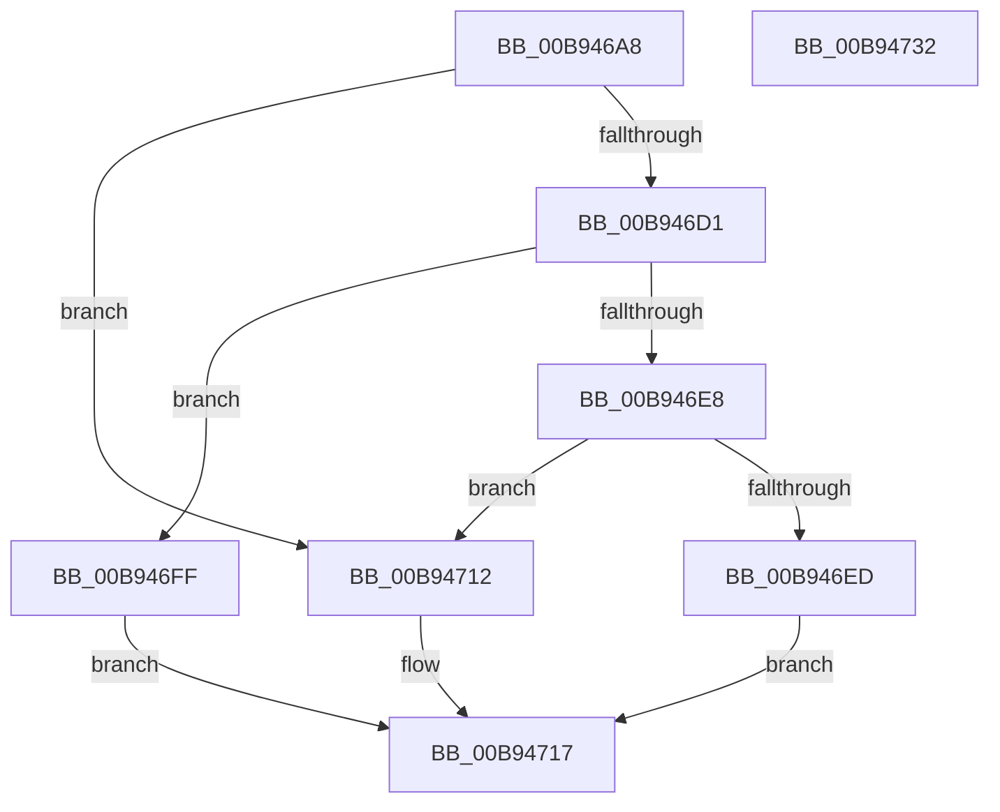

# ViDdiDispatchWmiRegInfoEx

- RVA: `0x00B946A8`–`0x00B94733` (길이 `139` bytes)
- VA: `0x0000000140B946A8`
- 실행 섹션: `PAGEVRFY`
- PDB 이름 있음: `예`; PDB Function 태그: `아니요`
- unwind 정보 RVA: `0x0005E6B4`
- 디코드: `40`개 명령, `139/139` bytes 표시
- 미해석 바이트: `0` (있으면 어셈블리에 `.byte`로 보존)

> 이 문서는 커널 이미지의 기계어와 PDB 기호를 분석해 생성했습니다. 4번과 5번은 함수 원형과 자료형을 바이너리 사용 방식에서 추정한 C 해석이며 원본 소스 복구 결과는 아닙니다.

## 1. Dependencies

- 직접 호출 지점: **2**; 고유 호출 대상: **1**
- 직접 호출자로 확인된 함수: **1**
- RIP 상대 이미지 참조: **0**

### Outgoing calls
- `0x00B946DD` → [ViDdiBuildWmiRegInfoData](ViDdiBuildWmiRegInfoData_function_00B94378.md) (function, `0x00B94378`)
- `0x00B94705` → [ViDdiBuildWmiRegInfoData](ViDdiBuildWmiRegInfoData_function_00B94378.md) (function, `0x00B94378`)

### Direct callers
- [ViDdiDispatchWmi](ViDdiDispatchWmi_function_00B94470.md) at `0x00B94493`

### Static image references
- 디코드된 RIP-relative 메모리 참조가 없습니다.

## 2. Other-region calls and transfers

- 다른 실행 섹션으로 향하는 call: **0**
- 별도 외부 분기/꼬리 이동을 확인하지 못했습니다.

## 3. Assembly (complete function range)

```asm
00B946A8  48 8B C4                        mov rax, rsp
00B946AB  48 89 58 08                     mov qword ptr [rax + 8], rbx
00B946AF  48 89 68 10                     mov qword ptr [rax + 0x10], rbp
00B946B3  48 89 70 18                     mov qword ptr [rax + 0x18], rsi
00B946B7  48 89 78 20                     mov qword ptr [rax + 0x20], rdi
00B946BB  41 56                           push r14
00B946BD  48 83 EC 20                     sub rsp, 0x20
00B946C1  48 8B 9A B8 00 00 00            mov rbx, qword ptr [rdx + 0xb8]
00B946C8  48 8B FA                        mov rdi, rdx
00B946CB  48 39 4B 08                     cmp qword ptr [rbx + 8], rcx
00B946CF  75 41                           jne 0x140b94712
00B946D1  8B 4B 10                        mov ecx, dword ptr [rbx + 0x10]
00B946D4  33 D2                           xor edx, edx
00B946D6  4C 8B 73 20                     mov r14, qword ptr [rbx + 0x20]
00B946DA  8B 6B 18                        mov ebp, dword ptr [rbx + 0x18]
00B946DD  E8 96 FC FF FF                  call 0x140b94378
00B946E2  8B F0                           mov esi, eax
00B946E4  3B C5                           cmp eax, ebp
00B946E6  76 17                           jbe 0x140b946ff
00B946E8  83 FD 04                        cmp ebp, 4
00B946EB  72 25                           jb 0x140b94712
00B946ED  41 89 36                        mov dword ptr [r14], esi
00B946F0  B8 23 00 00 C0                  mov eax, 0xc0000023
00B946F5  48 C7 47 38 04 00 00 00         mov qword ptr [rdi + 0x38], 4
00B946FD  EB 18                           jmp 0x140b94717
00B946FF  8B 4B 10                        mov ecx, dword ptr [rbx + 0x10]
00B94702  49 8B D6                        mov rdx, r14
00B94705  E8 6E FC FF FF                  call 0x140b94378
00B9470A  33 C0                           xor eax, eax
00B9470C  48 89 77 38                     mov qword ptr [rdi + 0x38], rsi
00B94710  EB 05                           jmp 0x140b94717
00B94712  B8 BB 00 00 C0                  mov eax, 0xc00000bb
00B94717  48 8B 5C 24 30                  mov rbx, qword ptr [rsp + 0x30]
00B9471C  48 8B 6C 24 38                  mov rbp, qword ptr [rsp + 0x38]
00B94721  48 8B 74 24 40                  mov rsi, qword ptr [rsp + 0x40]
00B94726  48 8B 7C 24 48                  mov rdi, qword ptr [rsp + 0x48]
00B9472B  48 83 C4 20                     add rsp, 0x20
00B9472F  41 5E                           pop r14
00B94731  C3                              ret
00B94732  CC                              int3
```

## 4. C-style interpretation (structured pseudocode)

```c
__int64 __fastcall ViDdiDispatchWmiRegInfoEx(__int64 a1, __int64 a2)
{
    __int64 result;
    __int64 v_rsp;
    unsigned __int64 v_stack_p10;
    unsigned __int64 v_stack_p18;
    unsigned __int64 v_stack_p20;
    unsigned __int64 v_stack_p8;

    *(unsigned __int64 *)(v_rsp + 8) = v_rbx;
    *(unsigned __int64 *)(v_rsp + 16) = v_rbp;
    *(unsigned __int64 *)(v_rsp + 24) = v_rsi;
    *(unsigned __int64 *)(v_rsp + 32) = v_rdi;
    v_rsp = (v_rsp) - (32);
    if ((*(unsigned __int64 *)(*(unsigned __int64 *)(a2 + 184) + 8)) != a1) goto loc_00B94712;
    a2 = 0;
    result = ViDdiBuildWmiRegInfoData((unsigned int)(*(unsigned int *)(*(unsigned __int64 *)(a2 + 184) + 16)), a2, a3, a4);
    if (((unsigned int)(result)) <= ((unsigned int)((unsigned int)(*(unsigned int *)(*(unsigned __int64 *)(a2 + 184) + 24))))) goto loc_00B946FF;
    if (((unsigned int)((unsigned int)(*(unsigned int *)(*(unsigned __int64 *)(a2 + 184) + 24)))) < 4) goto loc_00B94712;
    *(unsigned int *)(*(unsigned __int64 *)(*(unsigned __int64 *)(a2 + 184) + 32)) = (unsigned int)((unsigned int)((unsigned int)(result)));
    *(unsigned __int64 *)(a2 + 56) = 4;
    goto loc_00B94717;
loc_00B946FF:
    result = ViDdiBuildWmiRegInfoData((unsigned int)(*(unsigned int *)(*(unsigned __int64 *)(a2 + 184) + 16)), *(unsigned __int64 *)(*(unsigned __int64 *)(a2 + 184) + 32), a3, a4);
    result = 0;
    *(unsigned __int64 *)(a2 + 56) = (unsigned int)((unsigned int)(result));
    goto loc_00B94717;
loc_00B94712:
loc_00B94717:
    v_rsp = (v_rsp) + (32);
    return (unsigned int)(0xC00000BBULL);
}
```

## 5. (Beta) C Style

```c
int64_t ViDdiDispatchWmiRegInfoEx(int64_t Arg1, void *Arg2)
{
    uint8_t *arg2 = (uint8_t *)Arg2;

    int64_t result;
    int64_t local_rsp;
    uint64_t v_stack_p10;
    uint64_t v_stack_p18;
    uint64_t v_stack_p20;
    uint64_t v_stack_p8;

    *(uint64_t *)(local_rsp + 0x8) = local_rbx;
    *(uint64_t *)(local_rsp + 0x10) = local_rbp;
    *(uint64_t *)(local_rsp + 0x18) = local_rsi;
    *(uint64_t *)(local_rsp + 0x20) = local_rdi;
    local_rsp = (local_rsp) - (32);
    if ((*(uint64_t *)(*(uint64_t *)(arg2 + 0xB8) + 0x8)) != Arg1) goto loc_00B94712;
    Arg2 = 0;
    result = ViDdiBuildWmiRegInfoData((uint32_t)(*(uint32_t *)(*(uint64_t *)(arg2 + 0xB8) + 0x10)), Arg2, a3, a4);
    if (((uint32_t)(result)) <= ((uint32_t)((uint32_t)(*(uint32_t *)(*(uint64_t *)(arg2 + 0xB8) + 0x18))))) goto loc_00B946FF;
    if (((uint32_t)((uint32_t)(*(uint32_t *)(*(uint64_t *)(arg2 + 0xB8) + 0x18)))) < 4) goto loc_00B94712;
    *(uint32_t *)(*(uint64_t *)(*(uint64_t *)(arg2 + 0xB8) + 0x20)) = (uint32_t)((uint32_t)((uint32_t)(result)));
    *(uint64_t *)(arg2 + 0x38) = 4;
    goto loc_00B94717;
loc_00B946FF:
    result = ViDdiBuildWmiRegInfoData((uint32_t)(*(uint32_t *)(*(uint64_t *)(arg2 + 0xB8) + 0x10)), *(uint64_t *)(*(uint64_t *)(arg2 + 0xB8) + 0x20), a3, a4);
    result = 0;
    *(uint64_t *)(arg2 + 0x38) = (uint32_t)((uint32_t)(result));
    goto loc_00B94717;
loc_00B94712:
loc_00B94717:
    local_rsp = (local_rsp) + (32);
    return (uint32_t)(0xC00000BBULL);
}
```

### 관측된 메모리 오프셋

구조체 형식이 확인되지 않은 접근은 인자 기준의 오프셋으로만 기록했습니다.

| 기준 인자 | 오프셋 표현 | 폭 (bit) | 접근 |
|---|---:|---:|---|
| `Arg2` | `+ 0x38` | `64` | `W` |
| `Arg2` | `+ 0xB8` | `64` | `R` |

## 6. Execution-region graph

[열기: 2D/3D 그래프와 함수 탐색 컨트롤 패널](../../../control-panel.html?section=pagevrfy&rva=0x00B946A8&view=graph)

- 2D 그래프는 위에서 아래로 흐르고, 3D 그래프는 빈 공간을 드래그해 회전합니다. Shift+드래그는 이동, 휠은 확대·축소, 함수 노드 선택은 대상 보고서 이동입니다.

### Static fallback


