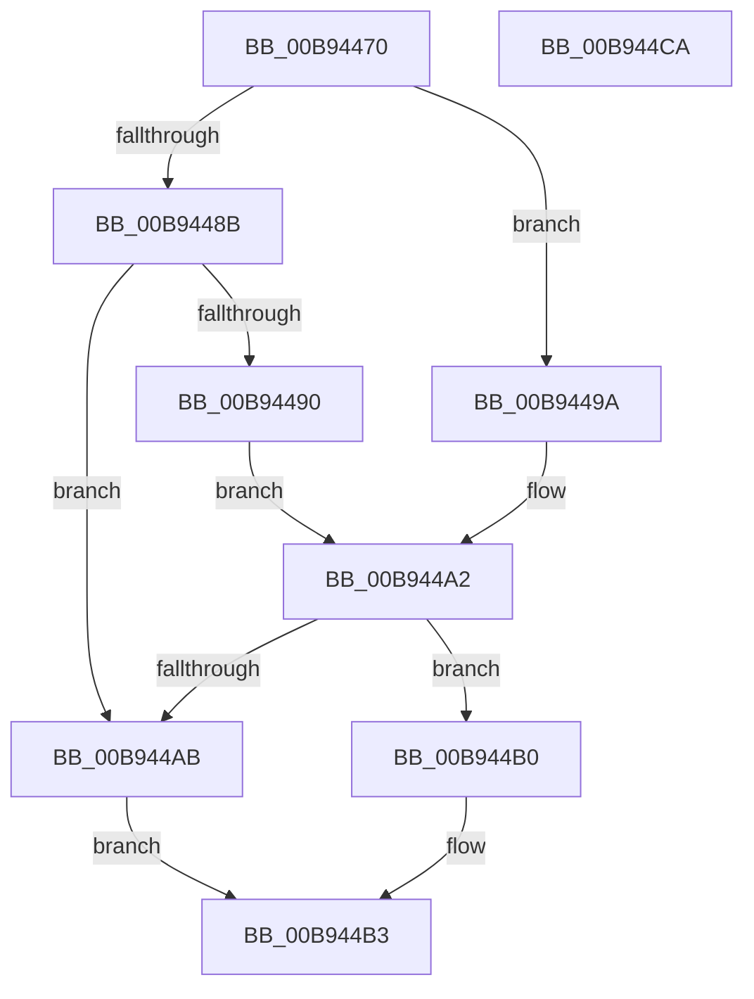

# ViDdiDispatchWmi

- RVA: `0x00B94470`–`0x00B944CB` (길이 `91` bytes)
- VA: `0x0000000140B94470`
- 실행 섹션: `PAGEVRFY`
- PDB 이름 있음: `예`; PDB Function 태그: `아니요`
- unwind 정보 RVA: `0x0005CAAC`
- 디코드: `30`개 명령, `91/91` bytes 표시
- 미해석 바이트: `0` (있으면 어셈블리에 `.byte`로 보존)

> 이 문서는 커널 이미지의 기계어와 PDB 기호를 분석해 생성했습니다. 4번과 5번은 함수 원형과 자료형을 바이너리 사용 방식에서 추정한 C 해석이며 원본 소스 복구 결과는 아닙니다.

## 1. Dependencies

- 직접 호출 지점: **3**; 고유 호출 대상: **3**
- 직접 호출자로 확인된 함수: **0**
- RIP 상대 이미지 참조: **0**

### Outgoing calls
- `0x00B94493` → [ViDdiDispatchWmiRegInfoEx](ViDdiDispatchWmiRegInfoEx_function_00B946A8.md) (function, `0x00B946A8`)
- `0x00B9449D` → [ViDdiDispatchWmiQueryAllData](ViDdiDispatchWmiQueryAllData_function_00B944D4.md) (function, `0x00B944D4`)
- `0x00B944B8` → [IofCompleteRequest](../../text/29/IofCompleteRequest_function_0029B5C0.md) (function, `0x0029B5C0`)

### Direct callers
- 이 함수 시작 RVA로 연결되는 직접 call은 확인되지 않았습니다. 간접 호출은 완전히 역산할 수 없습니다.

### Static image references
- 디코드된 RIP-relative 메모리 참조가 없습니다.

## 2. Other-region calls and transfers

- 다른 실행 섹션으로 향하는 call: **1**
  - `0x00B944B8` → [IofCompleteRequest](../../text/29/IofCompleteRequest_function_0029B5C0.md) (`PAGEVRFY` → `.text`)
- 별도 외부 분기/꼬리 이동을 확인하지 못했습니다.

## 3. Assembly (complete function range)

```asm
00B94470  48 89 5C 24 08                  mov qword ptr [rsp + 8], rbx
00B94475  57                              push rdi
00B94476  48 83 EC 20                     sub rsp, 0x20
00B9447A  48 8B 82 B8 00 00 00            mov rax, qword ptr [rdx + 0xb8]
00B94481  48 8B FA                        mov rdi, rdx
00B94484  8A 50 01                        mov dl, byte ptr [rax + 1]
00B94487  84 D2                           test dl, dl
00B94489  74 0F                           je 0x140b9449a
00B9448B  80 FA 0B                        cmp dl, 0xb
00B9448E  75 1B                           jne 0x140b944ab
00B94490  48 8B D7                        mov rdx, rdi
00B94493  E8 10 02 00 00                  call 0x140b946a8
00B94498  EB 08                           jmp 0x140b944a2
00B9449A  48 8B D7                        mov rdx, rdi
00B9449D  E8 32 00 00 00                  call 0x140b944d4
00B944A2  8B D8                           mov ebx, eax
00B944A4  3D BB 00 00 C0                  cmp eax, 0xc00000bb
00B944A9  75 05                           jne 0x140b944b0
00B944AB  8B 5F 30                        mov ebx, dword ptr [rdi + 0x30]
00B944AE  EB 03                           jmp 0x140b944b3
00B944B0  89 5F 30                        mov dword ptr [rdi + 0x30], ebx
00B944B3  33 D2                           xor edx, edx
00B944B5  48 8B CF                        mov rcx, rdi
00B944B8  E8 03 71 70 FF                  call 0x14029b5c0
00B944BD  8B C3                           mov eax, ebx
00B944BF  48 8B 5C 24 30                  mov rbx, qword ptr [rsp + 0x30]
00B944C4  48 83 C4 20                     add rsp, 0x20
00B944C8  5F                              pop rdi
00B944C9  C3                              ret
00B944CA  CC                              int3
```

## 4. C-style interpretation (structured pseudocode)

```c
__int64 __fastcall ViDdiDispatchWmi(__int64 a1, __int64 a2)
{
    __int64 result;
    __int64 v_rsp;
    unsigned __int64 v_stack_p8;

    v_stack_p8 = v_rbx;
    v_rsp = (v_rsp) - (32);
    if ((unsigned __int8)(*(unsigned __int8 *)(*(unsigned __int64 *)(a2 + 184) + 1)) == 0) goto loc_00B9449A;
    if (((unsigned __int8)(*(unsigned __int8 *)(*(unsigned __int64 *)(a2 + 184) + 1))) != 11) goto loc_00B944AB;
    result = ViDdiDispatchWmiRegInfoEx(a1, a2, a3, a4);
    goto loc_00B944A2;
loc_00B9449A:
    result = ViDdiDispatchWmiQueryAllData(a1, a2, a3, a4);
loc_00B944A2:
    if (((unsigned int)(result)) != 0xC00000BBULL) goto loc_00B944B0;
loc_00B944AB:
    goto loc_00B944B3;
loc_00B944B0:
    *(unsigned int *)(a2 + 48) = (unsigned int)((unsigned int)(*(unsigned int *)(a2 + 48)));
loc_00B944B3:
    a2 = 0;
    result = IofCompleteRequest(0, a2, a3, a4);
    v_rsp = (v_rsp) + (32);
    return (unsigned int)((unsigned int)((unsigned int)(*(unsigned int *)(a2 + 48))));
}
```

## 5. (Beta) C Style

```c
int64_t ViDdiDispatchWmi(int64_t Arg1, void *Arg2)
{
    uint8_t *arg2 = (uint8_t *)Arg2;

    int64_t result;
    int64_t local_rsp;
    uint64_t v_stack_p8;

    v_stack_p8 = local_rbx;
    local_rsp = (local_rsp) - (32);
    if ((uint8_t)(*(uint8_t *)(*(uint64_t *)(arg2 + 0xB8) + 0x1)) == 0) goto loc_00B9449A;
    if (((uint8_t)(*(uint8_t *)(*(uint64_t *)(arg2 + 0xB8) + 0x1))) != 11) goto loc_00B944AB;
    result = ViDdiDispatchWmiRegInfoEx(Arg1, Arg2, a3, a4);
    goto loc_00B944A2;
loc_00B9449A:
    result = ViDdiDispatchWmiQueryAllData(Arg1, Arg2, a3, a4);
loc_00B944A2:
    if (((uint32_t)(result)) != 0xC00000BBULL) goto loc_00B944B0;
loc_00B944AB:
    goto loc_00B944B3;
loc_00B944B0:
    *(uint32_t *)(arg2 + 0x30) = (uint32_t)((uint32_t)(*(uint32_t *)(arg2 + 0x30)));
loc_00B944B3:
    Arg2 = 0;
    result = IofCompleteRequest(0, Arg2, a3, a4);
    local_rsp = (local_rsp) + (32);
    return (uint32_t)((uint32_t)((uint32_t)(*(uint32_t *)(arg2 + 0x30))));
}
```

### 관측된 메모리 오프셋

구조체 형식이 확인되지 않은 접근은 인자 기준의 오프셋으로만 기록했습니다.

| 기준 인자 | 오프셋 표현 | 폭 (bit) | 접근 |
|---|---:|---:|---|
| `Arg2` | `+ 0x30` | `32` | `R` |
| `Arg2` | `+ 0x30` | `32` | `W` |
| `Arg2` | `+ 0xB8` | `64` | `R` |

## 6. Execution-region graph

[열기: 2D/3D 그래프와 함수 탐색 컨트롤 패널](../../../control-panel.html?section=pagevrfy&rva=0x00B94470&view=graph)

- 2D 그래프는 위에서 아래로 흐르고, 3D 그래프는 빈 공간을 드래그해 회전합니다. Shift+드래그는 이동, 휠은 확대·축소, 함수 노드 선택은 대상 보고서 이동입니다.

### Static fallback


