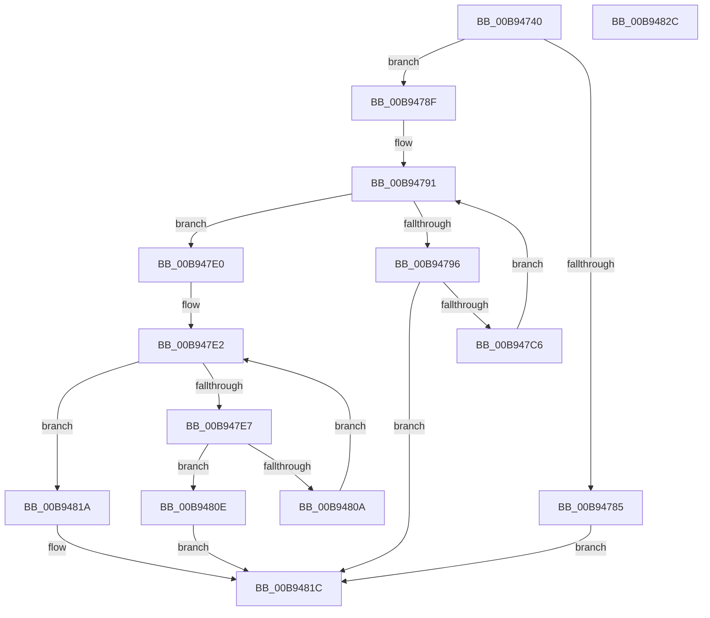

# ViDdiDriverEntry

- RVA: `0x00B94740`–`0x00B9482D` (길이 `237` bytes)
- VA: `0x0000000140B94740`
- 실행 섹션: `PAGEVRFY`
- PDB 이름 있음: `예`; PDB Function 태그: `아니요`
- unwind 정보 RVA: `0x000C91A4`
- 디코드: `63`개 명령, `237/237` bytes 표시
- 미해석 바이트: `0` (있으면 어셈블리에 `.byte`로 보존)

> 이 문서는 커널 이미지의 기계어와 PDB 기호를 분석해 생성했습니다. 4번과 5번은 함수 원형과 자료형을 바이너리 사용 방식에서 추정한 C 해석이며 원본 소스 복구 결과는 아닙니다.

## 1. Dependencies

- 직접 호출 지점: **4**; 고유 호출 대상: **4**
- 직접 호출자로 확인된 함수: **0**
- RIP 상대 이미지 참조: **3**

### Outgoing calls
- `0x00B94774` → [ExAllocatePool2](../../poolcode/B8/ExAllocatePool2_function_00B820F0.md) (function, `0x00B820F0`)
- `0x00B947BD` → [IoCreateDevice](../../page/9A/IoCreateDevice_function_009A4B00.md) (function, `0x009A4B00`)
- `0x00B947FF` → [IoWMIRegistrationControl](../../page/9E/IoWMIRegistrationControl_function_009E2D60.md) (function, `0x009E2D60`)
- `0x00B94811` → [IoDeleteDevice](../../text/26/IoDeleteDevice_function_0026FE90.md) (function, `0x0026FE90`)

### Direct callers
- 이 함수 시작 RVA로 연결되는 직접 call은 확인되지 않았습니다. 간접 호출은 완전히 역산할 수 없습니다.

### Static image references
- `0x00B94755` → RVA `0x00B94470` (`ViDdiDispatchWmi`; read)
- `0x00B94779` → RVA `0x00FFDB10` (`PAGEVRFD`; write)
- `0x00B947CB` → RVA `0x00FFDB10` (`PAGEVRFD`; read)

## 2. Other-region calls and transfers

- 다른 실행 섹션으로 향하는 call: **4**
  - `0x00B94774` → [ExAllocatePool2](../../poolcode/B8/ExAllocatePool2_function_00B820F0.md) (`PAGEVRFY` → `POOLCODE`)
  - `0x00B947BD` → [IoCreateDevice](../../page/9A/IoCreateDevice_function_009A4B00.md) (`PAGEVRFY` → `PAGE`)
  - `0x00B947FF` → [IoWMIRegistrationControl](../../page/9E/IoWMIRegistrationControl_function_009E2D60.md) (`PAGEVRFY` → `PAGE`)
  - `0x00B94811` → [IoDeleteDevice](../../text/26/IoDeleteDevice_function_0026FE90.md) (`PAGEVRFY` → `.text`)
- 별도 외부 분기/꼬리 이동을 확인하지 못했습니다.

## 3. Assembly (complete function range)

```asm
00B94740  48 89 5C 24 10                  mov qword ptr [rsp + 0x10], rbx
00B94745  48 89 74 24 18                  mov qword ptr [rsp + 0x18], rsi
00B9474A  57                              push rdi
00B9474B  48 83 EC 40                     sub rsp, 0x40
00B9474F  48 83 64 24 50 00               and qword ptr [rsp + 0x50], 0
00B94755  48 8D 05 14 FD FF FF            lea rax, [rip - 0x2ec]
00B9475C  BA 08 00 00 00                  mov edx, 8
00B94761  48 89 81 28 01 00 00            mov qword ptr [rcx + 0x128], rax
00B94768  48 8B F9                        mov rdi, rcx
00B9476B  41 B8 56 66 44 61               mov r8d, 0x61446656
00B94771  8D 4A 38                        lea ecx, [rdx + 0x38]
00B94774  E8 77 D9 FE FF                  call 0x140b820f0
00B94779  48 89 05 90 93 46 00            mov qword ptr [rip + 0x469390], rax
00B94780  48 85 C0                        test rax, rax
00B94783  75 0A                           jne 0x140b9478f
00B94785  B8 9A 00 00 C0                  mov eax, 0xc000009a
00B9478A  E9 8D 00 00 00                  jmp 0x140b9481c
00B9478F  33 DB                           xor ebx, ebx
00B94791  83 FB 01                        cmp ebx, 1
00B94794  73 4A                           jae 0x140b947e0
00B94796  41 B9 22 00 00 00               mov r9d, 0x22
00B9479C  48 8D 44 24 50                  lea rax, [rsp + 0x50]
00B947A1  48 89 44 24 30                  mov qword ptr [rsp + 0x30], rax
00B947A6  45 33 C0                        xor r8d, r8d
00B947A9  C6 44 24 28 00                  mov byte ptr [rsp + 0x28], 0
00B947AE  48 8B CF                        mov rcx, rdi
00B947B1  C7 44 24 20 80 01 00 00         mov dword ptr [rsp + 0x20], 0x180
00B947B9  41 8D 51 E2                     lea edx, [r9 - 0x1e]
00B947BD  E8 3E 03 E1 FF                  call 0x1409a4b00
00B947C2  85 C0                           test eax, eax
00B947C4  78 56                           js 0x140b9481c
00B947C6  48 8B 4C 24 50                  mov rcx, qword ptr [rsp + 0x50]
00B947CB  48 8B 15 3E 93 46 00            mov rdx, qword ptr [rip + 0x46933e]
00B947D2  48 89 0C DA                     mov qword ptr [rdx + rbx*8], rcx
00B947D6  48 8B 41 40                     mov rax, qword ptr [rcx + 0x40]
00B947DA  89 18                           mov dword ptr [rax], ebx
00B947DC  FF C3                           inc ebx
00B947DE  EB B1                           jmp 0x140b94791
00B947E0  33 DB                           xor ebx, ebx
00B947E2  83 FB 01                        cmp ebx, 1
00B947E5  73 33                           jae 0x140b9481a
00B947E7  48 8B 05 22 93 46 00            mov rax, qword ptr [rip + 0x469322]
00B947EE  BA 01 00 00 00                  mov edx, 1
00B947F3  48 8B 3C D8                     mov rdi, qword ptr [rax + rbx*8]
00B947F7  48 8B CF                        mov rcx, rdi
00B947FA  0F BA 77 30 07                  btr dword ptr [rdi + 0x30], 7
00B947FF  E8 5C E5 E4 FF                  call 0x1409e2d60
00B94804  8B F0                           mov esi, eax
00B94806  85 C0                           test eax, eax
00B94808  78 04                           js 0x140b9480e
00B9480A  FF C3                           inc ebx
00B9480C  EB D4                           jmp 0x140b947e2
00B9480E  48 8B CF                        mov rcx, rdi
00B94811  E8 7A B6 6D FF                  call 0x14026fe90
00B94816  8B C6                           mov eax, esi
00B94818  EB 02                           jmp 0x140b9481c
00B9481A  33 C0                           xor eax, eax
00B9481C  48 8B 5C 24 58                  mov rbx, qword ptr [rsp + 0x58]
00B94821  48 8B 74 24 60                  mov rsi, qword ptr [rsp + 0x60]
00B94826  48 83 C4 40                     add rsp, 0x40
00B9482A  5F                              pop rdi
00B9482B  C3                              ret
00B9482C  CC                              int3
```

## 4. C-style interpretation (structured pseudocode)

```c
__int64 __fastcall ViDdiDriverEntry(__int64 a1)
{
    __int64 result;
    __int64 v_rbx;
    __int64 v_rsp;
    unsigned __int64 v_stack_m18;
    unsigned __int8 v_stack_m20;
    unsigned int v_stack_m28;
    unsigned __int64 v_stack_p10;
    unsigned __int64 v_stack_p18;
    unsigned __int64 v_stack_p8;

    v_stack_p10 = v_rbx;
    v_stack_p18 = v_rsi;
    v_rsp = (v_rsp) - (64);
    *(unsigned __int64 *)(a1 + 296) = v_rip - 748;
    result = ExAllocatePool2(8 + 56, 8, (unsigned int)(0x61446656ULL), a4);
    *(unsigned __int64 *)(v_rip + 4625296) = result;
    if (result != 0) goto loc_00B9478F;
    goto loc_00B9481C;
loc_00B9478F:
    v_rbx = 0;
loc_00B94791:
    if (0 >= 1) goto loc_00B947E0;
    v_stack_m18 = v_stack_p8;
    a3 = 0;
    v_stack_m20 = 0;
    v_stack_m28 = 384;
    result = IoCreateDevice(a1, 34 - 30, a3, 34);
    if (sign_flag) goto loc_00B9481C;
    *(unsigned __int64 *)(*(unsigned __int64 *)(v_rip + 4625214) + v_rbx * 8) = v_stack_p8;
    *(unsigned int *)(*(unsigned __int64 *)(v_stack_p8 + 64)) = 0;
    v_rbx = (unsigned int)((v_rbx) + 1);
    goto loc_00B94791;
loc_00B947E0:
    v_rbx = 0;
loc_00B947E2:
    if (0 >= 1) goto loc_00B9481A;
    result = IoWMIRegistrationControl(*(unsigned __int64 *)(*(unsigned __int64 *)(v_rip + 4625186) + v_rbx * 8), 1, a3, 34);
    if (sign_flag) goto loc_00B9480E;
    v_rbx = (unsigned int)((v_rbx) + 1);
    goto loc_00B947E2;
loc_00B9480E:
    result = IoDeleteDevice(*(unsigned __int64 *)(*(unsigned __int64 *)(v_rip + 4625186) + v_rbx * 8), 1, a3, 34);
    goto loc_00B9481C;
loc_00B9481A:
    result = 0;
loc_00B9481C:
    v_rsp = (v_rsp) + (64);
    return result;
}
```

## 5. (Beta) C Style

```c
int64_t ViDdiDriverEntry(void *Arg1)
{
    uint8_t *arg1 = (uint8_t *)Arg1;

    int64_t result;
    int64_t local_rbx;
    int64_t local_rsp;
    uint64_t v_stack_m18;
    uint8_t v_stack_m20;
    uint32_t v_stack_m28;
    uint64_t v_stack_p10;
    uint64_t v_stack_p18;
    uint64_t v_stack_p8;

    v_stack_p10 = local_rbx;
    v_stack_p18 = local_rsi;
    local_rsp = (local_rsp) - (64);
    *(uint64_t *)(arg1 + 0x128) = v_rip - 748;
    result = ExAllocatePool2(8 + 56, 8, (uint32_t)(0x61446656ULL), a4);
    *(uint64_t *)(v_rip + 0x469390) = result;
    if (result != 0) goto loc_00B9478F;
    goto loc_00B9481C;
loc_00B9478F:
    local_rbx = 0;
loc_00B94791:
    if (0 >= 1) goto loc_00B947E0;
    v_stack_m18 = v_stack_p8;
    a3 = 0;
    v_stack_m20 = 0;
    v_stack_m28 = 384;
    result = IoCreateDevice(Arg1, 34 - 30, a3, 34);
    if (sign_flag) goto loc_00B9481C;
    *(uint64_t *)(*(uint64_t *)(v_rip + 0x46933E) + local_rbx * 8) = v_stack_p8;
    *(uint32_t *)(*(uint64_t *)(v_stack_p8 + 0x40)) = 0;
    local_rbx = (uint32_t)((local_rbx) + 1);
    goto loc_00B94791;
loc_00B947E0:
    local_rbx = 0;
loc_00B947E2:
    if (0 >= 1) goto loc_00B9481A;
    result = IoWMIRegistrationControl(*(uint64_t *)(*(uint64_t *)(v_rip + 0x469322) + local_rbx * 8), 1, a3, 34);
    if (sign_flag) goto loc_00B9480E;
    local_rbx = (uint32_t)((local_rbx) + 1);
    goto loc_00B947E2;
loc_00B9480E:
    result = IoDeleteDevice(*(uint64_t *)(*(uint64_t *)(v_rip + 0x469322) + local_rbx * 8), 1, a3, 34);
    goto loc_00B9481C;
loc_00B9481A:
    result = 0;
loc_00B9481C:
    local_rsp = (local_rsp) + (64);
    return result;
}
```

### 관측된 메모리 오프셋

구조체 형식이 확인되지 않은 접근은 인자 기준의 오프셋으로만 기록했습니다.

| 기준 인자 | 오프셋 표현 | 폭 (bit) | 접근 |
|---|---:|---:|---|
| `Arg1` | `+ 0x128` | `64` | `W` |

## 6. Execution-region graph

[열기: 2D/3D 그래프와 함수 탐색 컨트롤 패널](../../../control-panel.html?section=pagevrfy&rva=0x00B94740&view=graph)

- 2D 그래프는 위에서 아래로 흐르고, 3D 그래프는 빈 공간을 드래그해 회전합니다. Shift+드래그는 이동, 휠은 확대·축소, 함수 노드 선택은 대상 보고서 이동입니다.

### Static fallback


