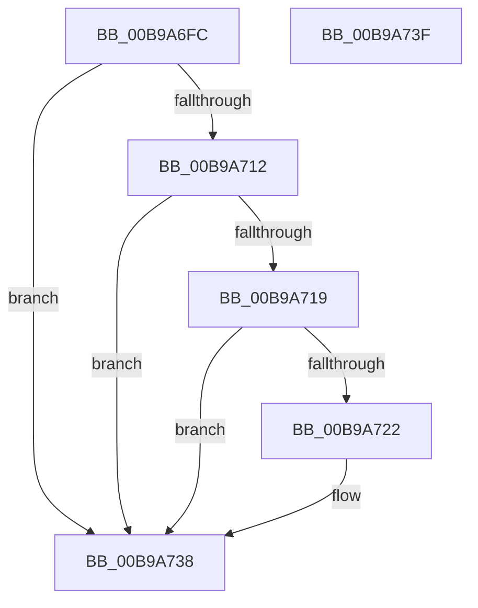

# ViDifCaptureDriverEntry

- RVA: `0x00B9A6FC`–`0x00B9A740` (길이 `68` bytes)
- VA: `0x0000000140B9A6FC`
- 실행 섹션: `PAGEVRFY`
- PDB 이름 있음: `예`; PDB Function 태그: `아니요`
- unwind 정보 RVA: `0x0005C788`
- 디코드: `21`개 명령, `68/68` bytes 표시
- 미해석 바이트: `0` (있으면 어셈블리에 `.byte`로 보존)

> 이 문서는 커널 이미지의 기계어와 PDB 기호를 분석해 생성했습니다. 4번과 5번은 함수 원형과 자료형을 바이너리 사용 방식에서 추정한 C 해석이며 원본 소스 복구 결과는 아닙니다.

## 1. Dependencies

- 직접 호출 지점: **1**; 고유 호출 대상: **1**
- 직접 호출자로 확인된 함수: **1**
- RIP 상대 이미지 참조: **1**

### Outgoing calls
- `0x00B9A708` → [ViDifFindIoCallbackContext](ViDifFindIoCallbackContext_function_00B9A8B4.md) (function, `0x00B9A8B4`)

### Direct callers
- [sub_006F9C9A](../../text/6F/Unknown_function_006F9C9A.md) at `0x006F9CDC`

### Static image references
- `0x00B9A72D` → RVA `0x00F042C8` (`.data`; read)

## 2. Other-region calls and transfers

- 다른 실행 섹션으로 향하는 call: **0**
- 별도 외부 분기/꼬리 이동을 확인하지 못했습니다.

## 3. Assembly (complete function range)

```asm
00B9A6FC  48 83 EC 28                     sub rsp, 0x28
00B9A700  4C 8B C1                        mov r8, rcx
00B9A703  B9 1C 00 00 10                  mov ecx, 0x1000001c
00B9A708  E8 A7 01 00 00                  call 0x140b9a8b4
00B9A70D  48 85 C0                        test rax, rax
00B9A710  74 26                           je 0x140b9a738
00B9A712  8B 40 08                        mov eax, dword ptr [rax + 8]
00B9A715  A8 01                           test al, 1
00B9A717  74 1F                           je 0x140b9a738
00B9A719  4D 8B 48 58                     mov r9, qword ptr [r8 + 0x58]
00B9A71D  4D 85 C9                        test r9, r9
00B9A720  74 16                           je 0x140b9a738
00B9A722  49 8B 48 30                     mov rcx, qword ptr [r8 + 0x30]
00B9A726  48 8B 51 40                     mov rdx, qword ptr [rcx + 0x40]
00B9A72A  4C 89 0A                        mov qword ptr [rdx], r9
00B9A72D  48 8B 0D 94 9B 36 00            mov rcx, qword ptr [rip + 0x369b94]
00B9A734  49 89 48 58                     mov qword ptr [r8 + 0x58], rcx
00B9A738  B0 01                           mov al, 1
00B9A73A  48 83 C4 28                     add rsp, 0x28
00B9A73E  C3                              ret
00B9A73F  CC                              int3
```

## 4. C-style interpretation (structured pseudocode)

```c
__int64 __fastcall ViDifCaptureDriverEntry(__int64 a1)
{
    __int64 result;
    __int64 v_rsp;

    v_rsp = (v_rsp) - (40);
    result = ViDifFindIoCallbackContext((unsigned int)(0x1000001CULL), a2, a1, a4);
    if (result == 0) goto loc_00B9A738;
    if ((((unsigned __int8)((unsigned int)(*(unsigned int *)(result + 8)))) & (1)) == 0) goto loc_00B9A738;
    if (*(unsigned __int64 *)(a1 + 88) != 0) {
        a1 = *(unsigned __int64 *)(a1 + 48);
        a2 = *(unsigned __int64 *)(a1 + 64);
        *(unsigned __int64 *)(a2) = *(unsigned __int64 *)(a1 + 88);
        a1 = *(unsigned __int64 *)(v_rip + 3578772);
        *(unsigned __int64 *)(a1 + 88) = a1;
    }
    v_rsp = (v_rsp) + (40);
    return 1;
}
```

## 5. (Beta) C Style

```c
int64_t ViDifCaptureDriverEntry(int64_t Arg1)
{
    int64_t result;
    int64_t local_rsp;

    local_rsp = (local_rsp) - (40);
    result = ViDifFindIoCallbackContext((uint32_t)(0x1000001CULL), a2, Arg1, a4);
    if (result == 0) goto loc_00B9A738;
    if ((((uint8_t)((uint32_t)(*(uint32_t *)(result + 0x8)))) & (1)) == 0) goto loc_00B9A738;
    if (*(uint64_t *)(Arg1 + 0x58) != 0) {
        Arg1 = *(uint64_t *)(Arg1 + 0x30);
        a2 = *(uint64_t *)(Arg1 + 0x40);
        *(uint64_t *)(a2) = *(uint64_t *)(Arg1 + 0x58);
        Arg1 = *(uint64_t *)(v_rip + 0x369B94);
        *(uint64_t *)(Arg1 + 0x58) = Arg1;
    }
    local_rsp = (local_rsp) + (40);
    return 1;
}
```

## 6. Execution-region graph

[열기: 2D/3D 그래프와 함수 탐색 컨트롤 패널](../../../control-panel.html?section=pagevrfy&rva=0x00B9A6FC&view=graph)

- 2D 그래프는 위에서 아래로 흐르고, 3D 그래프는 빈 공간을 드래그해 회전합니다. Shift+드래그는 이동, 휠은 확대·축소, 함수 노드 선택은 대상 보고서 이동입니다.

### Static fallback


