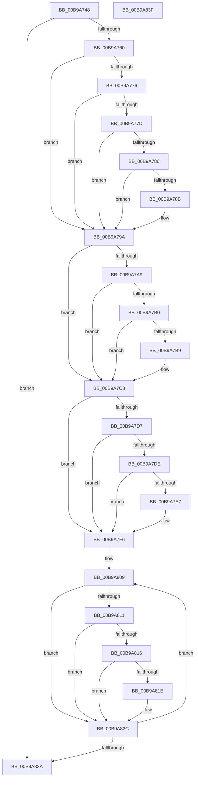

# ViDifCaptureIoCallbacks

- RVA: `0x00B9A748`–`0x00B9A840` (길이 `248` bytes)
- VA: `0x0000000140B9A748`
- 실행 섹션: `PAGEVRFY`
- PDB 이름 있음: `예`; PDB Function 태그: `아니요`
- unwind 정보 RVA: `0x0005C788`
- 디코드: `71`개 명령, `248/248` bytes 표시
- 미해석 바이트: `0` (있으면 어셈블리에 `.byte`로 보존)

> 이 문서는 커널 이미지의 기계어와 PDB 기호를 분석해 생성했습니다. 4번과 5번은 함수 원형과 자료형을 바이너리 사용 방식에서 추정한 C 해석이며 원본 소스 복구 결과는 아닙니다.

## 1. Dependencies

- 직접 호출 지점: **3**; 고유 호출 대상: **1**
- 직접 호출자로 확인된 함수: **1**
- RIP 상대 이미지 참조: **5**

### Outgoing calls
- `0x00B9A765` → [ViDifFindIoCallbackContext](ViDifFindIoCallbackContext_function_00B9A8B4.md) (function, `0x00B9A8B4`)
- `0x00B9A79F` → [ViDifFindIoCallbackContext](ViDifFindIoCallbackContext_function_00B9A8B4.md) (function, `0x00B9A8B4`)
- `0x00B9A7CD` → [ViDifFindIoCallbackContext](ViDifFindIoCallbackContext_function_00B9A8B4.md) (function, `0x00B9A8B4`)

### Direct callers
- [sub_006F9C7C](../../text/6F/Unknown_function_006F9C7C.md) at `0x006F9C8D`

### Static image references
- `0x00B9A76A` → RVA `0x0029B590` (`IopInvalidDeviceRequest`; read)
- `0x00B9A78F` → RVA `0x00F042F8` (`.data`; read)
- `0x00B9A7BD` → RVA `0x00F04300` (`.data`; read)
- `0x00B9A7EB` → RVA `0x00F042D0` (`.data`; read)
- `0x00B9A802` → RVA `0x00FF4220` (`PAGEVRFD`; read)

## 2. Other-region calls and transfers

- 다른 실행 섹션으로 향하는 call: **0**
- 별도 외부 분기/꼬리 이동을 확인하지 못했습니다.

## 3. Assembly (complete function range)

```asm
00B9A748  48 83 EC 28                     sub rsp, 0x28
00B9A74C  4C 8B 49 30                     mov r9, qword ptr [rcx + 0x30]
00B9A750  48 8B D1                        mov rdx, rcx
00B9A753  4D 8B 41 40                     mov r8, qword ptr [r9 + 0x40]
00B9A757  4D 85 C0                        test r8, r8
00B9A75A  0F 84 DA 00 00 00               je 0x140b9a83a
00B9A760  B9 1D 00 00 10                  mov ecx, 0x1000001d
00B9A765  E8 4A 01 00 00                  call 0x140b9a8b4
00B9A76A  4C 8D 1D 1F 0E 70 FF            lea r11, [rip - 0x8ff1e1]
00B9A771  48 85 C0                        test rax, rax
00B9A774  74 24                           je 0x140b9a79a
00B9A776  8B 40 08                        mov eax, dword ptr [rax + 8]
00B9A779  A8 01                           test al, 1
00B9A77B  74 1D                           je 0x140b9a79a
00B9A77D  48 8B 42 60                     mov rax, qword ptr [rdx + 0x60]
00B9A781  48 85 C0                        test rax, rax
00B9A784  74 14                           je 0x140b9a79a
00B9A786  49 3B C3                        cmp rax, r11
00B9A789  74 0F                           je 0x140b9a79a
00B9A78B  49 89 40 08                     mov qword ptr [r8 + 8], rax
00B9A78F  48 8B 05 62 9B 36 00            mov rax, qword ptr [rip + 0x369b62]
00B9A796  48 89 42 60                     mov qword ptr [rdx + 0x60], rax
00B9A79A  B9 1F 00 00 10                  mov ecx, 0x1000001f
00B9A79F  E8 10 01 00 00                  call 0x140b9a8b4
00B9A7A4  48 85 C0                        test rax, rax
00B9A7A7  74 1F                           je 0x140b9a7c8
00B9A7A9  8B 40 08                        mov eax, dword ptr [rax + 8]
00B9A7AC  A8 01                           test al, 1
00B9A7AE  74 18                           je 0x140b9a7c8
00B9A7B0  48 8B 42 68                     mov rax, qword ptr [rdx + 0x68]
00B9A7B4  48 85 C0                        test rax, rax
00B9A7B7  74 0F                           je 0x140b9a7c8
00B9A7B9  49 89 40 10                     mov qword ptr [r8 + 0x10], rax
00B9A7BD  48 8B 05 3C 9B 36 00            mov rax, qword ptr [rip + 0x369b3c]
00B9A7C4  48 89 42 68                     mov qword ptr [rdx + 0x68], rax
00B9A7C8  B9 1E 00 00 10                  mov ecx, 0x1000001e
00B9A7CD  E8 E2 00 00 00                  call 0x140b9a8b4
00B9A7D2  48 85 C0                        test rax, rax
00B9A7D5  74 1F                           je 0x140b9a7f6
00B9A7D7  8B 40 08                        mov eax, dword ptr [rax + 8]
00B9A7DA  A8 01                           test al, 1
00B9A7DC  74 18                           je 0x140b9a7f6
00B9A7DE  49 8B 41 08                     mov rax, qword ptr [r9 + 8]
00B9A7E2  48 85 C0                        test rax, rax
00B9A7E5  74 0F                           je 0x140b9a7f6
00B9A7E7  49 89 40 18                     mov qword ptr [r8 + 0x18], rax
00B9A7EB  48 8B 05 DE 9A 36 00            mov rax, qword ptr [rip + 0x369ade]
00B9A7F2  49 89 41 08                     mov qword ptr [r9 + 8], rax
00B9A7F6  4C 8D 4A 70                     lea r9, [rdx + 0x70]
00B9A7FA  4C 2B C2                        sub r8, rdx
00B9A7FD  BA 1C 00 00 00                  mov edx, 0x1c
00B9A802  4C 8D 15 17 9A 45 00            lea r10, [rip + 0x459a17]
00B9A809  49 8B 09                        mov rcx, qword ptr [r9]
00B9A80C  48 85 C9                        test rcx, rcx
00B9A80F  74 1B                           je 0x140b9a82c
00B9A811  49 3B CB                        cmp rcx, r11
00B9A814  74 16                           je 0x140b9a82c
00B9A816  41 8B 42 F8                     mov eax, dword ptr [r10 - 8]
00B9A81A  A8 01                           test al, 1
00B9A81C  74 0E                           je 0x140b9a82c
00B9A81E  4B 89 4C 08 B0                  mov qword ptr [r8 + r9 - 0x50], rcx
00B9A823  49 8B 02                        mov rax, qword ptr [r10]
00B9A826  48 8B 08                        mov rcx, qword ptr [rax]
00B9A829  49 89 09                        mov qword ptr [r9], rcx
00B9A82C  49 83 C1 08                     add r9, 8
00B9A830  49 83 C2 20                     add r10, 0x20
00B9A834  48 83 EA 01                     sub rdx, 1
00B9A838  75 CF                           jne 0x140b9a809
00B9A83A  48 83 C4 28                     add rsp, 0x28
00B9A83E  C3                              ret
00B9A83F  CC                              int3
```

## 4. C-style interpretation (structured pseudocode)

```c
__int64 __fastcall ViDifCaptureIoCallbacks(__int64 a1)
{
    __int64 result;
    __int64 v_r10;
    __int64 v_rsp;

    v_rsp = (v_rsp) - (40);
    if (*(unsigned __int64 *)(*(unsigned __int64 *)(a1 + 48) + 64) == 0) goto loc_00B9A83A;
    result = ViDifFindIoCallbackContext((unsigned int)(0x1000001DULL), a1, *(unsigned __int64 *)(*(unsigned __int64 *)(a1 + 48) + 64), *(unsigned __int64 *)(a1 + 48));
    if (result == 0) goto loc_00B9A79A;
    if ((((unsigned __int8)((unsigned int)(*(unsigned int *)(result + 8)))) & (1)) == 0) goto loc_00B9A79A;
    if (*(unsigned __int64 *)(a1 + 96) == 0) goto loc_00B9A79A;
    result = *(unsigned __int64 *)(a1 + 96);
    if ((*(unsigned __int64 *)(a1 + 96)) != (v_rip - 9433569)) {
        *(unsigned __int64 *)(*(unsigned __int64 *)(*(unsigned __int64 *)(a1 + 48) + 64) + 8) = *(unsigned __int64 *)(a1 + 96);
        result = *(unsigned __int64 *)(v_rip + 3578722);
        *(unsigned __int64 *)(a1 + 96) = result;
    }
    result = ViDifFindIoCallbackContext((unsigned int)(0x1000001FULL), a1, *(unsigned __int64 *)(*(unsigned __int64 *)(a1 + 48) + 64), *(unsigned __int64 *)(a1 + 48));
    if (result == 0) goto loc_00B9A7C8;
    if ((((unsigned __int8)((unsigned int)(*(unsigned int *)(result + 8)))) & (1)) == 0) goto loc_00B9A7C8;
    result = *(unsigned __int64 *)(a1 + 104);
    if (*(unsigned __int64 *)(a1 + 104) != 0) {
        *(unsigned __int64 *)(*(unsigned __int64 *)(*(unsigned __int64 *)(a1 + 48) + 64) + 16) = *(unsigned __int64 *)(a1 + 104);
        result = *(unsigned __int64 *)(v_rip + 3578684);
        *(unsigned __int64 *)(a1 + 104) = result;
    }
    result = ViDifFindIoCallbackContext((unsigned int)(0x1000001EULL), a1, *(unsigned __int64 *)(*(unsigned __int64 *)(a1 + 48) + 64), *(unsigned __int64 *)(a1 + 48));
    if (result == 0) goto loc_00B9A7F6;
    if ((((unsigned __int8)((unsigned int)(*(unsigned int *)(result + 8)))) & (1)) == 0) goto loc_00B9A7F6;
    result = *(unsigned __int64 *)(*(unsigned __int64 *)(a1 + 48) + 8);
    if (*(unsigned __int64 *)(*(unsigned __int64 *)(a1 + 48) + 8) != 0) {
        *(unsigned __int64 *)(*(unsigned __int64 *)(*(unsigned __int64 *)(a1 + 48) + 64) + 24) = *(unsigned __int64 *)(*(unsigned __int64 *)(a1 + 48) + 8);
        result = *(unsigned __int64 *)(v_rip + 3578590);
        *(unsigned __int64 *)(*(unsigned __int64 *)(a1 + 48) + 8) = result;
    }
    a3 = (*(unsigned __int64 *)(*(unsigned __int64 *)(a1 + 48) + 64)) - (a1);
loc_00B9A809:
    if (*(unsigned __int64 *)(a1 + 112) == 0) goto loc_00B9A82C;
    if ((*(unsigned __int64 *)(a1 + 112)) == (v_rip - 9433569)) goto loc_00B9A82C;
    result = (unsigned int)(*(unsigned int *)(v_rip + 4561431 - 8));
    if ((((unsigned __int8)((unsigned int)(*(unsigned int *)(v_rip + 4561431 - 8)))) & (1)) != 0) {
        *(unsigned __int64 *)(a3 + a1 + 112 * 1 - 80) = *(unsigned __int64 *)(a1 + 112);
        result = *(unsigned __int64 *)(v_rip + 4561431);
        a1 = *(unsigned __int64 *)(result);
        *(unsigned __int64 *)(a1 + 112) = a1;
    }
    a4 = (a1 + 112) + (8);
    v_r10 = (v_rip + 4561431) + (32);
    a2 = (28) - (1);
    if (condition_is_not_equal) goto loc_00B9A809;
loc_00B9A83A:
    v_rsp = (v_rsp) + (40);
    return result;
}
```

## 5. (Beta) C Style

```c
int64_t ViDifCaptureIoCallbacks(void *Arg1)
{
    uint8_t *arg1 = (uint8_t *)Arg1;

    int64_t result;
    int64_t local_r10;
    int64_t local_rsp;

    local_rsp = (local_rsp) - (40);
    if (*(uint64_t *)(*(uint64_t *)(arg1 + 0x30) + 0x40) == 0) goto loc_00B9A83A;
    result = ViDifFindIoCallbackContext((uint32_t)(0x1000001DULL), Arg1, *(uint64_t *)(*(uint64_t *)(arg1 + 0x30) + 0x40), *(uint64_t *)(arg1 + 0x30));
    if (result == 0) goto loc_00B9A79A;
    if ((((uint8_t)((uint32_t)(*(uint32_t *)(result + 0x8)))) & (1)) == 0) goto loc_00B9A79A;
    if (*(uint64_t *)(arg1 + 0x60) == 0) goto loc_00B9A79A;
    result = *(uint64_t *)(arg1 + 0x60);
    if ((*(uint64_t *)(arg1 + 0x60)) != (v_rip - 9433569)) {
        *(uint64_t *)(*(uint64_t *)(*(uint64_t *)(arg1 + 0x30) + 0x40) + 0x8) = *(uint64_t *)(arg1 + 0x60);
        result = *(uint64_t *)(v_rip + 0x369B62);
        *(uint64_t *)(arg1 + 0x60) = result;
    }
    result = ViDifFindIoCallbackContext((uint32_t)(0x1000001FULL), Arg1, *(uint64_t *)(*(uint64_t *)(arg1 + 0x30) + 0x40), *(uint64_t *)(arg1 + 0x30));
    if (result == 0) goto loc_00B9A7C8;
    if ((((uint8_t)((uint32_t)(*(uint32_t *)(result + 0x8)))) & (1)) == 0) goto loc_00B9A7C8;
    result = *(uint64_t *)(arg1 + 0x68);
    if (*(uint64_t *)(arg1 + 0x68) != 0) {
        *(uint64_t *)(*(uint64_t *)(*(uint64_t *)(arg1 + 0x30) + 0x40) + 0x10) = *(uint64_t *)(arg1 + 0x68);
        result = *(uint64_t *)(v_rip + 0x369B3C);
        *(uint64_t *)(arg1 + 0x68) = result;
    }
    result = ViDifFindIoCallbackContext((uint32_t)(0x1000001EULL), Arg1, *(uint64_t *)(*(uint64_t *)(arg1 + 0x30) + 0x40), *(uint64_t *)(arg1 + 0x30));
    if (result == 0) goto loc_00B9A7F6;
    if ((((uint8_t)((uint32_t)(*(uint32_t *)(result + 0x8)))) & (1)) == 0) goto loc_00B9A7F6;
    result = *(uint64_t *)(*(uint64_t *)(arg1 + 0x30) + 0x8);
    if (*(uint64_t *)(*(uint64_t *)(arg1 + 0x30) + 0x8) != 0) {
        *(uint64_t *)(*(uint64_t *)(*(uint64_t *)(arg1 + 0x30) + 0x40) + 0x18) = *(uint64_t *)(*(uint64_t *)(arg1 + 0x30) + 0x8);
        result = *(uint64_t *)(v_rip + 0x369ADE);
        *(uint64_t *)(*(uint64_t *)(arg1 + 0x30) + 0x8) = result;
    }
    a3 = (*(uint64_t *)(*(uint64_t *)(arg1 + 0x30) + 0x40)) - (Arg1);
loc_00B9A809:
    if (*(uint64_t *)(arg1 + 0x70) == 0) goto loc_00B9A82C;
    if ((*(uint64_t *)(arg1 + 0x70)) == (v_rip - 9433569)) goto loc_00B9A82C;
    result = (uint32_t)(*(uint32_t *)(v_rip + 0x459A17 - 0x8));
    if ((((uint8_t)((uint32_t)(*(uint32_t *)(v_rip + 0x459A17 - 0x8)))) & (1)) != 0) {
        *(uint64_t *)(a3 + arg1 + 0x70 * 1 - 0x50) = *(uint64_t *)(arg1 + 0x70);
        result = *(uint64_t *)(v_rip + 0x459A17);
        Arg1 = *(uint64_t *)(result);
        *(void **)(arg1 + 0x70) = Arg1;
    }
    a4 = (Arg1 + 112) + (8);
    local_r10 = (v_rip + 4561431) + (32);
    a2 = (28) - (1);
    if (condition_is_not_equal) goto loc_00B9A809;
loc_00B9A83A:
    local_rsp = (local_rsp) + (40);
    return result;
}
```

### 관측된 메모리 오프셋

구조체 형식이 확인되지 않은 접근은 인자 기준의 오프셋으로만 기록했습니다.

| 기준 인자 | 오프셋 표현 | 폭 (bit) | 접근 |
|---|---:|---:|---|
| `Arg1` | `+ 0x30` | `64` | `R` |

## 6. Execution-region graph

[열기: 2D/3D 그래프와 함수 탐색 컨트롤 패널](../../../control-panel.html?section=pagevrfy&rva=0x00B9A748&view=graph)

- 2D 그래프는 위에서 아래로 흐르고, 3D 그래프는 빈 공간을 드래그해 회전합니다. Shift+드래그는 이동, 휠은 확대·축소, 함수 노드 선택은 대상 보고서 이동입니다.

### Static fallback


