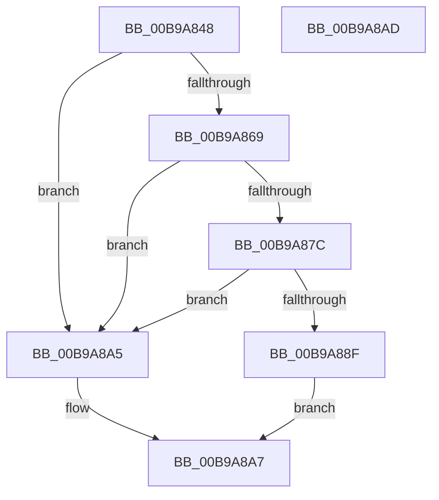

# ViDifCheckCallbackInterception

- RVA: `0x00B9A848`–`0x00B9A8AE` (길이 `102` bytes)
- VA: `0x0000000140B9A848`
- 실행 섹션: `PAGEVRFY`
- PDB 이름 있음: `예`; PDB Function 태그: `아니요`
- unwind 정보 RVA: `0x0005CF00`
- 디코드: `30`개 명령, `102/102` bytes 표시
- 미해석 바이트: `0` (있으면 어셈블리에 `.byte`로 보존)

> 이 문서는 커널 이미지의 기계어와 PDB 기호를 분석해 생성했습니다. 4번과 5번은 함수 원형과 자료형을 바이너리 사용 방식에서 추정한 C 해석이며 원본 소스 복구 결과는 아닙니다.

## 1. Dependencies

- 직접 호출 지점: **4**; 고유 호출 대상: **1**
- 직접 호출자로 확인된 함수: **2**
- RIP 상대 이미지 참조: **4**

### Outgoing calls
- `0x00B9A860` → [VfUtilEqualUnicodeString](VfUtilEqualUnicodeString_function_00B93218.md) (function, `0x00B93218`)
- `0x00B9A873` → [VfUtilEqualUnicodeString](VfUtilEqualUnicodeString_function_00B93218.md) (function, `0x00B93218`)
- `0x00B9A886` → [VfUtilEqualUnicodeString](VfUtilEqualUnicodeString_function_00B93218.md) (function, `0x00B93218`)
- `0x00B9A899` → [VfUtilEqualUnicodeString](VfUtilEqualUnicodeString_function_00B93218.md) (function, `0x00B93218`)

### Direct callers
- [VfDifCaptureIoCallbacks](../../text/4A/VfDifCaptureIoCallbacks_function_004A8698.md) at `0x004A86BF`
- [VfDifCaptureDriverEntry](../../text/4A/VfDifCaptureDriverEntry_function_004A86F8.md) at `0x004A8728`

### Static image references
- `0x00B9A852` → RVA `0x00B8B0F0` (`VfRdbssServiceName`; read)
- `0x00B9A86C` → RVA `0x00B8B0E0` (`VfMupServiceName`; read)
- `0x00B9A87F` → RVA `0x00B8B0D0` (`VfCscServiceName`; read)
- `0x00B9A892` → RVA `0x00B8B100` (`VfAmdkmpagServiceName`; read)

## 2. Other-region calls and transfers

- 다른 실행 섹션으로 향하는 call: **0**
- 별도 외부 분기/꼬리 이동을 확인하지 못했습니다.

## 3. Assembly (complete function range)

```asm
00B9A848  40 53                           push rbx
00B9A84A  48 83 EC 20                     sub rsp, 0x20
00B9A84E  48 8B 59 30                     mov rbx, qword ptr [rcx + 0x30]
00B9A852  48 8D 0D 97 08 FF FF            lea rcx, [rip - 0xf769]
00B9A859  48 83 C3 18                     add rbx, 0x18
00B9A85D  48 8B D3                        mov rdx, rbx
00B9A860  E8 B3 89 FF FF                  call 0x140b93218
00B9A865  85 C0                           test eax, eax
00B9A867  75 3C                           jne 0x140b9a8a5
00B9A869  48 8B D3                        mov rdx, rbx
00B9A86C  48 8D 0D 6D 08 FF FF            lea rcx, [rip - 0xf793]
00B9A873  E8 A0 89 FF FF                  call 0x140b93218
00B9A878  85 C0                           test eax, eax
00B9A87A  75 29                           jne 0x140b9a8a5
00B9A87C  48 8B D3                        mov rdx, rbx
00B9A87F  48 8D 0D 4A 08 FF FF            lea rcx, [rip - 0xf7b6]
00B9A886  E8 8D 89 FF FF                  call 0x140b93218
00B9A88B  85 C0                           test eax, eax
00B9A88D  75 16                           jne 0x140b9a8a5
00B9A88F  48 8B D3                        mov rdx, rbx
00B9A892  48 8D 0D 67 08 FF FF            lea rcx, [rip - 0xf799]
00B9A899  E8 7A 89 FF FF                  call 0x140b93218
00B9A89E  85 C0                           test eax, eax
00B9A8A0  0F 94 C0                        sete al
00B9A8A3  EB 02                           jmp 0x140b9a8a7
00B9A8A5  32 C0                           xor al, al
00B9A8A7  48 83 C4 20                     add rsp, 0x20
00B9A8AB  5B                              pop rbx
00B9A8AC  C3                              ret
00B9A8AD  CC                              int3
```

## 4. C-style interpretation (structured pseudocode)

```c
__int64 __fastcall ViDifCheckCallbackInterception(__int64 a1)
{
    __int64 result;
    __int64 v_rbx;
    __int64 v_rsp;

    v_rsp = (v_rsp) - (32);
    v_rbx = (*(unsigned __int64 *)(a1 + 48)) + (24);
    result = VfUtilEqualUnicodeString(v_rip - 63337, v_rbx, a3, a4);
    if ((unsigned int)(result) != 0) goto loc_00B9A8A5;
    result = VfUtilEqualUnicodeString(v_rip - 63379, v_rbx, a3, a4);
    if ((unsigned int)(result) != 0) goto loc_00B9A8A5;
    result = VfUtilEqualUnicodeString(v_rip - 63414, v_rbx, a3, a4);
    if ((unsigned int)(result) != 0) goto loc_00B9A8A5;
    result = VfUtilEqualUnicodeString(v_rip - 63385, v_rbx, a3, a4);
    result = ((unsigned int)(result) == 0) ? 1 : 0;
    goto loc_00B9A8A7;
loc_00B9A8A5:
    result = 0;
loc_00B9A8A7:
    v_rsp = (v_rsp) + (32);
    return result;
}
```

## 5. (Beta) C Style

```c
int64_t ViDifCheckCallbackInterception(void *Arg1)
{
    uint8_t *arg1 = (uint8_t *)Arg1;

    int64_t result;
    int64_t local_rbx;
    int64_t local_rsp;

    local_rsp = (local_rsp) - (32);
    local_rbx = (*(uint64_t *)(arg1 + 0x30)) + (24);
    result = VfUtilEqualUnicodeString(v_rip - 63337, local_rbx, a3, a4);
    if ((uint32_t)(result) != 0) goto loc_00B9A8A5;
    result = VfUtilEqualUnicodeString(v_rip - 63379, local_rbx, a3, a4);
    if ((uint32_t)(result) != 0) goto loc_00B9A8A5;
    result = VfUtilEqualUnicodeString(v_rip - 63414, local_rbx, a3, a4);
    if ((uint32_t)(result) != 0) goto loc_00B9A8A5;
    result = VfUtilEqualUnicodeString(v_rip - 63385, local_rbx, a3, a4);
    result = ((uint32_t)(result) == 0) ? 1 : 0;
    goto loc_00B9A8A7;
loc_00B9A8A5:
    result = 0;
loc_00B9A8A7:
    local_rsp = (local_rsp) + (32);
    return result;
}
```

### 관측된 메모리 오프셋

구조체 형식이 확인되지 않은 접근은 인자 기준의 오프셋으로만 기록했습니다.

| 기준 인자 | 오프셋 표현 | 폭 (bit) | 접근 |
|---|---:|---:|---|
| `Arg1` | `+ 0x30` | `64` | `R` |

## 6. Execution-region graph

[열기: 2D/3D 그래프와 함수 탐색 컨트롤 패널](../../../control-panel.html?section=pagevrfy&rva=0x00B9A848&view=graph)

- 2D 그래프는 위에서 아래로 흐르고, 3D 그래프는 빈 공간을 드래그해 회전합니다. Shift+드래그는 이동, 휠은 확대·축소, 함수 노드 선택은 대상 보고서 이동입니다.

### Static fallback


