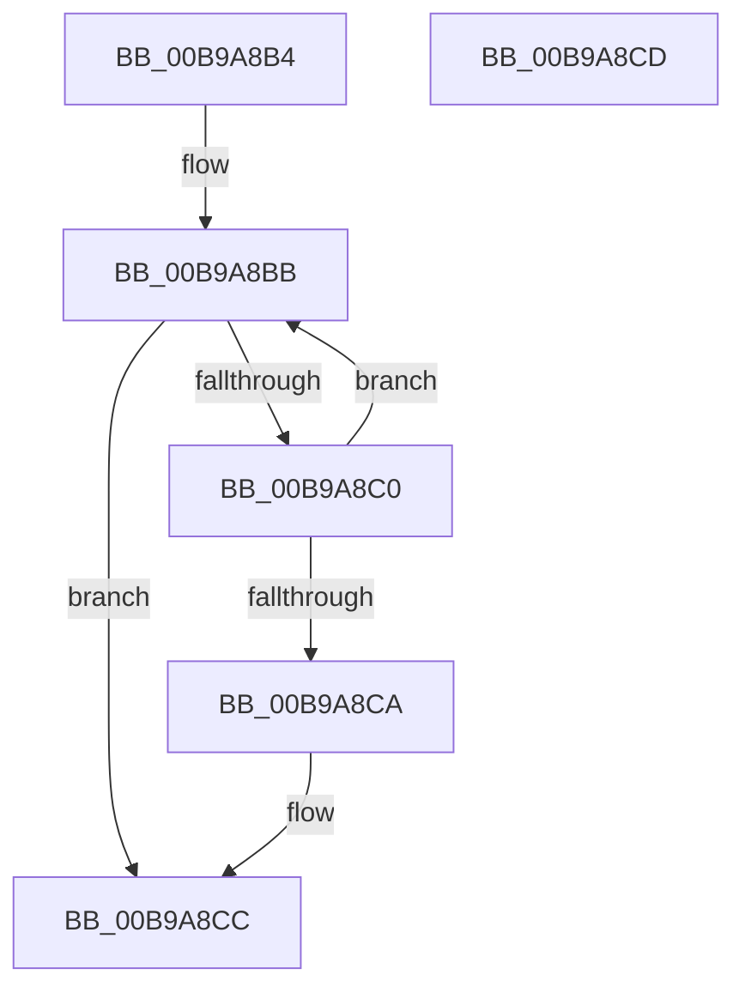

# ViDifFindIoCallbackContext

- RVA: `0x00B9A8B4`–`0x00B9A8CE` (길이 `26` bytes)
- VA: `0x0000000140B9A8B4`
- 실행 섹션: `PAGEVRFY`
- PDB 이름 있음: `예`; PDB Function 태그: `아니요`
- unwind 정보 RVA: `0x000DB714`
- 디코드: `9`개 명령, `26/26` bytes 표시
- 미해석 바이트: `0` (있으면 어셈블리에 `.byte`로 보존)

> 이 문서는 커널 이미지의 기계어와 PDB 기호를 분석해 생성했습니다. 4번과 5번은 함수 원형과 자료형을 바이너리 사용 방식에서 추정한 C 해석이며 원본 소스 복구 결과는 아닙니다.

## 1. Dependencies

- 직접 호출 지점: **0**; 고유 호출 대상: **0**
- 직접 호출자로 확인된 함수: **3**
- RIP 상대 이미지 참조: **1**

### Outgoing calls
- 직접 디코드된 call 명령이 없습니다.

### Direct callers
- [VfDifRecoverIoCallbacks](../../text/61/VfDifRecoverIoCallbacks_function_00612F40.md) at `0x00612F70`
- [VfDifRecoverIoCallbacks](../../text/61/VfDifRecoverIoCallbacks_function_00612F40.md) at `0x00612FA0`
- [VfDifRecoverIoCallbacks](../../text/61/VfDifRecoverIoCallbacks_function_00612F40.md) at `0x00612FD0`
- [ViDifCaptureDriverEntry](ViDifCaptureDriverEntry_function_00B9A6FC.md) at `0x00B9A708`
- [ViDifCaptureIoCallbacks](ViDifCaptureIoCallbacks_function_00B9A748.md) at `0x00B9A765`
- [ViDifCaptureIoCallbacks](ViDifCaptureIoCallbacks_function_00B9A748.md) at `0x00B9A79F`
- [ViDifCaptureIoCallbacks](ViDifCaptureIoCallbacks_function_00B9A748.md) at `0x00B9A7CD`

### Static image references
- `0x00B9A8B4` → RVA `0x00FF4210` (`PAGEVRFD`; read)

## 2. Other-region calls and transfers

- 다른 실행 섹션으로 향하는 call: **0**
- 별도 외부 분기/꼬리 이동을 확인하지 못했습니다.

## 3. Assembly (complete function range)

```asm
00B9A8B4  48 8D 05 55 99 45 00            lea rax, [rip + 0x459955]
00B9A8BB  39 48 18                        cmp dword ptr [rax + 0x18], ecx
00B9A8BE  74 0C                           je 0x140b9a8cc
00B9A8C0  48 83 C0 20                     add rax, 0x20
00B9A8C4  48 83 38 00                     cmp qword ptr [rax], 0
00B9A8C8  75 F1                           jne 0x140b9a8bb
00B9A8CA  33 C0                           xor eax, eax
00B9A8CC  C3                              ret
00B9A8CD  CC                              int3
```

## 4. C-style interpretation (structured pseudocode)

```c
__int64 __fastcall ViDifFindIoCallbackContext(int a1)
{
    __int64 result;

loc_00B9A8BB:
    if ((*(unsigned int *)(v_rip + 4561237 + 24)) == a1) goto loc_00B9A8CC;
    result = (v_rip + 4561237) + (32);
    if ((*(unsigned __int64 *)(result)) != 0) goto loc_00B9A8BB;
    result = 0;
loc_00B9A8CC:
    return result;
}
```

## 5. (Beta) C Style

```c
int64_t ViDifFindIoCallbackContext(int32_t Arg1)
{
    int64_t result;

loc_00B9A8BB:
    if ((*(uint32_t *)(v_rip + 0x459955 + 0x18)) == Arg1) goto loc_00B9A8CC;
    result = (v_rip + 4561237) + (32);
    if ((*(uint64_t *)(result)) != 0) goto loc_00B9A8BB;
    result = 0;
loc_00B9A8CC:
    return result;
}
```

## 6. Execution-region graph

[열기: 2D/3D 그래프와 함수 탐색 컨트롤 패널](../../../control-panel.html?section=pagevrfy&rva=0x00B9A8B4&view=graph)

- 2D 그래프는 위에서 아래로 흐르고, 3D 그래프는 빈 공간을 드래그해 회전합니다. Shift+드래그는 이동, 휠은 확대·축소, 함수 노드 선택은 대상 보고서 이동입니다.

### Static fallback


