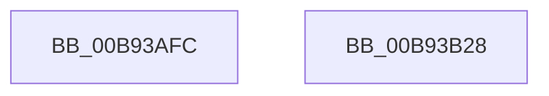

# ViDisableVerification

- RVA: `0x00B93AFC`–`0x00B93B29` (길이 `45` bytes)
- VA: `0x0000000140B93AFC`
- 실행 섹션: `PAGEVRFY`
- PDB 이름 있음: `예`; PDB Function 태그: `아니요`
- unwind 정보 RVA: `0x000DB714`
- 디코드: `10`개 명령, `45/45` bytes 표시
- 미해석 바이트: `0` (있으면 어셈블리에 `.byte`로 보존)

> 이 문서는 커널 이미지의 기계어와 PDB 기호를 분석해 생성했습니다. 4번과 5번은 함수 원형과 자료형을 바이너리 사용 방식에서 추정한 C 해석이며 원본 소스 복구 결과는 아닙니다.

## 1. Dependencies

- 직접 호출 지점: **0**; 고유 호출 대상: **0**
- 직접 호출자로 확인된 함수: **1**
- RIP 상대 이미지 참조: **6**

### Outgoing calls
- 직접 디코드된 call 명령이 없습니다.

### Direct callers
- [ViInitSystemPhase0](../../init/C4/ViInitSystemPhase0_function_00C4C1B0.md) at `0x00C4C3DB`
- [ViInitSystemPhase0](../../init/C4/ViInitSystemPhase0_function_00C4C1B0.md) at `0x00C4C5CE`

### Static image references
- `0x00B93AFC` → RVA `0x01008150` (`INITDATA`; read/write)
- `0x00B93B05` → RVA `0x00E0E950` (`.data`; write)
- `0x00B93B0B` → RVA `0x00E681A0` (`.data`; write)
- `0x00B93B12` → RVA `0x00FFDA08` (`PAGEVRFD`; write)
- `0x00B93B18` → RVA `0x00F04A04` (`.data`; write)
- `0x00B93B21` → RVA `0x00F044C0` (`.data`; write)

## 2. Other-region calls and transfers

- 다른 실행 섹션으로 향하는 call: **0**
- 별도 외부 분기/꼬리 이동을 확인하지 못했습니다.

## 3. Assembly (complete function range)

```asm
00B93AFC  83 0D 4D 46 47 00 FF            or dword ptr [rip + 0x47464d], 0xffffffff
00B93B03  33 C0                           xor eax, eax
00B93B05  89 05 45 AE 27 00               mov dword ptr [rip + 0x27ae45], eax
00B93B0B  48 89 05 8E 46 2D 00            mov qword ptr [rip + 0x2d468e], rax
00B93B12  89 05 F0 9E 46 00               mov dword ptr [rip + 0x469ef0], eax
00B93B18  89 05 E6 0E 37 00               mov dword ptr [rip + 0x370ee6], eax
00B93B1E  0F B6 C1                        movzx eax, cl
00B93B21  89 05 99 09 37 00               mov dword ptr [rip + 0x370999], eax
00B93B27  C3                              ret
00B93B28  CC                              int3
```

## 4. C-style interpretation (structured pseudocode)

```c
__int64 __fastcall ViDisableVerification(unsigned __int8 a1)
{
    __int64 result;

    result = 0;
    *(unsigned int *)(v_rip + 2600517) = 0;
    *(unsigned __int64 *)(v_rip + 2967182) = 0;
    *(unsigned int *)(v_rip + 4628208) = 0;
    *(unsigned int *)(v_rip + 3608294) = 0;
    *(unsigned int *)(v_rip + 3606937) = a1;
    return a1;
}
```

## 5. (Beta) C Style

```c
int64_t ViDisableVerification(uint8_t Arg1)
{
    int64_t result;

    result = 0;
    *(uint32_t *)(v_rip + 0x27AE45) = 0;
    *(uint64_t *)(v_rip + 0x2D468E) = 0;
    *(uint32_t *)(v_rip + 0x469EF0) = 0;
    *(uint32_t *)(v_rip + 0x370EE6) = 0;
    *(uint32_t *)(v_rip + 0x370999) = Arg1;
    return Arg1;
}
```

## 6. Execution-region graph

[열기: 2D/3D 그래프와 함수 탐색 컨트롤 패널](../../../control-panel.html?section=pagevrfy&rva=0x00B93AFC&view=graph)

- 2D 그래프는 위에서 아래로 흐르고, 3D 그래프는 빈 공간을 드래그해 회전합니다. Shift+드래그는 이동, 휠은 확대·축소, 함수 노드 선택은 대상 보고서 이동입니다.

### Static fallback


