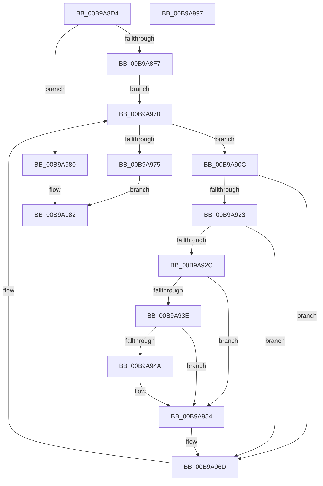

# ViDriverReApplyVerifierForAll

- RVA: `0x00B9A8D4`–`0x00B9A998` (길이 `196` bytes)
- VA: `0x0000000140B9A8D4`
- 실행 섹션: `PAGEVRFY`
- PDB 이름 있음: `예`; PDB Function 태그: `아니요`
- unwind 정보 RVA: `0x0005C954`
- 디코드: `51`개 명령, `196/196` bytes 표시
- 미해석 바이트: `0` (있으면 어셈블리에 `.byte`로 보존)

> 이 문서는 커널 이미지의 기계어와 PDB 기호를 분석해 생성했습니다. 4번과 5번은 함수 원형과 자료형을 바이너리 사용 방식에서 추정한 C 해석이며 원본 소스 복구 결과는 아닙니다.

## 1. Dependencies

- 직접 호출 지점: **8**; 고유 호출 대상: **8**
- 직접 호출자로 확인된 함수: **1**
- RIP 상대 이미지 참조: **5**

### Outgoing calls
- `0x00B9A8F7` → [MmAcquireLoadLock](../../text/4D/MmAcquireLoadLock_function_004DC2A0.md) (function, `0x004DC2A0`)
- `0x00B9A91A` → [RtlEqualUnicodeString](../../page/93/RtlEqualUnicodeString_function_00932A20.md) (function, `0x00932A20`)
- `0x00B9A92C` → [VfDriverLock](VfDriverLock_function_00B9A4A4.md) (function, `0x00B9A4A4`)
- `0x00B9A935` → [VfSuspectDriversIsLoaded](../../init/C4/VfSuspectDriversIsLoaded_function_00C4C7F8.md) (function, `0x00C4C7F8`)
- `0x00B9A941` → [VfUtilIsProtectedDriver](VfUtilIsProtectedDriver_function_00B9349C.md) (function, `0x00B9349C`)
- `0x00B9A94D` → [VfThunkApplyDriverAddedThunks](../BA/VfThunkApplyDriverAddedThunks_function_00BA7008.md) (function, `0x00BA7008`)
- `0x00B9A968` → [KeReleaseMutex](../../text/39/KeReleaseMutex_function_00396810.md) (function, `0x00396810`)
- `0x00B9A977` → [MmReleaseLoadLock](../../text/4D/MmReleaseLoadLock_function_004D36D0.md) (function, `0x004D36D0`)

### Direct callers
- [VfDriverInitSuccess](VfDriverInitSuccess_function_00B9A484.md) at `0x00B9A492`

### Static image references
- `0x00B9A8EA` → RVA `0x00F04890` (`.data`; read)
- `0x00B9A8FC` → RVA `0x00EF54C0` (`.data`; read)
- `0x00B9A913` → RVA `0x00B8B038` (`VfKernelImageName`; read)
- `0x00B9A956` → RVA `0x00F04938` (`.data`; write)
- `0x00B9A961` → RVA `0x00F04900` (`.data`; read)

## 2. Other-region calls and transfers

- 다른 실행 섹션으로 향하는 call: **5**
  - `0x00B9A8F7` → [MmAcquireLoadLock](../../text/4D/MmAcquireLoadLock_function_004DC2A0.md) (`PAGEVRFY` → `.text`)
  - `0x00B9A91A` → [RtlEqualUnicodeString](../../page/93/RtlEqualUnicodeString_function_00932A20.md) (`PAGEVRFY` → `PAGE`)
  - `0x00B9A935` → [VfSuspectDriversIsLoaded](../../init/C4/VfSuspectDriversIsLoaded_function_00C4C7F8.md) (`PAGEVRFY` → `INIT`)
  - `0x00B9A968` → [KeReleaseMutex](../../text/39/KeReleaseMutex_function_00396810.md) (`PAGEVRFY` → `.text`)
  - `0x00B9A977` → [MmReleaseLoadLock](../../text/4D/MmReleaseLoadLock_function_004D36D0.md) (`PAGEVRFY` → `.text`)
- 별도 외부 분기/꼬리 이동을 확인하지 못했습니다.

## 3. Assembly (complete function range)

```asm
00B9A8D4  48 89 5C 24 08                  mov qword ptr [rsp + 8], rbx
00B9A8D9  48 89 6C 24 10                  mov qword ptr [rsp + 0x10], rbp
00B9A8DE  48 89 74 24 18                  mov qword ptr [rsp + 0x18], rsi
00B9A8E3  57                              push rdi
00B9A8E4  48 83 EC 20                     sub rsp, 0x20
00B9A8E8  33 FF                           xor edi, edi
00B9A8EA  48 39 3D 9F 9F 36 00            cmp qword ptr [rip + 0x369f9f], rdi
00B9A8F1  0F 84 89 00 00 00               je 0x140b9a980
00B9A8F7  E8 A4 19 94 FF                  call 0x1404dc2a0
00B9A8FC  48 8B 1D BD AB 35 00            mov rbx, qword ptr [rip + 0x35abbd]
00B9A903  48 8D 2D B6 AB 35 00            lea rbp, [rip + 0x35abb6]
00B9A90A  EB 64                           jmp 0x140b9a970
00B9A90C  41 B0 01                        mov r8b, 1
00B9A90F  48 8D 53 58                     lea rdx, [rbx + 0x58]
00B9A913  48 8D 0D 1E 07 FF FF            lea rcx, [rip - 0xf8e2]
00B9A91A  E8 01 81 D9 FF                  call 0x140932a20
00B9A91F  84 C0                           test al, al
00B9A921  75 4A                           jne 0x140b9a96d
00B9A923  F7 43 68 00 00 00 02            test dword ptr [rbx + 0x68], 0x2000000
00B9A92A  74 41                           je 0x140b9a96d
00B9A92C  E8 73 FB FF FF                  call 0x140b9a4a4
00B9A931  48 8D 4B 58                     lea rcx, [rbx + 0x58]
00B9A935  E8 BE 1E 0B 00                  call 0x140c4c7f8
00B9A93A  85 C0                           test eax, eax
00B9A93C  74 16                           je 0x140b9a954
00B9A93E  48 8B CB                        mov rcx, rbx
00B9A941  E8 56 8B FF FF                  call 0x140b9349c
00B9A946  85 C0                           test eax, eax
00B9A948  75 0A                           jne 0x140b9a954
00B9A94A  48 8B CB                        mov rcx, rbx
00B9A94D  E8 B6 C6 00 00                  call 0x140ba7008
00B9A952  8B F8                           mov edi, eax
00B9A954  33 D2                           xor edx, edx
00B9A956  48 C7 05 D7 9F 36 00 00 00 00 00  mov qword ptr [rip + 0x369fd7], 0
00B9A961  48 8D 0D 98 9F 36 00            lea rcx, [rip + 0x369f98]
00B9A968  E8 A3 BE 7F FF                  call 0x140396810
00B9A96D  48 8B 1B                        mov rbx, qword ptr [rbx]
00B9A970  48 3B DD                        cmp rbx, rbp
00B9A973  75 97                           jne 0x140b9a90c
00B9A975  33 C9                           xor ecx, ecx
00B9A977  E8 54 8D 93 FF                  call 0x1404d36d0
00B9A97C  8B C7                           mov eax, edi
00B9A97E  EB 02                           jmp 0x140b9a982
00B9A980  33 C0                           xor eax, eax
00B9A982  48 8B 5C 24 30                  mov rbx, qword ptr [rsp + 0x30]
00B9A987  48 8B 6C 24 38                  mov rbp, qword ptr [rsp + 0x38]
00B9A98C  48 8B 74 24 40                  mov rsi, qword ptr [rsp + 0x40]
00B9A991  48 83 C4 20                     add rsp, 0x20
00B9A995  5F                              pop rdi
00B9A996  C3                              ret
00B9A997  CC                              int3
```

## 4. C-style interpretation (structured pseudocode)

```c
__int64 __fastcall ViDriverReApplyVerifierForAll(void)
{
    __int64 result;
    __int64 v_rdi;
    __int64 v_rsp;
    unsigned __int64 v_stack_p10;
    unsigned __int64 v_stack_p18;
    unsigned __int64 v_stack_p8;

    v_stack_p8 = v_rbx;
    v_stack_p10 = v_rbp;
    v_stack_p18 = v_rsi;
    v_rsp = (v_rsp) - (32);
    v_rdi = 0;
    if ((*(unsigned __int64 *)(v_rip + 3579807)) == 0) goto loc_00B9A980;
    result = MmAcquireLoadLock(a1, a2, a3, a4);
    goto loc_00B9A970;
loc_00B9A90C:
    result = RtlEqualUnicodeString(v_rip - 63714, *(unsigned __int64 *)(v_rip + 3517373) + 88, 1, a4);
    if ((unsigned __int8)(result) != 0) goto loc_00B9A96D;
    if (((*(unsigned int *)(*(unsigned __int64 *)(v_rip + 3517373) + 104)) & (0x2000000ULL)) == 0) goto loc_00B9A96D;
    result = VfDriverLock(v_rip - 63714, *(unsigned __int64 *)(v_rip + 3517373) + 88, 1, a4);
    result = VfSuspectDriversIsLoaded(*(unsigned __int64 *)(v_rip + 3517373) + 88, *(unsigned __int64 *)(v_rip + 3517373) + 88, 1, a4);
    if ((unsigned int)(result) == 0) goto loc_00B9A954;
    result = VfUtilIsProtectedDriver(*(unsigned __int64 *)(v_rip + 3517373), *(unsigned __int64 *)(v_rip + 3517373) + 88, 1, a4);
    if ((unsigned int)(result) == 0) {
        a1 = *(unsigned __int64 *)(v_rip + 3517373);
        result = VfThunkApplyDriverAddedThunks(a1, *(unsigned __int64 *)(v_rip + 3517373) + 88, 1, a4);
        v_rdi = (unsigned int)(result);
    }
    a2 = 0;
    *(unsigned __int64 *)(v_rip + 3579863) = 0;
    result = KeReleaseMutex(v_rip + 3579800, a2, 1, a4);
loc_00B9A96D:
loc_00B9A970:
    if ((*(unsigned __int64 *)(*(unsigned __int64 *)(v_rip + 3517373))) != (v_rip + 3517366)) goto loc_00B9A90C;
    a1 = 0;
    result = MmReleaseLoadLock(a1, a2, 1, a4);
    goto loc_00B9A982;
loc_00B9A980:
    result = 0;
loc_00B9A982:
    v_rsp = (v_rsp) + (32);
    return result;
}
```

## 5. (Beta) C Style

```c
void ViDriverReApplyVerifierForAll(void)
{
    int64_t result;
    int64_t local_rdi;
    int64_t local_rsp;
    uint64_t v_stack_p10;
    uint64_t v_stack_p18;
    uint64_t v_stack_p8;

    v_stack_p8 = local_rbx;
    v_stack_p10 = local_rbp;
    v_stack_p18 = local_rsi;
    local_rsp = (local_rsp) - (32);
    local_rdi = 0;
    if ((*(uint64_t *)(v_rip + 0x369F9F)) == 0) goto loc_00B9A980;
    result = MmAcquireLoadLock(a1, a2, a3, a4);
    goto loc_00B9A970;
loc_00B9A90C:
    result = RtlEqualUnicodeString(v_rip - 63714, *(uint64_t *)(v_rip + 0x35ABBD) + 88, 1, a4);
    if ((uint8_t)(result) != 0) goto loc_00B9A96D;
    if (((*(uint32_t *)(*(uint64_t *)(v_rip + 0x35ABBD) + 0x68)) & (0x2000000ULL)) == 0) goto loc_00B9A96D;
    result = VfDriverLock(v_rip - 63714, *(uint64_t *)(v_rip + 0x35ABBD) + 88, 1, a4);
    result = VfSuspectDriversIsLoaded(*(uint64_t *)(v_rip + 0x35ABBD) + 88, *(uint64_t *)(v_rip + 0x35ABBD) + 88, 1, a4);
    if ((uint32_t)(result) == 0) goto loc_00B9A954;
    result = VfUtilIsProtectedDriver(*(uint64_t *)(v_rip + 0x35ABBD), *(uint64_t *)(v_rip + 0x35ABBD) + 88, 1, a4);
    if ((uint32_t)(result) == 0) {
        a1 = *(uint64_t *)(v_rip + 0x35ABBD);
        result = VfThunkApplyDriverAddedThunks(a1, *(uint64_t *)(v_rip + 0x35ABBD) + 88, 1, a4);
        local_rdi = (uint32_t)(result);
    }
    a2 = 0;
    *(uint64_t *)(v_rip + 0x369FD7) = 0;
    result = KeReleaseMutex(v_rip + 3579800, a2, 1, a4);
loc_00B9A96D:
loc_00B9A970:
    if ((*(uint64_t *)(*(uint64_t *)(v_rip + 0x35ABBD))) != (v_rip + 3517366)) goto loc_00B9A90C;
    a1 = 0;
    result = MmReleaseLoadLock(a1, a2, 1, a4);
    goto loc_00B9A982;
loc_00B9A980:
    result = 0;
loc_00B9A982:
    local_rsp = (local_rsp) + (32);
    return result;
}
```

## 6. Execution-region graph

[열기: 2D/3D 그래프와 함수 탐색 컨트롤 패널](../../../control-panel.html?section=pagevrfy&rva=0x00B9A8D4&view=graph)

- 2D 그래프는 위에서 아래로 흐르고, 3D 그래프는 빈 공간을 드래그해 회전합니다. Shift+드래그는 이동, 휠은 확대·축소, 함수 노드 선택은 대상 보고서 이동입니다.

### Static fallback


