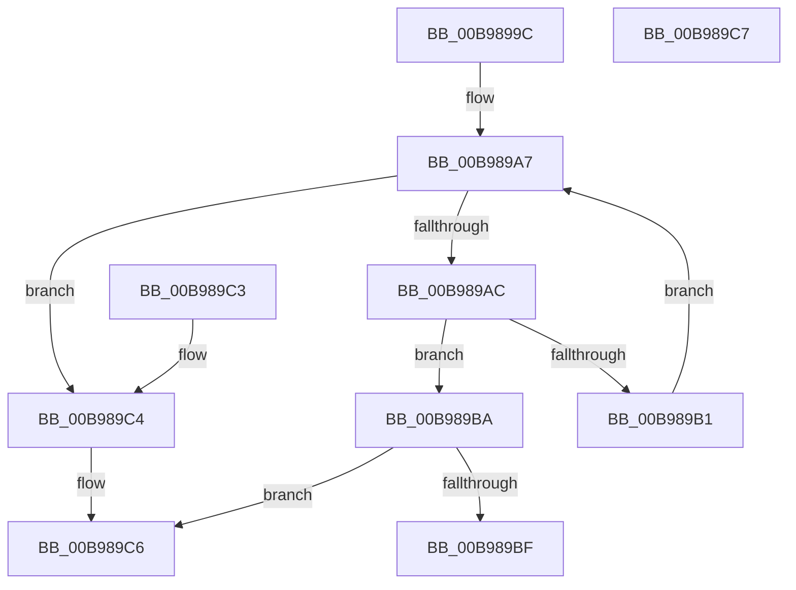

# ViFindMappedRegisterInFile

- RVA: `0x00B9899C`–`0x00B989C8` (길이 `44` bytes)
- VA: `0x0000000140B9899C`
- 실행 섹션: `PAGEVRFY`
- PDB 이름 있음: `예`; PDB Function 태그: `아니요`
- unwind 정보 RVA: `0x000DB714`
- 디코드: `18`개 명령, `44/44` bytes 표시
- 미해석 바이트: `0` (있으면 어셈블리에 `.byte`로 보존)

> 이 문서는 커널 이미지의 기계어와 PDB 기호를 분석해 생성했습니다. 4번과 5번은 함수 원형과 자료형을 바이너리 사용 방식에서 추정한 C 해석이며 원본 소스 복구 결과는 아닙니다.

## 1. Dependencies

- 직접 호출 지점: **0**; 고유 호출 대상: **0**
- 직접 호출자로 확인된 함수: **3**
- RIP 상대 이미지 참조: **0**

### Outgoing calls
- 직접 디코드된 call 명령이 없습니다.

### Direct callers
- [ViFlushDoubleBuffer](ViFlushDoubleBuffer_function_00B989D0.md) at `0x00B98A24`
- [ViFreeMapRegistersToFile](ViFreeMapRegistersToFile_function_00B98D04.md) at `0x00B98D5C`
- [ViSwap](ViSwap_function_00B99E54.md) at `0x00B99EA4`

### Static image references
- 디코드된 RIP-relative 메모리 참조가 없습니다.

## 2. Other-region calls and transfers

- 다른 실행 섹션으로 향하는 call: **0**
- 별도 외부 분기/꼬리 이동을 확인하지 못했습니다.

## 3. Assembly (complete function range)

```asm
00B9899C  44 8B 51 1C                     mov r10d, dword ptr [rcx + 0x1c]
00B989A0  48 8D 41 58                     lea rax, [rcx + 0x58]
00B989A4  45 33 C9                        xor r9d, r9d
00B989A7  45 3B CA                        cmp r9d, r10d
00B989AA  73 18                           jae 0x140b989c4
00B989AC  48 3B 10                        cmp rdx, qword ptr [rax]
00B989AF  74 09                           je 0x140b989ba
00B989B1  48 83 C0 20                     add rax, 0x20
00B989B5  41 FF C1                        inc r9d
00B989B8  EB ED                           jmp 0x140b989a7
00B989BA  4D 85 C0                        test r8, r8
00B989BD  74 07                           je 0x140b989c6
00B989BF  45 89 08                        mov dword ptr [r8], r9d
00B989C2  C3                              ret
00B989C3  CC                              int3
00B989C4  33 C0                           xor eax, eax
00B989C6  C3                              ret
00B989C7  CC                              int3
```

## 4. C-style interpretation (structured pseudocode)

```c
__int64 __fastcall ViFindMappedRegisterInFile(__int64 a1, __int64 a2, __int64 a3, int a4)
{
    __int64 result;

    a4 = 0;
loc_00B989A7:
    if (0 >= ((unsigned int)((unsigned int)(*(unsigned int *)(a1 + 28))))) goto loc_00B989C4;
    if (a2 == (*(unsigned __int64 *)(a1 + 88))) goto loc_00B989BA;
    result = (a1 + 88) + (32);
    a4 = (unsigned int)((a4) + 1);
    goto loc_00B989A7;
loc_00B989BA:
    if (a3 == 0) goto loc_00B989C6;
    *(unsigned int *)(a3) = a4;
    return result;
loc_00B989C4:
    result = 0;
loc_00B989C6:
    return result;
}
```

## 5. (Beta) C Style

```c
int64_t ViFindMappedRegisterInFile(void *Arg1, int64_t Arg2, int64_t Arg3, int32_t Arg4)
{
    uint8_t *arg1 = (uint8_t *)Arg1;

    int64_t result;

    Arg4 = 0;
loc_00B989A7:
    if (0 >= ((uint32_t)((uint32_t)(*(uint32_t *)(arg1 + 0x1C))))) goto loc_00B989C4;
    if (Arg2 == (*(uint64_t *)(arg1 + 0x58))) goto loc_00B989BA;
    result = (Arg1 + 88) + (32);
    Arg4 = (uint32_t)((Arg4) + 1);
    goto loc_00B989A7;
loc_00B989BA:
    if (Arg3 == 0) goto loc_00B989C6;
    *(uint32_t *)(Arg3) = Arg4;
    return result;
loc_00B989C4:
    result = 0;
loc_00B989C6:
    return result;
}
```

### 관측된 메모리 오프셋

구조체 형식이 확인되지 않은 접근은 인자 기준의 오프셋으로만 기록했습니다.

| 기준 인자 | 오프셋 표현 | 폭 (bit) | 접근 |
|---|---:|---:|---|
| `Arg1` | `+ 0x0` | `64` | `R` |
| `Arg1` | `+ 0x1C` | `32` | `R` |
| `Arg1` | `+ 0x58` | `64` | `R` |

## 6. Execution-region graph

[열기: 2D/3D 그래프와 함수 탐색 컨트롤 패널](../../../control-panel.html?section=pagevrfy&rva=0x00B9899C&view=graph)

- 2D 그래프는 위에서 아래로 흐르고, 3D 그래프는 빈 공간을 드래그해 회전합니다. Shift+드래그는 이동, 휠은 확대·축소, 함수 노드 선택은 대상 보고서 이동입니다.

### Static fallback


