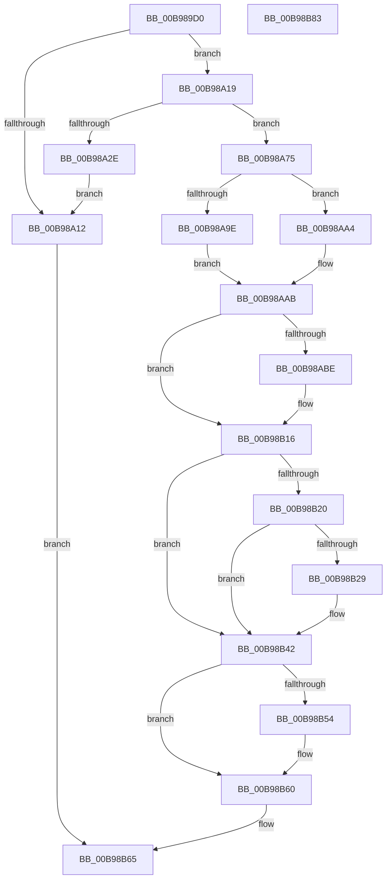

# ViFlushDoubleBuffer

- RVA: `0x00B989D0`–`0x00B98B84` (길이 `436` bytes)
- VA: `0x0000000140B989D0`
- 실행 섹션: `PAGEVRFY`
- PDB 이름 있음: `예`; PDB Function 태그: `아니요`
- unwind 정보 RVA: `0x000AC264`
- 디코드: `119`개 명령, `436/436` bytes 표시
- 미해석 바이트: `0` (있으면 어셈블리에 `.byte`로 보존)

> 이 문서는 커널 이미지의 기계어와 PDB 기호를 분석해 생성했습니다. 4번과 5번은 함수 원형과 자료형을 바이너리 사용 방식에서 추정한 C 해석이며 원본 소스 복구 결과는 아닙니다.

## 1. Dependencies

- 직접 호출 지점: **10**; 고유 호출 대상: **8**
- 직접 호출자로 확인된 함수: **2**
- RIP 상대 이미지 참조: **5**

### Outgoing calls
- `0x00B98A05` → [ViGetMdlBufferSa](ViGetMdlBufferSa_function_00B98FC8.md) (function, `0x00B98FC8`)
- `0x00B98A24` → [ViFindMappedRegisterInFile](ViFindMappedRegisterInFile_function_00B9899C.md) (function, `0x00B9899C`)
- `0x00B98A52` → [ViHalPreprocessOptions](ViHalPreprocessOptions_function_00B9920C.md) (function, `0x00B9920C`)
- `0x00B98A6E` → [VfReportIssueWithOptions](../../text/61/VfReportIssueWithOptions_function_00614444.md) (function, `0x00614444`)
- `0x00B98AA6` → [MmMapLockedPages](../../text/67/MmMapLockedPages_function_00674BB0.md) (function, `0x00674BB0`)
- `0x00B98AE5` → [ViHalPreprocessOptions](ViHalPreprocessOptions_function_00B9920C.md) (function, `0x00B9920C`)
- `0x00B98B09` → [VfReportIssueWithOptions](../../text/61/VfReportIssueWithOptions_function_00614444.md) (function, `0x00614444`)
- `0x00B98B3D` → [ViCopyBackModifiedBuffer](ViCopyBackModifiedBuffer_function_00B98764.md) (function, `0x00B98764`)
- `0x00B98B4B` → [ViFreeMapRegistersToFile](ViFreeMapRegistersToFile_function_00B98D04.md) (function, `0x00B98D04`)
- `0x00B98B5B` → [VfUtilDbgPrint](../../text/61/VfUtilDbgPrint_function_006122AC.md) (function, `0x006122AC`)

### Direct callers
- [VfFlushAdapterBuffers](VfFlushAdapterBuffers_function_00B96220.md) at `0x00B963A8`
- [VfPutScatterGatherList](VfPutScatterGatherList_function_00B97970.md) at `0x00B97A6A`

### Static image references
- `0x00B98A36` → RVA `0x00E0E9F4` (`.data`; read)
- `0x00B98A45` → RVA `0x00BB9F40` (` ?? ::JKADOLAD::`string'`; read)
- `0x00B98AC1` → RVA `0x00BB9EF0` (` ?? ::JKADOLAD::`string'`; read)
- `0x00B98ACD` → RVA `0x00E0E9F8` (`.data`; read)
- `0x00B98B54` → RVA `0x00BB9FD0` (` ?? ::JKADOLAD::`string'`; read)

## 2. Other-region calls and transfers

- 다른 실행 섹션으로 향하는 call: **4**
  - `0x00B98A6E` → [VfReportIssueWithOptions](../../text/61/VfReportIssueWithOptions_function_00614444.md) (`PAGEVRFY` → `.text`)
  - `0x00B98AA6` → [MmMapLockedPages](../../text/67/MmMapLockedPages_function_00674BB0.md) (`PAGEVRFY` → `.text`)
  - `0x00B98B09` → [VfReportIssueWithOptions](../../text/61/VfReportIssueWithOptions_function_00614444.md) (`PAGEVRFY` → `.text`)
  - `0x00B98B5B` → [VfUtilDbgPrint](../../text/61/VfUtilDbgPrint_function_006122AC.md) (`PAGEVRFY` → `.text`)
- 별도 외부 분기/꼬리 이동을 확인하지 못했습니다.

## 3. Assembly (complete function range)

```asm
00B989D0  48 8B C4                        mov rax, rsp
00B989D3  48 89 58 08                     mov qword ptr [rax + 8], rbx
00B989D7  48 89 68 10                     mov qword ptr [rax + 0x10], rbp
00B989DB  48 89 70 18                     mov qword ptr [rax + 0x18], rsi
00B989DF  57                              push rdi
00B989E0  41 54                           push r12
00B989E2  41 55                           push r13
00B989E4  41 56                           push r14
00B989E6  41 57                           push r15
00B989E8  48 83 EC 40                     sub rsp, 0x40
00B989EC  4C 8B EA                        mov r13, rdx
00B989EF  41 8B D9                        mov ebx, r9d
00B989F2  48 8B F1                        mov rsi, rcx
00B989F5  45 33 F6                        xor r14d, r14d
00B989F8  49 8B CD                        mov rcx, r13
00B989FB  44 89 70 C8                     mov dword ptr [rax - 0x38], r14d
00B989FF  49 8B D0                        mov rdx, r8
00B98A02  4D 8B E0                        mov r12, r8
00B98A05  E8 BE 05 00 00                  call 0x140b98fc8
00B98A0A  48 8B E8                        mov rbp, rax
00B98A0D  48 85 C0                        test rax, rax
00B98A10  75 07                           jne 0x140b98a19
00B98A12  33 C0                           xor eax, eax
00B98A14  E9 4C 01 00 00                  jmp 0x140b98b65
00B98A19  4C 8D 44 24 30                  lea r8, [rsp + 0x30]
00B98A1E  48 8B D5                        mov rdx, rbp
00B98A21  48 8B CE                        mov rcx, rsi
00B98A24  E8 73 FF FF FF                  call 0x140b9899c
00B98A29  48 85 C0                        test rax, rax
00B98A2C  75 47                           jne 0x140b98a75
00B98A2E  8D 78 16                        lea edi, [rax + 0x16]
00B98A31  4C 89 74 24 28                  mov qword ptr [rsp + 0x28], r14
00B98A36  48 8D 1D B7 5F 27 00            lea rbx, [rip + 0x275fb7]
00B98A3D  48 89 74 24 20                  mov qword ptr [rsp + 0x20], rsi
00B98A42  44 8B C7                        mov r8d, edi
00B98A45  48 8D 15 F4 14 02 00            lea rdx, [rip + 0x214f4]
00B98A4C  48 8B CB                        mov rcx, rbx
00B98A4F  4C 8B CD                        mov r9, rbp
00B98A52  E8 B5 07 00 00                  call 0x140b9920c
00B98A57  4C 8B CE                        mov r9, rsi
00B98A5A  48 89 5C 24 28                  mov qword ptr [rsp + 0x28], rbx
00B98A5F  4C 8B C5                        mov r8, rbp
00B98A62  4C 89 74 24 20                  mov qword ptr [rsp + 0x20], r14
00B98A67  8B D7                           mov edx, edi
00B98A69  B9 E6 00 00 00                  mov ecx, 0xe6
00B98A6E  E8 D1 B9 A7 FF                  call 0x140614444
00B98A73  EB 9D                           jmp 0x140b98a12
00B98A75  8B 44 24 30                     mov eax, dword ptr [rsp + 0x30]
00B98A79  48 8B FD                        mov rdi, rbp
00B98A7C  48 8B 4E 38                     mov rcx, qword ptr [rsi + 0x38]
00B98A80  81 E7 FF 0F 00 00               and edi, 0xfff
00B98A86  4C 8B 7E 40                     mov r15, qword ptr [rsi + 0x40]
00B98A8A  C1 E0 0C                        shl eax, 0xc
00B98A8D  48 03 F8                        add rdi, rax
00B98A90  4C 03 FF                        add r15, rdi
00B98A93  48 89 7C 24 30                  mov qword ptr [rsp + 0x30], rdi
00B98A98  F6 41 0A 05                     test byte ptr [rcx + 0xa], 5
00B98A9C  74 06                           je 0x140b98aa4
00B98A9E  48 8B 41 18                     mov rax, qword ptr [rcx + 0x18]
00B98AA2  EB 07                           jmp 0x140b98aab
00B98AA4  33 D2                           xor edx, edx
00B98AA6  E8 05 C1 AD FF                  call 0x140674bb0
00B98AAB  48 8B 4E 38                     mov rcx, qword ptr [rsi + 0x38]
00B98AAF  44 8B 71 28                     mov r14d, dword ptr [rcx + 0x28]
00B98AB3  45 2B F7                        sub r14d, r15d
00B98AB6  44 03 F0                        add r14d, eax
00B98AB9  41 3B DE                        cmp ebx, r14d
00B98ABC  76 58                           jbe 0x140b98b16
00B98ABE  41 8B FE                        mov edi, r14d
00B98AC1  48 8D 15 28 14 02 00            lea rdx, [rip + 0x21428]
00B98AC8  48 89 5C 24 28                  mov qword ptr [rsp + 0x28], rbx
00B98ACD  48 8D 0D 24 5F 27 00            lea rcx, [rip + 0x275f24]
00B98AD4  41 B9 01 00 00 00               mov r9d, 1
00B98ADA  48 89 7C 24 20                  mov qword ptr [rsp + 0x20], rdi
00B98ADF  41 B8 00 00 00 10               mov r8d, 0x10000000
00B98AE5  E8 22 07 00 00                  call 0x140b9920c
00B98AEA  33 D2                           xor edx, edx
00B98AEC  45 8B CE                        mov r9d, r14d
00B98AEF  48 8D 05 02 5F 27 00            lea rax, [rip + 0x275f02]
00B98AF6  B9 E6 00 00 00                  mov ecx, 0xe6
00B98AFB  48 89 44 24 28                  mov qword ptr [rsp + 0x28], rax
00B98B00  48 89 5C 24 20                  mov qword ptr [rsp + 0x20], rbx
00B98B05  44 8D 42 01                     lea r8d, [rdx + 1]
00B98B09  E8 36 B9 A7 FF                  call 0x140614444
00B98B0E  48 8B 7C 24 30                  mov rdi, qword ptr [rsp + 0x30]
00B98B13  41 8B DE                        mov ebx, r14d
00B98B16  80 BC 24 90 00 00 00 00         cmp byte ptr [rsp + 0x90], 0
00B98B1E  75 22                           jne 0x140b98b42
00B98B20  48 8B 4E 48                     mov rcx, qword ptr [rsi + 0x48]
00B98B24  48 85 C9                        test rcx, rcx
00B98B27  74 19                           je 0x140b98b42
00B98B29  8B C3                           mov eax, ebx
00B98B2B  4C 8D 0C 39                     lea r9, [rcx + rdi]
00B98B2F  49 8B CD                        mov rcx, r13
00B98B32  48 89 44 24 20                  mov qword ptr [rsp + 0x20], rax
00B98B37  4D 8B C7                        mov r8, r15
00B98B3A  49 8B D4                        mov rdx, r12
00B98B3D  E8 22 FC FF FF                  call 0x140b98764
00B98B42  44 8B C3                        mov r8d, ebx
00B98B45  48 8B D5                        mov rdx, rbp
00B98B48  48 8B CE                        mov rcx, rsi
00B98B4B  E8 B4 01 00 00                  call 0x140b98d04
00B98B50  85 C0                           test eax, eax
00B98B52  75 0C                           jne 0x140b98b60
00B98B54  48 8D 0D 75 14 02 00            lea rcx, [rip + 0x21475]
00B98B5B  E8 4C 97 A7 FF                  call 0x1406122ac
00B98B60  B8 01 00 00 00                  mov eax, 1
00B98B65  4C 8D 5C 24 40                  lea r11, [rsp + 0x40]
00B98B6A  49 8B 5B 30                     mov rbx, qword ptr [r11 + 0x30]
00B98B6E  49 8B 6B 38                     mov rbp, qword ptr [r11 + 0x38]
00B98B72  49 8B 73 40                     mov rsi, qword ptr [r11 + 0x40]
00B98B76  49 8B E3                        mov rsp, r11
00B98B79  41 5F                           pop r15
00B98B7B  41 5E                           pop r14
00B98B7D  41 5D                           pop r13
00B98B7F  41 5C                           pop r12
00B98B81  5F                              pop rdi
00B98B82  C3                              ret
00B98B83  CC                              int3
```

## 4. C-style interpretation (structured pseudocode)

```c
__int64 __fastcall ViFlushDoubleBuffer(__int64 a1, __int64 a2, __int64 a3, int a4, unsigned __int8 a5)
{
    __int64 result;
    __int64 v_r14;
    __int64 v_r15;
    __int64 v_rbx;
    __int64 v_rdi;
    __int64 v_rsp;
    unsigned __int64 v_stack_m28;
    unsigned __int64 v_stack_m38;
    unsigned __int64 v_stack_m40;
    unsigned __int64 v_stack_m48;

    *(unsigned __int64 *)(v_rsp + 8) = v_rbx;
    *(unsigned __int64 *)(v_rsp + 16) = v_rbp;
    *(unsigned __int64 *)(v_rsp + 24) = v_rsi;
    v_rsp = (v_rsp) - (64);
    v_r14 = 0;
    *(unsigned int *)(v_rsp - 56) = 0;
    result = ViGetMdlBufferSa(a2, a3, a3, a4);
    if (result != 0) goto loc_00B98A19;
loc_00B98A12:
    result = 0;
    goto loc_00B98B65;
loc_00B98A19:
    result = ViFindMappedRegisterInFile(a1, 0, v_stack_m38, a4);
    if (result != 0) goto loc_00B98A75;
    v_stack_m40 = 0;
    v_stack_m48 = a1;
    result = ViHalPreprocessOptions(v_rip + 2580407, v_rip + 136436, (unsigned int)((unsigned int)(result + 22)), result);
    v_stack_m40 = v_rip + 2580407;
    v_stack_m48 = 0;
    result = VfReportIssueWithOptions(230, (unsigned int)((unsigned int)(result + 22)), result, a1);
    goto loc_00B98A12;
loc_00B98A75:
    v_rdi = (unsigned int)((result) & (0xFFFULL));
    result = (unsigned int)(((unsigned int)(v_stack_m38)) << (12));
    v_rdi = (v_rdi) + (result);
    v_r15 = (*(unsigned __int64 *)(a1 + 64)) + (v_rdi);
    v_stack_m38 = v_rdi;
    if (((*(unsigned __int8 *)(*(unsigned __int64 *)(a1 + 56) + 10)) & (5)) == 0) goto loc_00B98AA4;
    goto loc_00B98AAB;
loc_00B98AA4:
    a2 = 0;
    result = MmMapLockedPages(*(unsigned __int64 *)(a1 + 56), a2, result, a1);
loc_00B98AAB:
    v_r14 = (unsigned int)(((unsigned int)(*(unsigned int *)(*(unsigned __int64 *)(a1 + 56) + 40))) - ((unsigned int)(v_r15)));
    v_r14 = (unsigned int)((v_r14) + ((unsigned int)(result)));
    v_rbx = v_rip + 2580407;
    if (((unsigned int)(v_rip + 2580407)) >= = ((unsigned int)(v_r14))) {
        v_rdi = (unsigned int)(v_r14);
        a2 = v_rip + 136232;
        v_stack_m40 = v_rip + 2580407;
        a1 = v_rip + 2580260;
        a4 = 1;
        v_stack_m48 = v_rdi;
        a3 = 0x10000000ULL;
        result = ViHalPreprocessOptions(a1, a2, a3, a4);
        a2 = 0;
        a4 = (unsigned int)(v_r14);
        result = v_rip + 2580226;
        a1 = 230;
        v_stack_m40 = result;
        v_stack_m48 = v_rip + 2580407;
        a3 = a2 + 1;
        result = VfReportIssueWithOptions(a1, a2, a3, a4);
        v_rdi = v_stack_m38;
        v_rbx = (unsigned int)(v_r14);
    }
    if (a5 != 0) goto loc_00B98B42;
    if (*(unsigned __int64 *)(a1 + 72) != 0) {
        result = (unsigned int)(v_rbx);
        a4 = *(unsigned __int64 *)(a1 + 72) + v_rdi * 1;
        a1 = 0;
        v_stack_m48 = result;
        a3 = v_r15;
        a2 = a3;
        result = ViCopyBackModifiedBuffer(a1, a2, a3, a4);
    }
    result = ViFreeMapRegistersToFile(a1, result, (unsigned int)((unsigned int)(v_rbx)), a4);
    if ((unsigned int)(result) == 0) {
        a1 = v_rip + 136309;
        result = VfUtilDbgPrint(a1, result, (unsigned int)((unsigned int)(v_rbx)), a4);
    }
loc_00B98B65:
    return 1;
}
```

## 5. (Beta) C Style

```c
int64_t ViFlushDoubleBuffer(void *Arg1, int64_t Arg2, int64_t Arg3, int32_t Arg4, uint8_t Arg5)
{
    uint8_t *arg1 = (uint8_t *)Arg1;

    int64_t result;
    int64_t local_r14;
    int64_t local_r15;
    int64_t local_rbx;
    int64_t local_rdi;
    int64_t local_rsp;
    uint64_t v_stack_m28;
    uint64_t v_stack_m38;
    uint64_t v_stack_m40;
    uint64_t v_stack_m48;

    *(uint64_t *)(local_rsp + 0x8) = local_rbx;
    *(uint64_t *)(local_rsp + 0x10) = local_rbp;
    *(uint64_t *)(local_rsp + 0x18) = local_rsi;
    local_rsp = (local_rsp) - (64);
    local_r14 = 0;
    *(uint32_t *)(local_rsp - 0x38) = 0;
    result = ViGetMdlBufferSa(Arg2, Arg3, Arg3, Arg4);
    if (result != 0) goto loc_00B98A19;
loc_00B98A12:
    result = 0;
    goto loc_00B98B65;
loc_00B98A19:
    result = ViFindMappedRegisterInFile(Arg1, 0, v_stack_m38, Arg4);
    if (result != 0) goto loc_00B98A75;
    v_stack_m40 = 0;
    v_stack_m48 = Arg1;
    result = ViHalPreprocessOptions(v_rip + 2580407, v_rip + 136436, (uint32_t)((uint32_t)(result + 22)), result);
    v_stack_m40 = v_rip + 2580407;
    v_stack_m48 = 0;
    result = VfReportIssueWithOptions(230, (uint32_t)((uint32_t)(result + 22)), result, Arg1);
    goto loc_00B98A12;
loc_00B98A75:
    local_rdi = (uint32_t)((result) & (0xFFFULL));
    result = (uint32_t)(((uint32_t)(v_stack_m38)) << (12));
    local_rdi = (local_rdi) + (result);
    local_r15 = (*(uint64_t *)(arg1 + 0x40)) + (local_rdi);
    v_stack_m38 = local_rdi;
    if (((*(uint8_t *)(*(uint64_t *)(arg1 + 0x38) + 0xA)) & (5)) == 0) goto loc_00B98AA4;
    goto loc_00B98AAB;
loc_00B98AA4:
    Arg2 = 0;
    result = MmMapLockedPages(*(uint64_t *)(arg1 + 0x38), Arg2, result, Arg1);
loc_00B98AAB:
    local_r14 = (uint32_t)(((uint32_t)(*(uint32_t *)(*(uint64_t *)(arg1 + 0x38) + 0x28))) - ((uint32_t)(local_r15)));
    local_r14 = (uint32_t)((local_r14) + ((uint32_t)(result)));
    local_rbx = v_rip + 2580407;
    if (((uint32_t)(v_rip + 2580407)) >= = ((uint32_t)(local_r14))) {
        local_rdi = (uint32_t)(local_r14);
        Arg2 = v_rip + 136232;
        v_stack_m40 = v_rip + 2580407;
        Arg1 = v_rip + 2580260;
        Arg4 = 1;
        v_stack_m48 = local_rdi;
        Arg3 = 0x10000000ULL;
        result = ViHalPreprocessOptions(Arg1, Arg2, Arg3, Arg4);
        Arg2 = 0;
        Arg4 = (uint32_t)(local_r14);
        result = v_rip + 2580226;
        Arg1 = 230;
        v_stack_m40 = result;
        v_stack_m48 = v_rip + 2580407;
        Arg3 = Arg2 + 1;
        result = VfReportIssueWithOptions(Arg1, Arg2, Arg3, Arg4);
        local_rdi = v_stack_m38;
        local_rbx = (uint32_t)(local_r14);
    }
    if (Arg5 != 0) goto loc_00B98B42;
    if (*(uint64_t *)(arg1 + 0x48) != 0) {
        result = (uint32_t)(local_rbx);
        Arg4 = *(uint64_t *)(arg1 + 0x48) + local_rdi * 1;
        Arg1 = 0;
        v_stack_m48 = result;
        Arg3 = local_r15;
        Arg2 = Arg3;
        result = ViCopyBackModifiedBuffer(Arg1, Arg2, Arg3, Arg4);
    }
    result = ViFreeMapRegistersToFile(Arg1, result, (uint32_t)((uint32_t)(local_rbx)), Arg4);
    if ((uint32_t)(result) == 0) {
        Arg1 = v_rip + 136309;
        result = VfUtilDbgPrint(Arg1, result, (uint32_t)((uint32_t)(local_rbx)), Arg4);
    }
loc_00B98B65:
    return 1;
}
```

### 관측된 메모리 오프셋

구조체 형식이 확인되지 않은 접근은 인자 기준의 오프셋으로만 기록했습니다.

| 기준 인자 | 오프셋 표현 | 폭 (bit) | 접근 |
|---|---:|---:|---|
| `Arg1` | `+ 0x38` | `64` | `R` |
| `Arg1` | `+ 0x40` | `64` | `R` |
| `Arg1` | `+ 0x48` | `64` | `R` |

## 6. Execution-region graph

[열기: 2D/3D 그래프와 함수 탐색 컨트롤 패널](../../../control-panel.html?section=pagevrfy&rva=0x00B989D0&view=graph)

- 2D 그래프는 위에서 아래로 흐르고, 3D 그래프는 빈 공간을 드래그해 회전합니다. Shift+드래그는 이동, 휠은 확대·축소, 함수 노드 선택은 대상 보고서 이동입니다.

### Static fallback


