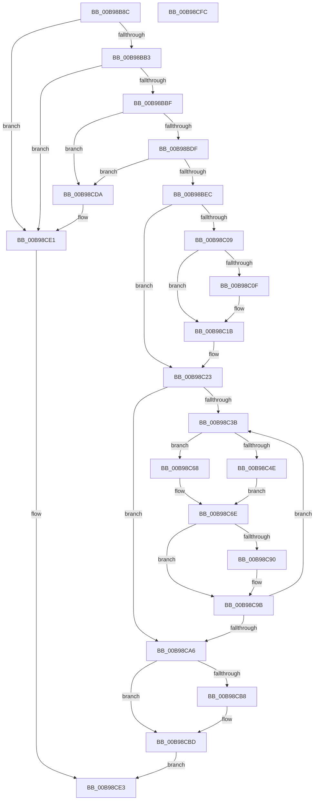

# ViFreeMapRegisterFile

- RVA: `0x00B98B8C`–`0x00B98CFD` (길이 `369` bytes)
- VA: `0x0000000140B98B8C`
- 실행 섹션: `PAGEVRFY`
- PDB 이름 있음: `예`; PDB Function 태그: `아니요`
- unwind 정보 RVA: `0x00060300`
- 디코드: `101`개 명령, `369/369` bytes 표시
- 미해석 바이트: `0` (있으면 어셈블리에 `.byte`로 보존)

> 이 문서는 커널 이미지의 기계어와 PDB 기호를 분석해 생성했습니다. 4번과 5번은 함수 원형과 자료형을 바이너리 사용 방식에서 추정한 C 해석이며 원본 소스 복구 결과는 아닙니다.

## 1. Dependencies

- 직접 호출 지점: **12**; 고유 호출 대상: **9**
- 직접 호출자로 확인된 함수: **9**
- RIP 상대 이미지 참조: **0**

### Outgoing calls
- `0x00B98BC9` → [KeAcquireSpinLockRaiseToDpc](../../text/20/KeAcquireSpinLockRaiseToDpc_function_00208470.md) (function, `0x00208470`)
- `0x00B98BF8` → [KeReleaseSpinLock](../../text/39/KeReleaseSpinLock_function_00392BA0.md) (function, `0x00392BA0`)
- `0x00B98C16` → [MmUnmapLockedPages](../../text/24/MmUnmapLockedPages_function_00246E60.md) (function, `0x00246E60`)
- `0x00B98C1E` → [IoFreeMdl](../../text/29/IoFreeMdl_function_0029EA80.md) (function, `0x0029EA80`)
- `0x00B98C2B` → [MmUnmapLockedPages](../../text/24/MmUnmapLockedPages_function_00246E60.md) (function, `0x00246E60`)
- `0x00B98C73` → [ViCheckPadding](ViCheckPadding_function_00B98464.md) (function, `0x00B98464`)
- `0x00B98C87` → [ViFreeToContiguousMemory](ViFreeToContiguousMemory_function_00B98DD8.md) (function, `0x00B98DD8`)
- `0x00B98C96` → [ExFreePoolWithTag](../../poolcode/B8/ExFreePoolWithTag_function_00B82870.md) (function, `0x00B82870`)
- `0x00B98CAA` → [IoFreeMdl](../../text/29/IoFreeMdl_function_0029EA80.md) (function, `0x0029EA80`)
- `0x00B98CB8` → [VfUtilFreePoolCheckIRQL](../../text/4C/VfUtilFreePoolCheckIRQL_function_004C65D0.md) (function, `0x004C65D0`)
- `0x00B98CC6` → [memset](../../text/6C/memset_function_006C6C40.md) (function, `0x006C6C40`)
- `0x00B98CCE` → [VfUtilFreePoolCheckIRQL](../../text/4C/VfUtilFreePoolCheckIRQL_function_004C65D0.md) (function, `0x004C65D0`)

### Direct callers
- [VfAllocateAdapterChannel](VfAllocateAdapterChannel_function_00B95180.md) at `0x00B95314`
- [VfBuildScatterGatherList](VfBuildScatterGatherList_function_00B95AA0.md) at `0x00B95D11`
- [VfBuildScatterGatherList](VfBuildScatterGatherList_function_00B95AA0.md) at `0x00B95D7C`
- [VfCancelAdapterChannel](VfCancelAdapterChannel_function_00B95FD0.md) at `0x00B96060`
- [VfFreeAdapterChannel](VfFreeAdapterChannel_function_00B96480.md) at `0x00B964FD`
- [VfFreeAdapterObject](VfFreeAdapterObject_function_00B96530.md) at `0x00B96621`
- [VfFreeMapRegisters](VfFreeMapRegisters_function_00B967D0.md) at `0x00B96895`
- [VfGetScatterGatherList](VfGetScatterGatherList_function_00B96BD0.md) at `0x00B96E9A`
- [VfGetScatterGatherList](VfGetScatterGatherList_function_00B96BD0.md) at `0x00B96F05`
- [VfPutScatterGatherList](VfPutScatterGatherList_function_00B97970.md) at `0x00B97A76`
- [ViAdapterCallback](ViAdapterCallback_function_00B97B40.md) at `0x00B97C64`

### Static image references
- 디코드된 RIP-relative 메모리 참조가 없습니다.

## 2. Other-region calls and transfers

- 다른 실행 섹션으로 향하는 call: **10**
  - `0x00B98BC9` → [KeAcquireSpinLockRaiseToDpc](../../text/20/KeAcquireSpinLockRaiseToDpc_function_00208470.md) (`PAGEVRFY` → `.text`)
  - `0x00B98BF8` → [KeReleaseSpinLock](../../text/39/KeReleaseSpinLock_function_00392BA0.md) (`PAGEVRFY` → `.text`)
  - `0x00B98C16` → [MmUnmapLockedPages](../../text/24/MmUnmapLockedPages_function_00246E60.md) (`PAGEVRFY` → `.text`)
  - `0x00B98C1E` → [IoFreeMdl](../../text/29/IoFreeMdl_function_0029EA80.md) (`PAGEVRFY` → `.text`)
  - `0x00B98C2B` → [MmUnmapLockedPages](../../text/24/MmUnmapLockedPages_function_00246E60.md) (`PAGEVRFY` → `.text`)
  - `0x00B98C96` → [ExFreePoolWithTag](../../poolcode/B8/ExFreePoolWithTag_function_00B82870.md) (`PAGEVRFY` → `POOLCODE`)
  - `0x00B98CAA` → [IoFreeMdl](../../text/29/IoFreeMdl_function_0029EA80.md) (`PAGEVRFY` → `.text`)
  - `0x00B98CB8` → [VfUtilFreePoolCheckIRQL](../../text/4C/VfUtilFreePoolCheckIRQL_function_004C65D0.md) (`PAGEVRFY` → `.text`)
  - `0x00B98CC6` → [memset](../../text/6C/memset_function_006C6C40.md) (`PAGEVRFY` → `.text`)
  - `0x00B98CCE` → [VfUtilFreePoolCheckIRQL](../../text/4C/VfUtilFreePoolCheckIRQL_function_004C65D0.md) (`PAGEVRFY` → `.text`)
- 별도 외부 분기/꼬리 이동을 확인하지 못했습니다.

## 3. Assembly (complete function range)

```asm
00B98B8C  48 89 5C 24 08                  mov qword ptr [rsp + 8], rbx
00B98B91  48 89 6C 24 10                  mov qword ptr [rsp + 0x10], rbp
00B98B96  48 89 74 24 18                  mov qword ptr [rsp + 0x18], rsi
00B98B9B  57                              push rdi
00B98B9C  41 56                           push r14
00B98B9E  41 57                           push r15
00B98BA0  48 83 EC 20                     sub rsp, 0x20
00B98BA4  48 8B DA                        mov rbx, rdx
00B98BA7  48 8B E9                        mov rbp, rcx
00B98BAA  48 85 D2                        test rdx, rdx
00B98BAD  0F 84 2E 01 00 00               je 0x140b98ce1
00B98BB3  81 3A 0D D0 EF AC               cmp dword ptr [rdx], 0xacefd00d
00B98BB9  0F 85 22 01 00 00               jne 0x140b98ce1
00B98BBF  48 8D B9 98 00 00 00            lea rdi, [rcx + 0x98]
00B98BC6  48 8B CF                        mov rcx, rdi
00B98BC9  E8 A2 F8 66 FF                  call 0x140208470
00B98BCE  48 8D 53 08                     lea rdx, [rbx + 8]
00B98BD2  4C 8B 0A                        mov r9, qword ptr [rdx]
00B98BD5  49 39 51 08                     cmp qword ptr [r9 + 8], rdx
00B98BD9  0F 85 FB 00 00 00               jne 0x140b98cda
00B98BDF  4C 8B 42 08                     mov r8, qword ptr [rdx + 8]
00B98BE3  49 39 10                        cmp qword ptr [r8], rdx
00B98BE6  0F 85 EE 00 00 00               jne 0x140b98cda
00B98BEC  4D 89 08                        mov qword ptr [r8], r9
00B98BEF  8A D0                           mov dl, al
00B98BF1  48 8B CF                        mov rcx, rdi
00B98BF4  4D 89 41 08                     mov qword ptr [r9 + 8], r8
00B98BF8  E8 A3 9F 7F FF                  call 0x140392ba0
00B98BFD  83 23 00                        and dword ptr [rbx], 0
00B98C00  48 8B 7B 28                     mov rdi, qword ptr [rbx + 0x28]
00B98C04  48 85 FF                        test rdi, rdi
00B98C07  74 1A                           je 0x140b98c23
00B98C09  F6 47 0A 01                     test byte ptr [rdi + 0xa], 1
00B98C0D  74 0C                           je 0x140b98c1b
00B98C0F  48 8B 4F 18                     mov rcx, qword ptr [rdi + 0x18]
00B98C13  48 8B D7                        mov rdx, rdi
00B98C16  E8 45 E2 6A FF                  call 0x140246e60
00B98C1B  48 8B CF                        mov rcx, rdi
00B98C1E  E8 5D 5E 70 FF                  call 0x14029ea80
00B98C23  48 8B 53 38                     mov rdx, qword ptr [rbx + 0x38]
00B98C27  48 8B 4B 40                     mov rcx, qword ptr [rbx + 0x40]
00B98C2B  E8 30 E2 6A FF                  call 0x140246e60
00B98C30  33 F6                           xor esi, esi
00B98C32  48 8D 7B 58                     lea rdi, [rbx + 0x58]
00B98C36  39 73 1C                        cmp dword ptr [rbx + 0x1c], esi
00B98C39  76 6B                           jbe 0x140b98ca6
00B98C3B  48 83 3F 00                     cmp qword ptr [rdi], 0
00B98C3F  4C 8B F7                        mov r14, rdi
00B98C42  48 8B 4F 10                     mov rcx, qword ptr [rdi + 0x10]
00B98C46  41 BF 0C 00 00 00               mov r15d, 0xc
00B98C4C  74 1A                           je 0x140b98c68
00B98C4E  44 8B 07                        mov r8d, dword ptr [rdi]
00B98C51  44 8B 4F 08                     mov r9d, dword ptr [rdi + 8]
00B98C55  41 81 E0 FF 0F 00 00            and r8d, 0xfff
00B98C5C  49 81 C0 00 10 00 00            add r8, 0x1000
00B98C63  4C 03 C1                        add r8, rcx
00B98C66  EB 06                           jmp 0x140b98c6e
00B98C68  45 33 C0                        xor r8d, r8d
00B98C6B  45 33 C9                        xor r9d, r9d
00B98C6E  BA 00 30 00 00                  mov edx, 0x3000
00B98C73  E8 EC F7 FF FF                  call 0x140b98464
00B98C78  48 8B 57 10                     mov rdx, qword ptr [rdi + 0x10]
00B98C7C  44 8B C6                        mov r8d, esi
00B98C7F  43 83 24 37 00                  and dword ptr [r15 + r14], 0
00B98C84  48 8B CD                        mov rcx, rbp
00B98C87  E8 4C 01 00 00                  call 0x140b98dd8
00B98C8C  85 C0                           test eax, eax
00B98C8E  75 0B                           jne 0x140b98c9b
00B98C90  48 8B 4F 10                     mov rcx, qword ptr [rdi + 0x10]
00B98C94  33 D2                           xor edx, edx
00B98C96  E8 D5 9B FE FF                  call 0x140b82870
00B98C9B  FF C6                           inc esi
00B98C9D  48 83 C7 20                     add rdi, 0x20
00B98CA1  3B 73 1C                        cmp esi, dword ptr [rbx + 0x1c]
00B98CA4  72 95                           jb 0x140b98c3b
00B98CA6  48 8B 4B 38                     mov rcx, qword ptr [rbx + 0x38]
00B98CAA  E8 D1 5D 70 FF                  call 0x14029ea80
00B98CAF  48 8B 4B 48                     mov rcx, qword ptr [rbx + 0x48]
00B98CB3  48 85 C9                        test rcx, rcx
00B98CB6  74 05                           je 0x140b98cbd
00B98CB8  E8 13 D9 92 FF                  call 0x1404c65d0
00B98CBD  33 D2                           xor edx, edx
00B98CBF  48 8B CB                        mov rcx, rbx
00B98CC2  44 8D 42 78                     lea r8d, [rdx + 0x78]
00B98CC6  E8 75 DF B2 FF                  call 0x1406c6c40
00B98CCB  48 8B CB                        mov rcx, rbx
00B98CCE  E8 FD D8 92 FF                  call 0x1404c65d0
00B98CD3  B8 01 00 00 00                  mov eax, 1
00B98CD8  EB 09                           jmp 0x140b98ce3
00B98CDA  B9 03 00 00 00                  mov ecx, 3
00B98CDF  CD 29                           int 0x29
00B98CE1  33 C0                           xor eax, eax
00B98CE3  48 8B 5C 24 40                  mov rbx, qword ptr [rsp + 0x40]
00B98CE8  48 8B 6C 24 48                  mov rbp, qword ptr [rsp + 0x48]
00B98CED  48 8B 74 24 50                  mov rsi, qword ptr [rsp + 0x50]
00B98CF2  48 83 C4 20                     add rsp, 0x20
00B98CF6  41 5F                           pop r15
00B98CF8  41 5E                           pop r14
00B98CFA  5F                              pop rdi
00B98CFB  C3                              ret
00B98CFC  CC                              int3
```

## 4. C-style interpretation (structured pseudocode)

```c
__int64 __fastcall ViFreeMapRegisterFile(__int64 a1, __int64 a2)
{
    __int64 result;
    __int64 v_rdi;
    __int64 v_rsi;
    __int64 v_rsp;
    unsigned __int64 v_stack_p10;
    unsigned __int64 v_stack_p18;
    unsigned __int64 v_stack_p8;

    v_stack_p8 = v_rbx;
    v_stack_p10 = v_rbp;
    v_stack_p18 = v_rsi;
    v_rsp = (v_rsp) - (32);
    if (a2 == 0) goto loc_00B98CE1;
    if ((*(unsigned int *)(a2)) != 0xACEFD00DULL) goto loc_00B98CE1;
    result = KeAcquireSpinLockRaiseToDpc(a1 + 152, a2, a3, a4);
    if ((*(unsigned __int64 *)(*(unsigned __int64 *)(a2 + 8) + 8)) != (a2 + 8)) goto loc_00B98CDA;
    if ((*(unsigned __int64 *)(*(unsigned __int64 *)(a2 + 8 + 8))) != (a2 + 8)) goto loc_00B98CDA;
    *(unsigned __int64 *)(*(unsigned __int64 *)(a2 + 8 + 8)) = *(unsigned __int64 *)(a2 + 8);
    *(unsigned __int64 *)(*(unsigned __int64 *)(a2 + 8) + 8) = *(unsigned __int64 *)(a2 + 8 + 8);
    result = KeReleaseSpinLock(a1 + 152, (unsigned __int8)(result), *(unsigned __int64 *)(a2 + 8 + 8), *(unsigned __int64 *)(a2 + 8));
    if (*(unsigned __int64 *)(a2 + 40) == 0) goto loc_00B98C23;
    if (((*(unsigned __int8 *)(*(unsigned __int64 *)(a2 + 40) + 10)) & (1)) != 0) {
        a1 = *(unsigned __int64 *)(*(unsigned __int64 *)(a2 + 40) + 24);
        a2 = *(unsigned __int64 *)(a2 + 40);
        result = MmUnmapLockedPages(a1, a2, *(unsigned __int64 *)(a2 + 8 + 8), *(unsigned __int64 *)(a2 + 8));
    }
    result = IoFreeMdl(*(unsigned __int64 *)(a2 + 40), a2, *(unsigned __int64 *)(a2 + 8 + 8), *(unsigned __int64 *)(a2 + 8));
loc_00B98C23:
    result = MmUnmapLockedPages(*(unsigned __int64 *)(a2 + 64), *(unsigned __int64 *)(a2 + 56), *(unsigned __int64 *)(a2 + 8 + 8), *(unsigned __int64 *)(a2 + 8));
    v_rsi = 0;
    if ((*(unsigned int *)(a2 + 28)) <= 0) goto loc_00B98CA6;
loc_00B98C3B:
    if ((*(unsigned __int64 *)(a2 + 88)) == 0) goto loc_00B98C68;
    a3 = (unsigned int)(((unsigned int)(*(unsigned int *)(a2 + 88))) & (0xFFFULL));
    a3 = (a3) + (0x1000ULL);
    a3 = (a3) + (*(unsigned __int64 *)(a2 + 88 + 16));
    goto loc_00B98C6E;
loc_00B98C68:
    a3 = 0;
    a4 = 0;
loc_00B98C6E:
    result = ViCheckPadding(*(unsigned __int64 *)(a2 + 88 + 16), (unsigned int)(0x3000ULL), a3, a4);
    result = ViFreeToContiguousMemory(a1, *(unsigned __int64 *)(a2 + 88 + 16), 0, a4);
    if ((unsigned int)(result) == 0) {
        a1 = *(unsigned __int64 *)(a2 + 88 + 16);
        a2 = 0;
        result = ExFreePoolWithTag(a1, a2, 0, a4);
    }
    v_rsi = (unsigned int)((v_rsi) + 1);
    v_rdi = (a2 + 88) + (32);
    if (((unsigned int)(v_rsi)) < (*(unsigned int *)(a2 + 28))) goto loc_00B98C3B;
loc_00B98CA6:
    result = IoFreeMdl(*(unsigned __int64 *)(a2 + 56), a2, 0, a4);
    if (*(unsigned __int64 *)(a2 + 72) != 0) {
        result = VfUtilFreePoolCheckIRQL(*(unsigned __int64 *)(a2 + 72), a2, 0, a4);
    }
    a2 = 0;
    result = memset(0, a2, a2 + 120, a4);
    result = VfUtilFreePoolCheckIRQL(0, a2, a2 + 120, a4);
    goto loc_00B98CE3;
loc_00B98CDA:
loc_00B98CE1:
    result = 0;
loc_00B98CE3:
    v_rsp = (v_rsp) + (32);
    return result;
}
```

## 5. (Beta) C Style

```c
int64_t ViFreeMapRegisterFile(void *Arg1, void *Arg2)
{
    uint8_t *arg1 = (uint8_t *)Arg1;
    uint8_t *arg2 = (uint8_t *)Arg2;

    int64_t result;
    int64_t local_rdi;
    int64_t local_rsi;
    int64_t local_rsp;
    uint64_t v_stack_p10;
    uint64_t v_stack_p18;
    uint64_t v_stack_p8;

    v_stack_p8 = local_rbx;
    v_stack_p10 = local_rbp;
    v_stack_p18 = local_rsi;
    local_rsp = (local_rsp) - (32);
    if (Arg2 == NULL) goto loc_00B98CE1;
    if ((*(uint32_t *)(arg2)) != 0xACEFD00DULL) goto loc_00B98CE1;
    result = KeAcquireSpinLockRaiseToDpc(Arg1 + 152, Arg2, a3, a4);
    if ((*(uint64_t *)(*(uint64_t *)(arg2 + 0x8) + 0x8)) != (Arg2 + 8)) goto loc_00B98CDA;
    if ((*(uint64_t *)(*(uint64_t *)(arg2 + 0x8 + 0x8))) != (Arg2 + 8)) goto loc_00B98CDA;
    *(uint64_t *)(*(uint64_t *)(arg2 + 0x8 + 0x8)) = *(uint64_t *)(arg2 + 0x8);
    *(uint64_t *)(*(uint64_t *)(arg2 + 0x8) + 0x8) = *(uint64_t *)(arg2 + 0x8 + 0x8);
    result = KeReleaseSpinLock(Arg1 + 152, (uint8_t)(result), *(uint64_t *)(arg2 + 0x8 + 0x8), *(uint64_t *)(arg2 + 0x8));
    if (*(uint64_t *)(arg2 + 0x28) == 0) goto loc_00B98C23;
    if (((*(uint8_t *)(*(uint64_t *)(arg2 + 0x28) + 0xA)) & (1)) != 0) {
        Arg1 = *(uint64_t *)(*(uint64_t *)(arg2 + 0x28) + 0x18);
        Arg2 = *(uint64_t *)(arg2 + 0x28);
        result = MmUnmapLockedPages(Arg1, Arg2, *(uint64_t *)(arg2 + 0x8 + 0x8), *(uint64_t *)(arg2 + 0x8));
    }
    result = IoFreeMdl(*(uint64_t *)(arg2 + 0x28), Arg2, *(uint64_t *)(arg2 + 0x8 + 0x8), *(uint64_t *)(arg2 + 0x8));
loc_00B98C23:
    result = MmUnmapLockedPages(*(uint64_t *)(arg2 + 0x40), *(uint64_t *)(arg2 + 0x38), *(uint64_t *)(arg2 + 0x8 + 0x8), *(uint64_t *)(arg2 + 0x8));
    local_rsi = 0;
    if ((*(uint32_t *)(arg2 + 0x1C)) <= 0) goto loc_00B98CA6;
loc_00B98C3B:
    if ((*(uint64_t *)(arg2 + 0x58)) == 0) goto loc_00B98C68;
    a3 = (uint32_t)(((uint32_t)(*(uint32_t *)(arg2 + 0x58))) & (0xFFFULL));
    a3 = (a3) + (0x1000ULL);
    a3 = (a3) + (*(uint64_t *)(arg2 + 0x58 + 0x10));
    goto loc_00B98C6E;
loc_00B98C68:
    a3 = 0;
    a4 = 0;
loc_00B98C6E:
    result = ViCheckPadding(*(uint64_t *)(arg2 + 0x58 + 0x10), (uint32_t)(0x3000ULL), a3, a4);
    result = ViFreeToContiguousMemory(Arg1, *(uint64_t *)(arg2 + 0x58 + 0x10), 0, a4);
    if ((uint32_t)(result) == 0) {
        Arg1 = *(uint64_t *)(arg2 + 0x58 + 0x10);
        Arg2 = 0;
        result = ExFreePoolWithTag(Arg1, Arg2, 0, a4);
    }
    local_rsi = (uint32_t)((local_rsi) + 1);
    local_rdi = (Arg2 + 88) + (32);
    if (((uint32_t)(local_rsi)) < (*(uint32_t *)(arg2 + 0x1C))) goto loc_00B98C3B;
loc_00B98CA6:
    result = IoFreeMdl(*(uint64_t *)(arg2 + 0x38), Arg2, 0, a4);
    if (*(uint64_t *)(arg2 + 0x48) != 0) {
        result = VfUtilFreePoolCheckIRQL(*(uint64_t *)(arg2 + 0x48), Arg2, 0, a4);
    }
    Arg2 = 0;
    result = memset(0, Arg2, Arg2 + 120, a4);
    result = VfUtilFreePoolCheckIRQL(0, Arg2, Arg2 + 120, a4);
    goto loc_00B98CE3;
loc_00B98CDA:
loc_00B98CE1:
    result = 0;
loc_00B98CE3:
    local_rsp = (local_rsp) + (32);
    return result;
}
```

### 관측된 메모리 오프셋

구조체 형식이 확인되지 않은 접근은 인자 기준의 오프셋으로만 기록했습니다.

| 기준 인자 | 오프셋 표현 | 폭 (bit) | 접근 |
|---|---:|---:|---|
| `Arg1` | `+ 0x98` | `64` | `R` |
| `Arg2` | `+ 0x0` | `32` | `R` |
| `Arg2` | `+ 0x0` | `32` | `R/W` |
| `Arg2` | `+ 0x0` | `64` | `R` |
| `Arg2` | `+ 0x8` | `32` | `R` |
| `Arg2` | `+ 0x8` | `64` | `R` |
| `Arg2` | `+ 0x10` | `64` | `R` |
| `Arg2` | `+ 0x1C` | `32` | `R` |
| `Arg2` | `+ 0x28` | `64` | `R` |
| `Arg2` | `+ 0x38` | `64` | `R` |
| `Arg2` | `+ 0x40` | `64` | `R` |
| `Arg2` | `+ 0x48` | `64` | `R` |
| `Arg2` | `+ 0x58` | `64` | `R` |

## 6. Execution-region graph

[열기: 2D/3D 그래프와 함수 탐색 컨트롤 패널](../../../control-panel.html?section=pagevrfy&rva=0x00B98B8C&view=graph)

- 2D 그래프는 위에서 아래로 흐르고, 3D 그래프는 빈 공간을 드래그해 회전합니다. Shift+드래그는 이동, 휠은 확대·축소, 함수 노드 선택은 대상 보고서 이동입니다.

### Static fallback


