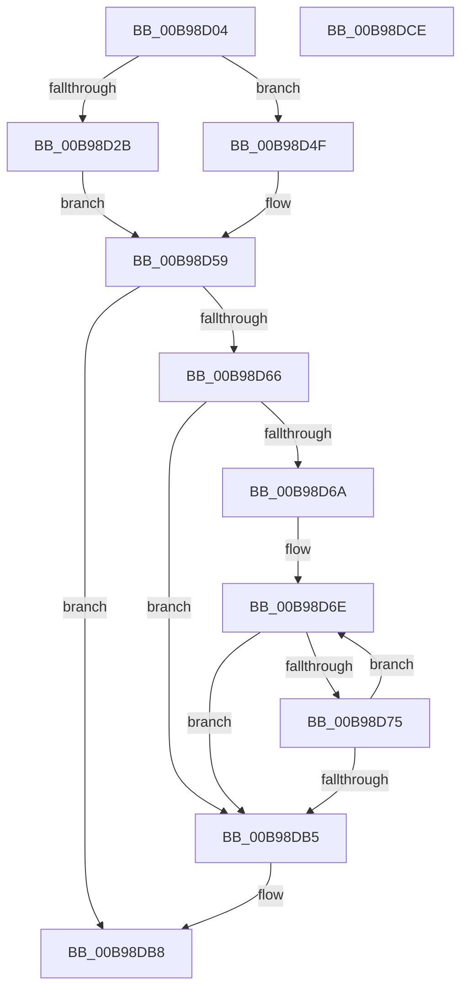

# ViFreeMapRegistersToFile

- RVA: `0x00B98D04`–`0x00B98DCF` (길이 `203` bytes)
- VA: `0x0000000140B98D04`
- 실행 섹션: `PAGEVRFY`
- PDB 이름 있음: `예`; PDB Function 태그: `아니요`
- unwind 정보 RVA: `0x0006F978`
- 디코드: `55`개 명령, `203/203` bytes 표시
- 미해석 바이트: `0` (있으면 어셈블리에 `.byte`로 보존)

> 이 문서는 커널 이미지의 기계어와 PDB 기호를 분석해 생성했습니다. 4번과 5번은 함수 원형과 자료형을 바이너리 사용 방식에서 추정한 C 해석이며 원본 소스 복구 결과는 아닙니다.

## 1. Dependencies

- 직접 호출 지점: **2**; 고유 호출 대상: **2**
- 직접 호출자로 확인된 함수: **1**
- RIP 상대 이미지 참조: **0**

### Outgoing calls
- `0x00B98D5C` → [ViFindMappedRegisterInFile](ViFindMappedRegisterInFile_function_00B9899C.md) (function, `0x00B9899C`)
- `0x00B98D97` → [ViCheckTag](ViCheckTag_function_00B98614.md) (function, `0x00B98614`)

### Direct callers
- [ViFlushDoubleBuffer](ViFlushDoubleBuffer_function_00B989D0.md) at `0x00B98B4B`

### Static image references
- 디코드된 RIP-relative 메모리 참조가 없습니다.

## 2. Other-region calls and transfers

- 다른 실행 섹션으로 향하는 call: **0**
- 별도 외부 분기/꼬리 이동을 확인하지 못했습니다.

## 3. Assembly (complete function range)

```asm
00B98D04  48 89 5C 24 08                  mov qword ptr [rsp + 8], rbx
00B98D09  48 89 74 24 10                  mov qword ptr [rsp + 0x10], rsi
00B98D0E  48 89 7C 24 18                  mov qword ptr [rsp + 0x18], rdi
00B98D13  41 56                           push r14
00B98D15  48 83 EC 20                     sub rsp, 0x20
00B98D19  44 8B 51 20                     mov r10d, dword ptr [rcx + 0x20]
00B98D1D  48 8B F1                        mov rsi, rcx
00B98D20  41 BE 01 00 00 00               mov r14d, 1
00B98D26  45 85 C0                        test r8d, r8d
00B98D29  74 24                           je 0x140b98d4f
00B98D2B  4C 8B CA                        mov r9, rdx
00B98D2E  41 8B F8                        mov edi, r8d
00B98D31  48 81 C7 FF 0F 00 00            add rdi, 0xfff
00B98D38  41 81 E1 FF 0F 00 00            and r9d, 0xfff
00B98D3F  49 03 F9                        add rdi, r9
00B98D42  48 C1 EF 0C                     shr rdi, 0xc
00B98D46  41 3B FA                        cmp edi, r10d
00B98D49  41 0F 43 FA                     cmovae edi, r10d
00B98D4D  EB 0A                           jmp 0x140b98d59
00B98D4F  45 3B D6                        cmp r10d, r14d
00B98D52  45 0F 47 D6                     cmova r10d, r14d
00B98D56  41 8B FA                        mov edi, r10d
00B98D59  45 33 C0                        xor r8d, r8d
00B98D5C  E8 3B FC FF FF                  call 0x140b9899c
00B98D61  48 85 C0                        test rax, rax
00B98D64  74 52                           je 0x140b98db8
00B98D66  85 FF                           test edi, edi
00B98D68  74 4B                           je 0x140b98db5
00B98D6A  48 8D 58 0C                     lea rbx, [rax + 0xc]
00B98D6E  48 83 7B F4 00                  cmp qword ptr [rbx - 0xc], 0
00B98D73  74 40                           je 0x140b98db5
00B98D75  8B 4B F4                        mov ecx, dword ptr [rbx - 0xc]
00B98D78  41 B9 03 00 00 00               mov r9d, 3
00B98D7E  48 8B 43 04                     mov rax, qword ptr [rbx + 4]
00B98D82  81 E1 FF 0F 00 00               and ecx, 0xfff
00B98D88  8B 53 FC                        mov edx, dword ptr [rbx - 4]
00B98D8B  48 05 00 10 00 00               add rax, 0x1000
00B98D91  48 03 C8                        add rcx, rax
00B98D94  45 8B C6                        mov r8d, r14d
00B98D97  E8 78 F8 FF FF                  call 0x140b98614
00B98D9C  83 23 FC                        and dword ptr [rbx], 0xfffffffc
00B98D9F  48 83 63 F4 00                  and qword ptr [rbx - 0xc], 0
00B98DA4  83 63 FC 00                     and dword ptr [rbx - 4], 0
00B98DA8  48 83 C3 20                     add rbx, 0x20
00B98DAC  F0 FF 4E 20                     lock dec dword ptr [rsi + 0x20]
00B98DB0  83 C7 FF                        add edi, -1
00B98DB3  75 B9                           jne 0x140b98d6e
00B98DB5  41 8B C6                        mov eax, r14d
00B98DB8  48 8B 5C 24 30                  mov rbx, qword ptr [rsp + 0x30]
00B98DBD  48 8B 74 24 38                  mov rsi, qword ptr [rsp + 0x38]
00B98DC2  48 8B 7C 24 40                  mov rdi, qword ptr [rsp + 0x40]
00B98DC7  48 83 C4 20                     add rsp, 0x20
00B98DCB  41 5E                           pop r14
00B98DCD  C3                              ret
00B98DCE  CC                              int3
```

## 4. C-style interpretation (structured pseudocode)

```c
__int64 __fastcall ViFreeMapRegistersToFile(__int64 a1, __int64 a2, int a3)
{
    __int64 result;
    __int64 v_r10;
    __int64 v_rbx;
    __int64 v_rdi;
    __int64 v_rsp;
    unsigned __int64 v_stack_p10;
    unsigned __int64 v_stack_p18;
    unsigned __int64 v_stack_p8;

    v_stack_p8 = v_rbx;
    v_stack_p10 = v_rsi;
    v_stack_p18 = v_rdi;
    v_rsp = (v_rsp) - (32);
    if (a3 == 0) goto loc_00B98D4F;
    v_rdi = ((unsigned int)(a3)) + (0xFFFULL);
    a4 = (unsigned int)((a2) & (0xFFFULL));
    v_rdi = (v_rdi) + (a4);
    v_rdi = (v_rdi) >> (12);
    if (((unsigned int)(v_rdi)) >= ((unsigned int)((unsigned int)(*(unsigned int *)(a1 + 32))))) { v_rdi = (unsigned int)((unsigned int)(*(unsigned int *)(a1 + 32))); }
    goto loc_00B98D59;
loc_00B98D4F:
    v_r10 = (unsigned int)(*(unsigned int *)(a1 + 32));
    if (((unsigned int)((unsigned int)(*(unsigned int *)(a1 + 32)))) > 1) { v_r10 = 1; }
loc_00B98D59:
    a3 = 0;
    result = ViFindMappedRegisterInFile(a1, a2, a3, a4);
    if (result == 0) goto loc_00B98DB8;
    if ((unsigned int)((unsigned int)((unsigned int)(v_r10))) == 0) goto loc_00B98DB5;
loc_00B98D6E:
    if ((*(unsigned __int64 *)(result + 12 - 12)) == 0) goto loc_00B98DB5;
    a1 = (unsigned int)(((unsigned int)(*(unsigned int *)(result + 12 - 12))) & (0xFFFULL));
    result = (*(unsigned __int64 *)(result + 12 + 4)) + (0x1000ULL);
    a1 = (a1) + (result);
    result = ViCheckTag(a1, (unsigned int)(*(unsigned int *)(result + 12 - 4)), 1, 3);
    v_rbx = (result + 12) + (32);
    v_rdi = (unsigned int)(((unsigned int)((unsigned int)(v_r10))) + (-1));
    if (condition_is_not_equal) goto loc_00B98D6E;
loc_00B98DB5:
loc_00B98DB8:
    v_rsp = (v_rsp) + (32);
    return 1;
}
```

## 5. (Beta) C Style

```c
int64_t ViFreeMapRegistersToFile(void *Arg1, int64_t Arg2, int32_t Arg3)
{
    uint8_t *arg1 = (uint8_t *)Arg1;

    int64_t result;
    int64_t local_r10;
    int64_t local_rbx;
    int64_t local_rdi;
    int64_t local_rsp;
    uint64_t v_stack_p10;
    uint64_t v_stack_p18;
    uint64_t v_stack_p8;

    v_stack_p8 = local_rbx;
    v_stack_p10 = local_rsi;
    v_stack_p18 = local_rdi;
    local_rsp = (local_rsp) - (32);
    if (Arg3 == 0) goto loc_00B98D4F;
    local_rdi = ((uint32_t)(Arg3)) + (0xFFFULL);
    a4 = (uint32_t)((Arg2) & (0xFFFULL));
    local_rdi = (local_rdi) + (a4);
    local_rdi = (local_rdi) >> (12);
    if (((uint32_t)(local_rdi)) >= ((uint32_t)((uint32_t)(*(uint32_t *)(arg1 + 0x20))))) { local_rdi = (uint32_t)((uint32_t)(*(uint32_t *)(arg1 + 0x20))); }
    goto loc_00B98D59;
loc_00B98D4F:
    local_r10 = (uint32_t)(*(uint32_t *)(arg1 + 0x20));
    if (((uint32_t)((uint32_t)(*(uint32_t *)(arg1 + 0x20)))) > 1) { local_r10 = 1; }
loc_00B98D59:
    Arg3 = 0;
    result = ViFindMappedRegisterInFile(Arg1, Arg2, Arg3, a4);
    if (result == 0) goto loc_00B98DB8;
    if ((uint32_t)((uint32_t)((uint32_t)(local_r10))) == 0) goto loc_00B98DB5;
loc_00B98D6E:
    if ((*(uint64_t *)(result + 0xC - 0xC)) == 0) goto loc_00B98DB5;
    Arg1 = (uint32_t)(((uint32_t)(*(uint32_t *)(result + 0xC - 0xC))) & (0xFFFULL));
    result = (*(uint64_t *)(result + 0xC + 0x4)) + (0x1000ULL);
    Arg1 = (Arg1) + (result);
    result = ViCheckTag(Arg1, (uint32_t)(*(uint32_t *)(result + 0xC - 0x4)), 1, 3);
    local_rbx = (result + 12) + (32);
    local_rdi = (uint32_t)(((uint32_t)((uint32_t)(local_r10))) + (-1));
    if (condition_is_not_equal) goto loc_00B98D6E;
loc_00B98DB5:
loc_00B98DB8:
    local_rsp = (local_rsp) + (32);
    return 1;
}
```

### 관측된 메모리 오프셋

구조체 형식이 확인되지 않은 접근은 인자 기준의 오프셋으로만 기록했습니다.

| 기준 인자 | 오프셋 표현 | 폭 (bit) | 접근 |
|---|---:|---:|---|
| `Arg1` | `+ 0x20` | `32` | `R` |
| `Arg1` | `+ 0x20` | `32` | `R/W` |

## 6. Execution-region graph

[열기: 2D/3D 그래프와 함수 탐색 컨트롤 패널](../../../control-panel.html?section=pagevrfy&rva=0x00B98D04&view=graph)

- 2D 그래프는 위에서 아래로 흐르고, 3D 그래프는 빈 공간을 드래그해 회전합니다. Shift+드래그는 이동, 휠은 확대·축소, 함수 노드 선택은 대상 보고서 이동입니다.

### Static fallback


