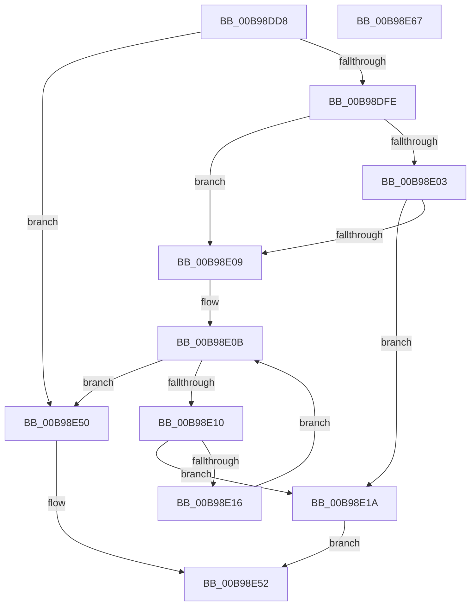

# ViFreeToContiguousMemory

- RVA: `0x00B98DD8`–`0x00B98E68` (길이 `144` bytes)
- VA: `0x0000000140B98DD8`
- 실행 섹션: `PAGEVRFY`
- PDB 이름 있음: `예`; PDB Function 태그: `아니요`
- unwind 정보 RVA: `0x0005C954`
- 디코드: `42`개 명령, `144/144` bytes 표시
- 미해석 바이트: `0` (있으면 어셈블리에 `.byte`로 보존)

> 이 문서는 커널 이미지의 기계어와 PDB 기호를 분석해 생성했습니다. 4번과 5번은 함수 원형과 자료형을 바이너리 사용 방식에서 추정한 C 해석이며 원본 소스 복구 결과는 아닙니다.

## 1. Dependencies

- 직접 호출 지점: **3**; 고유 호출 대상: **3**
- 직접 호출자로 확인된 함수: **2**
- RIP 상대 이미지 참조: **0**

### Outgoing calls
- `0x00B98E24` → [KeAcquireSpinLockRaiseToDpc](../../text/20/KeAcquireSpinLockRaiseToDpc_function_00208470.md) (function, `0x00208470`)
- `0x00B98E3A` → [RtlClearBits](../../text/3E/RtlClearBits_function_003E1A90.md) (function, `0x003E1A90`)
- `0x00B98E44` → [KeReleaseSpinLock](../../text/39/KeReleaseSpinLock_function_00392BA0.md) (function, `0x00392BA0`)

### Direct callers
- [ViAllocateMapRegisterFile](ViAllocateMapRegisterFile_function_00B97E9C.md) at `0x00B98041`
- [ViFreeMapRegisterFile](ViFreeMapRegisterFile_function_00B98B8C.md) at `0x00B98C87`

### Static image references
- 디코드된 RIP-relative 메모리 참조가 없습니다.

## 2. Other-region calls and transfers

- 다른 실행 섹션으로 향하는 call: **3**
  - `0x00B98E24` → [KeAcquireSpinLockRaiseToDpc](../../text/20/KeAcquireSpinLockRaiseToDpc_function_00208470.md) (`PAGEVRFY` → `.text`)
  - `0x00B98E3A` → [RtlClearBits](../../text/3E/RtlClearBits_function_003E1A90.md) (`PAGEVRFY` → `.text`)
  - `0x00B98E44` → [KeReleaseSpinLock](../../text/39/KeReleaseSpinLock_function_00392BA0.md) (`PAGEVRFY` → `.text`)
- 별도 외부 분기/꼬리 이동을 확인하지 못했습니다.

## 3. Assembly (complete function range)

```asm
00B98DD8  48 89 5C 24 08                  mov qword ptr [rsp + 8], rbx
00B98DDD  48 89 6C 24 10                  mov qword ptr [rsp + 0x10], rbp
00B98DE2  48 89 74 24 18                  mov qword ptr [rsp + 0x18], rsi
00B98DE7  57                              push rdi
00B98DE8  48 83 EC 20                     sub rsp, 0x20
00B98DEC  41 8B F0                        mov esi, r8d
00B98DEF  48 8B E9                        mov rbp, rcx
00B98DF2  4C 8B 81 28 01 00 00            mov r8, qword ptr [rcx + 0x128]
00B98DF9  4D 85 C0                        test r8, r8
00B98DFC  74 52                           je 0x140b98e50
00B98DFE  83 FE 20                        cmp esi, 0x20
00B98E01  73 06                           jae 0x140b98e09
00B98E03  49 39 14 F0                     cmp qword ptr [r8 + rsi*8], rdx
00B98E07  74 11                           je 0x140b98e1a
00B98E09  33 F6                           xor esi, esi
00B98E0B  83 FE 20                        cmp esi, 0x20
00B98E0E  73 40                           jae 0x140b98e50
00B98E10  49 39 14 F0                     cmp qword ptr [r8 + rsi*8], rdx
00B98E14  74 04                           je 0x140b98e1a
00B98E16  FF C6                           inc esi
00B98E18  EB F1                           jmp 0x140b98e0b
00B98E1A  48 8D B9 38 01 00 00            lea rdi, [rcx + 0x138]
00B98E21  48 8B CF                        mov rcx, rdi
00B98E24  E8 47 F6 66 FF                  call 0x140208470
00B98E29  48 8D 8D 48 01 00 00            lea rcx, [rbp + 0x148]
00B98E30  41 B8 01 00 00 00               mov r8d, 1
00B98E36  8B D6                           mov edx, esi
00B98E38  8A D8                           mov bl, al
00B98E3A  E8 51 8C 84 FF                  call 0x1403e1a90
00B98E3F  8A D3                           mov dl, bl
00B98E41  48 8B CF                        mov rcx, rdi
00B98E44  E8 57 9D 7F FF                  call 0x140392ba0
00B98E49  B8 01 00 00 00                  mov eax, 1
00B98E4E  EB 02                           jmp 0x140b98e52
00B98E50  33 C0                           xor eax, eax
00B98E52  48 8B 5C 24 30                  mov rbx, qword ptr [rsp + 0x30]
00B98E57  48 8B 6C 24 38                  mov rbp, qword ptr [rsp + 0x38]
00B98E5C  48 8B 74 24 40                  mov rsi, qword ptr [rsp + 0x40]
00B98E61  48 83 C4 20                     add rsp, 0x20
00B98E65  5F                              pop rdi
00B98E66  C3                              ret
00B98E67  CC                              int3
```

## 4. C-style interpretation (structured pseudocode)

```c
__int64 __fastcall ViFreeToContiguousMemory(__int64 a1, __int64 a2, int a3)
{
    __int64 result;
    __int64 v_rsi;
    __int64 v_rsp;
    unsigned __int64 v_stack_p10;
    unsigned __int64 v_stack_p18;
    unsigned __int64 v_stack_p8;

    v_stack_p8 = v_rbx;
    v_stack_p10 = v_rbp;
    v_stack_p18 = v_rsi;
    v_rsp = (v_rsp) - (32);
    if (*(unsigned __int64 *)(a1 + 296) == 0) goto loc_00B98E50;
    if (((unsigned int)((unsigned int)(a3))) >= 32) goto loc_00B98E09;
    if ((*(unsigned __int64 *)(*(unsigned __int64 *)(a1 + 296) + (unsigned int)(a3) * 8)) == a2) goto loc_00B98E1A;
loc_00B98E09:
    v_rsi = 0;
loc_00B98E0B:
    if (0 >= 32) goto loc_00B98E50;
    if ((*(unsigned __int64 *)(*(unsigned __int64 *)(a1 + 296) + v_rsi * 8)) == a2) goto loc_00B98E1A;
    v_rsi = (unsigned int)((v_rsi) + 1);
    goto loc_00B98E0B;
loc_00B98E1A:
    result = KeAcquireSpinLockRaiseToDpc(a1 + 312, a2, *(unsigned __int64 *)(a1 + 296), a4);
    result = RtlClearBits(a1 + 328, (unsigned int)((unsigned int)(v_rsi)), 1, a4);
    result = KeReleaseSpinLock(a1 + 312, (unsigned __int8)((unsigned __int8)(result)), 1, a4);
    goto loc_00B98E52;
loc_00B98E50:
    result = 0;
loc_00B98E52:
    v_rsp = (v_rsp) + (32);
    return result;
}
```

## 5. (Beta) C Style

```c
int64_t ViFreeToContiguousMemory(void *Arg1, int64_t Arg2, int32_t Arg3)
{
    uint8_t *arg1 = (uint8_t *)Arg1;

    int64_t result;
    int64_t local_rsi;
    int64_t local_rsp;
    uint64_t v_stack_p10;
    uint64_t v_stack_p18;
    uint64_t v_stack_p8;

    v_stack_p8 = local_rbx;
    v_stack_p10 = local_rbp;
    v_stack_p18 = local_rsi;
    local_rsp = (local_rsp) - (32);
    if (*(uint64_t *)(arg1 + 0x128) == 0) goto loc_00B98E50;
    if (((uint32_t)((uint32_t)(Arg3))) >= 32) goto loc_00B98E09;
    if ((*(uint64_t *)(*(uint64_t *)(arg1 + 0x128) + (uint32_t)(Arg3) * 8)) == Arg2) goto loc_00B98E1A;
loc_00B98E09:
    local_rsi = 0;
loc_00B98E0B:
    if (0 >= 32) goto loc_00B98E50;
    if ((*(uint64_t *)(*(uint64_t *)(arg1 + 0x128) + local_rsi * 8)) == Arg2) goto loc_00B98E1A;
    local_rsi = (uint32_t)((local_rsi) + 1);
    goto loc_00B98E0B;
loc_00B98E1A:
    result = KeAcquireSpinLockRaiseToDpc(Arg1 + 312, Arg2, *(uint64_t *)(arg1 + 0x128), a4);
    result = RtlClearBits(Arg1 + 328, (uint32_t)((uint32_t)(local_rsi)), 1, a4);
    result = KeReleaseSpinLock(Arg1 + 312, (uint8_t)((uint8_t)(result)), 1, a4);
    goto loc_00B98E52;
loc_00B98E50:
    result = 0;
loc_00B98E52:
    local_rsp = (local_rsp) + (32);
    return result;
}
```

### 관측된 메모리 오프셋

구조체 형식이 확인되지 않은 접근은 인자 기준의 오프셋으로만 기록했습니다.

| 기준 인자 | 오프셋 표현 | 폭 (bit) | 접근 |
|---|---:|---:|---|
| `Arg1` | `+ 0x128` | `64` | `R` |
| `Arg1` | `+ 0x138` | `64` | `R` |
| `Arg1` | `+ 0x148` | `64` | `R` |

## 6. Execution-region graph

[열기: 2D/3D 그래프와 함수 탐색 컨트롤 패널](../../../control-panel.html?section=pagevrfy&rva=0x00B98DD8&view=graph)

- 2D 그래프는 위에서 아래로 흐르고, 3D 그래프는 빈 공간을 드래그해 회전합니다. Shift+드래그는 이동, 휠은 확대·축소, 함수 노드 선택은 대상 보고서 이동입니다.

### Static fallback


