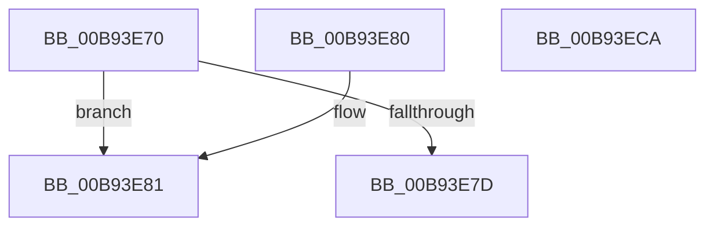

# ViGenericBuildIrpLogEntry

- RVA: `0x00B93E70`–`0x00B93ECB` (길이 `91` bytes)
- VA: `0x0000000140B93E70`
- 실행 섹션: `PAGEVRFY`
- PDB 이름 있음: `예`; PDB Function 태그: `아니요`
- unwind 정보 RVA: `0x000DB714`
- 디코드: `27`개 명령, `91/91` bytes 표시
- 미해석 바이트: `0` (있으면 어셈블리에 `.byte`로 보존)

> 이 문서는 커널 이미지의 기계어와 PDB 기호를 분석해 생성했습니다. 4번과 5번은 함수 원형과 자료형을 바이너리 사용 방식에서 추정한 C 해석이며 원본 소스 복구 결과는 아닙니다.

## 1. Dependencies

- 직접 호출 지점: **0**; 고유 호출 대상: **0**
- 직접 호출자로 확인된 함수: **0**
- RIP 상대 이미지 참조: **0**

### Outgoing calls
- 직접 디코드된 call 명령이 없습니다.

### Direct callers
- 이 함수 시작 RVA로 연결되는 직접 call은 확인되지 않았습니다. 간접 호출은 완전히 역산할 수 없습니다.

### Static image references
- 디코드된 RIP-relative 메모리 참조가 없습니다.

## 2. Other-region calls and transfers

- 다른 실행 섹션으로 향하는 call: **0**
- 별도 외부 분기/꼬리 이동을 확인하지 못했습니다.

## 3. Assembly (complete function range)

```asm
00B93E70  48 8B 91 B8 00 00 00            mov rdx, qword ptr [rcx + 0xb8]
00B93E77  80 7A B8 0E                     cmp byte ptr [rdx - 0x48], 0xe
00B93E7B  74 04                           je 0x140b93e81
00B93E7D  33 C0                           xor eax, eax
00B93E7F  C3                              ret
00B93E80  CC                              int3
00B93E81  41 B8 01 00 00 00               mov r8d, 1
00B93E87  45 89 01                        mov dword ptr [r9], r8d
00B93E8A  8A 42 B8                        mov al, byte ptr [rdx - 0x48]
00B93E8D  41 88 41 04                     mov byte ptr [r9 + 4], al
00B93E91  41 8B C0                        mov eax, r8d
00B93E94  8A 4A B9                        mov cl, byte ptr [rdx - 0x47]
00B93E97  41 88 49 05                     mov byte ptr [r9 + 5], cl
00B93E9B  8A 4A BA                        mov cl, byte ptr [rdx - 0x46]
00B93E9E  41 88 49 06                     mov byte ptr [r9 + 6], cl
00B93EA2  8A 4A BB                        mov cl, byte ptr [rdx - 0x45]
00B93EA5  41 88 49 07                     mov byte ptr [r9 + 7], cl
00B93EA9  48 8B 4A C0                     mov rcx, qword ptr [rdx - 0x40]
00B93EAD  49 89 49 08                     mov qword ptr [r9 + 8], rcx
00B93EB1  48 8B 4A C8                     mov rcx, qword ptr [rdx - 0x38]
00B93EB5  49 89 49 10                     mov qword ptr [r9 + 0x10], rcx
00B93EB9  48 8B 4A D0                     mov rcx, qword ptr [rdx - 0x30]
00B93EBD  49 89 49 18                     mov qword ptr [r9 + 0x18], rcx
00B93EC1  48 8B 4A D8                     mov rcx, qword ptr [rdx - 0x28]
00B93EC5  49 89 49 20                     mov qword ptr [r9 + 0x20], rcx
00B93EC9  C3                              ret
00B93ECA  CC                              int3
```

## 4. C-style interpretation (structured pseudocode)

```c
__int64 __fastcall ViGenericBuildIrpLogEntry(__int64 a1, __int64 a2, __int64 a3, __int64 a4)
{
    __int64 result;

    if ((*(unsigned __int8 *)(*(unsigned __int64 *)(a1 + 184) - 72)) == 14) goto loc_00B93E81;
    result = 0;
    return result;
loc_00B93E81:
    *(unsigned int *)(a4) = 1;
    *(unsigned __int8 *)(a4 + 4) = (unsigned __int8)(*(unsigned __int8 *)(*(unsigned __int64 *)(a1 + 184) - 72));
    *(unsigned __int8 *)(a4 + 5) = (unsigned __int8)(*(unsigned __int8 *)(*(unsigned __int64 *)(a1 + 184) - 71));
    *(unsigned __int8 *)(a4 + 6) = (unsigned __int8)(*(unsigned __int8 *)(*(unsigned __int64 *)(a1 + 184) - 70));
    *(unsigned __int8 *)(a4 + 7) = (unsigned __int8)(*(unsigned __int8 *)(*(unsigned __int64 *)(a1 + 184) - 69));
    *(unsigned __int64 *)(a4 + 8) = *(unsigned __int64 *)(*(unsigned __int64 *)(a1 + 184) - 64);
    *(unsigned __int64 *)(a4 + 16) = *(unsigned __int64 *)(*(unsigned __int64 *)(a1 + 184) - 56);
    *(unsigned __int64 *)(a4 + 24) = *(unsigned __int64 *)(*(unsigned __int64 *)(a1 + 184) - 48);
    *(unsigned __int64 *)(a4 + 32) = *(unsigned __int64 *)(*(unsigned __int64 *)(a1 + 184) - 40);
    return 1;
}
```

## 5. (Beta) C Style

```c
int64_t ViGenericBuildIrpLogEntry(void *Arg1, int64_t Arg2, int64_t Arg3, void *Arg4)
{
    uint8_t *arg1 = (uint8_t *)Arg1;
    uint8_t *arg4 = (uint8_t *)Arg4;

    int64_t result;

    if ((*(uint8_t *)(*(uint64_t *)(arg1 + 0xB8) - 0x48)) == 14) goto loc_00B93E81;
    result = 0;
    return result;
loc_00B93E81:
    *(uint32_t *)(arg4) = 1;
    *(uint8_t *)(arg4 + 0x4) = (uint8_t)(*(uint8_t *)(*(uint64_t *)(arg1 + 0xB8) - 0x48));
    *(uint8_t *)(arg4 + 0x5) = (uint8_t)(*(uint8_t *)(*(uint64_t *)(arg1 + 0xB8) - 0x47));
    *(uint8_t *)(arg4 + 0x6) = (uint8_t)(*(uint8_t *)(*(uint64_t *)(arg1 + 0xB8) - 0x46));
    *(uint8_t *)(arg4 + 0x7) = (uint8_t)(*(uint8_t *)(*(uint64_t *)(arg1 + 0xB8) - 0x45));
    *(uint64_t *)(arg4 + 0x8) = *(uint64_t *)(*(uint64_t *)(arg1 + 0xB8) - 0x40);
    *(uint64_t *)(arg4 + 0x10) = *(uint64_t *)(*(uint64_t *)(arg1 + 0xB8) - 0x38);
    *(uint64_t *)(arg4 + 0x18) = *(uint64_t *)(*(uint64_t *)(arg1 + 0xB8) - 0x30);
    *(uint64_t *)(arg4 + 0x20) = *(uint64_t *)(*(uint64_t *)(arg1 + 0xB8) - 0x28);
    return 1;
}
```

### 관측된 메모리 오프셋

구조체 형식이 확인되지 않은 접근은 인자 기준의 오프셋으로만 기록했습니다.

| 기준 인자 | 오프셋 표현 | 폭 (bit) | 접근 |
|---|---:|---:|---|
| `Arg1` | `+ 0xB8` | `64` | `R` |
| `Arg4` | `+ 0x0` | `32` | `W` |
| `Arg4` | `+ 0x4` | `8` | `W` |
| `Arg4` | `+ 0x5` | `8` | `W` |
| `Arg4` | `+ 0x6` | `8` | `W` |
| `Arg4` | `+ 0x7` | `8` | `W` |
| `Arg4` | `+ 0x8` | `64` | `W` |
| `Arg4` | `+ 0x10` | `64` | `W` |
| `Arg4` | `+ 0x18` | `64` | `W` |
| `Arg4` | `+ 0x20` | `64` | `W` |

## 6. Execution-region graph

[열기: 2D/3D 그래프와 함수 탐색 컨트롤 패널](../../../control-panel.html?section=pagevrfy&rva=0x00B93E70&view=graph)

- 2D 그래프는 위에서 아래로 흐르고, 3D 그래프는 빈 공간을 드래그해 회전합니다. Shift+드래그는 이동, 휠은 확대·축소, 함수 노드 선택은 대상 보고서 이동입니다.

### Static fallback


