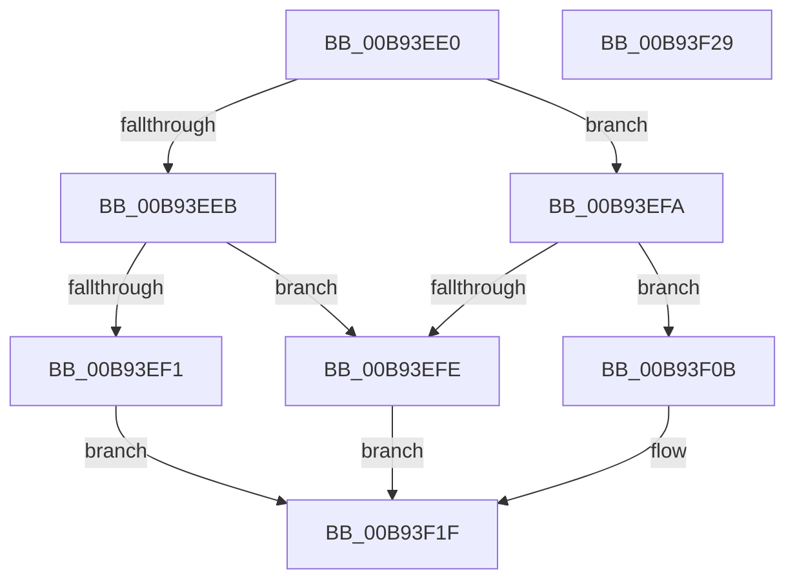

# ViGenericDumpIrpStack

- RVA: `0x00B93EE0`–`0x00B93F2A` (길이 `74` bytes)
- VA: `0x0000000140B93EE0`
- 실행 섹션: `PAGEVRFY`
- PDB 이름 있음: `예`; PDB Function 태그: `아니요`
- unwind 정보 RVA: `0x0005C788`
- 디코드: `21`개 명령, `74/74` bytes 표시
- 미해석 바이트: `0` (있으면 어셈블리에 `.byte`로 보존)

> 이 문서는 커널 이미지의 기계어와 PDB 기호를 분석해 생성했습니다. 4번과 5번은 함수 원형과 자료형을 바이너리 사용 방식에서 추정한 C 해석이며 원본 소스 복구 결과는 아닙니다.

## 1. Dependencies

- 직접 호출 지점: **1**; 고유 호출 대상: **1**
- 직접 호출자로 확인된 함수: **0**
- RIP 상대 이미지 참조: **4**

### Outgoing calls
- `0x00B93F1F` → [VfUtilDbgPrint](../../text/61/VfUtilDbgPrint_function_006122AC.md) (function, `0x006122AC`)

### Direct callers
- 이 함수 시작 RVA로 연결되는 직접 call은 확인되지 않았습니다. 간접 호출은 완전히 역산할 수 없습니다.

### Static image references
- `0x00B93EF1` → RVA `0x00BB9A40` (` ?? ::JKADOLAD::`string'`; read)
- `0x00B93EFE` → RVA `0x00B8B5F0` (`IrpMajorNames`; read)
- `0x00B93F0D` → RVA `0x00BB9A60` (` ?? ::JKADOLAD::`string'`; read)
- `0x00B93F14` → RVA `0x00BB9A50` (` ?? ::JKADOLAD::`string'`; read)

## 2. Other-region calls and transfers

- 다른 실행 섹션으로 향하는 call: **1**
  - `0x00B93F1F` → [VfUtilDbgPrint](../../text/61/VfUtilDbgPrint_function_006122AC.md) (`PAGEVRFY` → `.text`)
- 별도 외부 분기/꼬리 이동을 확인하지 못했습니다.

## 3. Assembly (complete function range)

```asm
00B93EE0  48 83 EC 28                     sub rsp, 0x28
00B93EE4  0F B6 01                        movzx eax, byte ptr [rcx]
00B93EE7  3C 0F                           cmp al, 0xf
00B93EE9  75 0F                           jne 0x140b93efa
00B93EEB  80 79 01 01                     cmp byte ptr [rcx + 1], 1
00B93EEF  75 0D                           jne 0x140b93efe
00B93EF1  48 8D 0D 48 5B 02 00            lea rcx, [rip + 0x25b48]
00B93EF8  EB 25                           jmp 0x140b93f1f
00B93EFA  3C 1B                           cmp al, 0x1b
00B93EFC  77 0D                           ja 0x140b93f0b
00B93EFE  48 8D 0D EB 76 FF FF            lea rcx, [rip - 0x8915]
00B93F05  48 8B 0C C1                     mov rcx, qword ptr [rcx + rax*8]
00B93F09  EB 14                           jmp 0x140b93f1f
00B93F0B  3C FF                           cmp al, 0xff
00B93F0D  48 8D 0D 4C 5B 02 00            lea rcx, [rip + 0x25b4c]
00B93F14  48 8D 15 35 5B 02 00            lea rdx, [rip + 0x25b35]
00B93F1B  48 0F 45 CA                     cmovne rcx, rdx
00B93F1F  E8 88 E3 A7 FF                  call 0x1406122ac
00B93F24  48 83 C4 28                     add rsp, 0x28
00B93F28  C3                              ret
00B93F29  CC                              int3
```

## 4. C-style interpretation (structured pseudocode)

```c
__int64 __fastcall ViGenericDumpIrpStack(__int64 a1)
{
    __int64 result;
    __int64 v_rsp;

    v_rsp = (v_rsp) - (40);
    if (((unsigned __int8)(*(unsigned __int8 *)(a1))) != 15) goto loc_00B93EFA;
    if ((*(unsigned __int8 *)(a1 + 1)) != 1) goto loc_00B93EFE;
    goto loc_00B93F1F;
loc_00B93EFA:
    if (((unsigned __int8)(*(unsigned __int8 *)(a1))) > 27) goto loc_00B93F0B;
loc_00B93EFE:
    goto loc_00B93F1F;
loc_00B93F0B:
    a1 = v_rip + 154444;
    if (((unsigned __int8)(*(unsigned __int8 *)(a1))) != 255) { a1 = v_rip + 154421; }
loc_00B93F1F:
    result = VfUtilDbgPrint(a1, v_rip + 154421, a3, a4);
    v_rsp = (v_rsp) + (40);
    return result;
}
```

## 5. (Beta) C Style

```c
int64_t ViGenericDumpIrpStack(void *Arg1)
{
    uint8_t *arg1 = (uint8_t *)Arg1;

    int64_t result;
    int64_t local_rsp;

    local_rsp = (local_rsp) - (40);
    if (((uint8_t)(*(uint8_t *)(arg1))) != 15) goto loc_00B93EFA;
    if ((*(uint8_t *)(arg1 + 0x1)) != 1) goto loc_00B93EFE;
    goto loc_00B93F1F;
loc_00B93EFA:
    if (((uint8_t)(*(uint8_t *)(arg1))) > 27) goto loc_00B93F0B;
loc_00B93EFE:
    goto loc_00B93F1F;
loc_00B93F0B:
    Arg1 = v_rip + 154444;
    if (((uint8_t)(*(uint8_t *)(arg1))) != 255) { Arg1 = v_rip + 154421; }
loc_00B93F1F:
    result = VfUtilDbgPrint(Arg1, v_rip + 154421, a3, a4);
    local_rsp = (local_rsp) + (40);
    return result;
}
```

### 관측된 메모리 오프셋

구조체 형식이 확인되지 않은 접근은 인자 기준의 오프셋으로만 기록했습니다.

| 기준 인자 | 오프셋 표현 | 폭 (bit) | 접근 |
|---|---:|---:|---|
| `Arg1` | `+ 0x0` | `8` | `R` |
| `Arg1` | `+ 0x1` | `8` | `R` |

## 6. Execution-region graph

[열기: 2D/3D 그래프와 함수 탐색 컨트롤 패널](../../../control-panel.html?section=pagevrfy&rva=0x00B93EE0&view=graph)

- 2D 그래프는 위에서 아래로 흐르고, 3D 그래프는 빈 공간을 드래그해 회전합니다. Shift+드래그는 이동, 휠은 확대·축소, 함수 노드 선택은 대상 보고서 이동입니다.

### Static fallback


