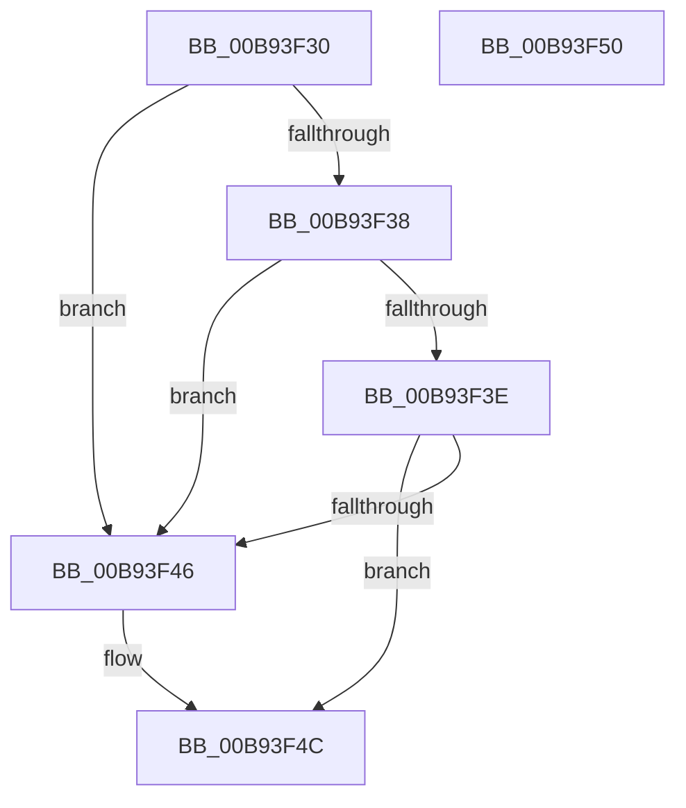

# ViGenericIsNewRequest

- RVA: `0x00B93F30`–`0x00B93F51` (길이 `33` bytes)
- VA: `0x0000000140B93F30`
- 실행 섹션: `PAGEVRFY`
- PDB 이름 있음: `예`; PDB Function 태그: `아니요`
- unwind 정보 RVA: `0x000DB714`
- 디코드: `13`개 명령, `33/33` bytes 표시
- 미해석 바이트: `0` (있으면 어셈블리에 `.byte`로 보존)

> 이 문서는 커널 이미지의 기계어와 PDB 기호를 분석해 생성했습니다. 4번과 5번은 함수 원형과 자료형을 바이너리 사용 방식에서 추정한 C 해석이며 원본 소스 복구 결과는 아닙니다.

## 1. Dependencies

- 직접 호출 지점: **0**; 고유 호출 대상: **0**
- 직접 호출자로 확인된 함수: **0**
- RIP 상대 이미지 참조: **0**

### Outgoing calls
- 직접 디코드된 call 명령이 없습니다.

### Direct callers
- 이 함수 시작 RVA로 연결되는 직접 call은 확인되지 않았습니다. 간접 호출은 완전히 역산할 수 없습니다.

### Static image references
- 디코드된 RIP-relative 메모리 참조가 없습니다.

## 2. Other-region calls and transfers

- 다른 실행 섹션으로 향하는 call: **0**
- 별도 외부 분기/꼬리 이동을 확인하지 못했습니다.

## 3. Assembly (complete function range)

```asm
00B93F30  45 33 C0                        xor r8d, r8d
00B93F33  48 85 C9                        test rcx, rcx
00B93F36  74 0E                           je 0x140b93f46
00B93F38  8A 01                           mov al, byte ptr [rcx]
00B93F3A  38 02                           cmp byte ptr [rdx], al
00B93F3C  75 08                           jne 0x140b93f46
00B93F3E  8A 41 01                        mov al, byte ptr [rcx + 1]
00B93F41  38 42 01                        cmp byte ptr [rdx + 1], al
00B93F44  74 06                           je 0x140b93f4c
00B93F46  41 B8 01 00 00 00               mov r8d, 1
00B93F4C  41 8B C0                        mov eax, r8d
00B93F4F  C3                              ret
00B93F50  CC                              int3
```

## 4. C-style interpretation (structured pseudocode)

```c
__int64 __fastcall ViGenericIsNewRequest(__int64 a1, __int64 a2, int a3)
{
    a3 = 0;
    if (a1 == 0) goto loc_00B93F46;
    if ((*(unsigned __int8 *)(a2)) != ((unsigned __int8)(*(unsigned __int8 *)(a1)))) goto loc_00B93F46;
    if ((*(unsigned __int8 *)(a2 + 1)) != ((unsigned __int8)(*(unsigned __int8 *)(a1 + 1)))) {
        a3 = 1;
    }
    return (unsigned int)(a3);
}
```

## 5. (Beta) C Style

```c
int64_t ViGenericIsNewRequest(int64_t Arg1, void *Arg2, int32_t Arg3)
{
    uint8_t *arg2 = (uint8_t *)Arg2;

    Arg3 = 0;
    if (Arg1 == 0) goto loc_00B93F46;
    if ((*(uint8_t *)(arg2)) != ((uint8_t)(*(uint8_t *)(Arg1)))) goto loc_00B93F46;
    if ((*(uint8_t *)(arg2 + 0x1)) != ((uint8_t)(*(uint8_t *)(Arg1 + 0x1)))) {
        Arg3 = 1;
    }
    return (uint32_t)(Arg3);
}
```

### 관측된 메모리 오프셋

구조체 형식이 확인되지 않은 접근은 인자 기준의 오프셋으로만 기록했습니다.

| 기준 인자 | 오프셋 표현 | 폭 (bit) | 접근 |
|---|---:|---:|---|
| `Arg2` | `+ 0x0` | `8` | `R` |
| `Arg2` | `+ 0x1` | `8` | `R` |

## 6. Execution-region graph

[열기: 2D/3D 그래프와 함수 탐색 컨트롤 패널](../../../control-panel.html?section=pagevrfy&rva=0x00B93F30&view=graph)

- 2D 그래프는 위에서 아래로 흐르고, 3D 그래프는 빈 공간을 드래그해 회전합니다. Shift+드래그는 이동, 휠은 확대·축소, 함수 노드 선택은 대상 보고서 이동입니다.

### Static fallback


