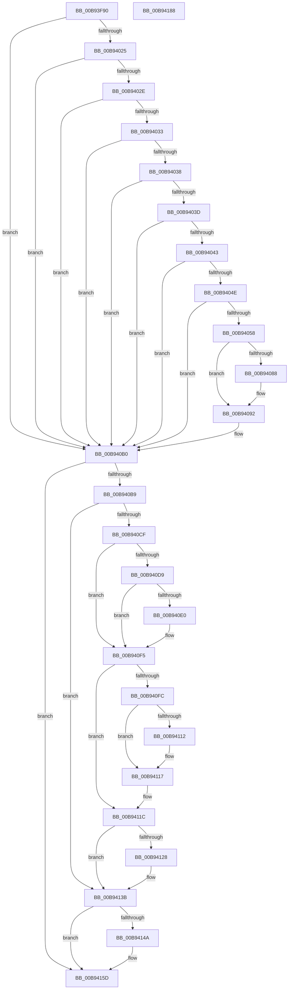

# ViGenericVerifyIrpStackDownward

- RVA: `0x00B93F90`–`0x00B94189` (길이 `505` bytes)
- VA: `0x0000000140B93F90`
- 실행 섹션: `PAGEVRFY`
- PDB 이름 있음: `예`; PDB Function 태그: `아니요`
- unwind 정보 RVA: `0x000D2220`
- 디코드: `134`개 명령, `505/505` bytes 표시
- 미해석 바이트: `0` (있으면 어셈블리에 `.byte`로 보존)

> 이 문서는 커널 이미지의 기계어와 PDB 기호를 분석해 생성했습니다. 4번과 5번은 함수 원형과 자료형을 바이너리 사용 방식에서 추정한 C 해석이며 원본 소스 복구 결과는 아닙니다.

## 1. Dependencies

- 직접 호출 지점: **11**; 고유 호출 대상: **9**
- 직접 호출자로 확인된 함수: **0**
- RIP 상대 이미지 참조: **2**

### Outgoing calls
- `0x00B9400B` → [VfMajorIsNewRequest](../BA/VfMajorIsNewRequest_function_00BA2F24.md) (function, `0x00BA2F24`)
- `0x00B9405D` → [ViErrorDisplayDescription](../BA/ViErrorDisplayDescription_function_00BA361C.md) (function, `0x00BA361C`)
- `0x00B9407F` → [RtlStringCbPrintfA](../../text/53/RtlStringCbPrintfA_function_0053BC0C.md) (function, `0x0053BC0C`)
- `0x00B9408D` → [VfUtilDbgPrint](../../text/61/VfUtilDbgPrint_function_006122AC.md) (function, `0x006122AC`)
- `0x00B940A0` → [ViErrorFinishReport](../BA/ViErrorFinishReport_function_00BA366C.md) (function, `0x00BA366C`)
- `0x00B940F0` → [ViErrorReport1](../../text/61/ViErrorReport1_function_00614584.md) (function, `0x00614584`)
- `0x00B94117` → [ViErrorReport1](../../text/61/ViErrorReport1_function_00614584.md) (function, `0x00614584`)
- `0x00B94136` → [ViErrorReport1](../../text/61/ViErrorReport1_function_00614584.md) (function, `0x00614584`)
- `0x00B94141` → [VfMajorIsValidIrpStatus](../BA/VfMajorIsValidIrpStatus_function_00BA2FA4.md) (function, `0x00BA2FA4`)
- `0x00B94158` → [ViErrorReport6](../../text/61/ViErrorReport6_function_00614740.md) (function, `0x00614740`)
- `0x00B94168` → [_security_check_cookie](../../text/6A/_security_check_cookie_function_006AC640.md) (function, `0x006AC640`)

### Direct callers
- 이 함수 시작 RVA로 연결되는 직접 call은 확인되지 않았습니다. 간접 호출은 완전히 역산할 수 없습니다.

### Static image references
- `0x00B93FA7` → RVA `0x00E0A740` (`.data`; read)
- `0x00B94069` → RVA `0x006CE5D0` (` ?? ::FNODOBFM::`string'`; read)

## 2. Other-region calls and transfers

- 다른 실행 섹션으로 향하는 call: **7**
  - `0x00B9407F` → [RtlStringCbPrintfA](../../text/53/RtlStringCbPrintfA_function_0053BC0C.md) (`PAGEVRFY` → `.text`)
  - `0x00B9408D` → [VfUtilDbgPrint](../../text/61/VfUtilDbgPrint_function_006122AC.md) (`PAGEVRFY` → `.text`)
  - `0x00B940F0` → [ViErrorReport1](../../text/61/ViErrorReport1_function_00614584.md) (`PAGEVRFY` → `.text`)
  - `0x00B94117` → [ViErrorReport1](../../text/61/ViErrorReport1_function_00614584.md) (`PAGEVRFY` → `.text`)
  - `0x00B94136` → [ViErrorReport1](../../text/61/ViErrorReport1_function_00614584.md) (`PAGEVRFY` → `.text`)
  - `0x00B94158` → [ViErrorReport6](../../text/61/ViErrorReport6_function_00614740.md) (`PAGEVRFY` → `.text`)
  - `0x00B94168` → [_security_check_cookie](../../text/6A/_security_check_cookie_function_006AC640.md) (`PAGEVRFY` → `.text`)
- 별도 외부 분기/꼬리 이동을 확인하지 못했습니다.

## 3. Assembly (complete function range)

```asm
00B93F90  48 89 5C 24 10                  mov qword ptr [rsp + 0x10], rbx
00B93F95  55                              push rbp
00B93F96  56                              push rsi
00B93F97  57                              push rdi
00B93F98  41 54                           push r12
00B93F9A  41 55                           push r13
00B93F9C  41 56                           push r14
00B93F9E  41 57                           push r15
00B93FA0  48 81 EC C0 00 00 00            sub rsp, 0xc0
00B93FA7  48 8B 05 92 67 27 00            mov rax, qword ptr [rip + 0x276792]
00B93FAE  48 33 C4                        xor rax, rsp
00B93FB1  48 89 84 24 B0 00 00 00         mov qword ptr [rsp + 0xb0], rax
00B93FB9  48 8B 19                        mov rbx, qword ptr [rcx]
00B93FBC  4C 8B F1                        mov r14, rcx
00B93FBF  48 8B BC 24 20 01 00 00         mov rdi, qword ptr [rsp + 0x120]
00B93FC7  49 8B D1                        mov rdx, r9
00B93FCA  48 8B A9 F0 00 00 00            mov rbp, qword ptr [rcx + 0xf0]
00B93FD1  4D 8B E1                        mov r12, r9
00B93FD4  48 8B B4 24 30 01 00 00         mov rsi, qword ptr [rsp + 0x130]
00B93FDC  49 8B C8                        mov rcx, r8
00B93FDF  44 8B 7B 30                     mov r15d, dword ptr [rbx + 0x30]
00B93FE3  4D 8B E8                        mov r13, r8
00B93FE6  8B 47 60                        mov eax, dword ptr [rdi + 0x60]
00B93FE9  89 44 24 38                     mov dword ptr [rsp + 0x38], eax
00B93FED  48 8B 43 38                     mov rax, qword ptr [rbx + 0x38]
00B93FF1  48 89 44 24 48                  mov qword ptr [rsp + 0x48], rax
00B93FF6  48 8B 47 68                     mov rax, qword ptr [rdi + 0x68]
00B93FFA  48 89 44 24 40                  mov qword ptr [rsp + 0x40], rax
00B93FFF  8B 47 04                        mov eax, dword ptr [rdi + 4]
00B94002  25 00 00 00 08                  and eax, 0x8000000
00B94007  89 44 24 34                     mov dword ptr [rsp + 0x34], eax
00B9400B  E8 14 EF 00 00                  call 0x140ba2f24
00B94010  41 0F B6 14 24                  movzx edx, byte ptr [r12]
00B94015  44 8B C0                        mov r8d, eax
00B94018  89 44 24 30                     mov dword ptr [rsp + 0x30], eax
00B9401C  83 EA 03                        sub edx, 3
00B9401F  0F 84 8B 00 00 00               je 0x140b940b0
00B94025  83 EA 01                        sub edx, 1
00B94028  0F 84 82 00 00 00               je 0x140b940b0
00B9402E  83 EA 0A                        sub edx, 0xa
00B94031  74 7D                           je 0x140b940b0
00B94033  83 EA 01                        sub edx, 1
00B94036  74 78                           je 0x140b940b0
00B94038  83 FA 07                        cmp edx, 7
00B9403B  74 73                           je 0x140b940b0
00B9403D  83 7D 38 02                     cmp dword ptr [rbp + 0x38], 2
00B94041  75 6D                           jne 0x140b940b0
00B94043  41 0F B6 6E 3C                  movzx ebp, byte ptr [r14 + 0x3c]
00B94048  40 80 FD 02                     cmp bpl, 2
00B9404C  72 62                           jb 0x140b940b0
00B9404E  41 F7 46 38 00 00 00 02         test dword ptr [r14 + 0x38], 0x2000000
00B94056  75 58                           jne 0x140b940b0
00B94058  B9 01 03 00 00                  mov ecx, 0x301
00B9405D  E8 BA F5 00 00                  call 0x140ba361c
00B94062  4C 8B CE                        mov r9, rsi
00B94065  89 6C 24 28                     mov dword ptr [rsp + 0x28], ebp
00B94069  4C 8D 05 60 A5 B3 FF            lea r8, [rip - 0x4c5aa0]
00B94070  48 89 5C 24 20                  mov qword ptr [rsp + 0x20], rbx
00B94075  BA 5B 00 00 00                  mov edx, 0x5b
00B9407A  48 8D 4C 24 50                  lea rcx, [rsp + 0x50]
00B9407F  E8 88 7B 9A FF                  call 0x14053bc0c
00B94084  85 C0                           test eax, eax
00B94086  78 0A                           js 0x140b94092
00B94088  48 8D 4C 24 50                  lea rcx, [rsp + 0x50]
00B9408D  E8 1A E2 A7 FF                  call 0x1406122ac
00B94092  4C 8B CD                        mov r9, rbp
00B94095  4C 8B C3                        mov r8, rbx
00B94098  48 8B D6                        mov rdx, rsi
00B9409B  B9 01 03 00 00                  mov ecx, 0x301
00B940A0  E8 C7 F5 00 00                  call 0x140ba366c
00B940A5  41 0F BA 6E 38 19               bts dword ptr [r14 + 0x38], 0x19
00B940AB  44 8B 44 24 30                  mov r8d, dword ptr [rsp + 0x30]
00B940B0  4D 85 ED                        test r13, r13
00B940B3  0F 84 A4 00 00 00               je 0x140b9415d
00B940B9  41 F6 46 38 20                  test byte ptr [r14 + 0x38], 0x20
00B940BE  8B 57 04                        mov edx, dword ptr [rdi + 4]
00B940C1  0F 95 C1                        setne cl
00B940C4  0F BA E2 18                     bt edx, 0x18
00B940C8  0F 93 C0                        setae al
00B940CB  84 C8                           test al, cl
00B940CD  74 6C                           je 0x140b9413b
00B940CF  BD 00 00 00 01                  mov ebp, 0x1000000
00B940D4  45 85 C0                        test r8d, r8d
00B940D7  74 1C                           je 0x140b940f5
00B940D9  83 7C 24 34 00                  cmp dword ptr [rsp + 0x34], 0
00B940DE  75 15                           jne 0x140b940f5
00B940E0  0B D5                           or edx, ebp
00B940E2  4C 8B C3                        mov r8, rbx
00B940E5  89 57 04                        mov dword ptr [rdi + 4], edx
00B940E8  B9 12 02 00 00                  mov ecx, 0x212
00B940ED  48 8B D6                        mov rdx, rsi
00B940F0  E8 8F 04 A8 FF                  call 0x140614584
00B940F5  44 3B 7C 24 38                  cmp r15d, dword ptr [rsp + 0x38]
00B940FA  74 20                           je 0x140b9411c
00B940FC  09 6F 04                        or dword ptr [rdi + 4], ebp
00B940FF  4C 8B C3                        mov r8, rbx
00B94102  41 80 7C 24 01 FF               cmp byte ptr [r12 + 1], 0xff
00B94108  48 8B D6                        mov rdx, rsi
00B9410B  B9 3B 02 00 00                  mov ecx, 0x23b
00B94110  74 05                           je 0x140b94117
00B94112  B9 13 02 00 00                  mov ecx, 0x213
00B94117  E8 68 04 A8 FF                  call 0x140614584
00B9411C  48 8B 44 24 40                  mov rax, qword ptr [rsp + 0x40]
00B94121  48 39 44 24 48                  cmp qword ptr [rsp + 0x48], rax
00B94126  74 13                           je 0x140b9413b
00B94128  09 6F 04                        or dword ptr [rdi + 4], ebp
00B9412B  4C 8B C3                        mov r8, rbx
00B9412E  48 8B D6                        mov rdx, rsi
00B94131  B9 14 02 00 00                  mov ecx, 0x214
00B94136  E8 49 04 A8 FF                  call 0x140614584
00B9413B  41 8B D7                        mov edx, r15d
00B9413E  49 8B CC                        mov rcx, r12
00B94141  E8 5E EE 00 00                  call 0x140ba2fa4
00B94146  85 C0                           test eax, eax
00B94148  75 13                           jne 0x140b9415d
00B9414A  45 8B CF                        mov r9d, r15d
00B9414D  4C 8B C3                        mov r8, rbx
00B94150  48 8B D6                        mov rdx, rsi
00B94153  B9 00 03 00 00                  mov ecx, 0x300
00B94158  E8 E3 05 A8 FF                  call 0x140614740
00B9415D  48 8B 8C 24 B0 00 00 00         mov rcx, qword ptr [rsp + 0xb0]
00B94165  48 33 CC                        xor rcx, rsp
00B94168  E8 D3 84 B1 FF                  call 0x1406ac640
00B9416D  48 8B 9C 24 08 01 00 00         mov rbx, qword ptr [rsp + 0x108]
00B94175  48 81 C4 C0 00 00 00            add rsp, 0xc0
00B9417C  41 5F                           pop r15
00B9417E  41 5E                           pop r14
00B94180  41 5D                           pop r13
00B94182  41 5C                           pop r12
00B94184  5F                              pop rdi
00B94185  5E                              pop rsi
00B94186  5D                              pop rbp
00B94187  C3                              ret
00B94188  CC                              int3
```

## 4. C-style interpretation (structured pseudocode)

```c
__int64 __fastcall ViGenericVerifyIrpStackDownward(__int64 a1, __int64 a2, __int64 a3, __int64 a4, __int64 a5, __int64 a6, __int64 a7)
{
    __int64 result;
    __int64 v_rsp;
    unsigned __int64 v_stack_m48;
    unsigned __int64 v_stack_mA8;
    unsigned __int64 v_stack_mB0;
    unsigned __int64 v_stack_mB8;
    unsigned int v_stack_mC0;
    unsigned int v_stack_mC4;
    unsigned int v_stack_mC8;
    unsigned int v_stack_mD0;
    unsigned __int64 v_stack_mD8;
    unsigned __int64 v_stack_p10;

    v_stack_p10 = v_rbx;
    v_rsp = (v_rsp) - (192);
    result = (*(unsigned __int64 *)(v_rip + 2582418)) ^ (v_rsp);
    v_stack_m48 = result;
    v_stack_mC0 = (unsigned int)((unsigned int)(*(unsigned int *)(a5 + 96)));
    v_stack_mB0 = *(unsigned __int64 *)(*(unsigned __int64 *)(a1) + 56);
    v_stack_mB8 = *(unsigned __int64 *)(a5 + 104);
    result = (unsigned int)(((unsigned int)(*(unsigned int *)(a5 + 4))) & (0x8000000ULL));
    v_stack_mC4 = (unsigned int)(result);
    result = VfMajorIsNewRequest(a3, a4, a3, a4);
    v_stack_mC8 = (unsigned int)(result);
    a2 = (unsigned int)((*(unsigned __int8 *)(a4)) - (3));
    if (condition_is_equal) goto loc_00B940B0;
    a2 = (unsigned int)((a2) - (1));
    if (condition_is_equal) goto loc_00B940B0;
    a2 = (unsigned int)((a2) - (10));
    if (condition_is_equal) goto loc_00B940B0;
    a2 = (unsigned int)((a2) - (1));
    if (condition_is_equal) goto loc_00B940B0;
    if (((unsigned int)(a2)) == 7) goto loc_00B940B0;
    if ((*(unsigned int *)(*(unsigned __int64 *)(a1 + 240) + 56)) != 2) goto loc_00B940B0;
    if (((unsigned __int8)(*(unsigned __int8 *)(a1 + 60))) < 2) goto loc_00B940B0;
    if (((*(unsigned int *)(a1 + 56)) & (0x2000000ULL)) != 0) goto loc_00B940B0;
    result = ViErrorDisplayDescription(769, a2, (unsigned int)((unsigned int)(result)), a4);
    v_stack_mD0 = (unsigned int)(*(unsigned __int8 *)(a1 + 60));
    v_stack_mD8 = *(unsigned __int64 *)(a1);
    result = RtlStringCbPrintfA(v_stack_mA8, 91, v_rip - 5003936, a7);
    if (!(sign_flag)) {
        a1 = v_stack_mA8;
        result = VfUtilDbgPrint(a1, 91, v_rip - 5003936, a7);
    }
    result = ViErrorFinishReport(769, a7, *(unsigned __int64 *)(a1), *(unsigned __int8 *)(a1 + 60));
loc_00B940B0:
    if (a3 == 0) goto loc_00B9415D;
    a1 = (((*(unsigned __int8 *)(a1 + 56)) & (32)) != 0) ? 1 : 0;
    result = (condition_is_above_or_equal) ? 1 : 0;
    if ((((unsigned __int8)(result)) & ((unsigned __int8)(a1))) == 0) goto loc_00B9413B;
    if ((unsigned int)((unsigned int)(v_stack_mC8)) == 0) goto loc_00B940F5;
    if (v_stack_mC4 == 0) {
        a2 = (unsigned int)(((unsigned int)(*(unsigned int *)(a5 + 4))) | ((unsigned int)((unsigned int)(0x1000000ULL))));
        a3 = *(unsigned __int64 *)(a1);
        *(unsigned int *)(a5 + 4) = (unsigned int)(a2);
        a1 = 530;
        a2 = a7;
        result = ViErrorReport1(a1, a2, a3, *(unsigned __int8 *)(a1 + 60));
    }
    if (((unsigned int)((unsigned int)(*(unsigned int *)(*(unsigned __int64 *)(a1) + 48)))) == v_stack_mC0) goto loc_00B9411C;
    if ((*(unsigned __int8 *)(a4 + 1)) != 255) {
        a1 = 531;
    }
    result = ViErrorReport1(a1, a7, *(unsigned __int64 *)(a1), *(unsigned __int8 *)(a1 + 60));
loc_00B9411C:
    result = v_stack_mB8;
    if (v_stack_mB0 != v_stack_mB8) {
        a3 = *(unsigned __int64 *)(a1);
        a2 = a7;
        a1 = 532;
        result = ViErrorReport1(a1, a2, a3, *(unsigned __int8 *)(a1 + 60));
    }
    result = VfMajorIsValidIrpStatus(a4, (unsigned int)((unsigned int)((unsigned int)(*(unsigned int *)(*(unsigned __int64 *)(a1) + 48)))), a3, *(unsigned __int8 *)(a1 + 60));
    if ((unsigned int)(result) == 0) {
        a4 = (unsigned int)((unsigned int)(*(unsigned int *)(*(unsigned __int64 *)(a1) + 48)));
        a3 = *(unsigned __int64 *)(a1);
        a2 = a7;
        a1 = 768;
        result = ViErrorReport6(a1, a2, a3, a4);
    }
    a1 = (v_stack_m48) ^ (v_rsp);
    result = _security_check_cookie(a1, a2, a3, a4);
    v_rsp = (v_rsp) + (192);
    return result;
}
```

## 5. (Beta) C Style

```c
int64_t ViGenericVerifyIrpStackDownward(void *Arg1, int64_t Arg2, int64_t Arg3, void *Arg4, void *Arg5, uint64_t Arg6, int64_t Arg7)
{
    uint8_t *arg1 = (uint8_t *)Arg1;
    uint8_t *arg4 = (uint8_t *)Arg4;
    uint8_t *arg5 = (uint8_t *)Arg5;

    int64_t result;
    int64_t local_rsp;
    uint64_t v_stack_m48;
    uint64_t v_stack_mA8;
    uint64_t v_stack_mB0;
    uint64_t v_stack_mB8;
    uint32_t v_stack_mC0;
    uint32_t v_stack_mC4;
    uint32_t v_stack_mC8;
    uint32_t v_stack_mD0;
    uint64_t v_stack_mD8;
    uint64_t v_stack_p10;

    v_stack_p10 = local_rbx;
    local_rsp = (local_rsp) - (192);
    result = (*(uint64_t *)(v_rip + 0x276792)) ^ (local_rsp);
    v_stack_m48 = result;
    v_stack_mC0 = (uint32_t)((uint32_t)(*(uint32_t *)(arg5 + 0x60)));
    v_stack_mB0 = *(uint64_t *)(*(uint64_t *)(arg1) + 0x38);
    v_stack_mB8 = *(uint64_t *)(arg5 + 0x68);
    result = (uint32_t)(((uint32_t)(*(uint32_t *)(arg5 + 0x4))) & (0x8000000ULL));
    v_stack_mC4 = (uint32_t)(result);
    result = VfMajorIsNewRequest(Arg3, Arg4, Arg3, Arg4);
    v_stack_mC8 = (uint32_t)(result);
    Arg2 = (uint32_t)((*(uint8_t *)(arg4)) - (3));
    if (condition_is_equal) goto loc_00B940B0;
    Arg2 = (uint32_t)((Arg2) - (1));
    if (condition_is_equal) goto loc_00B940B0;
    Arg2 = (uint32_t)((Arg2) - (10));
    if (condition_is_equal) goto loc_00B940B0;
    Arg2 = (uint32_t)((Arg2) - (1));
    if (condition_is_equal) goto loc_00B940B0;
    if (((uint32_t)(Arg2)) == 7) goto loc_00B940B0;
    if ((*(uint32_t *)(*(uint64_t *)(arg1 + 0xF0) + 0x38)) != 2) goto loc_00B940B0;
    if (((uint8_t)(*(uint8_t *)(arg1 + 0x3C))) < 2) goto loc_00B940B0;
    if (((*(uint32_t *)(arg1 + 0x38)) & (0x2000000ULL)) != 0) goto loc_00B940B0;
    result = ViErrorDisplayDescription(769, Arg2, (uint32_t)((uint32_t)(result)), Arg4);
    v_stack_mD0 = (uint32_t)(*(uint8_t *)(arg1 + 0x3C));
    v_stack_mD8 = *(uint64_t *)(arg1);
    result = RtlStringCbPrintfA(v_stack_mA8, 91, v_rip - 5003936, Arg7);
    if (!(sign_flag)) {
        Arg1 = v_stack_mA8;
        result = VfUtilDbgPrint(Arg1, 91, v_rip - 5003936, Arg7);
    }
    result = ViErrorFinishReport(769, Arg7, *(uint64_t *)(arg1), *(uint8_t *)(arg1 + 0x3C));
loc_00B940B0:
    if (Arg3 == 0) goto loc_00B9415D;
    Arg1 = (((*(uint8_t *)(arg1 + 0x38)) & (32)) != 0) ? 1 : 0;
    result = (condition_is_above_or_equal) ? 1 : 0;
    if ((((uint8_t)(result)) & ((uint8_t)(Arg1))) == 0) goto loc_00B9413B;
    if ((uint32_t)((uint32_t)(v_stack_mC8)) == 0) goto loc_00B940F5;
    if (v_stack_mC4 == 0) {
        Arg2 = (uint32_t)(((uint32_t)(*(uint32_t *)(arg5 + 0x4))) | ((uint32_t)((uint32_t)(0x1000000ULL))));
        Arg3 = *(uint64_t *)(arg1);
        *(uint32_t *)(arg5 + 0x4) = (uint32_t)(Arg2);
        Arg1 = 530;
        Arg2 = Arg7;
        result = ViErrorReport1(Arg1, Arg2, Arg3, *(uint8_t *)(arg1 + 0x3C));
    }
    if (((uint32_t)((uint32_t)(*(uint32_t *)(*(uint64_t *)(arg1) + 0x30)))) == v_stack_mC0) goto loc_00B9411C;
    if ((*(uint8_t *)(arg4 + 0x1)) != 255) {
        Arg1 = 531;
    }
    result = ViErrorReport1(Arg1, Arg7, *(uint64_t *)(arg1), *(uint8_t *)(arg1 + 0x3C));
loc_00B9411C:
    result = v_stack_mB8;
    if (v_stack_mB0 != v_stack_mB8) {
        Arg3 = *(uint64_t *)(arg1);
        Arg2 = Arg7;
        Arg1 = 532;
        result = ViErrorReport1(Arg1, Arg2, Arg3, *(uint8_t *)(arg1 + 0x3C));
    }
    result = VfMajorIsValidIrpStatus(Arg4, (uint32_t)((uint32_t)((uint32_t)(*(uint32_t *)(*(uint64_t *)(arg1) + 0x30)))), Arg3, *(uint8_t *)(arg1 + 0x3C));
    if ((uint32_t)(result) == 0) {
        Arg4 = (uint32_t)((uint32_t)(*(uint32_t *)(*(uint64_t *)(arg1) + 0x30)));
        Arg3 = *(uint64_t *)(arg1);
        Arg2 = Arg7;
        Arg1 = 768;
        result = ViErrorReport6(Arg1, Arg2, Arg3, Arg4);
    }
    Arg1 = (v_stack_m48) ^ (local_rsp);
    result = _security_check_cookie(Arg1, Arg2, Arg3, Arg4);
    local_rsp = (local_rsp) + (192);
    return result;
}
```

### 관측된 메모리 오프셋

구조체 형식이 확인되지 않은 접근은 인자 기준의 오프셋으로만 기록했습니다.

| 기준 인자 | 오프셋 표현 | 폭 (bit) | 접근 |
|---|---:|---:|---|
| `Arg1` | `+ 0x0` | `64` | `R` |
| `Arg1` | `+ 0x38` | `8` | `R` |
| `Arg1` | `+ 0x38` | `32` | `R` |
| `Arg1` | `+ 0x38` | `32` | `R/W` |
| `Arg1` | `+ 0x3C` | `8` | `R` |
| `Arg1` | `+ 0xF0` | `64` | `R` |
| `Arg4` | `+ 0x0` | `8` | `R` |
| `Arg4` | `+ 0x1` | `8` | `R` |
| `Arg5` | `+ 0x4` | `32` | `R` |
| `Arg5` | `+ 0x4` | `32` | `R/W` |
| `Arg5` | `+ 0x4` | `32` | `W` |
| `Arg5` | `+ 0x60` | `32` | `R` |
| `Arg5` | `+ 0x68` | `64` | `R` |

## 6. Execution-region graph

[열기: 2D/3D 그래프와 함수 탐색 컨트롤 패널](../../../control-panel.html?section=pagevrfy&rva=0x00B93F90&view=graph)

- 2D 그래프는 위에서 아래로 흐르고, 3D 그래프는 빈 공간을 드래그해 회전합니다. Shift+드래그는 이동, 휠은 확대·축소, 함수 노드 선택은 대상 보고서 이동입니다.

### Static fallback


