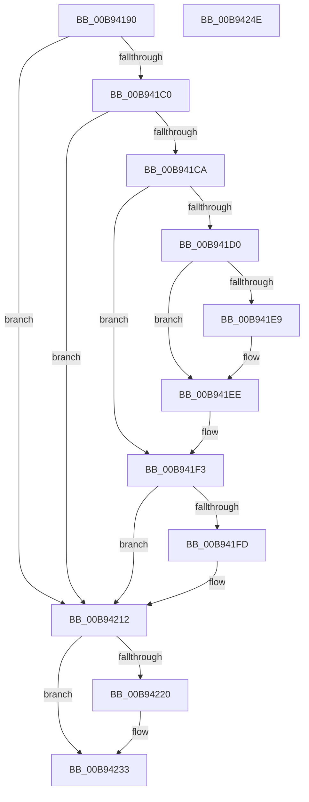

# ViGenericVerifyIrpStackUpward

- RVA: `0x00B94190`–`0x00B9424F` (길이 `191` bytes)
- VA: `0x0000000140B94190`
- 실행 섹션: `PAGEVRFY`
- PDB 이름 있음: `예`; PDB Function 태그: `아니요`
- unwind 정보 RVA: `0x0005E6B4`
- 디코드: `55`개 명령, `191/191` bytes 표시
- 미해석 바이트: `0` (있으면 어셈블리에 `.byte`로 보존)

> 이 문서는 커널 이미지의 기계어와 PDB 기호를 분석해 생성했습니다. 4번과 5번은 함수 원형과 자료형을 바이너리 사용 방식에서 추정한 C 해석이며 원본 소스 복구 결과는 아닙니다.

## 1. Dependencies

- 직접 호출 지점: **4**; 고유 호출 대상: **3**
- 직접 호출자로 확인된 함수: **0**
- RIP 상대 이미지 참조: **0**

### Outgoing calls
- `0x00B941EE` → [ViErrorReport1](../../text/61/ViErrorReport1_function_00614584.md) (function, `0x00614584`)
- `0x00B9420D` → [ViErrorReport1](../../text/61/ViErrorReport1_function_00614584.md) (function, `0x00614584`)
- `0x00B94217` → [VfMajorIsValidIrpStatus](../BA/VfMajorIsValidIrpStatus_function_00BA2FA4.md) (function, `0x00BA2FA4`)
- `0x00B9422E` → [ViErrorReport6](../../text/61/ViErrorReport6_function_00614740.md) (function, `0x00614740`)

### Direct callers
- 이 함수 시작 RVA로 연결되는 직접 call은 확인되지 않았습니다. 간접 호출은 완전히 역산할 수 없습니다.

### Static image references
- 디코드된 RIP-relative 메모리 참조가 없습니다.

## 2. Other-region calls and transfers

- 다른 실행 섹션으로 향하는 call: **3**
  - `0x00B941EE` → [ViErrorReport1](../../text/61/ViErrorReport1_function_00614584.md) (`PAGEVRFY` → `.text`)
  - `0x00B9420D` → [ViErrorReport1](../../text/61/ViErrorReport1_function_00614584.md) (`PAGEVRFY` → `.text`)
  - `0x00B9422E` → [ViErrorReport6](../../text/61/ViErrorReport6_function_00614740.md) (`PAGEVRFY` → `.text`)
- 별도 외부 분기/꼬리 이동을 확인하지 못했습니다.

## 3. Assembly (complete function range)

```asm
00B94190  48 8B C4                        mov rax, rsp
00B94193  48 89 58 08                     mov qword ptr [rax + 8], rbx
00B94197  48 89 68 10                     mov qword ptr [rax + 0x10], rbp
00B9419B  48 89 70 18                     mov qword ptr [rax + 0x18], rsi
00B9419F  48 89 78 20                     mov qword ptr [rax + 0x20], rdi
00B941A3  41 56                           push r14
00B941A5  48 83 EC 20                     sub rsp, 0x20
00B941A9  48 8B 39                        mov rdi, qword ptr [rcx]
00B941AC  49 8B D8                        mov rbx, r8
00B941AF  8B 41 38                        mov eax, dword ptr [rcx + 0x38]
00B941B2  4C 8B F2                        mov r14, rdx
00B941B5  49 8B 71 28                     mov rsi, qword ptr [r9 + 0x28]
00B941B9  8B 6F 30                        mov ebp, dword ptr [rdi + 0x30]
00B941BC  A8 20                           test al, 0x20
00B941BE  74 52                           je 0x140b94212
00B941C0  41 8B 40 04                     mov eax, dword ptr [r8 + 4]
00B941C4  0F BA E0 18                     bt eax, 0x18
00B941C8  72 48                           jb 0x140b94212
00B941CA  41 3B 68 60                     cmp ebp, dword ptr [r8 + 0x60]
00B941CE  74 23                           je 0x140b941f3
00B941D0  0F BA E8 18                     bts eax, 0x18
00B941D4  B9 3B 02 00 00                  mov ecx, 0x23b
00B941D9  41 89 40 04                     mov dword ptr [r8 + 4], eax
00B941DD  4C 8B C7                        mov r8, rdi
00B941E0  80 7A 01 FF                     cmp byte ptr [rdx + 1], 0xff
00B941E4  48 8B D6                        mov rdx, rsi
00B941E7  74 05                           je 0x140b941ee
00B941E9  B9 13 02 00 00                  mov ecx, 0x213
00B941EE  E8 91 03 A8 FF                  call 0x140614584
00B941F3  48 8B 43 68                     mov rax, qword ptr [rbx + 0x68]
00B941F7  48 39 47 38                     cmp qword ptr [rdi + 0x38], rax
00B941FB  74 15                           je 0x140b94212
00B941FD  0F BA 6B 04 18                  bts dword ptr [rbx + 4], 0x18
00B94202  4C 8B C7                        mov r8, rdi
00B94205  48 8B D6                        mov rdx, rsi
00B94208  B9 14 02 00 00                  mov ecx, 0x214
00B9420D  E8 72 03 A8 FF                  call 0x140614584
00B94212  8B D5                           mov edx, ebp
00B94214  49 8B CE                        mov rcx, r14
00B94217  E8 88 ED 00 00                  call 0x140ba2fa4
00B9421C  85 C0                           test eax, eax
00B9421E  75 13                           jne 0x140b94233
00B94220  44 8B CD                        mov r9d, ebp
00B94223  4C 8B C7                        mov r8, rdi
00B94226  48 8B D6                        mov rdx, rsi
00B94229  B9 00 03 00 00                  mov ecx, 0x300
00B9422E  E8 0D 05 A8 FF                  call 0x140614740
00B94233  48 8B 5C 24 30                  mov rbx, qword ptr [rsp + 0x30]
00B94238  48 8B 6C 24 38                  mov rbp, qword ptr [rsp + 0x38]
00B9423D  48 8B 74 24 40                  mov rsi, qword ptr [rsp + 0x40]
00B94242  48 8B 7C 24 48                  mov rdi, qword ptr [rsp + 0x48]
00B94247  48 83 C4 20                     add rsp, 0x20
00B9424B  41 5E                           pop r14
00B9424D  C3                              ret
00B9424E  CC                              int3
```

## 4. C-style interpretation (structured pseudocode)

```c
__int64 __fastcall ViGenericVerifyIrpStackUpward(__int64 a1, __int64 a2, __int64 a3, __int64 a4)
{
    __int64 result;
    __int64 v_rsp;
    unsigned __int64 v_stack_p10;
    unsigned __int64 v_stack_p18;
    unsigned __int64 v_stack_p20;
    unsigned __int64 v_stack_p8;

    *(unsigned __int64 *)(v_rsp + 8) = v_rbx;
    *(unsigned __int64 *)(v_rsp + 16) = v_rbp;
    *(unsigned __int64 *)(v_rsp + 24) = v_rsi;
    *(unsigned __int64 *)(v_rsp + 32) = v_rdi;
    v_rsp = (v_rsp) - (32);
    if ((((unsigned __int8)((unsigned int)(*(unsigned int *)(a1 + 56)))) & (32)) == 0) goto loc_00B94212;
    if (condition_is_below) goto loc_00B94212;
    if (((unsigned int)((unsigned int)(*(unsigned int *)(*(unsigned __int64 *)(a1) + 48)))) == (*(unsigned int *)(a3 + 96))) goto loc_00B941F3;
    *(unsigned int *)(a3 + 4) = (unsigned int)((unsigned int)(*(unsigned int *)(a3 + 4)));
    if ((*(unsigned __int8 *)(a2 + 1)) != 255) {
        a1 = 531;
    }
    result = ViErrorReport1(a1, *(unsigned __int64 *)(a4 + 40), *(unsigned __int64 *)(a1), a4);
loc_00B941F3:
    result = *(unsigned __int64 *)(a3 + 104);
    if ((*(unsigned __int64 *)(*(unsigned __int64 *)(a1) + 56)) != (*(unsigned __int64 *)(a3 + 104))) {
        a3 = *(unsigned __int64 *)(a1);
        a2 = *(unsigned __int64 *)(a4 + 40);
        a1 = 532;
        result = ViErrorReport1(a1, a2, a3, a4);
    }
    result = VfMajorIsValidIrpStatus(a2, (unsigned int)((unsigned int)((unsigned int)(*(unsigned int *)(*(unsigned __int64 *)(a1) + 48)))), a3, a4);
    if ((unsigned int)(result) == 0) {
        a4 = (unsigned int)((unsigned int)(*(unsigned int *)(*(unsigned __int64 *)(a1) + 48)));
        a3 = *(unsigned __int64 *)(a1);
        a2 = *(unsigned __int64 *)(a4 + 40);
        a1 = 768;
        result = ViErrorReport6(a1, a2, a3, a4);
    }
    v_rsp = (v_rsp) + (32);
    return result;
}
```

## 5. (Beta) C Style

```c
int64_t ViGenericVerifyIrpStackUpward(void *Arg1, void *Arg2, void *Arg3, void *Arg4)
{
    uint8_t *arg1 = (uint8_t *)Arg1;
    uint8_t *arg2 = (uint8_t *)Arg2;
    uint8_t *arg3 = (uint8_t *)Arg3;
    uint8_t *arg4 = (uint8_t *)Arg4;

    int64_t result;
    int64_t local_rsp;
    uint64_t v_stack_p10;
    uint64_t v_stack_p18;
    uint64_t v_stack_p20;
    uint64_t v_stack_p8;

    *(uint64_t *)(local_rsp + 0x8) = local_rbx;
    *(uint64_t *)(local_rsp + 0x10) = local_rbp;
    *(uint64_t *)(local_rsp + 0x18) = local_rsi;
    *(uint64_t *)(local_rsp + 0x20) = local_rdi;
    local_rsp = (local_rsp) - (32);
    if ((((uint8_t)((uint32_t)(*(uint32_t *)(arg1 + 0x38)))) & (32)) == 0) goto loc_00B94212;
    if (condition_is_below) goto loc_00B94212;
    if (((uint32_t)((uint32_t)(*(uint32_t *)(*(uint64_t *)(arg1) + 0x30)))) == (*(uint32_t *)(arg3 + 0x60))) goto loc_00B941F3;
    *(uint32_t *)(arg3 + 0x4) = (uint32_t)((uint32_t)(*(uint32_t *)(arg3 + 0x4)));
    if ((*(uint8_t *)(arg2 + 0x1)) != 255) {
        Arg1 = 531;
    }
    result = ViErrorReport1(Arg1, *(uint64_t *)(arg4 + 0x28), *(uint64_t *)(arg1), Arg4);
loc_00B941F3:
    result = *(uint64_t *)(arg3 + 0x68);
    if ((*(uint64_t *)(*(uint64_t *)(arg1) + 0x38)) != (*(uint64_t *)(arg3 + 0x68))) {
        Arg3 = *(uint64_t *)(arg1);
        Arg2 = *(uint64_t *)(arg4 + 0x28);
        Arg1 = 532;
        result = ViErrorReport1(Arg1, Arg2, Arg3, Arg4);
    }
    result = VfMajorIsValidIrpStatus(Arg2, (uint32_t)((uint32_t)((uint32_t)(*(uint32_t *)(*(uint64_t *)(arg1) + 0x30)))), Arg3, Arg4);
    if ((uint32_t)(result) == 0) {
        Arg4 = (uint32_t)((uint32_t)(*(uint32_t *)(*(uint64_t *)(arg1) + 0x30)));
        Arg3 = *(uint64_t *)(arg1);
        Arg2 = *(uint64_t *)(arg4 + 0x28);
        Arg1 = 768;
        result = ViErrorReport6(Arg1, Arg2, Arg3, Arg4);
    }
    local_rsp = (local_rsp) + (32);
    return result;
}
```

### 관측된 메모리 오프셋

구조체 형식이 확인되지 않은 접근은 인자 기준의 오프셋으로만 기록했습니다.

| 기준 인자 | 오프셋 표현 | 폭 (bit) | 접근 |
|---|---:|---:|---|
| `Arg1` | `+ 0x0` | `64` | `R` |
| `Arg1` | `+ 0x38` | `32` | `R` |
| `Arg2` | `+ 0x1` | `8` | `R` |
| `Arg3` | `+ 0x4` | `32` | `R` |
| `Arg3` | `+ 0x4` | `32` | `R/W` |
| `Arg3` | `+ 0x4` | `32` | `W` |
| `Arg3` | `+ 0x60` | `32` | `R` |
| `Arg3` | `+ 0x68` | `64` | `R` |
| `Arg4` | `+ 0x28` | `64` | `R` |

## 6. Execution-region graph

[열기: 2D/3D 그래프와 함수 탐색 컨트롤 패널](../../../control-panel.html?section=pagevrfy&rva=0x00B94190&view=graph)

- 2D 그래프는 위에서 아래로 흐르고, 3D 그래프는 빈 공간을 드래그해 회전합니다. Shift+드래그는 이동, 휠은 확대·축소, 함수 노드 선택은 대상 보고서 이동입니다.

### Static fallback


