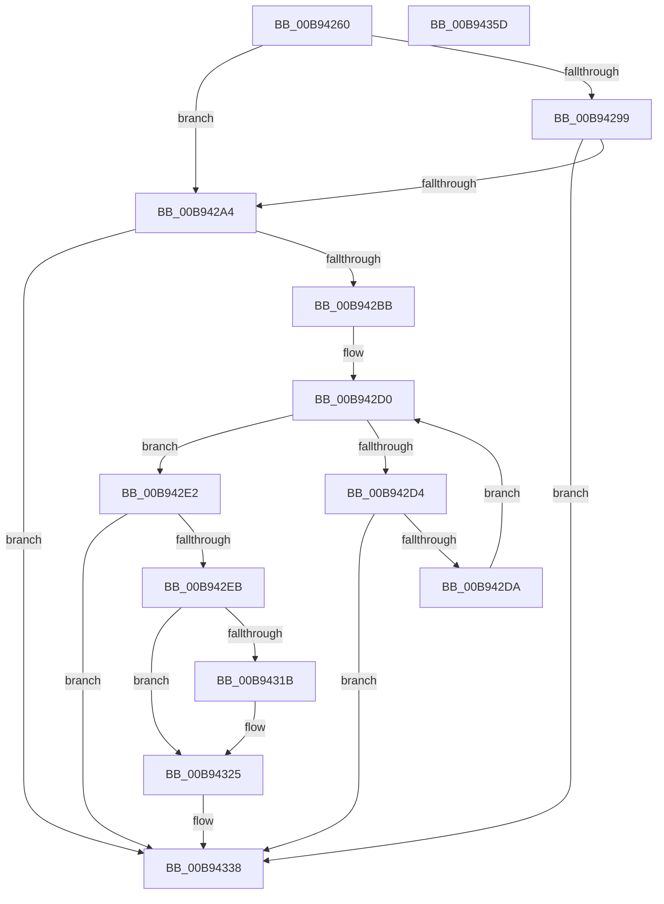

# ViGenericVerifyNewIrp

- RVA: `0x00B94260`–`0x00B9435E` (길이 `254` bytes)
- VA: `0x0000000140B94260`
- 실행 섹션: `PAGEVRFY`
- PDB 이름 있음: `예`; PDB Function 태그: `아니요`
- unwind 정보 RVA: `0x0009A988`
- 디코드: `64`개 명령, `254/254` bytes 표시
- 미해석 바이트: `0` (있으면 어셈블리에 `.byte`로 보존)

> 이 문서는 커널 이미지의 기계어와 PDB 기호를 분석해 생성했습니다. 4번과 5번은 함수 원형과 자료형을 바이너리 사용 방식에서 추정한 C 해석이며 원본 소스 복구 결과는 아닙니다.

## 1. Dependencies

- 직접 호출 지점: **5**; 고유 호출 대상: **5**
- 직접 호출자로 확인된 함수: **0**
- RIP 상대 이미지 참조: **2**

### Outgoing calls
- `0x00B942F0` → [ViErrorDisplayDescription](../BA/ViErrorDisplayDescription_function_00BA361C.md) (function, `0x00BA361C`)
- `0x00B94312` → [RtlStringCbPrintfA](../../text/53/RtlStringCbPrintfA_function_0053BC0C.md) (function, `0x0053BC0C`)
- `0x00B94320` → [VfUtilDbgPrint](../../text/61/VfUtilDbgPrint_function_006122AC.md) (function, `0x006122AC`)
- `0x00B94333` → [ViErrorFinishReport](../BA/ViErrorFinishReport_function_00BA366C.md) (function, `0x00BA366C`)
- `0x00B94343` → [_security_check_cookie](../../text/6A/_security_check_cookie_function_006AC640.md) (function, `0x006AC640`)

### Direct callers
- 이 함수 시작 RVA로 연결되는 직접 call은 확인되지 않았습니다. 간접 호출은 완전히 역산할 수 없습니다.

### Static image references
- `0x00B94272` → RVA `0x00E0A740` (`.data`; read)
- `0x00B942FC` → RVA `0x006CE5D0` (` ?? ::FNODOBFM::`string'`; read)

## 2. Other-region calls and transfers

- 다른 실행 섹션으로 향하는 call: **3**
  - `0x00B94312` → [RtlStringCbPrintfA](../../text/53/RtlStringCbPrintfA_function_0053BC0C.md) (`PAGEVRFY` → `.text`)
  - `0x00B94320` → [VfUtilDbgPrint](../../text/61/VfUtilDbgPrint_function_006122AC.md) (`PAGEVRFY` → `.text`)
  - `0x00B94343` → [_security_check_cookie](../../text/6A/_security_check_cookie_function_006AC640.md) (`PAGEVRFY` → `.text`)
- 별도 외부 분기/꼬리 이동을 확인하지 못했습니다.

## 3. Assembly (complete function range)

```asm
00B94260  48 89 5C 24 18                  mov qword ptr [rsp + 0x18], rbx
00B94265  48 89 74 24 20                  mov qword ptr [rsp + 0x20], rsi
00B9426A  57                              push rdi
00B9426B  48 81 EC A0 00 00 00            sub rsp, 0xa0
00B94272  48 8B 05 C7 64 27 00            mov rax, qword ptr [rip + 0x2764c7]
00B94279  48 33 C4                        xor rax, rsp
00B9427C  48 89 84 24 90 00 00 00         mov qword ptr [rsp + 0x90], rax
00B94284  48 83 7A 48 00                  cmp qword ptr [rdx + 0x48], 0
00B94289  48 8B DA                        mov rbx, rdx
00B9428C  48 8B B4 24 D0 00 00 00         mov rsi, qword ptr [rsp + 0xd0]
00B94294  48 8B F9                        mov rdi, rcx
00B94297  75 0B                           jne 0x140b942a4
00B94299  48 83 7A 50 00                  cmp qword ptr [rdx + 0x50], 0
00B9429E  0F 84 94 00 00 00               je 0x140b94338
00B942A4  8B 42 10                        mov eax, dword ptr [rdx + 0x10]
00B942A7  A9 40 04 00 00                  test eax, 0x440
00B942AC  0F 95 C1                        setne cl
00B942AF  A9 02 04 00 00                  test eax, 0x402
00B942B4  0F 95 C0                        setne al
00B942B7  84 C8                           test al, cl
00B942B9  75 7D                           jne 0x140b94338
00B942BB  0F BE 42 43                     movsx eax, byte ptr [rdx + 0x43]
00B942BF  48 8B 8B B8 00 00 00            mov rcx, qword ptr [rbx + 0xb8]
00B942C6  FF C8                           dec eax
00B942C8  0F BE 52 42                     movsx edx, byte ptr [rdx + 0x42]
00B942CC  48 83 E9 10                     sub rcx, 0x10
00B942D0  3B C2                           cmp eax, edx
00B942D2  7F 0E                           jg 0x140b942e2
00B942D4  48 83 39 00                     cmp qword ptr [rcx], 0
00B942D8  75 5E                           jne 0x140b94338
00B942DA  48 83 C1 48                     add rcx, 0x48
00B942DE  FF C0                           inc eax
00B942E0  EB EE                           jmp 0x140b942d0
00B942E2  0F B6 7F 3C                     movzx edi, byte ptr [rdi + 0x3c]
00B942E6  40 84 FF                        test dil, dil
00B942E9  74 4D                           je 0x140b94338
00B942EB  B9 02 03 00 00                  mov ecx, 0x302
00B942F0  E8 27 F3 00 00                  call 0x140ba361c
00B942F5  4C 8B CE                        mov r9, rsi
00B942F8  89 7C 24 28                     mov dword ptr [rsp + 0x28], edi
00B942FC  4C 8D 05 CD A2 B3 FF            lea r8, [rip - 0x4c5d33]
00B94303  48 89 5C 24 20                  mov qword ptr [rsp + 0x20], rbx
00B94308  BA 5B 00 00 00                  mov edx, 0x5b
00B9430D  48 8D 4C 24 30                  lea rcx, [rsp + 0x30]
00B94312  E8 F5 78 9A FF                  call 0x14053bc0c
00B94317  85 C0                           test eax, eax
00B94319  78 0A                           js 0x140b94325
00B9431B  48 8D 4C 24 30                  lea rcx, [rsp + 0x30]
00B94320  E8 87 DF A7 FF                  call 0x1406122ac
00B94325  4C 8B CF                        mov r9, rdi
00B94328  4C 8B C3                        mov r8, rbx
00B9432B  48 8B D6                        mov rdx, rsi
00B9432E  B9 02 03 00 00                  mov ecx, 0x302
00B94333  E8 34 F3 00 00                  call 0x140ba366c
00B94338  48 8B 8C 24 90 00 00 00         mov rcx, qword ptr [rsp + 0x90]
00B94340  48 33 CC                        xor rcx, rsp
00B94343  E8 F8 82 B1 FF                  call 0x1406ac640
00B94348  4C 8D 9C 24 A0 00 00 00         lea r11, [rsp + 0xa0]
00B94350  49 8B 5B 20                     mov rbx, qword ptr [r11 + 0x20]
00B94354  49 8B 73 28                     mov rsi, qword ptr [r11 + 0x28]
00B94358  49 8B E3                        mov rsp, r11
00B9435B  5F                              pop rdi
00B9435C  C3                              ret
00B9435D  CC                              int3
```

## 4. C-style interpretation (structured pseudocode)

```c
__int64 __fastcall ViGenericVerifyNewIrp(__int64 a1, __int64 a2, __int64 a3, __int64 a4, __int64 a5)
{
    __int64 result;
    __int64 v_rsp;
    unsigned __int64 v_stack_m18;
    unsigned __int64 v_stack_m78;
    unsigned __int64 v_stack_m8;
    unsigned int v_stack_m80;
    unsigned __int64 v_stack_m88;
    unsigned __int64 v_stack_p18;
    unsigned __int64 v_stack_p20;

    v_stack_p18 = v_rbx;
    v_stack_p20 = v_rsi;
    v_rsp = (v_rsp) - (160);
    result = (*(unsigned __int64 *)(v_rip + 2581703)) ^ (v_rsp);
    v_stack_m18 = result;
    if ((*(unsigned __int64 *)(a2 + 72)) != 0) goto loc_00B942A4;
    if ((*(unsigned __int64 *)(a2 + 80)) == 0) goto loc_00B94338;
loc_00B942A4:
    a1 = ((((unsigned int)((unsigned int)(*(unsigned int *)(a2 + 16)))) & (0x440ULL)) != 0) ? 1 : 0;
    result = ((((unsigned int)((unsigned int)(*(unsigned int *)(a2 + 16)))) & (0x402ULL)) != 0) ? 1 : 0;
    if ((((unsigned __int8)(result)) & ((unsigned __int8)(a1))) != 0) goto loc_00B94338;
    result = (unsigned int)(((__int8)(*(unsigned __int8 *)(a2 + 67))) - 1);
    a1 = (*(unsigned __int64 *)(a2 + 184)) - (16);
loc_00B942D0:
    if (((unsigned int)(result)) > ((unsigned int)((__int8)(*(unsigned __int8 *)(a2 + 66))))) goto loc_00B942E2;
    if ((*(unsigned __int64 *)(a1)) != 0) goto loc_00B94338;
    a1 = (a1) + (72);
    result = (unsigned int)((result) + 1);
    goto loc_00B942D0;
loc_00B942E2:
    if ((unsigned __int8)(*(unsigned __int8 *)(a1 + 60)) == 0) goto loc_00B94338;
    result = ViErrorDisplayDescription(770, (__int8)(*(unsigned __int8 *)(a2 + 66)), a3, a4);
    v_stack_m80 = (unsigned int)(*(unsigned __int8 *)(a1 + 60));
    v_stack_m88 = a2;
    result = RtlStringCbPrintfA(v_stack_m78, 91, v_rip - 5004595, a5);
    if (!(sign_flag)) {
        a1 = v_stack_m78;
        result = VfUtilDbgPrint(a1, 91, v_rip - 5004595, a5);
    }
    result = ViErrorFinishReport(770, a5, a2, *(unsigned __int8 *)(a1 + 60));
loc_00B94338:
    a1 = (v_stack_m18) ^ (v_rsp);
    result = _security_check_cookie(a1, a5, a2, *(unsigned __int8 *)(a1 + 60));
    return result;
}
```

## 5. (Beta) C Style

```c
int64_t ViGenericVerifyNewIrp(void *Arg1, void *Arg2, int64_t Arg3, int64_t Arg4, int64_t Arg5)
{
    uint8_t *arg1 = (uint8_t *)Arg1;
    uint8_t *arg2 = (uint8_t *)Arg2;

    int64_t result;
    int64_t local_rsp;
    uint64_t v_stack_m18;
    uint64_t v_stack_m78;
    uint64_t v_stack_m8;
    uint32_t v_stack_m80;
    uint64_t v_stack_m88;
    uint64_t v_stack_p18;
    uint64_t v_stack_p20;

    v_stack_p18 = local_rbx;
    v_stack_p20 = local_rsi;
    local_rsp = (local_rsp) - (160);
    result = (*(uint64_t *)(v_rip + 0x2764C7)) ^ (local_rsp);
    v_stack_m18 = result;
    if ((*(uint64_t *)(arg2 + 0x48)) != 0) goto loc_00B942A4;
    if ((*(uint64_t *)(arg2 + 0x50)) == 0) goto loc_00B94338;
loc_00B942A4:
    Arg1 = ((((uint32_t)((uint32_t)(*(uint32_t *)(arg2 + 0x10)))) & (0x440ULL)) != 0) ? 1 : 0;
    result = ((((uint32_t)((uint32_t)(*(uint32_t *)(arg2 + 0x10)))) & (0x402ULL)) != 0) ? 1 : 0;
    if ((((uint8_t)(result)) & ((uint8_t)(Arg1))) != 0) goto loc_00B94338;
    result = (uint32_t)(((int8_t)(*(uint8_t *)(arg2 + 0x43))) - 1);
    Arg1 = (*(uint64_t *)(arg2 + 0xB8)) - (16);
loc_00B942D0:
    if (((uint32_t)(result)) > ((uint32_t)((int8_t)(*(uint8_t *)(arg2 + 0x42))))) goto loc_00B942E2;
    if ((*(uint64_t *)(arg1)) != 0) goto loc_00B94338;
    Arg1 = (Arg1) + (72);
    result = (uint32_t)((result) + 1);
    goto loc_00B942D0;
loc_00B942E2:
    if ((uint8_t)(*(uint8_t *)(arg1 + 0x3C)) == 0) goto loc_00B94338;
    result = ViErrorDisplayDescription(770, (int8_t)(*(uint8_t *)(arg2 + 0x42)), Arg3, Arg4);
    v_stack_m80 = (uint32_t)(*(uint8_t *)(arg1 + 0x3C));
    v_stack_m88 = Arg2;
    result = RtlStringCbPrintfA(v_stack_m78, 91, v_rip - 5004595, Arg5);
    if (!(sign_flag)) {
        Arg1 = v_stack_m78;
        result = VfUtilDbgPrint(Arg1, 91, v_rip - 5004595, Arg5);
    }
    result = ViErrorFinishReport(770, Arg5, Arg2, *(uint8_t *)(arg1 + 0x3C));
loc_00B94338:
    Arg1 = (v_stack_m18) ^ (local_rsp);
    result = _security_check_cookie(Arg1, Arg5, Arg2, *(uint8_t *)(arg1 + 0x3C));
    return result;
}
```

### 관측된 메모리 오프셋

구조체 형식이 확인되지 않은 접근은 인자 기준의 오프셋으로만 기록했습니다.

| 기준 인자 | 오프셋 표현 | 폭 (bit) | 접근 |
|---|---:|---:|---|
| `Arg1` | `+ 0x3C` | `8` | `R` |
| `Arg2` | `+ 0x10` | `32` | `R` |
| `Arg2` | `+ 0x42` | `8` | `R` |
| `Arg2` | `+ 0x43` | `8` | `R` |
| `Arg2` | `+ 0x48` | `64` | `R` |
| `Arg2` | `+ 0x50` | `64` | `R` |
| `Arg2` | `+ 0xB8` | `64` | `R` |

## 6. Execution-region graph

[열기: 2D/3D 그래프와 함수 탐색 컨트롤 패널](../../../control-panel.html?section=pagevrfy&rva=0x00B94260&view=graph)

- 2D 그래프는 위에서 아래로 흐르고, 3D 그래프는 빈 공간을 드래그해 회전합니다. Shift+드래그는 이동, 휠은 확대·축소, 함수 노드 선택은 대상 보고서 이동입니다.

### Static fallback


