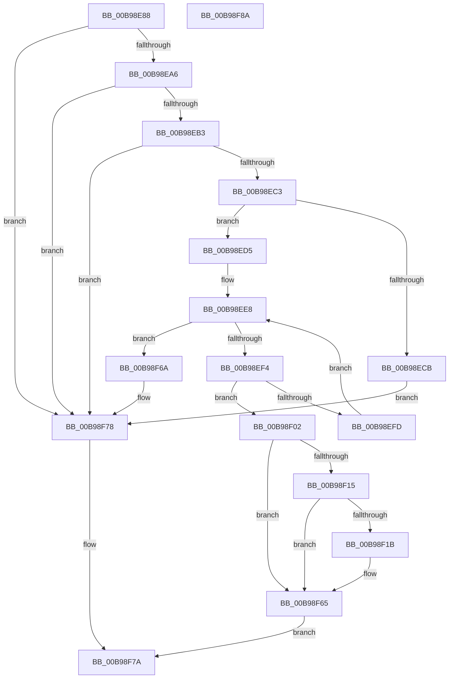

# ViGetAdapterInformationInternal

- RVA: `0x00B98E88`–`0x00B98F8B` (길이 `259` bytes)
- VA: `0x0000000140B98E88`
- 실행 섹션: `PAGEVRFY`
- PDB 이름 있음: `예`; PDB Function 태그: `아니요`
- unwind 정보 RVA: `0x000794E0`
- 디코드: `63`개 명령, `259/259` bytes 표시
- 미해석 바이트: `0` (있으면 어셈블리에 `.byte`로 보존)

> 이 문서는 커널 이미지의 기계어와 PDB 기호를 분석해 생성했습니다. 4번과 5번은 함수 원형과 자료형을 바이너리 사용 방식에서 추정한 C 해석이며 원본 소스 복구 결과는 아닙니다.

## 1. Dependencies

- 직접 호출 지점: **7**; 고유 호출 대상: **6**
- 직접 호출자로 확인된 함수: **27**
- RIP 상대 이미지 참조: **5**

### Outgoing calls
- `0x00B98EB3` → [ViGetAdapterSignature](ViGetAdapterSignature_function_00B98F94.md) (function, `0x00B98F94`)
- `0x00B98ECB` → [VF_ASSERT_MAX_IRQL](VF_ASSERT_MAX_IRQL_function_00B94FB0.md) (function, `0x00B94FB0`)
- `0x00B98EDC` → [KeAcquireSpinLockRaiseToDpc](../../text/20/KeAcquireSpinLockRaiseToDpc_function_00208470.md) (function, `0x00208470`)
- `0x00B98F0B` → [KeReleaseSpinLock](../../text/39/KeReleaseSpinLock_function_00392BA0.md) (function, `0x00392BA0`)
- `0x00B98F40` → [ViHalPreprocessOptions](ViHalPreprocessOptions_function_00B9920C.md) (function, `0x00B9920C`)
- `0x00B98F60` → [VfReportIssueWithOptions](../../text/61/VfReportIssueWithOptions_function_00614444.md) (function, `0x00614444`)
- `0x00B98F73` → [KeReleaseSpinLock](../../text/39/KeReleaseSpinLock_function_00392BA0.md) (function, `0x00392BA0`)

### Direct callers
- [VfAllocateAdapterChannel](VfAllocateAdapterChannel_function_00B95180.md) at `0x00B951AE`
- [VfAllocateAdapterChannelEx](VfAllocateAdapterChannelEx_function_00B95360.md) at `0x00B953A8`
- [VfAllocateCommonBuffer](VfAllocateCommonBuffer_function_00B95570.md) at `0x00B955A1`
- [VfAllocateCommonBufferEx](VfAllocateCommonBufferEx_function_00B95630.md) at `0x00B95662`
- [VfAllocateCommonBufferWithBounds](VfAllocateCommonBufferWithBounds_function_00B95780.md) at `0x00B957B2`
- [VfAllocateCrashDumpRegisters](VfAllocateCrashDumpRegisters_function_00B95860.md) at `0x00B95884`
- [VfBuildMdlFromScatterGatherList](VfBuildMdlFromScatterGatherList_function_00B95940.md) at `0x00B95978`
- [VfBuildScatterGatherList](VfBuildScatterGatherList_function_00B95AA0.md) at `0x00B95AE1`
- [VfBuildScatterGatherListEx](VfBuildScatterGatherListEx_function_00B95DA0.md) at `0x00B95DD8`
- [VfCancelAdapterChannel](VfCancelAdapterChannel_function_00B95FD0.md) at `0x00B95FFF`
- [VfCreateCommonBufferFromMdl](VfCreateCommonBufferFromMdl_function_00B96130.md) at `0x00B96162`
- [VfFlushAdapterBuffers](VfFlushAdapterBuffers_function_00B96220.md) at `0x00B9624A`
- [VfFlushAdapterBuffersEx](VfFlushAdapterBuffersEx_function_00B963D0.md) at `0x00B96401`
- [VfFreeAdapterChannel](VfFreeAdapterChannel_function_00B96480.md) at `0x00B96499`
- [VfFreeAdapterObject](VfFreeAdapterObject_function_00B96530.md) at `0x00B9655A`
- [VfFreeCommonBuffer](VfFreeCommonBuffer_function_00B96650.md) at `0x00B96687`
- [VfFreeMapRegisters](VfFreeMapRegisters_function_00B967D0.md) at `0x00B967FD`
- [VfGetDmaAlignment](VfGetDmaAlignment_function_00B96B10.md) at `0x00B96B1B`
- [VfGetScatterGatherList](VfGetScatterGatherList_function_00B96BD0.md) at `0x00B96C11`
- [VfGetScatterGatherListEx](VfGetScatterGatherListEx_function_00B96F20.md) at `0x00B96F55`
- [VfHalAllocateMapRegisters](VfHalAllocateMapRegisters_function_00B970B0.md) at `0x00B97105`
- [VfMapTransfer](VfMapTransfer_function_00B97300.md) at `0x00B9733B`
- [VfMapTransferEx](VfMapTransferEx_function_00B974B0.md) at `0x00B974E5`
- [VfPutDmaAdapter](VfPutDmaAdapter_function_00B97680.md) at `0x00B976AA`
- [VfPutScatterGatherList](VfPutScatterGatherList_function_00B97970.md) at `0x00B979A3`
- [VfReadDmaCounter](VfReadDmaCounter_function_00B97AF0.md) at `0x00B97AFB`
- [ViGetAdapterInformation](ViGetAdapterInformation_function_00B98E70.md) at `0x00B98E76`

### Static image references
- `0x00B98EA6` → RVA `0x00F03FA4` (`.data`; read)
- `0x00B98ED5` → RVA `0x00F03FD0` (`.data`; read)
- `0x00B98EE1` → RVA `0x00F03FC0` (`.data`; read)
- `0x00B98F21` → RVA `0x00E0E9D8` (`.data`; read)
- `0x00B98F33` → RVA `0x00BB9A80` (` ?? ::JKADOLAD::`string'`; read)

## 2. Other-region calls and transfers

- 다른 실행 섹션으로 향하는 call: **4**
  - `0x00B98EDC` → [KeAcquireSpinLockRaiseToDpc](../../text/20/KeAcquireSpinLockRaiseToDpc_function_00208470.md) (`PAGEVRFY` → `.text`)
  - `0x00B98F0B` → [KeReleaseSpinLock](../../text/39/KeReleaseSpinLock_function_00392BA0.md) (`PAGEVRFY` → `.text`)
  - `0x00B98F60` → [VfReportIssueWithOptions](../../text/61/VfReportIssueWithOptions_function_00614444.md) (`PAGEVRFY` → `.text`)
  - `0x00B98F73` → [KeReleaseSpinLock](../../text/39/KeReleaseSpinLock_function_00392BA0.md) (`PAGEVRFY` → `.text`)
- 별도 외부 분기/꼬리 이동을 확인하지 못했습니다.

## 3. Assembly (complete function range)

```asm
00B98E88  48 89 5C 24 08                  mov qword ptr [rsp + 8], rbx
00B98E8D  48 89 74 24 10                  mov qword ptr [rsp + 0x10], rsi
00B98E92  57                              push rdi
00B98E93  48 83 EC 30                     sub rsp, 0x30
00B98E97  40 8A F2                        mov sil, dl
00B98E9A  48 8B F9                        mov rdi, rcx
00B98E9D  48 85 C9                        test rcx, rcx
00B98EA0  0F 84 D2 00 00 00               je 0x140b98f78
00B98EA6  83 3D F7 B0 36 00 00            cmp dword ptr [rip + 0x36b0f7], 0
00B98EAD  0F 84 C5 00 00 00               je 0x140b98f78
00B98EB3  E8 DC 00 00 00                  call 0x140b98f94
00B98EB8  3D 56 44 6D 61                  cmp eax, 0x616d4456
00B98EBD  0F 85 B5 00 00 00               jne 0x140b98f78
00B98EC3  44 0F 20 C0                     mov rax, cr8
00B98EC7  3C 02                           cmp al, 2
00B98EC9  76 0A                           jbe 0x140b98ed5
00B98ECB  E8 E0 C0 FF FF                  call 0x140b94fb0
00B98ED0  E9 A3 00 00 00                  jmp 0x140b98f78
00B98ED5  48 8D 0D F4 B0 36 00            lea rcx, [rip + 0x36b0f4]
00B98EDC  E8 8F F5 66 FF                  call 0x140208470
00B98EE1  48 8B 1D D8 B0 36 00            mov rbx, qword ptr [rip + 0x36b0d8]
00B98EE8  48 8D 0D D1 B0 36 00            lea rcx, [rip + 0x36b0d1]
00B98EEF  48 3B CB                        cmp rcx, rbx
00B98EF2  74 76                           je 0x140b98f6a
00B98EF4  48 8D 4B 10                     lea rcx, [rbx + 0x10]
00B98EF8  48 3B F9                        cmp rdi, rcx
00B98EFB  74 05                           je 0x140b98f02
00B98EFD  48 8B 1B                        mov rbx, qword ptr [rbx]
00B98F00  EB E6                           jmp 0x140b98ee8
00B98F02  8A D0                           mov dl, al
00B98F04  48 8D 0D C5 B0 36 00            lea rcx, [rip + 0x36b0c5]
00B98F0B  E8 90 9C 7F FF                  call 0x140392ba0
00B98F10  40 84 F6                        test sil, sil
00B98F13  74 50                           je 0x140b98f65
00B98F15  83 7B 4C 00                     cmp dword ptr [rbx + 0x4c], 0
00B98F19  7F 4A                           jg 0x140b98f65
00B98F1B  48 83 64 24 28 00               and qword ptr [rsp + 0x28], 0
00B98F21  48 8D 35 B0 5A 27 00            lea rsi, [rip + 0x275ab0]
00B98F28  48 8B CE                        mov rcx, rsi
00B98F2B  48 89 5C 24 20                  mov qword ptr [rsp + 0x20], rbx
00B98F30  4C 8B CF                        mov r9, rdi
00B98F33  48 8D 15 46 0B 02 00            lea rdx, [rip + 0x20b46]
00B98F3A  41 B8 18 00 00 00               mov r8d, 0x18
00B98F40  E8 C7 02 00 00                  call 0x140b9920c
00B98F45  48 89 74 24 28                  mov qword ptr [rsp + 0x28], rsi
00B98F4A  4C 8B CB                        mov r9, rbx
00B98F4D  48 83 64 24 20 00               and qword ptr [rsp + 0x20], 0
00B98F53  4C 8B C7                        mov r8, rdi
00B98F56  BA 18 00 00 00                  mov edx, 0x18
00B98F5B  B9 E6 00 00 00                  mov ecx, 0xe6
00B98F60  E8 DF B4 A7 FF                  call 0x140614444
00B98F65  48 8B C3                        mov rax, rbx
00B98F68  EB 10                           jmp 0x140b98f7a
00B98F6A  8A D0                           mov dl, al
00B98F6C  48 8D 0D 5D B0 36 00            lea rcx, [rip + 0x36b05d]
00B98F73  E8 28 9C 7F FF                  call 0x140392ba0
00B98F78  33 C0                           xor eax, eax
00B98F7A  48 8B 5C 24 40                  mov rbx, qword ptr [rsp + 0x40]
00B98F7F  48 8B 74 24 48                  mov rsi, qword ptr [rsp + 0x48]
00B98F84  48 83 C4 30                     add rsp, 0x30
00B98F88  5F                              pop rdi
00B98F89  C3                              ret
00B98F8A  CC                              int3
```

## 4. C-style interpretation (structured pseudocode)

```c
__int64 __fastcall ViGetAdapterInformationInternal(__int64 a1, unsigned __int8 a2)
{
    __int64 result;
    __int64 v_rsi;
    __int64 v_rsp;
    unsigned __int64 v_stack_m10;
    unsigned __int64 v_stack_m18;
    unsigned __int64 v_stack_p10;
    unsigned __int64 v_stack_p8;

    v_stack_p8 = v_rbx;
    v_stack_p10 = v_rsi;
    v_rsp = (v_rsp) - (48);
    if (a1 == 0) goto loc_00B98F78;
    if ((*(unsigned int *)(v_rip + 3584247)) == 0) goto loc_00B98F78;
    result = ViGetAdapterSignature(a1, a2, a3, a4);
    if (((unsigned int)(result)) != 0x616D4456ULL) goto loc_00B98F78;
    if (((unsigned __int8)(v_cr8)) <= 2) goto loc_00B98ED5;
    result = VF_ASSERT_MAX_IRQL(a1, a2, a3, a4);
    goto loc_00B98F78;
loc_00B98ED5:
    result = KeAcquireSpinLockRaiseToDpc(v_rip + 3584244, a2, a3, a4);
loc_00B98EE8:
    if ((v_rip + 3584209) == (*(unsigned __int64 *)(v_rip + 3584216))) goto loc_00B98F6A;
    if (a1 == (*(unsigned __int64 *)(v_rip + 3584216) + 16)) goto loc_00B98F02;
    goto loc_00B98EE8;
loc_00B98F02:
    result = KeReleaseSpinLock(v_rip + 3584197, (unsigned __int8)(result), a3, a4);
    if (a2 == 0) goto loc_00B98F65;
    v_rsi = a2;
    if ((*(unsigned int *)(*(unsigned __int64 *)(*(unsigned __int64 *)(v_rip + 3584216)) + 76)) <= 0) {
        v_rsi = v_rip + 2579120;
        a1 = v_rsi;
        v_stack_m18 = *(unsigned __int64 *)(*(unsigned __int64 *)(v_rip + 3584216));
        a4 = a1;
        a2 = v_rip + 133958;
        a3 = 24;
        result = ViHalPreprocessOptions(a1, a2, a3, a4);
        v_stack_m10 = v_rsi;
        a4 = *(unsigned __int64 *)(*(unsigned __int64 *)(v_rip + 3584216));
        a3 = a1;
        a2 = 24;
        a1 = 230;
        result = VfReportIssueWithOptions(a1, a2, a3, a4);
    }
    goto loc_00B98F7A;
loc_00B98F6A:
    result = KeReleaseSpinLock(v_rip + 3584093, (unsigned __int8)(*(unsigned __int64 *)(*(unsigned __int64 *)(v_rip + 3584216))), a3, a4);
loc_00B98F78:
    result = 0;
loc_00B98F7A:
    v_rsp = (v_rsp) + (48);
    return result;
}
```

## 5. (Beta) C Style

```c
int64_t ViGetAdapterInformationInternal(int64_t Arg1, uint8_t Arg2)
{
    int64_t result;
    int64_t local_rsi;
    int64_t local_rsp;
    uint64_t v_stack_m10;
    uint64_t v_stack_m18;
    uint64_t v_stack_p10;
    uint64_t v_stack_p8;

    v_stack_p8 = local_rbx;
    v_stack_p10 = local_rsi;
    local_rsp = (local_rsp) - (48);
    if (Arg1 == 0) goto loc_00B98F78;
    if ((*(uint32_t *)(v_rip + 0x36B0F7)) == 0) goto loc_00B98F78;
    result = ViGetAdapterSignature(Arg1, Arg2, a3, a4);
    if (((uint32_t)(result)) != 0x616D4456ULL) goto loc_00B98F78;
    if (((uint8_t)(v_cr8)) <= 2) goto loc_00B98ED5;
    result = VF_ASSERT_MAX_IRQL(Arg1, Arg2, a3, a4);
    goto loc_00B98F78;
loc_00B98ED5:
    result = KeAcquireSpinLockRaiseToDpc(v_rip + 3584244, Arg2, a3, a4);
loc_00B98EE8:
    if ((v_rip + 3584209) == (*(uint64_t *)(v_rip + 0x36B0D8))) goto loc_00B98F6A;
    if (Arg1 == (*(uint64_t *)(v_rip + 0x36B0D8) + 16)) goto loc_00B98F02;
    goto loc_00B98EE8;
loc_00B98F02:
    result = KeReleaseSpinLock(v_rip + 3584197, (uint8_t)(result), a3, a4);
    if (Arg2 == 0) goto loc_00B98F65;
    local_rsi = Arg2;
    if ((*(uint32_t *)(*(uint64_t *)(*(uint64_t *)(v_rip + 0x36B0D8)) + 0x4C)) <= 0) {
        local_rsi = v_rip + 2579120;
        Arg1 = local_rsi;
        v_stack_m18 = *(uint64_t *)(*(uint64_t *)(v_rip + 0x36B0D8));
        a4 = Arg1;
        Arg2 = v_rip + 133958;
        a3 = 24;
        result = ViHalPreprocessOptions(Arg1, Arg2, a3, a4);
        v_stack_m10 = local_rsi;
        a4 = *(uint64_t *)(*(uint64_t *)(v_rip + 0x36B0D8));
        a3 = Arg1;
        Arg2 = 24;
        Arg1 = 230;
        result = VfReportIssueWithOptions(Arg1, Arg2, a3, a4);
    }
    goto loc_00B98F7A;
loc_00B98F6A:
    result = KeReleaseSpinLock(v_rip + 3584093, (uint8_t)(*(uint64_t *)(*(uint64_t *)(v_rip + 0x36B0D8))), a3, a4);
loc_00B98F78:
    result = 0;
loc_00B98F7A:
    local_rsp = (local_rsp) + (48);
    return result;
}
```

## 6. Execution-region graph

[열기: 2D/3D 그래프와 함수 탐색 컨트롤 패널](../../../control-panel.html?section=pagevrfy&rva=0x00B98E88&view=graph)

- 2D 그래프는 위에서 아래로 흐르고, 3D 그래프는 빈 공간을 드래그해 회전합니다. Shift+드래그는 이동, 휠은 확대·축소, 함수 노드 선택은 대상 보고서 이동입니다.

### Static fallback


