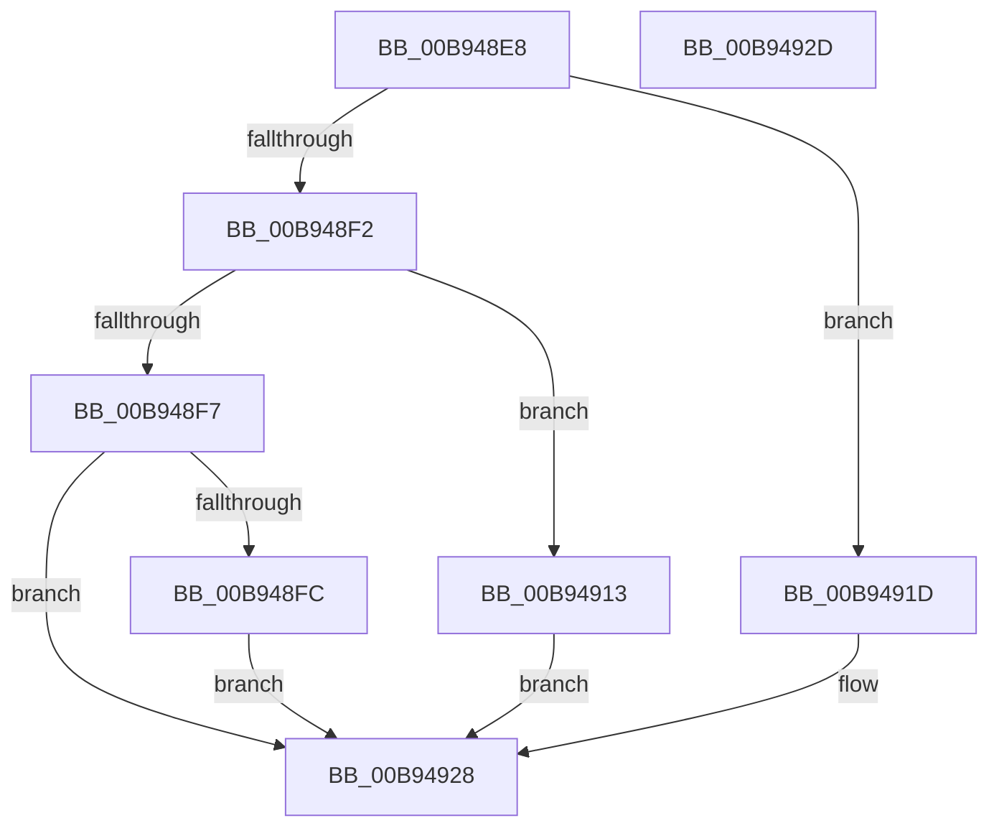

# ViGetContextPointer

- RVA: `0x00B948E8`–`0x00B9492E` (길이 `70` bytes)
- VA: `0x0000000140B948E8`
- 실행 섹션: `PAGEVRFY`
- PDB 이름 있음: `예`; PDB Function 태그: `아니요`
- unwind 정보 RVA: `0x0005C788`
- 디코드: `23`개 명령, `70/70` bytes 표시
- 미해석 바이트: `0` (있으면 어셈블리에 `.byte`로 보존)

> 이 문서는 커널 이미지의 기계어와 PDB 기호를 분석해 생성했습니다. 4번과 5번은 함수 원형과 자료형을 바이너리 사용 방식에서 추정한 C 해석이며 원본 소스 복구 결과는 아닙니다.

## 1. Dependencies

- 직접 호출 지점: **1**; 고유 호출 대상: **1**
- 직접 호출자로 확인된 함수: **3**
- RIP 상대 이미지 참조: **0**

### Outgoing calls
- `0x00B948FF` → [IopAllocateIrpExtension](../../text/44/IopAllocateIrpExtension_function_00444F30.md) (function, `0x00444F30`)

### Direct callers
- [VfInsertContext](../../text/61/VfInsertContext_function_006127F0.md) at `0x00612838`
- [VfRemoveContext](../../text/61/VfRemoveContext_function_00612990.md) at `0x006129E4`
- [ViQueryObjectContext](ViQueryObjectContext_function_00B9499C.md) at `0x00B949B0`

### Static image references
- 디코드된 RIP-relative 메모리 참조가 없습니다.

## 2. Other-region calls and transfers

- 다른 실행 섹션으로 향하는 call: **1**
  - `0x00B948FF` → [IopAllocateIrpExtension](../../text/44/IopAllocateIrpExtension_function_00444F30.md) (`PAGEVRFY` → `.text`)
- 별도 외부 분기/꼬리 이동을 확인하지 못했습니다.

## 3. Assembly (complete function range)

```asm
00B948E8  48 83 EC 28                     sub rsp, 0x28
00B948EC  33 C0                           xor eax, eax
00B948EE  85 D2                           test edx, edx
00B948F0  74 2B                           je 0x140b9491d
00B948F2  83 EA 01                        sub edx, 1
00B948F5  74 1C                           je 0x140b94913
00B948F7  83 FA 01                        cmp edx, 1
00B948FA  75 2C                           jne 0x140b94928
00B948FC  8D 50 03                        lea edx, [rax + 3]
00B948FF  E8 2C 06 8B FF                  call 0x140444f30
00B94904  48 8D 48 08                     lea rcx, [rax + 8]
00B94908  48 F7 D8                        neg rax
00B9490B  48 1B C0                        sbb rax, rax
00B9490E  48 23 C1                        and rax, rcx
00B94911  EB 15                           jmp 0x140b94928
00B94913  48 8B 41 30                     mov rax, qword ptr [rcx + 0x30]
00B94917  48 83 C0 48                     add rax, 0x48
00B9491B  EB 0B                           jmp 0x140b94928
00B9491D  48 8B 81 38 01 00 00            mov rax, qword ptr [rcx + 0x138]
00B94924  48 83 C0 68                     add rax, 0x68
00B94928  48 83 C4 28                     add rsp, 0x28
00B9492C  C3                              ret
00B9492D  CC                              int3
```

## 4. C-style interpretation (structured pseudocode)

```c
__int64 __fastcall ViGetContextPointer(__int64 a1, int a2)
{
    __int64 result;
    __int64 v_rsp;

    v_rsp = (v_rsp) - (40);
    result = 0;
    if (a2 == 0) goto loc_00B9491D;
    a2 = (unsigned int)((a2) - (1));
    if (condition_is_equal) goto loc_00B94913;
    if (a2 != 1) goto loc_00B94928;
    result = IopAllocateIrpExtension(a1, result + 3, a3, a4);
    result = -(result);
    result = (result) & (result + 8);
    goto loc_00B94928;
loc_00B94913:
    result = (*(unsigned __int64 *)(result + 8 + 48)) + (72);
    goto loc_00B94928;
loc_00B9491D:
    result = (*(unsigned __int64 *)(result + 8 + 312)) + (104);
loc_00B94928:
    v_rsp = (v_rsp) + (40);
    return result;
}
```

## 5. (Beta) C Style

```c
int64_t ViGetContextPointer(void *Arg1, int32_t Arg2)
{
    uint8_t *arg1 = (uint8_t *)Arg1;

    int64_t result;
    int64_t local_rsp;

    local_rsp = (local_rsp) - (40);
    result = 0;
    if (Arg2 == 0) goto loc_00B9491D;
    Arg2 = (uint32_t)((Arg2) - (1));
    if (condition_is_equal) goto loc_00B94913;
    if (Arg2 != 1) goto loc_00B94928;
    result = IopAllocateIrpExtension(Arg1, result + 3, a3, a4);
    result = -(result);
    result = (result) & (result + 8);
    goto loc_00B94928;
loc_00B94913:
    result = (*(uint64_t *)(result + 0x8 + 0x30)) + (72);
    goto loc_00B94928;
loc_00B9491D:
    result = (*(uint64_t *)(result + 0x8 + 0x138)) + (104);
loc_00B94928:
    local_rsp = (local_rsp) + (40);
    return result;
}
```

### 관측된 메모리 오프셋

구조체 형식이 확인되지 않은 접근은 인자 기준의 오프셋으로만 기록했습니다.

| 기준 인자 | 오프셋 표현 | 폭 (bit) | 접근 |
|---|---:|---:|---|
| `Arg1` | `+ 0x30` | `64` | `R` |
| `Arg1` | `+ 0x138` | `64` | `R` |

## 6. Execution-region graph

[열기: 2D/3D 그래프와 함수 탐색 컨트롤 패널](../../../control-panel.html?section=pagevrfy&rva=0x00B948E8&view=graph)

- 2D 그래프는 위에서 아래로 흐르고, 3D 그래프는 빈 공간을 드래그해 회전합니다. Shift+드래그는 이동, 휠은 확대·축소, 함수 노드 선택은 대상 보고서 이동입니다.

### Static fallback


