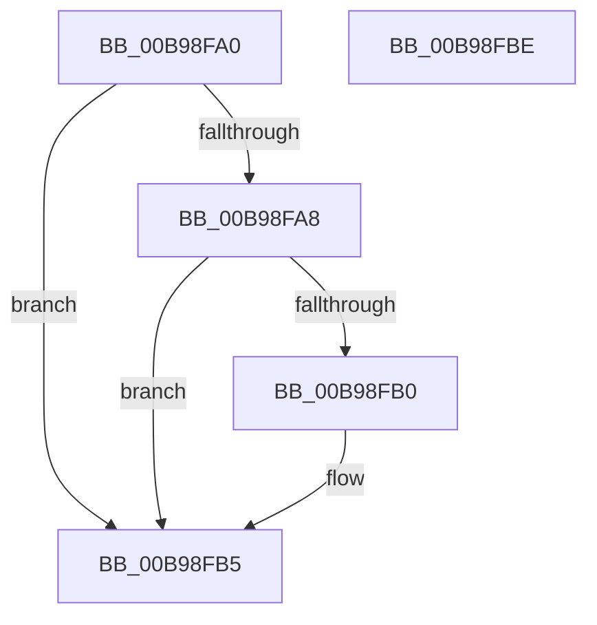

# ViGetMapRegisterFile

- RVA: `0x00B98FA0`–`0x00B98FBF` (길이 `31` bytes)
- VA: `0x0000000140B98FA0`
- 실행 섹션: `PAGEVRFY`
- PDB 이름 있음: `예`; PDB Function 태그: `아니요`
- unwind 정보 RVA: `0x000DB714`
- 디코드: `11`개 명령, `31/31` bytes 표시
- 미해석 바이트: `0` (있으면 어셈블리에 `.byte`로 보존)

> 이 문서는 커널 이미지의 기계어와 PDB 기호를 분석해 생성했습니다. 4번과 5번은 함수 원형과 자료형을 바이너리 사용 방식에서 추정한 C 해석이며 원본 소스 복구 결과는 아닙니다.

## 1. Dependencies

- 직접 호출 지점: **0**; 고유 호출 대상: **0**
- 직접 호출자로 확인된 함수: **3**
- RIP 상대 이미지 참조: **0**

### Outgoing calls
- 직접 디코드된 call 명령이 없습니다.

### Direct callers
- [VfFlushAdapterBuffers](VfFlushAdapterBuffers_function_00B96220.md) at `0x00B962D4`
- [VfMapTransfer](VfMapTransfer_function_00B97300.md) at `0x00B973EB`
- [ViSwap](ViSwap_function_00B99E54.md) at `0x00B99E79`

### Static image references
- 디코드된 RIP-relative 메모리 참조가 없습니다.

## 2. Other-region calls and transfers

- 다른 실행 섹션으로 향하는 call: **0**
- 별도 외부 분기/꼬리 이동을 확인하지 못했습니다.

## 3. Assembly (complete function range)

```asm
00B98FA0  33 C0                           xor eax, eax
00B98FA2  48 83 E1 FE                     and rcx, 0xfffffffffffffffe
00B98FA6  74 0D                           je 0x140b98fb5
00B98FA8  81 39 0D D0 EF AC               cmp dword ptr [rcx], 0xacefd00d
00B98FAE  75 05                           jne 0x140b98fb5
00B98FB0  B8 01 00 00 00                  mov eax, 1
00B98FB5  F7 D8                           neg eax
00B98FB7  48 1B C0                        sbb rax, rax
00B98FBA  48 23 C1                        and rax, rcx
00B98FBD  C3                              ret
00B98FBE  CC                              int3
```

## 4. C-style interpretation (structured pseudocode)

```c
__int64 __fastcall ViGetMapRegisterFile(__int64 a1)
{
    __int64 result;

    result = 0;
    a1 = (a1) & (-2);
    if (condition_is_equal) goto loc_00B98FB5;
    if ((*(unsigned int *)(a1)) == 0xACEFD00DULL) {
        result = 1;
    }
    result = (unsigned int)(-(result));
    result = (result) & (a1);
    return result;
}
```

## 5. (Beta) C Style

```c
int64_t ViGetMapRegisterFile(void *Arg1)
{
    uint8_t *arg1 = (uint8_t *)Arg1;

    int64_t result;

    result = 0;
    Arg1 = (Arg1) & (-2);
    if (condition_is_equal) goto loc_00B98FB5;
    if ((*(uint32_t *)(arg1)) == 0xACEFD00DULL) {
        result = 1;
    }
    result = (uint32_t)(-(result));
    result = (result) & (Arg1);
    return result;
}
```

### 관측된 메모리 오프셋

구조체 형식이 확인되지 않은 접근은 인자 기준의 오프셋으로만 기록했습니다.

| 기준 인자 | 오프셋 표현 | 폭 (bit) | 접근 |
|---|---:|---:|---|
| `Arg1` | `+ 0x0` | `32` | `R` |

## 6. Execution-region graph

[열기: 2D/3D 그래프와 함수 탐색 컨트롤 패널](../../../control-panel.html?section=pagevrfy&rva=0x00B98FA0&view=graph)

- 2D 그래프는 위에서 아래로 흐르고, 3D 그래프는 빈 공간을 드래그해 회전합니다. Shift+드래그는 이동, 휠은 확대·축소, 함수 노드 선택은 대상 보고서 이동입니다.

### Static fallback


