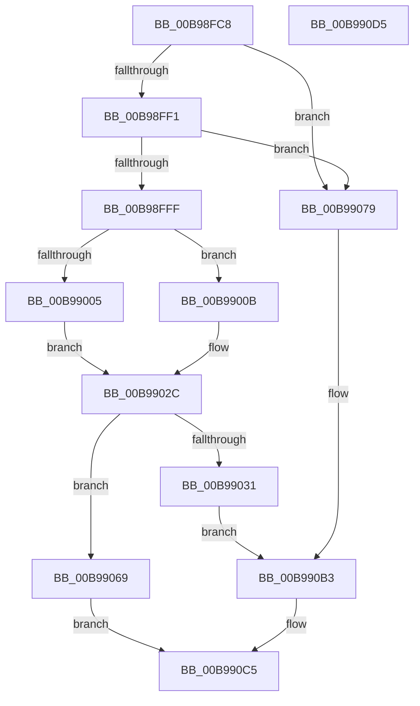

# ViGetMdlBufferSa

- RVA: `0x00B98FC8`–`0x00B990D6` (길이 `270` bytes)
- VA: `0x0000000140B98FC8`
- 실행 섹션: `PAGEVRFY`
- PDB 이름 있음: `예`; PDB Function 태그: `아니요`
- unwind 정보 RVA: `0x000B6B54`
- 디코드: `71`개 명령, `270/270` bytes 표시
- 미해석 바이트: `0` (있으면 어셈블리에 `.byte`로 보존)

> 이 문서는 커널 이미지의 기계어와 PDB 기호를 분석해 생성했습니다. 4번과 5번은 함수 원형과 자료형을 바이너리 사용 방식에서 추정한 C 해석이며 원본 소스 복구 결과는 아닙니다.

## 1. Dependencies

- 직접 호출 지점: **4**; 고유 호출 대상: **3**
- 직접 호출자로 확인된 함수: **3**
- RIP 상대 이미지 참조: **4**

### Outgoing calls
- `0x00B99024` → [MmMapLockedPagesSpecifyCache](../../text/31/MmMapLockedPagesSpecifyCache_function_00318800.md) (function, `0x00318800`)
- `0x00B99055` → [ViHalPreprocessOptions](ViHalPreprocessOptions_function_00B9920C.md) (function, `0x00B9920C`)
- `0x00B9909E` → [ViHalPreprocessOptions](ViHalPreprocessOptions_function_00B9920C.md) (function, `0x00B9920C`)
- `0x00B990BE` → [VfReportIssueWithOptions](../../text/61/VfReportIssueWithOptions_function_00614444.md) (function, `0x00614444`)

### Direct callers
- [ViCopyBackModifiedBuffer](ViCopyBackModifiedBuffer_function_00B98764.md) at `0x00B9881B`
- [ViFlushDoubleBuffer](ViFlushDoubleBuffer_function_00B989D0.md) at `0x00B98A05`
- [ViSwap](ViSwap_function_00B99E54.md) at `0x00B99E8C`

### Static image references
- `0x00B9903E` → RVA `0x00E0E98C` (`.data`; read)
- `0x00B99048` → RVA `0x00BBA200` (` ?? ::JKADOLAD::`string'`; read)
- `0x00B9907F` → RVA `0x00E0E994` (`.data`; read)
- `0x00B99091` → RVA `0x00BBA230` (` ?? ::JKADOLAD::`string'`; read)

## 2. Other-region calls and transfers

- 다른 실행 섹션으로 향하는 call: **2**
  - `0x00B99024` → [MmMapLockedPagesSpecifyCache](../../text/31/MmMapLockedPagesSpecifyCache_function_00318800.md) (`PAGEVRFY` → `.text`)
  - `0x00B990BE` → [VfReportIssueWithOptions](../../text/61/VfReportIssueWithOptions_function_00614444.md) (`PAGEVRFY` → `.text`)
- 별도 외부 분기/꼬리 이동을 확인하지 못했습니다.

## 3. Assembly (complete function range)

```asm
00B98FC8  48 89 5C 24 08                  mov qword ptr [rsp + 8], rbx
00B98FCD  48 89 6C 24 10                  mov qword ptr [rsp + 0x10], rbp
00B98FD2  56                              push rsi
00B98FD3  48 83 EC 30                     sub rsp, 0x30
00B98FD7  48 8B D9                        mov rbx, rcx
00B98FDA  48 8B F2                        mov rsi, rdx
00B98FDD  8B 49 2C                        mov ecx, dword ptr [rcx + 0x2c]
00B98FE0  48 8B 53 20                     mov rdx, qword ptr [rbx + 0x20]
00B98FE4  48 8D 04 0A                     lea rax, [rdx + rcx]
00B98FE8  48 3B F0                        cmp rsi, rax
00B98FEB  0F 82 88 00 00 00               jb 0x140b99079
00B98FF1  8B 43 28                        mov eax, dword ptr [rbx + 0x28]
00B98FF4  48 03 C2                        add rax, rdx
00B98FF7  48 03 C1                        add rax, rcx
00B98FFA  48 3B F0                        cmp rsi, rax
00B98FFD  73 7A                           jae 0x140b99079
00B98FFF  F6 43 0A 05                     test byte ptr [rbx + 0xa], 5
00B99003  74 06                           je 0x140b9900b
00B99005  48 8B 4B 18                     mov rcx, qword ptr [rbx + 0x18]
00B99009  EB 21                           jmp 0x140b9902c
00B9900B  45 33 C9                        xor r9d, r9d
00B9900E  C7 44 24 28 10 00 00 40         mov dword ptr [rsp + 0x28], 0x40000010
00B99016  83 64 24 20 00                  and dword ptr [rsp + 0x20], 0
00B9901B  33 D2                           xor edx, edx
00B9901D  48 8B CB                        mov rcx, rbx
00B99020  45 8D 41 01                     lea r8d, [r9 + 1]
00B99024  E8 D7 F7 77 FF                  call 0x140318800
00B99029  48 8B C8                        mov rcx, rax
00B9902C  48 85 C9                        test rcx, rcx
00B9902F  75 38                           jne 0x140b99069
00B99031  48 21 4C 24 28                  and qword ptr [rsp + 0x28], rcx
00B99036  8D 69 22                        lea ebp, [rcx + 0x22]
00B99039  48 21 4C 24 20                  and qword ptr [rsp + 0x20], rcx
00B9903E  48 8D 35 47 59 27 00            lea rsi, [rip + 0x275947]
00B99045  44 8B C5                        mov r8d, ebp
00B99048  48 8D 15 B1 11 02 00            lea rdx, [rip + 0x211b1]
00B9904F  48 8B CE                        mov rcx, rsi
00B99052  4C 8B CB                        mov r9, rbx
00B99055  E8 B2 01 00 00                  call 0x140b9920c
00B9905A  45 33 C9                        xor r9d, r9d
00B9905D  48 89 74 24 28                  mov qword ptr [rsp + 0x28], rsi
00B99062  4C 8B C3                        mov r8, rbx
00B99065  8B D5                           mov edx, ebp
00B99067  EB 4A                           jmp 0x140b990b3
00B99069  8B 43 2C                        mov eax, dword ptr [rbx + 0x2c]
00B9906C  48 2B C8                        sub rcx, rax
00B9906F  48 2B 4B 20                     sub rcx, qword ptr [rbx + 0x20]
00B99073  48 8D 04 0E                     lea rax, [rsi + rcx]
00B99077  EB 4C                           jmp 0x140b990c5
00B99079  48 83 64 24 28 00               and qword ptr [rsp + 0x28], 0
00B9907F  48 8D 2D 0E 59 27 00            lea rbp, [rip + 0x27590e]
00B99086  48 8B CD                        mov rcx, rbp
00B99089  48 89 5C 24 20                  mov qword ptr [rsp + 0x20], rbx
00B9908E  4C 8B CE                        mov r9, rsi
00B99091  48 8D 15 98 11 02 00            lea rdx, [rip + 0x21198]
00B99098  41 B8 1B 00 00 00               mov r8d, 0x1b
00B9909E  E8 69 01 00 00                  call 0x140b9920c
00B990A3  4C 8B CB                        mov r9, rbx
00B990A6  48 89 6C 24 28                  mov qword ptr [rsp + 0x28], rbp
00B990AB  4C 8B C6                        mov r8, rsi
00B990AE  BA 1B 00 00 00                  mov edx, 0x1b
00B990B3  48 83 64 24 20 00               and qword ptr [rsp + 0x20], 0
00B990B9  B9 E6 00 00 00                  mov ecx, 0xe6
00B990BE  E8 81 B3 A7 FF                  call 0x140614444
00B990C3  33 C0                           xor eax, eax
00B990C5  48 8B 5C 24 40                  mov rbx, qword ptr [rsp + 0x40]
00B990CA  48 8B 6C 24 48                  mov rbp, qword ptr [rsp + 0x48]
00B990CF  48 83 C4 30                     add rsp, 0x30
00B990D3  5E                              pop rsi
00B990D4  C3                              ret
00B990D5  CC                              int3
```

## 4. C-style interpretation (structured pseudocode)

```c
__int64 __fastcall ViGetMdlBufferSa(__int64 a1, __int64 a2, __int64 a3, int a4)
{
    __int64 result;
    __int64 v_rsp;
    unsigned int v_stack_m10;
    unsigned int v_stack_m18;
    unsigned __int64 v_stack_p10;
    unsigned __int64 v_stack_p8;

    v_stack_p8 = v_rbx;
    v_stack_p10 = v_rbp;
    v_rsp = (v_rsp) - (48);
    if (a2 < (*(unsigned __int64 *)(a1 + 32) + (unsigned int)(*(unsigned int *)(a1 + 44)) * 1)) goto loc_00B99079;
    result = ((unsigned int)(*(unsigned int *)(a1 + 40))) + (*(unsigned __int64 *)(a1 + 32));
    result = (result) + ((unsigned int)(*(unsigned int *)(a1 + 44)));
    if (a2 >= result) goto loc_00B99079;
    if (((*(unsigned __int8 *)(a1 + 10)) & (5)) == 0) goto loc_00B9900B;
    goto loc_00B9902C;
loc_00B9900B:
    a4 = 0;
    v_stack_m10 = 0x40000010ULL;
    a2 = 0;
    result = MmMapLockedPagesSpecifyCache(a1, a2, a4 + 1, a4);
loc_00B9902C:
    if (result != 0) goto loc_00B99069;
    result = ViHalPreprocessOptions(v_rip + 2578759, v_rip + 135601, (unsigned int)((unsigned int)(result + 34)), a1);
    a4 = 0;
    v_stack_m10 = v_rip + 2578759;
    goto loc_00B990B3;
loc_00B99069:
    a1 = (v_rip + 2578759) - ((unsigned int)(*(unsigned int *)(a1 + 44)));
    a1 = (a1) - (*(unsigned __int64 *)(a1 + 32));
    goto loc_00B990C5;
loc_00B99079:
    v_stack_m18 = a1;
    result = ViHalPreprocessOptions(v_rip + 2578702, v_rip + 135576, 27, v_rip + 2578759);
    v_stack_m10 = v_rip + 2578702;
loc_00B990B3:
    result = VfReportIssueWithOptions(230, 27, v_rip + 2578759, a1);
    result = 0;
loc_00B990C5:
    v_rsp = (v_rsp) + (48);
    return result;
}
```

## 5. (Beta) C Style

```c
int64_t ViGetMdlBufferSa(void *Arg1, int64_t Arg2, int64_t Arg3, int32_t Arg4)
{
    uint8_t *arg1 = (uint8_t *)Arg1;

    int64_t result;
    int64_t local_rsp;
    uint32_t v_stack_m10;
    uint32_t v_stack_m18;
    uint64_t v_stack_p10;
    uint64_t v_stack_p8;

    v_stack_p8 = local_rbx;
    v_stack_p10 = local_rbp;
    local_rsp = (local_rsp) - (48);
    if (Arg2 < (*(uint64_t *)(arg1 + 0x20) + (uint32_t)(*(uint32_t *)(arg1 + 0x2C)) * 1)) goto loc_00B99079;
    result = ((uint32_t)(*(uint32_t *)(arg1 + 0x28))) + (*(uint64_t *)(arg1 + 0x20));
    result = (result) + ((uint32_t)(*(uint32_t *)(arg1 + 0x2C)));
    if (Arg2 >= result) goto loc_00B99079;
    if (((*(uint8_t *)(arg1 + 0xA)) & (5)) == 0) goto loc_00B9900B;
    goto loc_00B9902C;
loc_00B9900B:
    Arg4 = 0;
    v_stack_m10 = 0x40000010ULL;
    Arg2 = 0;
    result = MmMapLockedPagesSpecifyCache(Arg1, Arg2, Arg4 + 1, Arg4);
loc_00B9902C:
    if (result != 0) goto loc_00B99069;
    result = ViHalPreprocessOptions(v_rip + 2578759, v_rip + 135601, (uint32_t)((uint32_t)(result + 34)), Arg1);
    Arg4 = 0;
    v_stack_m10 = v_rip + 2578759;
    goto loc_00B990B3;
loc_00B99069:
    Arg1 = (v_rip + 2578759) - ((uint32_t)(*(uint32_t *)(arg1 + 0x2C)));
    Arg1 = (Arg1) - (*(uint64_t *)(arg1 + 0x20));
    goto loc_00B990C5;
loc_00B99079:
    v_stack_m18 = Arg1;
    result = ViHalPreprocessOptions(v_rip + 2578702, v_rip + 135576, 27, v_rip + 2578759);
    v_stack_m10 = v_rip + 2578702;
loc_00B990B3:
    result = VfReportIssueWithOptions(230, 27, v_rip + 2578759, Arg1);
    result = 0;
loc_00B990C5:
    local_rsp = (local_rsp) + (48);
    return result;
}
```

### 관측된 메모리 오프셋

구조체 형식이 확인되지 않은 접근은 인자 기준의 오프셋으로만 기록했습니다.

| 기준 인자 | 오프셋 표현 | 폭 (bit) | 접근 |
|---|---:|---:|---|
| `Arg1` | `+ 0xA` | `8` | `R` |
| `Arg1` | `+ 0x18` | `64` | `R` |
| `Arg1` | `+ 0x20` | `64` | `R` |
| `Arg1` | `+ 0x28` | `32` | `R` |
| `Arg1` | `+ 0x2C` | `32` | `R` |

## 6. Execution-region graph

[열기: 2D/3D 그래프와 함수 탐색 컨트롤 패널](../../../control-panel.html?section=pagevrfy&rva=0x00B98FC8&view=graph)

- 2D 그래프는 위에서 아래로 흐르고, 3D 그래프는 빈 공간을 드래그해 회전합니다. Shift+드래그는 이동, 휠은 확대·축소, 함수 노드 선택은 대상 보고서 이동입니다.

### Static fallback


