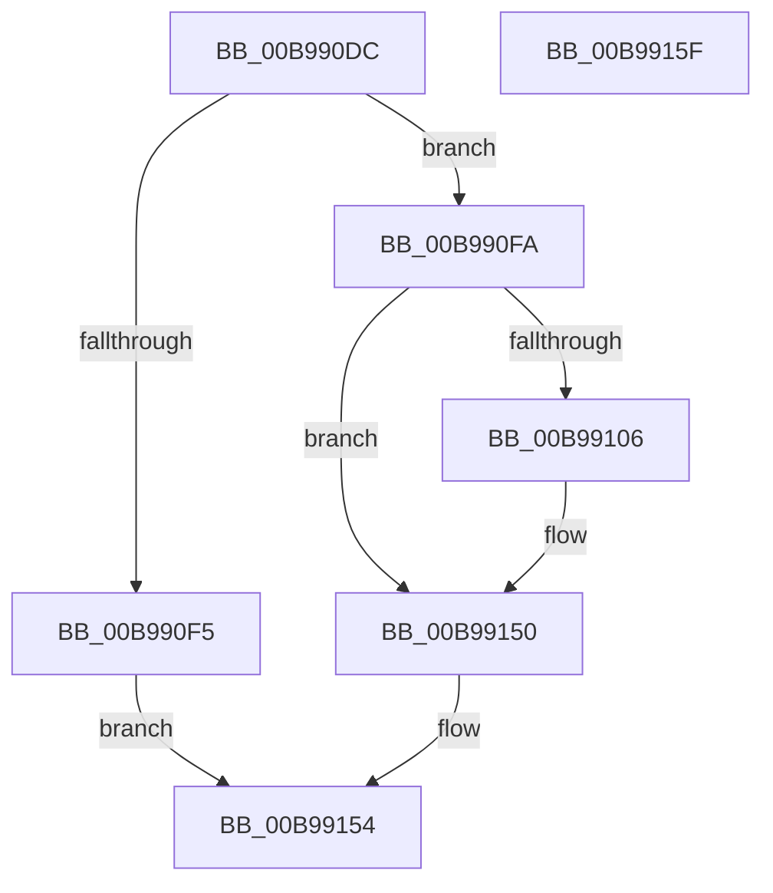

# ViGetRealDmaAdapter

- RVA: `0x00B990DC`–`0x00B99160` (길이 `132` bytes)
- VA: `0x0000000140B990DC`
- 실행 섹션: `PAGEVRFY`
- PDB 이름 있음: `예`; PDB Function 태그: `아니요`
- unwind 정보 RVA: `0x0006E5F8`
- 디코드: `33`개 명령, `132/132` bytes 표시
- 미해석 바이트: `0` (있으면 어셈블리에 `.byte`로 보존)

> 이 문서는 커널 이미지의 기계어와 PDB 기호를 분석해 생성했습니다. 4번과 5번은 함수 원형과 자료형을 바이너리 사용 방식에서 추정한 C 해석이며 원본 소스 복구 결과는 아닙니다.

## 1. Dependencies

- 직접 호출 지점: **4**; 고유 호출 대상: **3**
- 직접 호출자로 확인된 함수: **42**
- RIP 상대 이미지 참조: **2**

### Outgoing calls
- `0x00B990E9` → [ViGetAdapterSignature](ViGetAdapterSignature_function_00B98F94.md) (function, `0x00B98F94`)
- `0x00B990FA` → [ViGetAdapterSignature](ViGetAdapterSignature_function_00B98F94.md) (function, `0x00B98F94`)
- `0x00B9912C` → [ViHalPreprocessOptions](ViHalPreprocessOptions_function_00B9920C.md) (function, `0x00B9920C`)
- `0x00B9914B` → [VfReportIssueWithOptions](../../text/61/VfReportIssueWithOptions_function_00614444.md) (function, `0x00614444`)

### Direct callers
- [VfAllocateDomainCommonBuffer](../../text/61/VfAllocateDomainCommonBuffer_function_00612B20.md) at `0x00612B4B`
- [VfFlushDmaBuffer](../../text/61/VfFlushDmaBuffer_function_00612C40.md) at `0x00612C50`
- [VfGetDmaDomain](../../text/61/VfGetDmaDomain_function_00612C90.md) at `0x00612C94`
- [VfJoinDmaDomain](../../text/61/VfJoinDmaDomain_function_00612CC0.md) at `0x00612CC9`
- [VfLeaveDmaDomain](../../text/61/VfLeaveDmaDomain_function_00612D00.md) at `0x00612D04`
- [VfAllocateAdapterChannel](VfAllocateAdapterChannel_function_00B95180.md) at `0x00B95286`
- [VfAllocateAdapterChannelEx](VfAllocateAdapterChannelEx_function_00B95360.md) at `0x00B95396`
- [VfAllocateCommonBuffer](VfAllocateCommonBuffer_function_00B95570.md) at `0x00B95594`
- [VfAllocateCommonBufferEx](VfAllocateCommonBufferEx_function_00B95630.md) at `0x00B95655`
- [VfAllocateCommonBufferVector](VfAllocateCommonBufferVector_function_00B956F0.md) at `0x00B95708`
- [VfAllocateCommonBufferWithBounds](VfAllocateCommonBufferWithBounds_function_00B95780.md) at `0x00B957A5`
- [VfAllocateCrashDumpRegisters](VfAllocateCrashDumpRegisters_function_00B95860.md) at `0x00B9588F`
- [VfBuildMdlFromScatterGatherList](VfBuildMdlFromScatterGatherList_function_00B95940.md) at `0x00B9596B`
- [VfBuildScatterGatherList](VfBuildScatterGatherList_function_00B95AA0.md) at `0x00B95AD3`
- [VfBuildScatterGatherListEx](VfBuildScatterGatherListEx_function_00B95DA0.md) at `0x00B95DCB`
- [VfCalculateScatterGatherListSize](VfCalculateScatterGatherListSize_function_00B95F60.md) at `0x00B95F78`
- [VfCancelAdapterChannel](VfCancelAdapterChannel_function_00B95FD0.md) at `0x00B95FF2`
- [VfCancelMappedTransfer](VfCancelMappedTransfer_function_00B960A0.md) at `0x00B960A9`
- [VfConfigureAdapterChannel](VfConfigureAdapterChannel_function_00B960E0.md) at `0x00B960EF`
- [VfCreateCommonBufferFromMdl](VfCreateCommonBufferFromMdl_function_00B96130.md) at `0x00B96155`
- [VfFlushAdapterBuffers](VfFlushAdapterBuffers_function_00B96220.md) at `0x00B96255`
- [VfFlushAdapterBuffersEx](VfFlushAdapterBuffersEx_function_00B963D0.md) at `0x00B963F4`
- [VfFreeAdapterChannel](VfFreeAdapterChannel_function_00B96480.md) at `0x00B964A4`
- [VfFreeAdapterObject](VfFreeAdapterObject_function_00B96530.md) at `0x00B9654D`
- [VfFreeCommonBuffer](VfFreeCommonBuffer_function_00B96650.md) at `0x00B9667A`
- [VfFreeCommonBufferFromVector](VfFreeCommonBufferFromVector_function_00B96720.md) at `0x00B96730`
- [VfFreeCommonBufferVector](VfFreeCommonBufferVector_function_00B96770.md) at `0x00B96780`
- [VfFreeMapRegisters](VfFreeMapRegisters_function_00B967D0.md) at `0x00B96808`
- [VfGetCommonBufferFromVectorByIndex](VfGetCommonBufferFromVectorByIndex_function_00B968D0.md) at `0x00B968E8`
- [VfGetDmaAdapterInfo](VfGetDmaAdapterInfo_function_00B96AD0.md) at `0x00B96AD9`
- [VfGetDmaAlignment](VfGetDmaAlignment_function_00B96B10.md) at `0x00B96B2F`
- [VfGetDmaTransferInfo](VfGetDmaTransferInfo_function_00B96B60.md) at `0x00B96B78`
- [VfGetScatterGatherList](VfGetScatterGatherList_function_00B96BD0.md) at `0x00B96C03`
- [VfGetScatterGatherListEx](VfGetScatterGatherListEx_function_00B96F20.md) at `0x00B96F48`
- [VfHalAllocateMapRegisters](VfHalAllocateMapRegisters_function_00B970B0.md) at `0x00B970D1`
- [VfInitializeDmaTransferContext](VfInitializeDmaTransferContext_function_00B97240.md) at `0x00B97249`
- [VfMapTransfer](VfMapTransfer_function_00B97300.md) at `0x00B9732E`
- [VfMapTransferEx](VfMapTransferEx_function_00B974B0.md) at `0x00B974D8`
- [VfPutDmaAdapter](VfPutDmaAdapter_function_00B97680.md) at `0x00B9791C`
- [VfPutScatterGatherList](VfPutScatterGatherList_function_00B97970.md) at `0x00B97996`
- [VfReadDmaCounter](VfReadDmaCounter_function_00B97AF0.md) at `0x00B97B0D`
- [ViReleaseDmaAdapter](ViReleaseDmaAdapter_function_00B99A0C.md) at `0x00B99A2C`

### Static image references
- `0x00B9910C` → RVA `0x00E0E95C` (`.data`; read)
- `0x00B99119` → RVA `0x00BBA490` (` ?? ::JKADOLAD::`string'`; read)

## 2. Other-region calls and transfers

- 다른 실행 섹션으로 향하는 call: **1**
  - `0x00B9914B` → [VfReportIssueWithOptions](../../text/61/VfReportIssueWithOptions_function_00614444.md) (`PAGEVRFY` → `.text`)
- 별도 외부 분기/꼬리 이동을 확인하지 못했습니다.

## 3. Assembly (complete function range)

```asm
00B990DC  48 89 5C 24 08                  mov qword ptr [rsp + 8], rbx
00B990E1  57                              push rdi
00B990E2  48 83 EC 30                     sub rsp, 0x30
00B990E6  48 8B D9                        mov rbx, rcx
00B990E9  E8 A6 FE FF FF                  call 0x140b98f94
00B990EE  3D 48 44 6D 61                  cmp eax, 0x616d4448
00B990F3  75 05                           jne 0x140b990fa
00B990F5  48 8B C1                        mov rax, rcx
00B990F8  EB 5A                           jmp 0x140b99154
00B990FA  E8 95 FE FF FF                  call 0x140b98f94
00B990FF  3D 56 44 6D 61                  cmp eax, 0x616d4456
00B99104  74 4A                           je 0x140b99150
00B99106  48 83 64 24 28 00               and qword ptr [rsp + 0x28], 0
00B9910C  48 8D 3D 49 58 27 00            lea rdi, [rip + 0x275849]
00B99113  48 83 64 24 20 00               and qword ptr [rsp + 0x20], 0
00B99119  48 8D 15 70 13 02 00            lea rdx, [rip + 0x21370]
00B99120  48 8B CF                        mov rcx, rdi
00B99123  4C 8B CB                        mov r9, rbx
00B99126  41 B8 27 00 00 00               mov r8d, 0x27
00B9912C  E8 DB 00 00 00                  call 0x140b9920c
00B99131  45 33 C9                        xor r9d, r9d
00B99134  48 89 7C 24 28                  mov qword ptr [rsp + 0x28], rdi
00B99139  48 83 64 24 20 00               and qword ptr [rsp + 0x20], 0
00B9913F  4C 8B C3                        mov r8, rbx
00B99142  B9 E6 00 00 00                  mov ecx, 0xe6
00B99147  41 8D 51 27                     lea edx, [r9 + 0x27]
00B9914B  E8 F4 B2 A7 FF                  call 0x140614444
00B99150  48 8B 43 18                     mov rax, qword ptr [rbx + 0x18]
00B99154  48 8B 5C 24 40                  mov rbx, qword ptr [rsp + 0x40]
00B99159  48 83 C4 30                     add rsp, 0x30
00B9915D  5F                              pop rdi
00B9915E  C3                              ret
00B9915F  CC                              int3
```

## 4. C-style interpretation (structured pseudocode)

```c
__int64 __fastcall ViGetRealDmaAdapter(__int64 a1)
{
    __int64 result;
    __int64 v_rdi;
    __int64 v_rsp;
    unsigned __int64 v_stack_m10;
    unsigned __int64 v_stack_m18;
    unsigned __int64 v_stack_p8;

    v_stack_p8 = v_rbx;
    v_rsp = (v_rsp) - (48);
    result = ViGetAdapterSignature(a1, a2, a3, a4);
    if (((unsigned int)(result)) != 0x616D4448ULL) goto loc_00B990FA;
    goto loc_00B99154;
loc_00B990FA:
    result = ViGetAdapterSignature(a1, a2, a3, a4);
    if (((unsigned int)(result)) != 0x616D4456ULL) {
        v_rdi = v_rip + 2578505;
        a2 = v_rip + 136048;
        a1 = v_rdi;
        a4 = a1;
        a3 = 39;
        result = ViHalPreprocessOptions(a1, a2, a3, a4);
        a4 = 0;
        v_stack_m10 = v_rdi;
        a3 = a1;
        a1 = 230;
        a2 = a4 + 39;
        result = VfReportIssueWithOptions(a1, a2, a3, a4);
    }
loc_00B99154:
    v_rsp = (v_rsp) + (48);
    return *(unsigned __int64 *)(a1 + 24);
}
```

## 5. (Beta) C Style

```c
int64_t ViGetRealDmaAdapter(void *Arg1)
{
    uint8_t *arg1 = (uint8_t *)Arg1;

    int64_t result;
    int64_t local_rdi;
    int64_t local_rsp;
    uint64_t v_stack_m10;
    uint64_t v_stack_m18;
    uint64_t v_stack_p8;

    v_stack_p8 = local_rbx;
    local_rsp = (local_rsp) - (48);
    result = ViGetAdapterSignature(Arg1, a2, a3, a4);
    if (((uint32_t)(result)) != 0x616D4448ULL) goto loc_00B990FA;
    goto loc_00B99154;
loc_00B990FA:
    result = ViGetAdapterSignature(Arg1, a2, a3, a4);
    if (((uint32_t)(result)) != 0x616D4456ULL) {
        local_rdi = v_rip + 2578505;
        a2 = v_rip + 136048;
        Arg1 = local_rdi;
        a4 = Arg1;
        a3 = 39;
        result = ViHalPreprocessOptions(Arg1, a2, a3, a4);
        a4 = 0;
        v_stack_m10 = local_rdi;
        a3 = Arg1;
        Arg1 = 230;
        a2 = a4 + 39;
        result = VfReportIssueWithOptions(Arg1, a2, a3, a4);
    }
loc_00B99154:
    local_rsp = (local_rsp) + (48);
    return *(uint64_t *)(arg1 + 0x18);
}
```

### 관측된 메모리 오프셋

구조체 형식이 확인되지 않은 접근은 인자 기준의 오프셋으로만 기록했습니다.

| 기준 인자 | 오프셋 표현 | 폭 (bit) | 접근 |
|---|---:|---:|---|
| `Arg1` | `+ 0x18` | `64` | `R` |

## 6. Execution-region graph

[열기: 2D/3D 그래프와 함수 탐색 컨트롤 패널](../../../control-panel.html?section=pagevrfy&rva=0x00B990DC&view=graph)

- 2D 그래프는 위에서 아래로 흐르고, 3D 그래프는 빈 공간을 드래그해 회전합니다. Shift+드래그는 이동, 휠은 확대·축소, 함수 노드 선택은 대상 보고서 이동입니다.

### Static fallback


