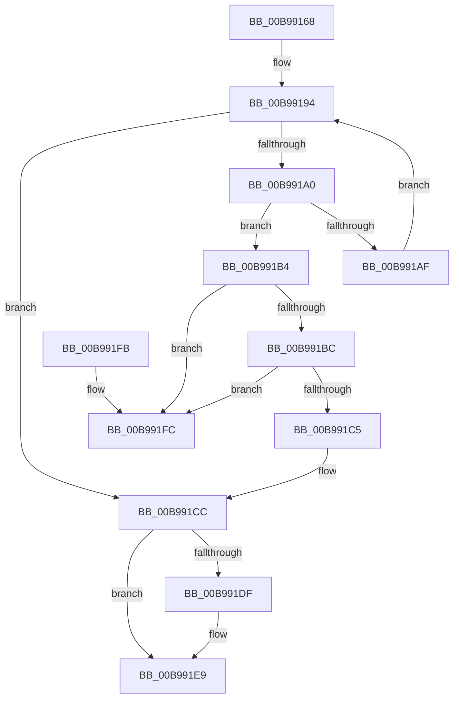

# ViHalFreeDomainCommonBuffer

- RVA: `0x00B99168`–`0x00B99203` (길이 `155` bytes)
- VA: `0x0000000140B99168`
- 실행 섹션: `PAGEVRFY`
- PDB 이름 있음: `예`; PDB Function 태그: `아니요`
- unwind 정보 RVA: `0x0006383C`
- 디코드: `46`개 명령, `155/155` bytes 표시
- 미해석 바이트: `0` (있으면 어셈블리에 `.byte`로 보존)

> 이 문서는 커널 이미지의 기계어와 PDB 기호를 분석해 생성했습니다. 4번과 5번은 함수 원형과 자료형을 바이너리 사용 방식에서 추정한 C 해석이며 원본 소스 복구 결과는 아닙니다.

## 1. Dependencies

- 직접 호출 지점: **3**; 고유 호출 대상: **3**
- 직접 호출자로 확인된 함수: **1**
- RIP 상대 이미지 참조: **2**

### Outgoing calls
- `0x00B99185` → [KeAcquireSpinLockRaiseToDpc](../../text/20/KeAcquireSpinLockRaiseToDpc_function_00208470.md) (function, `0x00208470`)
- `0x00B991D6` → [KeReleaseSpinLock](../../text/39/KeReleaseSpinLock_function_00392BA0.md) (function, `0x00392BA0`)
- `0x00B991E4` → [ExFreePoolWithTag](../../poolcode/B8/ExFreePoolWithTag_function_00B82870.md) (function, `0x00B82870`)

### Direct callers
- [VfFreeCommonBuffer](VfFreeCommonBuffer_function_00B96650.md) at `0x00B966A6`

### Static image references
- `0x00B9917C` → RVA `0x00F03FF0` (`.data`; read)
- `0x00B9918A` → RVA `0x00F03FE0` (`.data`; read)

## 2. Other-region calls and transfers

- 다른 실행 섹션으로 향하는 call: **3**
  - `0x00B99185` → [KeAcquireSpinLockRaiseToDpc](../../text/20/KeAcquireSpinLockRaiseToDpc_function_00208470.md) (`PAGEVRFY` → `.text`)
  - `0x00B991D6` → [KeReleaseSpinLock](../../text/39/KeReleaseSpinLock_function_00392BA0.md) (`PAGEVRFY` → `.text`)
  - `0x00B991E4` → [ExFreePoolWithTag](../../poolcode/B8/ExFreePoolWithTag_function_00B82870.md) (`PAGEVRFY` → `POOLCODE`)
- 별도 외부 분기/꼬리 이동을 확인하지 못했습니다.

## 3. Assembly (complete function range)

```asm
00B99168  48 89 5C 24 08                  mov qword ptr [rsp + 8], rbx
00B9916D  48 89 74 24 10                  mov qword ptr [rsp + 0x10], rsi
00B99172  57                              push rdi
00B99173  48 83 EC 20                     sub rsp, 0x20
00B99177  48 8B F1                        mov rsi, rcx
00B9917A  32 DB                           xor bl, bl
00B9917C  48 8D 0D 6D AE 36 00            lea rcx, [rip + 0x36ae6d]
00B99183  33 FF                           xor edi, edi
00B99185  E8 E6 F2 66 FF                  call 0x140208470
00B9918A  48 8B 15 4F AE 36 00            mov rdx, qword ptr [rip + 0x36ae4f]
00B99191  44 8A C0                        mov r8b, al
00B99194  48 8D 05 45 AE 36 00            lea rax, [rip + 0x36ae45]
00B9919B  48 3B D0                        cmp rdx, rax
00B9919E  74 2C                           je 0x140b991cc
00B991A0  48 8B 06                        mov rax, qword ptr [rsi]
00B991A3  48 8B FA                        mov rdi, rdx
00B991A6  48 8B 0A                        mov rcx, qword ptr [rdx]
00B991A9  48 39 42 10                     cmp qword ptr [rdx + 0x10], rax
00B991AD  74 05                           je 0x140b991b4
00B991AF  48 8B D1                        mov rdx, rcx
00B991B2  EB E0                           jmp 0x140b99194
00B991B4  B3 01                           mov bl, 1
00B991B6  48 39 51 08                     cmp qword ptr [rcx + 8], rdx
00B991BA  75 40                           jne 0x140b991fc
00B991BC  48 8B 42 08                     mov rax, qword ptr [rdx + 8]
00B991C0  48 39 10                        cmp qword ptr [rax], rdx
00B991C3  75 37                           jne 0x140b991fc
00B991C5  48 89 08                        mov qword ptr [rax], rcx
00B991C8  48 89 41 08                     mov qword ptr [rcx + 8], rax
00B991CC  41 8A D0                        mov dl, r8b
00B991CF  48 8D 0D 1A AE 36 00            lea rcx, [rip + 0x36ae1a]
00B991D6  E8 C5 99 7F FF                  call 0x140392ba0
00B991DB  84 DB                           test bl, bl
00B991DD  74 0A                           je 0x140b991e9
00B991DF  33 D2                           xor edx, edx
00B991E1  48 8B CF                        mov rcx, rdi
00B991E4  E8 87 96 FE FF                  call 0x140b82870
00B991E9  48 8B 74 24 38                  mov rsi, qword ptr [rsp + 0x38]
00B991EE  8A C3                           mov al, bl
00B991F0  48 8B 5C 24 30                  mov rbx, qword ptr [rsp + 0x30]
00B991F5  48 83 C4 20                     add rsp, 0x20
00B991F9  5F                              pop rdi
00B991FA  C3                              ret
00B991FB  CC                              int3
00B991FC  B9 03 00 00 00                  mov ecx, 3
00B99201  CD 29                           int 0x29
```

## 4. C-style interpretation (structured pseudocode)

```c
__int64 __fastcall ViHalFreeDomainCommonBuffer(__int64 a1)
{
    __int64 result;
    __int64 v_rbx;
    __int64 v_rdi;
    __int64 v_rsp;
    unsigned __int64 v_stack_p10;
    unsigned __int64 v_stack_p8;

    v_stack_p8 = v_rbx;
    v_stack_p10 = v_rsi;
    v_rsp = (v_rsp) - (32);
    v_rbx = 0;
    v_rdi = 0;
    result = KeAcquireSpinLockRaiseToDpc(v_rip + 3583597, a2, a3, a4);
loc_00B99194:
    if ((*(unsigned __int64 *)(v_rip + 3583567)) == (v_rip + 3583557)) goto loc_00B991CC;
    if ((*(unsigned __int64 *)(*(unsigned __int64 *)(v_rip + 3583567) + 16)) == (*(unsigned __int64 *)(a1))) goto loc_00B991B4;
    goto loc_00B99194;
loc_00B991B4:
    if ((*(unsigned __int64 *)(*(unsigned __int64 *)(*(unsigned __int64 *)(v_rip + 3583567)) + 8)) != (*(unsigned __int64 *)(*(unsigned __int64 *)(v_rip + 3583567)))) goto loc_00B991FC;
    if ((*(unsigned __int64 *)(*(unsigned __int64 *)(*(unsigned __int64 *)(*(unsigned __int64 *)(v_rip + 3583567)) + 8))) != (*(unsigned __int64 *)(*(unsigned __int64 *)(v_rip + 3583567)))) goto loc_00B991FC;
    *(unsigned __int64 *)(*(unsigned __int64 *)(*(unsigned __int64 *)(*(unsigned __int64 *)(v_rip + 3583567)) + 8)) = *(unsigned __int64 *)(*(unsigned __int64 *)(v_rip + 3583567));
    *(unsigned __int64 *)(*(unsigned __int64 *)(*(unsigned __int64 *)(v_rip + 3583567)) + 8) = *(unsigned __int64 *)(*(unsigned __int64 *)(*(unsigned __int64 *)(v_rip + 3583567)) + 8);
loc_00B991CC:
    result = KeReleaseSpinLock(v_rip + 3583514, (unsigned __int8)((unsigned __int8)(result)), (unsigned __int8)(result), a4);
    if (1 != 0) {
        a2 = 0;
        a1 = *(unsigned __int64 *)(v_rip + 3583567);
        result = ExFreePoolWithTag(a1, a2, (unsigned __int8)(result), a4);
    }
    v_rsp = (v_rsp) + (32);
    return 1;
loc_00B991FC:
    return 1;
}
```

## 5. (Beta) C Style

```c
int64_t ViHalFreeDomainCommonBuffer(void *Arg1)
{
    uint8_t *arg1 = (uint8_t *)Arg1;

    int64_t result;
    int64_t local_rbx;
    int64_t local_rdi;
    int64_t local_rsp;
    uint64_t v_stack_p10;
    uint64_t v_stack_p8;

    v_stack_p8 = local_rbx;
    v_stack_p10 = local_rsi;
    local_rsp = (local_rsp) - (32);
    local_rbx = 0;
    local_rdi = 0;
    result = KeAcquireSpinLockRaiseToDpc(v_rip + 3583597, a2, a3, a4);
loc_00B99194:
    if ((*(uint64_t *)(v_rip + 0x36AE4F)) == (v_rip + 3583557)) goto loc_00B991CC;
    if ((*(uint64_t *)(*(uint64_t *)(v_rip + 0x36AE4F) + 0x10)) == (*(uint64_t *)(arg1))) goto loc_00B991B4;
    goto loc_00B99194;
loc_00B991B4:
    if ((*(uint64_t *)(*(uint64_t *)(*(uint64_t *)(v_rip + 0x36AE4F)) + 0x8)) != (*(uint64_t *)(*(uint64_t *)(v_rip + 0x36AE4F)))) goto loc_00B991FC;
    if ((*(uint64_t *)(*(uint64_t *)(*(uint64_t *)(*(uint64_t *)(v_rip + 0x36AE4F)) + 0x8))) != (*(uint64_t *)(*(uint64_t *)(v_rip + 0x36AE4F)))) goto loc_00B991FC;
    *(uint64_t *)(*(uint64_t *)(*(uint64_t *)(*(uint64_t *)(v_rip + 0x36AE4F)) + 0x8)) = *(uint64_t *)(*(uint64_t *)(v_rip + 0x36AE4F));
    *(uint64_t *)(*(uint64_t *)(*(uint64_t *)(v_rip + 0x36AE4F)) + 0x8) = *(uint64_t *)(*(uint64_t *)(*(uint64_t *)(v_rip + 0x36AE4F)) + 0x8);
loc_00B991CC:
    result = KeReleaseSpinLock(v_rip + 3583514, (uint8_t)((uint8_t)(result)), (uint8_t)(result), a4);
    if (1 != 0) {
        a2 = 0;
        Arg1 = *(uint64_t *)(v_rip + 0x36AE4F);
        result = ExFreePoolWithTag(Arg1, a2, (uint8_t)(result), a4);
    }
    local_rsp = (local_rsp) + (32);
    return 1;
loc_00B991FC:
    return 1;
}
```

### 관측된 메모리 오프셋

구조체 형식이 확인되지 않은 접근은 인자 기준의 오프셋으로만 기록했습니다.

| 기준 인자 | 오프셋 표현 | 폭 (bit) | 접근 |
|---|---:|---:|---|
| `Arg1` | `+ 0x0` | `64` | `R` |

## 6. Execution-region graph

[열기: 2D/3D 그래프와 함수 탐색 컨트롤 패널](../../../control-panel.html?section=pagevrfy&rva=0x00B99168&view=graph)

- 2D 그래프는 위에서 아래로 흐르고, 3D 그래프는 빈 공간을 드래그해 회전합니다. Shift+드래그는 이동, 휠은 확대·축소, 함수 노드 선택은 대상 보고서 이동입니다.

### Static fallback


