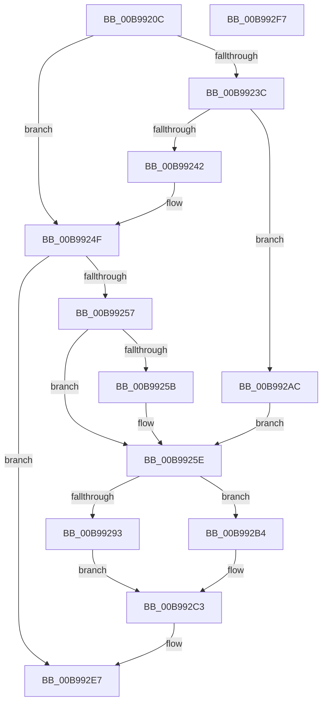

# ViHalPreprocessOptions

- RVA: `0x00B9920C`–`0x00B992F8` (길이 `236` bytes)
- VA: `0x0000000140B9920C`
- 실행 섹션: `PAGEVRFY`
- PDB 이름 있음: `예`; PDB Function 태그: `아니요`
- unwind 정보 RVA: `0x000794E0`
- 디코드: `59`개 명령, `236/236` bytes 표시
- 미해석 바이트: `0` (있으면 어셈블리에 `.byte`로 보존)

> 이 문서는 커널 이미지의 기계어와 PDB 기호를 분석해 생성했습니다. 4번과 5번은 함수 원형과 자료형을 바이너리 사용 방식에서 추정한 C 해석이며 원본 소스 복구 결과는 아닙니다.

## 1. Dependencies

- 직접 호출 지점: **8**; 고유 호출 대상: **2**
- 직접 호출자로 확인된 함수: **29**
- RIP 상대 이미지 참조: **6**

### Outgoing calls
- `0x00B99265` → [VfUtilDbgPrint](../../text/61/VfUtilDbgPrint_function_006122AC.md) (function, `0x006122AC`)
- `0x00B99271` → [VfUtilDbgPrint](../../text/61/VfUtilDbgPrint_function_006122AC.md) (function, `0x006122AC`)
- `0x00B9927D` → [VfUtilDbgPrint](../../text/61/VfUtilDbgPrint_function_006122AC.md) (function, `0x006122AC`)
- `0x00B992A5` → [DbgPrintEx](../../text/35/DbgPrintEx_function_00359290.md) (function, `0x00359290`)
- `0x00B992BE` → [DbgPrintEx](../../text/35/DbgPrintEx_function_00359290.md) (function, `0x00359290`)
- `0x00B992CA` → [VfUtilDbgPrint](../../text/61/VfUtilDbgPrint_function_006122AC.md) (function, `0x006122AC`)
- `0x00B992D6` → [VfUtilDbgPrint](../../text/61/VfUtilDbgPrint_function_006122AC.md) (function, `0x006122AC`)
- `0x00B992E2` → [VfUtilDbgPrint](../../text/61/VfUtilDbgPrint_function_006122AC.md) (function, `0x006122AC`)

### Direct callers
- [ADD_MAP_REGISTERS](ADD_MAP_REGISTERS_function_00B94A08.md) at `0x00B94A69`
- [ADD_MAP_REGISTERS](ADD_MAP_REGISTERS_function_00B94A08.md) at `0x00B94ACA`
- [DECREMENT_ADAPTER_CHANNELS](DECREMENT_ADAPTER_CHANNELS_function_00B94B14.md) at `0x00B94B6B`
- [DECREMENT_COMMON_BUFFERS](DECREMENT_COMMON_BUFFERS_function_00B94BB0.md) at `0x00B94C03`
- [DECREMENT_SCATTER_GATHER_LISTS](DECREMENT_SCATTER_GATHER_LISTS_function_00B94C44.md) at `0x00B94C93`
- [INCREASE_MAPPED_TRANSFER_BYTE_COUNT](INCREASE_MAPPED_TRANSFER_BYTE_COUNT_function_00B94CD8.md) at `0x00B94D31`
- [INCREMENT_ADAPTER_CHANNELS](INCREMENT_ADAPTER_CHANNELS_function_00B94D70.md) at `0x00B94DCF`
- [SUBTRACT_MAP_REGISTERS](SUBTRACT_MAP_REGISTERS_function_00B94E10.md) at `0x00B94E5E`
- [VERIFY_BUFFER_LOCKED](VERIFY_BUFFER_LOCKED_function_00B94EA4.md) at `0x00B94EF7`
- [VF_ASSERT_IRQL](VF_ASSERT_IRQL_function_00B94F30.md) at `0x00B94F73`
- [VF_ASSERT_MAX_IRQL](VF_ASSERT_MAX_IRQL_function_00B94FB0.md) at `0x00B94FF3`
- [VfBuildScatterGatherList](VfBuildScatterGatherList_function_00B95AA0.md) at `0x00B95B69`
- [VfBuildScatterGatherListEx](VfBuildScatterGatherListEx_function_00B95DA0.md) at `0x00B95E5B`
- [VfCreateCommonBufferFromMdl](VfCreateCommonBufferFromMdl_function_00B96130.md) at `0x00B961C5`
- [VfFlushAdapterBuffers](VfFlushAdapterBuffers_function_00B96220.md) at `0x00B96335`
- [VfGetScatterGatherList](VfGetScatterGatherList_function_00B96BD0.md) at `0x00B96C96`
- [VfGetScatterGatherListEx](VfGetScatterGatherListEx_function_00B96F20.md) at `0x00B96FC3`
- [VfMapTransfer](VfMapTransfer_function_00B97300.md) at `0x00B973B0`
- [VfMapTransferEx](VfMapTransferEx_function_00B974B0.md) at `0x00B97549`
- [VfPutDmaAdapter](VfPutDmaAdapter_function_00B97680.md) at `0x00B976F3`
- [VfPutDmaAdapter](VfPutDmaAdapter_function_00B97680.md) at `0x00B97754`
- [VfPutDmaAdapter](VfPutDmaAdapter_function_00B97680.md) at `0x00B977B7`
- [VfPutDmaAdapter](VfPutDmaAdapter_function_00B97680.md) at `0x00B97813`
- [VfPutDmaAdapter](VfPutDmaAdapter_function_00B97680.md) at `0x00B97868`
- [ViAllocateMapRegistersFromFile](ViAllocateMapRegistersFromFile_function_00B980A8.md) at `0x00B98167`
- [ViAllocateMapRegistersFromFile](ViAllocateMapRegistersFromFile_function_00B980A8.md) at `0x00B981FE`
- [ViCheckPadding](ViCheckPadding_function_00B98464.md) at `0x00B984D2`
- [ViCheckPadding](ViCheckPadding_function_00B98464.md) at `0x00B98571`
- [ViCheckPadding](ViCheckPadding_function_00B98464.md) at `0x00B985D0`
- [ViCheckTag](ViCheckTag_function_00B98614.md) at `0x00B98691`
- [ViCheckTag](ViCheckTag_function_00B98614.md) at `0x00B98702`
- [ViCopyDeviceDescription](ViCopyDeviceDescription_function_00B988A0.md) at `0x00B988E0`
- [ViFlushDoubleBuffer](ViFlushDoubleBuffer_function_00B989D0.md) at `0x00B98A52`
- [ViFlushDoubleBuffer](ViFlushDoubleBuffer_function_00B989D0.md) at `0x00B98AE5`
- [ViGetAdapterInformationInternal](ViGetAdapterInformationInternal_function_00B98E88.md) at `0x00B98F40`
- [ViGetMdlBufferSa](ViGetMdlBufferSa_function_00B98FC8.md) at `0x00B99055`
- [ViGetMdlBufferSa](ViGetMdlBufferSa_function_00B98FC8.md) at `0x00B9909E`
- [ViGetRealDmaAdapter](ViGetRealDmaAdapter_function_00B990DC.md) at `0x00B9912C`
- [ViMapDoubleBuffer](ViMapDoubleBuffer_function_00B99640.md) at `0x00B99694`
- [ViMapDoubleBuffer](ViMapDoubleBuffer_function_00B99640.md) at `0x00B99727`
- [ViMapDoubleBuffer](ViMapDoubleBuffer_function_00B99640.md) at `0x00B9977B`
- [ViMapDoubleBuffer](ViMapDoubleBuffer_function_00B99640.md) at `0x00B998D7`
- [ViReleaseDmaAdapter](ViReleaseDmaAdapter_function_00B99A0C.md) at `0x00B99AD2`

### Static image references
- `0x00B99242` → RVA `0x00B8B480` (`ViHalDefaultActions`; read)
- `0x00B9925E` → RVA `0x00BBA3E0` (` ?? ::JKADOLAD::`string'`; read)
- `0x00B9926A` → RVA `0x00BBA3D0` (` ?? ::JKADOLAD::`string'`; read)
- `0x00B99276` → RVA `0x00BBA2C0` (` ?? ::JKADOLAD::`string'`; read)
- `0x00B992C3` → RVA `0x00BBA2B0` (` ?? ::JKADOLAD::`string'`; read)
- `0x00B992DB` → RVA `0x00BBA2E0` (` ?? ::JKADOLAD::`string'`; read)

## 2. Other-region calls and transfers

- 다른 실행 섹션으로 향하는 call: **8**
  - `0x00B99265` → [VfUtilDbgPrint](../../text/61/VfUtilDbgPrint_function_006122AC.md) (`PAGEVRFY` → `.text`)
  - `0x00B99271` → [VfUtilDbgPrint](../../text/61/VfUtilDbgPrint_function_006122AC.md) (`PAGEVRFY` → `.text`)
  - `0x00B9927D` → [VfUtilDbgPrint](../../text/61/VfUtilDbgPrint_function_006122AC.md) (`PAGEVRFY` → `.text`)
  - `0x00B992A5` → [DbgPrintEx](../../text/35/DbgPrintEx_function_00359290.md) (`PAGEVRFY` → `.text`)
  - `0x00B992BE` → [DbgPrintEx](../../text/35/DbgPrintEx_function_00359290.md) (`PAGEVRFY` → `.text`)
  - `0x00B992CA` → [VfUtilDbgPrint](../../text/61/VfUtilDbgPrint_function_006122AC.md) (`PAGEVRFY` → `.text`)
  - `0x00B992D6` → [VfUtilDbgPrint](../../text/61/VfUtilDbgPrint_function_006122AC.md) (`PAGEVRFY` → `.text`)
  - `0x00B992E2` → [VfUtilDbgPrint](../../text/61/VfUtilDbgPrint_function_006122AC.md) (`PAGEVRFY` → `.text`)
- 별도 외부 분기/꼬리 이동을 확인하지 못했습니다.

## 3. Assembly (complete function range)

```asm
00B9920C  48 89 5C 24 08                  mov qword ptr [rsp + 8], rbx
00B99211  48 89 74 24 10                  mov qword ptr [rsp + 0x10], rsi
00B99216  57                              push rdi
00B99217  48 83 EC 30                     sub rsp, 0x30
00B9921B  41 8B C0                        mov eax, r8d
00B9921E  41 8B D8                        mov ebx, r8d
00B99221  0F BA F0 1C                     btr eax, 0x1c
00B99225  49 8B F1                        mov rsi, r9
00B99228  81 E3 00 00 00 10               and ebx, 0x10000000
00B9922E  48 8B FA                        mov rdi, rdx
00B99231  44 0F 45 C0                     cmovne r8d, eax
00B99235  8B 01                           mov eax, dword ptr [rcx]
00B99237  83 F8 FF                        cmp eax, -1
00B9923A  75 13                           jne 0x140b9924f
00B9923C  41 83 F8 28                     cmp r8d, 0x28
00B99240  73 6A                           jae 0x140b992ac
00B99242  48 8D 15 37 22 FF FF            lea rdx, [rip - 0xddc9]
00B99249  42 8B 04 82                     mov eax, dword ptr [rdx + r8*4]
00B9924D  89 01                           mov dword ptr [rcx], eax
00B9924F  85 C0                           test eax, eax
00B99251  0F 84 90 00 00 00               je 0x140b992e7
00B99257  A8 10                           test al, 0x10
00B99259  74 03                           je 0x140b9925e
00B9925B  83 21 00                        and dword ptr [rcx], 0
00B9925E  48 8D 0D 7B 11 02 00            lea rcx, [rip + 0x2117b]
00B99265  E8 42 90 A7 FF                  call 0x1406122ac
00B9926A  48 8D 0D 5F 11 02 00            lea rcx, [rip + 0x2115f]
00B99271  E8 36 90 A7 FF                  call 0x1406122ac
00B99276  48 8D 0D 43 10 02 00            lea rcx, [rip + 0x21043]
00B9927D  E8 2A 90 A7 FF                  call 0x1406122ac
00B99282  48 8B 44 24 68                  mov rax, qword ptr [rsp + 0x68]
00B99287  33 D2                           xor edx, edx
00B99289  4C 8B C7                        mov r8, rdi
00B9928C  8D 4A 65                        lea ecx, [rdx + 0x65]
00B9928F  85 DB                           test ebx, ebx
00B99291  75 21                           jne 0x140b992b4
00B99293  48 89 44 24 28                  mov qword ptr [rsp + 0x28], rax
00B99298  4C 8B CE                        mov r9, rsi
00B9929B  48 8B 44 24 60                  mov rax, qword ptr [rsp + 0x60]
00B992A0  48 89 44 24 20                  mov qword ptr [rsp + 0x20], rax
00B992A5  E8 E6 FF 7B FF                  call 0x140359290
00B992AA  EB 17                           jmp 0x140b992c3
00B992AC  C7 01 04 00 00 00               mov dword ptr [rcx], 4
00B992B2  EB AA                           jmp 0x140b9925e
00B992B4  4C 8B 4C 24 60                  mov r9, qword ptr [rsp + 0x60]
00B992B9  48 89 44 24 20                  mov qword ptr [rsp + 0x20], rax
00B992BE  E8 CD FF 7B FF                  call 0x140359290
00B992C3  48 8D 0D E6 0F 02 00            lea rcx, [rip + 0x20fe6]
00B992CA  E8 DD 8F A7 FF                  call 0x1406122ac
00B992CF  48 8D 0D FA 10 02 00            lea rcx, [rip + 0x210fa]
00B992D6  E8 D1 8F A7 FF                  call 0x1406122ac
00B992DB  48 8D 0D FE 0F 02 00            lea rcx, [rip + 0x20ffe]
00B992E2  E8 C5 8F A7 FF                  call 0x1406122ac
00B992E7  48 8B 5C 24 40                  mov rbx, qword ptr [rsp + 0x40]
00B992EC  48 8B 74 24 48                  mov rsi, qword ptr [rsp + 0x48]
00B992F1  48 83 C4 30                     add rsp, 0x30
00B992F5  5F                              pop rdi
00B992F6  C3                              ret
00B992F7  CC                              int3
```

## 4. C-style interpretation (structured pseudocode)

```c
__int64 __fastcall ViHalPreprocessOptions(__int64 a1, __int64 a2, int a3, __int64 a4, __int64 a5, __int64 a6)
{
    __int64 result;
    __int64 v_rbx;
    __int64 v_rsp;
    unsigned __int64 v_stack_m10;
    unsigned __int64 v_stack_m18;
    unsigned __int64 v_stack_p10;
    unsigned __int64 v_stack_p8;

    v_stack_p8 = v_rbx;
    v_stack_p10 = v_rsi;
    v_rsp = (v_rsp) - (48);
    v_rbx = (unsigned int)(((unsigned int)(a3)) & (0x10000000ULL));
    if (condition_is_not_equal) { a3 = (unsigned int)((unsigned int)(a3)); }
    if (((unsigned int)((unsigned int)(*(unsigned int *)(a1)))) != -1) goto loc_00B9924F;
    if (a3 >= 40) goto loc_00B992AC;
    *(unsigned int *)(a1) = (unsigned int)((unsigned int)(*(unsigned int *)(v_rip - 56777 + a3 * 4)));
loc_00B9924F:
    if ((unsigned int)((unsigned int)(*(unsigned int *)(v_rip - 56777 + a3 * 4))) == 0) goto loc_00B992E7;
    if ((((unsigned __int8)((unsigned int)(*(unsigned int *)(v_rip - 56777 + a3 * 4)))) & (16)) != 0) {
    }
    result = VfUtilDbgPrint(v_rip + 135547, v_rip - 56777, a3, a4);
    result = VfUtilDbgPrint(v_rip + 135519, v_rip - 56777, a3, a4);
    result = VfUtilDbgPrint(v_rip + 135235, v_rip - 56777, a3, a4);
    a2 = 0;
    if ((unsigned int)(v_rbx) != 0) goto loc_00B992B4;
    v_stack_m10 = a6;
    v_stack_m18 = a5;
    result = DbgPrintEx(a2 + 101, a2, 0, a4);
    goto loc_00B992C3;
loc_00B992AC:
    *(unsigned int *)(a2 + 101) = 4;
    goto loc_00B9925E;
loc_00B992B4:
    v_stack_m18 = result;
    result = DbgPrintEx(a2 + 101, a2, 0, a5);
loc_00B992C3:
    result = VfUtilDbgPrint(v_rip + 135142, a2, 0, a5);
    result = VfUtilDbgPrint(v_rip + 135418, a2, 0, a5);
    result = VfUtilDbgPrint(v_rip + 135166, a2, 0, a5);
loc_00B992E7:
    v_rsp = (v_rsp) + (48);
    return result;
}
```

## 5. (Beta) C Style

```c
int64_t ViHalPreprocessOptions(void *Arg1, int64_t Arg2, int32_t Arg3, int64_t Arg4, int64_t Arg5, int64_t Arg6)
{
    uint8_t *arg1 = (uint8_t *)Arg1;

    int64_t result;
    int64_t local_rbx;
    int64_t local_rsp;
    uint64_t v_stack_m10;
    uint64_t v_stack_m18;
    uint64_t v_stack_p10;
    uint64_t v_stack_p8;

    v_stack_p8 = local_rbx;
    v_stack_p10 = local_rsi;
    local_rsp = (local_rsp) - (48);
    local_rbx = (uint32_t)(((uint32_t)(Arg3)) & (0x10000000ULL));
    if (condition_is_not_equal) { Arg3 = (uint32_t)((uint32_t)(Arg3)); }
    if (((uint32_t)((uint32_t)(*(uint32_t *)(arg1)))) != -1) goto loc_00B9924F;
    if (Arg3 >= 40) goto loc_00B992AC;
    *(uint32_t *)(arg1) = (uint32_t)((uint32_t)(*(uint32_t *)(v_rip - 0xDDC9 + Arg3 * 4)));
loc_00B9924F:
    if ((uint32_t)((uint32_t)(*(uint32_t *)(v_rip - 0xDDC9 + Arg3 * 4))) == 0) goto loc_00B992E7;
    if ((((uint8_t)((uint32_t)(*(uint32_t *)(v_rip - 0xDDC9 + Arg3 * 4)))) & (16)) != 0) {
    }
    result = VfUtilDbgPrint(v_rip + 135547, v_rip - 56777, Arg3, Arg4);
    result = VfUtilDbgPrint(v_rip + 135519, v_rip - 56777, Arg3, Arg4);
    result = VfUtilDbgPrint(v_rip + 135235, v_rip - 56777, Arg3, Arg4);
    Arg2 = 0;
    if ((uint32_t)(local_rbx) != 0) goto loc_00B992B4;
    v_stack_m10 = Arg6;
    v_stack_m18 = Arg5;
    result = DbgPrintEx(Arg2 + 101, Arg2, 0, Arg4);
    goto loc_00B992C3;
loc_00B992AC:
    *(uint32_t *)(Arg2 + 0x65) = 4;
    goto loc_00B9925E;
loc_00B992B4:
    v_stack_m18 = result;
    result = DbgPrintEx(Arg2 + 101, Arg2, 0, Arg5);
loc_00B992C3:
    result = VfUtilDbgPrint(v_rip + 135142, Arg2, 0, Arg5);
    result = VfUtilDbgPrint(v_rip + 135418, Arg2, 0, Arg5);
    result = VfUtilDbgPrint(v_rip + 135166, Arg2, 0, Arg5);
loc_00B992E7:
    local_rsp = (local_rsp) + (48);
    return result;
}
```

### 관측된 메모리 오프셋

구조체 형식이 확인되지 않은 접근은 인자 기준의 오프셋으로만 기록했습니다.

| 기준 인자 | 오프셋 표현 | 폭 (bit) | 접근 |
|---|---:|---:|---|
| `Arg1` | `+ 0x0` | `32` | `R` |
| `Arg1` | `+ 0x0` | `32` | `R/W` |
| `Arg1` | `+ 0x0` | `32` | `W` |

## 6. Execution-region graph

[열기: 2D/3D 그래프와 함수 탐색 컨트롤 패널](../../../control-panel.html?section=pagevrfy&rva=0x00B9920C&view=graph)

- 2D 그래프는 위에서 아래로 흐르고, 3D 그래프는 빈 공간을 드래그해 회전합니다. Shift+드래그는 이동, 휠은 확대·축소, 함수 노드 선택은 대상 보고서 이동입니다.

### Static fallback


