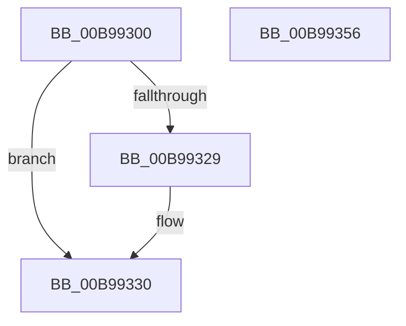

# ViHalTrackDomainCommonBuffer

- RVA: `0x00B99300`–`0x00B99357` (길이 `87` bytes)
- VA: `0x0000000140B99300`
- 실행 섹션: `PAGEVRFY`
- PDB 이름 있음: `예`; PDB Function 태그: `아니요`
- unwind 정보 RVA: `0x0005CF00`
- 디코드: `22`개 명령, `87/87` bytes 표시
- 미해석 바이트: `0` (있으면 어셈블리에 `.byte`로 보존)

> 이 문서는 커널 이미지의 기계어와 PDB 기호를 분석해 생성했습니다. 4번과 5번은 함수 원형과 자료형을 바이너리 사용 방식에서 추정한 C 해석이며 원본 소스 복구 결과는 아닙니다.

## 1. Dependencies

- 직접 호출 지점: **2**; 고유 호출 대상: **2**
- 직접 호출자로 확인된 함수: **1**
- RIP 상대 이미지 참조: **3**

### Outgoing calls
- `0x00B99310` → [KeAcquireSpinLockRaiseToDpc](../../text/20/KeAcquireSpinLockRaiseToDpc_function_00208470.md) (function, `0x00208470`)
- `0x00B9934B` → [KeReleaseSpinLock](../../text/39/KeReleaseSpinLock_function_00392BA0.md) (function, `0x00392BA0`)

### Direct callers
- [VfAllocateDomainCommonBuffer](../../text/61/VfAllocateDomainCommonBuffer_function_00612B20.md) at `0x00612BEE`

### Static image references
- `0x00B99309` → RVA `0x00F03FF0` (`.data`; read)
- `0x00B99315` → RVA `0x00F03FE0` (`.data`; read)
- `0x00B99344` → RVA `0x00F03FE0` (`.data`; write)

## 2. Other-region calls and transfers

- 다른 실행 섹션으로 향하는 call: **2**
  - `0x00B99310` → [KeAcquireSpinLockRaiseToDpc](../../text/20/KeAcquireSpinLockRaiseToDpc_function_00208470.md) (`PAGEVRFY` → `.text`)
  - `0x00B9934B` → [KeReleaseSpinLock](../../text/39/KeReleaseSpinLock_function_00392BA0.md) (`PAGEVRFY` → `.text`)
- 별도 외부 분기/꼬리 이동을 확인하지 못했습니다.

## 3. Assembly (complete function range)

```asm
00B99300  40 53                           push rbx
00B99302  48 83 EC 20                     sub rsp, 0x20
00B99306  48 8B D9                        mov rbx, rcx
00B99309  48 8D 0D E0 AC 36 00            lea rcx, [rip + 0x36ace0]
00B99310  E8 5B F1 66 FF                  call 0x140208470
00B99315  48 8B 0D C4 AC 36 00            mov rcx, qword ptr [rip + 0x36acc4]
00B9931C  48 8D 15 BD AC 36 00            lea rdx, [rip + 0x36acbd]
00B99323  48 39 51 08                     cmp qword ptr [rcx + 8], rdx
00B99327  74 07                           je 0x140b99330
00B99329  B9 03 00 00 00                  mov ecx, 3
00B9932E  CD 29                           int 0x29
00B99330  48 89 0B                        mov qword ptr [rbx], rcx
00B99333  48 89 53 08                     mov qword ptr [rbx + 8], rdx
00B99337  8A D0                           mov dl, al
00B99339  48 89 59 08                     mov qword ptr [rcx + 8], rbx
00B9933D  48 8D 0D AC AC 36 00            lea rcx, [rip + 0x36acac]
00B99344  48 89 1D 95 AC 36 00            mov qword ptr [rip + 0x36ac95], rbx
00B9934B  E8 50 98 7F FF                  call 0x140392ba0
00B99350  48 83 C4 20                     add rsp, 0x20
00B99354  5B                              pop rbx
00B99355  C3                              ret
00B99356  CC                              int3
```

## 4. C-style interpretation (structured pseudocode)

```c
__int64 __fastcall ViHalTrackDomainCommonBuffer(__int64 a1)
{
    __int64 result;
    __int64 v_rsp;

    v_rsp = (v_rsp) - (32);
    result = KeAcquireSpinLockRaiseToDpc(v_rip + 3583200, a2, a3, a4);
    if ((*(unsigned __int64 *)(*(unsigned __int64 *)(v_rip + 3583172) + 8)) != (v_rip + 3583165)) {
        a1 = 3;
    }
    *(unsigned __int64 *)(a1) = a1;
    *(unsigned __int64 *)(a1 + 8) = v_rip + 3583165;
    *(unsigned __int64 *)(a1 + 8) = a1;
    *(unsigned __int64 *)(v_rip + 3583125) = a1;
    result = KeReleaseSpinLock(v_rip + 3583148, (unsigned __int8)(result), a3, a4);
    v_rsp = (v_rsp) + (32);
    return result;
}
```

## 5. (Beta) C Style

```c
int64_t ViHalTrackDomainCommonBuffer(void *Arg1)
{
    uint8_t *arg1 = (uint8_t *)Arg1;

    int64_t result;
    int64_t local_rsp;

    local_rsp = (local_rsp) - (32);
    result = KeAcquireSpinLockRaiseToDpc(v_rip + 3583200, a2, a3, a4);
    if ((*(uint64_t *)(*(uint64_t *)(v_rip + 0x36ACC4) + 0x8)) != (v_rip + 3583165)) {
        Arg1 = 3;
    }
    *(void **)(arg1) = Arg1;
    *(uint64_t *)(arg1 + 0x8) = v_rip + 3583165;
    *(void **)(arg1 + 0x8) = Arg1;
    *(void **)(v_rip + 0x36AC95) = Arg1;
    result = KeReleaseSpinLock(v_rip + 3583148, (uint8_t)(result), a3, a4);
    local_rsp = (local_rsp) + (32);
    return result;
}
```

### 관측된 메모리 오프셋

구조체 형식이 확인되지 않은 접근은 인자 기준의 오프셋으로만 기록했습니다.

| 기준 인자 | 오프셋 표현 | 폭 (bit) | 접근 |
|---|---:|---:|---|
| `Arg1` | `+ 0x0` | `64` | `W` |
| `Arg1` | `+ 0x8` | `64` | `W` |

## 6. Execution-region graph

[열기: 2D/3D 그래프와 함수 탐색 컨트롤 패널](../../../control-panel.html?section=pagevrfy&rva=0x00B99300&view=graph)

- 2D 그래프는 위에서 아래로 흐르고, 3D 그래프는 빈 공간을 드래그해 회전합니다. Shift+드래그는 이동, 휠은 확대·축소, 함수 노드 선택은 대상 보고서 이동입니다.

### Static fallback


