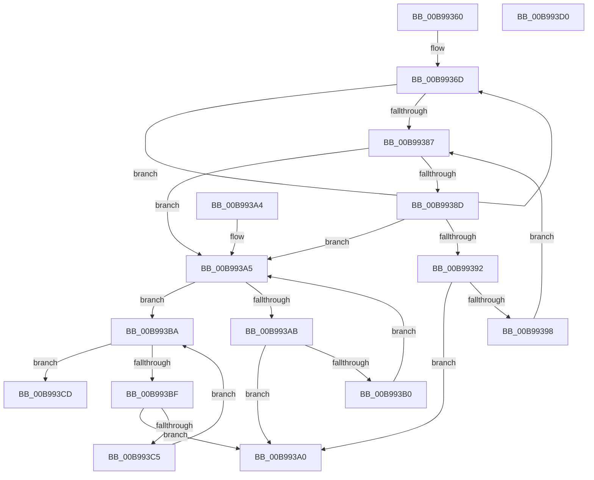

# ViHasBufferBeenTouched

- RVA: `0x00B99360`–`0x00B993D1` (길이 `113` bytes)
- VA: `0x0000000140B99360`
- 실행 섹션: `PAGEVRFY`
- PDB 이름 있음: `예`; PDB Function 태그: `아니요`
- unwind 정보 RVA: `0x000DB714`
- 디코드: `39`개 명령, `113/113` bytes 표시
- 미해석 바이트: `0` (있으면 어셈블리에 `.byte`로 보존)

> 이 문서는 커널 이미지의 기계어와 PDB 기호를 분석해 생성했습니다. 4번과 5번은 함수 원형과 자료형을 바이너리 사용 방식에서 추정한 C 해석이며 원본 소스 복구 결과는 아닙니다.

## 1. Dependencies

- 직접 호출 지점: **0**; 고유 호출 대상: **0**
- 직접 호출자로 확인된 함수: **1**
- RIP 상대 이미지 참조: **0**

### Outgoing calls
- 직접 디코드된 call 명령이 없습니다.

### Direct callers
- [ViCheckPadding](ViCheckPadding_function_00B98464.md) at `0x00B98497`
- [ViCheckPadding](ViCheckPadding_function_00B98464.md) at `0x00B9853A`
- [ViCheckPadding](ViCheckPadding_function_00B98464.md) at `0x00B98599`

### Static image references
- 디코드된 RIP-relative 메모리 참조가 없습니다.

## 2. Other-region calls and transfers

- 다른 실행 섹션으로 향하는 call: **0**
- 별도 외부 분기/꼬리 이동을 확인하지 못했습니다.

## 3. Assembly (complete function range)

```asm
00B99360  41 BA 0F 00 00 00               mov r10d, 0xf
00B99366  4C 8B C1                        mov r8, rcx
00B99369  45 8D 4A F2                     lea r9d, [r10 - 0xe]
00B9936D  42 8D 0C CD 00 00 00 00         lea ecx, [r9*8]
00B99375  49 8B C2                        mov rax, r10
00B99378  48 D3 E0                        shl rax, cl
00B9937B  45 03 C9                        add r9d, r9d
00B9937E  4C 0B D0                        or r10, rax
00B99381  41 83 F9 08                     cmp r9d, 8
00B99385  72 E6                           jb 0x140b9936d
00B99387  41 F6 C0 07                     test r8b, 7
00B9938B  74 18                           je 0x140b993a5
00B9938D  48 85 D2                        test rdx, rdx
00B99390  74 13                           je 0x140b993a5
00B99392  41 80 38 0F                     cmp byte ptr [r8], 0xf
00B99396  75 08                           jne 0x140b993a0
00B99398  49 FF C0                        inc r8
00B9939B  48 FF CA                        dec rdx
00B9939E  EB E7                           jmp 0x140b99387
00B993A0  49 8B C0                        mov rax, r8
00B993A3  C3                              ret
00B993A4  CC                              int3
00B993A5  48 83 FA 08                     cmp rdx, 8
00B993A9  72 0F                           jb 0x140b993ba
00B993AB  4D 39 10                        cmp qword ptr [r8], r10
00B993AE  75 F0                           jne 0x140b993a0
00B993B0  49 83 C0 08                     add r8, 8
00B993B4  48 83 EA 08                     sub rdx, 8
00B993B8  EB EB                           jmp 0x140b993a5
00B993BA  48 85 D2                        test rdx, rdx
00B993BD  74 0E                           je 0x140b993cd
00B993BF  41 80 38 0F                     cmp byte ptr [r8], 0xf
00B993C3  75 DB                           jne 0x140b993a0
00B993C5  49 FF C0                        inc r8
00B993C8  48 FF CA                        dec rdx
00B993CB  EB ED                           jmp 0x140b993ba
00B993CD  33 C0                           xor eax, eax
00B993CF  C3                              ret
00B993D0  CC                              int3
```

## 4. C-style interpretation (structured pseudocode)

```c
__int64 __fastcall ViHasBufferBeenTouched(__int64 a1, __int64 a2)
{
    __int64 result;
    __int64 v_r10;

loc_00B9936D:
    result = (15) << ((unsigned __int8)(15 - 14 * 8));
    a4 = (unsigned int)((15 - 14) + ((unsigned int)(15 - 14)));
    v_r10 = (15) | (result);
    if (((unsigned int)(a4)) < 8) goto loc_00B9936D;
loc_00B99387:
    if ((((unsigned __int8)(a1)) & (7)) == 0) goto loc_00B993A5;
    if (a2 == 0) goto loc_00B993A5;
    if ((*(unsigned __int8 *)(a1)) != 15) goto loc_00B993A0;
    a3 = (a1) + 1;
    a2 = (a2) - 1;
    goto loc_00B99387;
loc_00B993A0:
    return a3;
loc_00B993A5:
    if (a2 < 8) goto loc_00B993BA;
    if ((*(unsigned __int64 *)(a3)) != v_r10) goto loc_00B993A0;
    a3 = (a3) + (8);
    a2 = (a2) - (8);
    goto loc_00B993A5;
loc_00B993BA:
    if (a2 == 0) goto loc_00B993CD;
    if ((*(unsigned __int8 *)(a3)) != 15) goto loc_00B993A0;
    a3 = (a3) + 1;
    a2 = (a2) - 1;
    goto loc_00B993BA;
loc_00B993CD:
    result = 0;
    return result;
}
```

## 5. (Beta) C Style

```c
int64_t ViHasBufferBeenTouched(int64_t Arg1, int64_t Arg2)
{
    int64_t result;
    int64_t local_r10;

loc_00B9936D:
    result = (15) << ((uint8_t)(15 - 14 * 8));
    a4 = (uint32_t)((15 - 14) + ((uint32_t)(15 - 14)));
    local_r10 = (15) | (result);
    if (((uint32_t)(a4)) < 8) goto loc_00B9936D;
loc_00B99387:
    if ((((uint8_t)(Arg1)) & (7)) == 0) goto loc_00B993A5;
    if (Arg2 == 0) goto loc_00B993A5;
    if ((*(uint8_t *)(Arg1)) != 15) goto loc_00B993A0;
    a3 = (Arg1) + 1;
    Arg2 = (Arg2) - 1;
    goto loc_00B99387;
loc_00B993A0:
    return a3;
loc_00B993A5:
    if (Arg2 < 8) goto loc_00B993BA;
    if ((*(uint64_t *)(a3)) != local_r10) goto loc_00B993A0;
    a3 = (a3) + (8);
    Arg2 = (Arg2) - (8);
    goto loc_00B993A5;
loc_00B993BA:
    if (Arg2 == 0) goto loc_00B993CD;
    if ((*(uint8_t *)(a3)) != 15) goto loc_00B993A0;
    a3 = (a3) + 1;
    Arg2 = (Arg2) - 1;
    goto loc_00B993BA;
loc_00B993CD:
    result = 0;
    return result;
}
```

## 6. Execution-region graph

[열기: 2D/3D 그래프와 함수 탐색 컨트롤 패널](../../../control-panel.html?section=pagevrfy&rva=0x00B99360&view=graph)

- 2D 그래프는 위에서 아래로 흐르고, 3D 그래프는 빈 공간을 드래그해 회전합니다. Shift+드래그는 이동, 휠은 확대·축소, 함수 노드 선택은 대상 보고서 이동입니다.

### Static fallback


