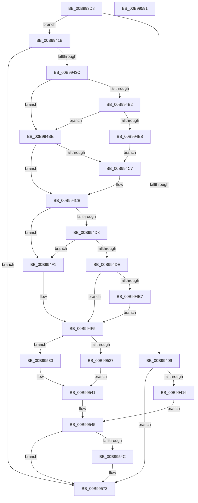

# ViHookDmaAdapter

- RVA: `0x00B993D8`–`0x00B99592` (길이 `442` bytes)
- VA: `0x0000000140B993D8`
- 실행 섹션: `PAGEVRFY`
- PDB 이름 있음: `예`; PDB Function 태그: `아니요`
- unwind 정보 RVA: `0x000D22F4`
- 디코드: `104`개 명령, `442/442` bytes 표시
- 미해석 바이트: `0` (있으면 어셈블리에 `.byte`로 보존)

> 이 문서는 커널 이미지의 기계어와 PDB 기호를 분석해 생성했습니다. 4번과 5번은 함수 원형과 자료형을 바이너리 사용 방식에서 추정한 C 해석이며 원본 소스 복구 결과는 아닙니다.

## 1. Dependencies

- 직접 호출 지점: **6**; 고유 호출 대상: **6**
- 직접 호출자로 확인된 함수: **1**
- RIP 상대 이미지 참조: **5**

### Outgoing calls
- `0x00B993FD` → [ViGetAdapterSignature](ViGetAdapterSignature_function_00B98F94.md) (function, `0x00B98F94`)
- `0x00B9942B` → [ExAllocatePool2](../../poolcode/B8/ExAllocatePool2_function_00B820F0.md) (function, `0x00B820F0`)
- `0x00B99443` → [ObfReferenceObject](../../text/20/ObfReferenceObject_function_0020FA20.md) (function, `0x0020FA20`)
- `0x00B994A1` → [ViCopyDeviceDescription](ViCopyDeviceDescription_function_00B988A0.md) (function, `0x00B988A0`)
- `0x00B994EA` → [ViAllocateContiguousMemory](ViAllocateContiguousMemory_function_00B97CE0.md) (function, `0x00B97CE0`)
- `0x00B9956E` → [ExInterlockedInsertHeadList](../../text/38/ExInterlockedInsertHeadList_function_00386680.md) (function, `0x00386680`)

### Direct callers
- [VfGetDmaAdapter](VfGetDmaAdapter_function_00B96930.md) at `0x00B96A1A`

### Static image references
- `0x00B994DE` → RVA `0x00FF4004` (`PAGEVRFD`; read)
- `0x00B99527` → RVA `0x00FF5DE0` (`PAGEVRFD`; read)
- `0x00B9953A` → RVA `0x00FF5CA0` (`PAGEVRFD`; read)
- `0x00B99555` → RVA `0x00F03FD0` (`.data`; read)
- `0x00B99563` → RVA `0x00F03FC0` (`.data`; read)

## 2. Other-region calls and transfers

- 다른 실행 섹션으로 향하는 call: **3**
  - `0x00B9942B` → [ExAllocatePool2](../../poolcode/B8/ExAllocatePool2_function_00B820F0.md) (`PAGEVRFY` → `POOLCODE`)
  - `0x00B99443` → [ObfReferenceObject](../../text/20/ObfReferenceObject_function_0020FA20.md) (`PAGEVRFY` → `.text`)
  - `0x00B9956E` → [ExInterlockedInsertHeadList](../../text/38/ExInterlockedInsertHeadList_function_00386680.md) (`PAGEVRFY` → `.text`)
- 별도 외부 분기/꼬리 이동을 확인하지 못했습니다.

## 3. Assembly (complete function range)

```asm
00B993D8  48 8B C4                        mov rax, rsp
00B993DB  48 89 58 08                     mov qword ptr [rax + 8], rbx
00B993DF  48 89 68 10                     mov qword ptr [rax + 0x10], rbp
00B993E3  48 89 70 18                     mov qword ptr [rax + 0x18], rsi
00B993E7  4C 89 70 20                     mov qword ptr [rax + 0x20], r14
00B993EB  41 57                           push r15
00B993ED  48 83 EC 30                     sub rsp, 0x30
00B993F1  4D 8B F9                        mov r15, r9
00B993F4  41 8B E8                        mov ebp, r8d
00B993F7  48 8B F2                        mov rsi, rdx
00B993FA  4C 8B F1                        mov r14, rcx
00B993FD  E8 92 FB FF FF                  call 0x140b98f94
00B99402  3D 56 44 6D 61                  cmp eax, 0x616d4456
00B99407  75 12                           jne 0x140b9941b
00B99409  48 8D 59 F0                     lea rbx, [rcx - 0x10]
00B9940D  48 85 DB                        test rbx, rbx
00B99410  0F 84 5D 01 00 00               je 0x140b99573
00B99416  E9 2A 01 00 00                  jmp 0x140b99545
00B9941B  BA 60 01 00 00                  mov edx, 0x160
00B99420  B9 40 00 00 00                  mov ecx, 0x40
00B99425  41 B8 48 61 6C 56               mov r8d, 0x566c6148
00B9942B  E8 C0 8C FE FF                  call 0x140b820f0
00B99430  48 8B D8                        mov rbx, rax
00B99433  48 85 C0                        test rax, rax
00B99436  0F 84 37 01 00 00               je 0x140b99573
00B9943C  83 60 4C 00                     and dword ptr [rax + 0x4c], 0
00B99440  49 8B CE                        mov rcx, r14
00B99443  E8 D8 65 67 FF                  call 0x14020fa20
00B99448  48 83 63 68 00                  and qword ptr [rbx + 0x68], 0
00B9944D  48 8D 4B 58                     lea rcx, [rbx + 0x58]
00B99451  48 89 49 08                     mov qword ptr [rcx + 8], rcx
00B99455  48 8D 83 88 00 00 00            lea rax, [rbx + 0x88]
00B9945C  48 89 09                        mov qword ptr [rcx], rcx
00B9945F  48 8B D6                        mov rdx, rsi
00B99462  48 83 A3 80 00 00 00 00         and qword ptr [rbx + 0x80], 0
00B9946A  48 8D 4B 70                     lea rcx, [rbx + 0x70]
00B9946E  48 89 49 08                     mov qword ptr [rcx + 8], rcx
00B99472  48 89 09                        mov qword ptr [rcx], rcx
00B99475  48 8D 8B E0 00 00 00            lea rcx, [rbx + 0xe0]
00B9947C  48 83 A3 98 00 00 00 00         and qword ptr [rbx + 0x98], 0
00B99484  48 89 40 08                     mov qword ptr [rax + 8], rax
00B99488  48 89 00                        mov qword ptr [rax], rax
00B9948B  48 8D 83 A0 00 00 00            lea rax, [rbx + 0xa0]
00B99492  48 83 A3 B0 00 00 00 00         and qword ptr [rbx + 0xb0], 0
00B9949A  48 89 40 08                     mov qword ptr [rax + 8], rax
00B9949E  48 89 00                        mov qword ptr [rax], rax
00B994A1  E8 FA F3 FF FF                  call 0x140b988a0
00B994A6  89 AB B8 00 00 00               mov dword ptr [rbx + 0xb8], ebp
00B994AC  83 7E 14 01                     cmp dword ptr [rsi + 0x14], 1
00B994B0  75 0C                           jne 0x140b994be
00B994B2  83 7E 10 08                     cmp dword ptr [rsi + 0x10], 8
00B994B6  73 06                           jae 0x140b994be
00B994B8  48 8D 46 04                     lea rax, [rsi + 4]
00B994BC  EB 09                           jmp 0x140b994c7
00B994BE  48 8D 46 04                     lea rax, [rsi + 4]
00B994C2  80 38 00                        cmp byte ptr [rax], 0
00B994C5  75 04                           jne 0x140b994cb
00B994C7  C6 43 4A 01                     mov byte ptr [rbx + 0x4a], 1
00B994CB  48 83 A3 38 01 00 00 00         and qword ptr [rbx + 0x138], 0
00B994D3  80 38 00                        cmp byte ptr [rax], 0
00B994D6  74 19                           je 0x140b994f1
00B994D8  80 7E 05 00                     cmp byte ptr [rsi + 5], 0
00B994DC  74 13                           je 0x140b994f1
00B994DE  83 3D 1F AB 45 00 00            cmp dword ptr [rip + 0x45ab1f], 0
00B994E5  74 0E                           je 0x140b994f5
00B994E7  48 8B CB                        mov rcx, rbx
00B994EA  E8 F1 E7 FF FF                  call 0x140b97ce0
00B994EF  EB 04                           jmp 0x140b994f5
00B994F1  C6 43 49 01                     mov byte ptr [rbx + 0x49], 1
00B994F5  C7 43 20 56 44 6D 61            mov dword ptr [rbx + 0x20], 0x616d4456
00B994FC  4C 89 73 28                     mov qword ptr [rbx + 0x28], r14
00B99500  41 0F B7 06                     movzx eax, word ptr [r14]
00B99504  66 89 43 10                     mov word ptr [rbx + 0x10], ax
00B99508  48 8D 43 30                     lea rax, [rbx + 0x30]
00B9950C  66 C7 43 12 30 00               mov word ptr [rbx + 0x12], 0x30
00B99512  48 89 40 08                     mov qword ptr [rax + 8], rax
00B99516  48 89 00                        mov qword ptr [rax], rax
00B99519  49 8B 46 08                     mov rax, qword ptr [r14 + 8]
00B9951D  48 83 B8 F8 00 00 00 00         cmp qword ptr [rax + 0xf8], 0
00B99525  75 09                           jne 0x140b99530
00B99527  48 8D 05 B2 C8 45 00            lea rax, [rip + 0x45c8b2]
00B9952E  EB 11                           jmp 0x140b99541
00B99530  C7 83 E0 00 00 00 03 00 00 00   mov dword ptr [rbx + 0xe0], 3
00B9953A  48 8D 05 5F C7 45 00            lea rax, [rip + 0x45c75f]
00B99541  48 89 43 18                     mov qword ptr [rbx + 0x18], rax
00B99545  80 7C 24 68 00                  cmp byte ptr [rsp + 0x68], 0
00B9954A  74 27                           je 0x140b99573
00B9954C  F0 FF 43 4C                     lock inc dword ptr [rbx + 0x4c]
00B99550  48 8B 44 24 60                  mov rax, qword ptr [rsp + 0x60]
00B99555  4C 8D 05 74 AA 36 00            lea r8, [rip + 0x36aa74]
00B9955C  48 8B D3                        mov rdx, rbx
00B9955F  48 89 43 50                     mov qword ptr [rbx + 0x50], rax
00B99563  48 8D 0D 56 AA 36 00            lea rcx, [rip + 0x36aa56]
00B9956A  4C 89 7B 40                     mov qword ptr [rbx + 0x40], r15
00B9956E  E8 0D D1 7E FF                  call 0x140386680
00B99573  48 8B 6C 24 48                  mov rbp, qword ptr [rsp + 0x48]
00B99578  48 8B C3                        mov rax, rbx
00B9957B  48 8B 5C 24 40                  mov rbx, qword ptr [rsp + 0x40]
00B99580  48 8B 74 24 50                  mov rsi, qword ptr [rsp + 0x50]
00B99585  4C 8B 74 24 58                  mov r14, qword ptr [rsp + 0x58]
00B9958A  48 83 C4 30                     add rsp, 0x30
00B9958E  41 5F                           pop r15
00B99590  C3                              ret
00B99591  CC                              int3
```

## 4. C-style interpretation (structured pseudocode)

```c
__int64 __fastcall ViHookDmaAdapter(__int64 a1, __int64 a2, int a3, __int64 a4, __int64 a5, unsigned __int8 a6)
{
    __int64 result;
    __int64 v_rsp;
    unsigned __int64 v_stack_p10;
    unsigned __int64 v_stack_p18;
    unsigned __int64 v_stack_p20;
    unsigned __int64 v_stack_p8;

    *(unsigned __int64 *)(v_rsp + 8) = v_rbx;
    *(unsigned __int64 *)(v_rsp + 16) = v_rbp;
    *(unsigned __int64 *)(v_rsp + 24) = v_rsi;
    *(unsigned __int64 *)(v_rsp + 32) = v_r14;
    v_rsp = (v_rsp) - (48);
    result = ViGetAdapterSignature(a1, a2, a3, a4);
    if (((unsigned int)(result)) != 0x616D4456ULL) goto loc_00B9941B;
    if (a1 - 16 == 0) goto loc_00B99573;
    goto loc_00B99545;
loc_00B9941B:
    result = ExAllocatePool2(64, 352, (unsigned int)(0x566C6148ULL), a4);
    if (result == 0) goto loc_00B99573;
    result = ObfReferenceObject(a1, 352, (unsigned int)(0x566C6148ULL), a4);
    *(unsigned __int64 *)(result + 88 + 8) = result + 88;
    *(unsigned __int64 *)(result + 88) = result + 88;
    *(unsigned __int64 *)(result + 112 + 8) = result + 112;
    *(unsigned __int64 *)(result + 112) = result + 112;
    *(unsigned __int64 *)(result + 136 + 8) = result + 136;
    *(unsigned __int64 *)(result + 136) = result + 136;
    *(unsigned __int64 *)(result + 160 + 8) = result + 160;
    *(unsigned __int64 *)(result + 160) = result + 160;
    result = ViCopyDeviceDescription(result + 224, a2, (unsigned int)(0x566C6148ULL), a4);
    *(unsigned int *)(result + 184) = (unsigned int)((unsigned int)(a3));
    if ((*(unsigned int *)(a2 + 20)) != 1) goto loc_00B994BE;
    if ((*(unsigned int *)(a2 + 16)) >= 8) goto loc_00B994BE;
    goto loc_00B994C7;
loc_00B994BE:
    if ((*(unsigned __int8 *)(a2 + 4)) == 0) {
        *(unsigned __int8 *)(result + 74) = 1;
    }
    if ((*(unsigned __int8 *)(a2 + 4)) == 0) goto loc_00B994F1;
    if ((*(unsigned __int8 *)(a2 + 5)) == 0) goto loc_00B994F1;
    if ((*(unsigned int *)(v_rip + 4565791)) == 0) goto loc_00B994F5;
    result = ViAllocateContiguousMemory(result, a2, (unsigned int)(0x566C6148ULL), a4);
    goto loc_00B994F5;
loc_00B994F1:
    *(unsigned __int8 *)(result + 73) = 1;
loc_00B994F5:
    *(unsigned int *)(result + 32) = 0x616D4456ULL;
    *(unsigned __int64 *)(result + 40) = a1;
    *(unsigned __int16 *)(result + 16) = (unsigned __int16)(*(unsigned __int16 *)(a1));
    *(unsigned __int16 *)(result + 18) = 48;
    *(unsigned __int64 *)(result + 48 + 8) = result + 48;
    *(unsigned __int64 *)(result + 48) = result + 48;
    if ((*(unsigned __int64 *)(*(unsigned __int64 *)(a1 + 8) + 248)) != 0) goto loc_00B99530;
    goto loc_00B99541;
loc_00B99530:
    *(unsigned int *)(result + 224) = 3;
loc_00B99541:
    *(unsigned __int64 *)(result + 24) = v_rip + 4573023;
loc_00B99545:
    result = v_rip + 4573023;
    if (a6 != 0) {
        result = a5;
        a3 = v_rip + 3582580;
        a2 = result;
        *(unsigned __int64 *)(result + 80) = result;
        a1 = v_rip + 3582550;
        *(unsigned __int64 *)(result + 64) = a4;
        result = ExInterlockedInsertHeadList(a1, a2, a3, a4);
    }
    v_rsp = (v_rsp) + (48);
    return result;
}
```

## 5. (Beta) C Style

```c
int64_t ViHookDmaAdapter(void *Arg1, void *Arg2, int32_t Arg3, int64_t Arg4, int64_t Arg5, uint8_t Arg6)
{
    uint8_t *arg1 = (uint8_t *)Arg1;
    uint8_t *arg2 = (uint8_t *)Arg2;

    int64_t result;
    int64_t local_rsp;
    uint64_t v_stack_p10;
    uint64_t v_stack_p18;
    uint64_t v_stack_p20;
    uint64_t v_stack_p8;

    *(uint64_t *)(local_rsp + 0x8) = local_rbx;
    *(uint64_t *)(local_rsp + 0x10) = local_rbp;
    *(uint64_t *)(local_rsp + 0x18) = local_rsi;
    *(uint64_t *)(local_rsp + 0x20) = local_r14;
    local_rsp = (local_rsp) - (48);
    result = ViGetAdapterSignature(Arg1, Arg2, Arg3, Arg4);
    if (((uint32_t)(result)) != 0x616D4456ULL) goto loc_00B9941B;
    if (Arg1 - 16 == 0) goto loc_00B99573;
    goto loc_00B99545;
loc_00B9941B:
    result = ExAllocatePool2(64, 352, (uint32_t)(0x566C6148ULL), Arg4);
    if (result == 0) goto loc_00B99573;
    result = ObfReferenceObject(Arg1, 352, (uint32_t)(0x566C6148ULL), Arg4);
    *(uint64_t *)(result + 0x58 + 0x8) = result + 88;
    *(uint64_t *)(result + 0x58) = result + 88;
    *(uint64_t *)(result + 0x70 + 0x8) = result + 112;
    *(uint64_t *)(result + 0x70) = result + 112;
    *(uint64_t *)(result + 0x88 + 0x8) = result + 136;
    *(uint64_t *)(result + 0x88) = result + 136;
    *(uint64_t *)(result + 0xA0 + 0x8) = result + 160;
    *(uint64_t *)(result + 0xA0) = result + 160;
    result = ViCopyDeviceDescription(result + 224, Arg2, (uint32_t)(0x566C6148ULL), Arg4);
    *(uint32_t *)(result + 0xB8) = (uint32_t)((uint32_t)(Arg3));
    if ((*(uint32_t *)(arg2 + 0x14)) != 1) goto loc_00B994BE;
    if ((*(uint32_t *)(arg2 + 0x10)) >= 8) goto loc_00B994BE;
    goto loc_00B994C7;
loc_00B994BE:
    if ((*(uint8_t *)(arg2 + 0x4)) == 0) {
        *(uint8_t *)(result + 0x4A) = 1;
    }
    if ((*(uint8_t *)(arg2 + 0x4)) == 0) goto loc_00B994F1;
    if ((*(uint8_t *)(arg2 + 0x5)) == 0) goto loc_00B994F1;
    if ((*(uint32_t *)(v_rip + 0x45AB1F)) == 0) goto loc_00B994F5;
    result = ViAllocateContiguousMemory(result, Arg2, (uint32_t)(0x566C6148ULL), Arg4);
    goto loc_00B994F5;
loc_00B994F1:
    *(uint8_t *)(result + 0x49) = 1;
loc_00B994F5:
    *(uint32_t *)(result + 0x20) = 0x616D4456ULL;
    *(void **)(result + 0x28) = Arg1;
    *(uint16_t *)(result + 0x10) = (uint16_t)(*(uint16_t *)(arg1));
    *(uint16_t *)(result + 0x12) = 48;
    *(uint64_t *)(result + 0x30 + 0x8) = result + 48;
    *(uint64_t *)(result + 0x30) = result + 48;
    if ((*(uint64_t *)(*(uint64_t *)(arg1 + 0x8) + 0xF8)) != 0) goto loc_00B99530;
    goto loc_00B99541;
loc_00B99530:
    *(uint32_t *)(result + 0xE0) = 3;
loc_00B99541:
    *(uint64_t *)(result + 0x18) = v_rip + 4573023;
loc_00B99545:
    result = v_rip + 4573023;
    if (Arg6 != 0) {
        result = Arg5;
        Arg3 = v_rip + 3582580;
        Arg2 = result;
        *(uint64_t *)(result + 0x50) = result;
        Arg1 = v_rip + 3582550;
        *(uint64_t *)(result + 0x40) = Arg4;
        result = ExInterlockedInsertHeadList(Arg1, Arg2, Arg3, Arg4);
    }
    local_rsp = (local_rsp) + (48);
    return result;
}
```

### 관측된 메모리 오프셋

구조체 형식이 확인되지 않은 접근은 인자 기준의 오프셋으로만 기록했습니다.

| 기준 인자 | 오프셋 표현 | 폭 (bit) | 접근 |
|---|---:|---:|---|
| `Arg1` | `+ 0x0` | `16` | `R` |
| `Arg1` | `+ 0x8` | `64` | `R` |
| `Arg2` | `+ 0x0` | `8` | `R` |
| `Arg2` | `+ 0x4` | `64` | `R` |
| `Arg2` | `+ 0x5` | `8` | `R` |
| `Arg2` | `+ 0x10` | `32` | `R` |
| `Arg2` | `+ 0x14` | `32` | `R` |

## 6. Execution-region graph

[열기: 2D/3D 그래프와 함수 탐색 컨트롤 패널](../../../control-panel.html?section=pagevrfy&rva=0x00B993D8&view=graph)

- 2D 그래프는 위에서 아래로 흐르고, 3D 그래프는 빈 공간을 드래그해 회전합니다. Shift+드래그는 이동, 휠은 확대·축소, 함수 노드 선택은 대상 보고서 이동입니다.

### Static fallback


