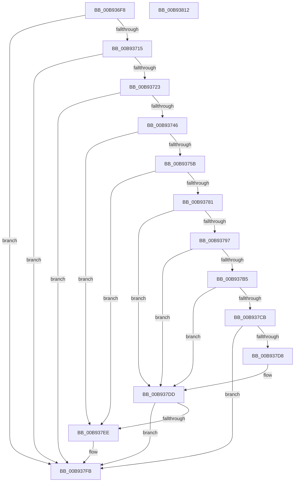

# ViInitializeLocalSystemDescriptor

- RVA: `0x00B936F8`–`0x00B93813` (길이 `283` bytes)
- VA: `0x0000000140B936F8`
- 실행 섹션: `PAGEVRFY`
- PDB 이름 있음: `예`; PDB Function 태그: `아니요`
- unwind 정보 RVA: `0x00060BC4`
- 디코드: `73`개 명령, `283/283` bytes 표시
- 미해석 바이트: `0` (있으면 어셈블리에 `.byte`로 보존)

> 이 문서는 커널 이미지의 기계어와 PDB 기호를 분석해 생성했습니다. 4번과 5번은 함수 원형과 자료형을 바이너리 사용 방식에서 추정한 C 해석이며 원본 소스 복구 결과는 아닙니다.

## 1. Dependencies

- 직접 호출 지점: **9**; 고유 호출 대상: **7**
- 직접 호출자로 확인된 함수: **1**
- RIP 상대 이미지 참조: **2**

### Outgoing calls
- `0x00B93735` → [ExAllocatePool2](../../poolcode/B8/ExAllocatePool2_function_00B820F0.md) (function, `0x00B820F0`)
- `0x00B9374E` → [RtlCreateSecurityDescriptor](../../page/9F/RtlCreateSecurityDescriptor_function_009F1DF0.md) (function, `0x009F1DF0`)
- `0x00B93762` → [RtlLengthSid](../../text/45/RtlLengthSid_function_0045D270.md) (function, `0x0045D270`)
- `0x00B93774` → [ExAllocatePool2](../../poolcode/B8/ExAllocatePool2_function_00B820F0.md) (function, `0x00B820F0`)
- `0x00B9378C` → [RtlCreateAcl](../../page/91/RtlCreateAcl_function_00916F00.md) (function, `0x00916F00`)
- `0x00B937AA` → [RtlAddAccessAllowedAce](../../page/92/RtlAddAccessAllowedAce_function_009298C0.md) (function, `0x009298C0`)
- `0x00B937C0` → [RtlSetDaclSecurityDescriptor](../../page/9E/RtlSetDaclSecurityDescriptor_function_009EC210.md) (function, `0x009EC210`)
- `0x00B937E5` → [ExFreePoolWithTag](../../poolcode/B8/ExFreePoolWithTag_function_00B82870.md) (function, `0x00B82870`)
- `0x00B937F6` → [ExFreePoolWithTag](../../poolcode/B8/ExFreePoolWithTag_function_00B82870.md) (function, `0x00B82870`)

### Direct callers
- [VfUtilIsLocalSystem](VfUtilIsLocalSystem_function_00B933F4.md) at `0x00B93412`

### Static image references
- `0x00B93707` → RVA `0x00FFDBB8` (`PAGEVRFD`; read)
- `0x00B93715` → RVA `0x00E67D58` (`.data`; read)

## 2. Other-region calls and transfers

- 다른 실행 섹션으로 향하는 call: **9**
  - `0x00B93735` → [ExAllocatePool2](../../poolcode/B8/ExAllocatePool2_function_00B820F0.md) (`PAGEVRFY` → `POOLCODE`)
  - `0x00B9374E` → [RtlCreateSecurityDescriptor](../../page/9F/RtlCreateSecurityDescriptor_function_009F1DF0.md) (`PAGEVRFY` → `PAGE`)
  - `0x00B93762` → [RtlLengthSid](../../text/45/RtlLengthSid_function_0045D270.md) (`PAGEVRFY` → `.text`)
  - `0x00B93774` → [ExAllocatePool2](../../poolcode/B8/ExAllocatePool2_function_00B820F0.md) (`PAGEVRFY` → `POOLCODE`)
  - `0x00B9378C` → [RtlCreateAcl](../../page/91/RtlCreateAcl_function_00916F00.md) (`PAGEVRFY` → `PAGE`)
  - `0x00B937AA` → [RtlAddAccessAllowedAce](../../page/92/RtlAddAccessAllowedAce_function_009298C0.md) (`PAGEVRFY` → `PAGE`)
  - `0x00B937C0` → [RtlSetDaclSecurityDescriptor](../../page/9E/RtlSetDaclSecurityDescriptor_function_009EC210.md) (`PAGEVRFY` → `PAGE`)
  - `0x00B937E5` → [ExFreePoolWithTag](../../poolcode/B8/ExFreePoolWithTag_function_00B82870.md) (`PAGEVRFY` → `POOLCODE`)
  - `0x00B937F6` → [ExFreePoolWithTag](../../poolcode/B8/ExFreePoolWithTag_function_00B82870.md) (`PAGEVRFY` → `POOLCODE`)
- 별도 외부 분기/꼬리 이동을 확인하지 못했습니다.

## 3. Assembly (complete function range)

```asm
00B936F8  48 89 5C 24 08                  mov qword ptr [rsp + 8], rbx
00B936FD  48 89 74 24 10                  mov qword ptr [rsp + 0x10], rsi
00B93702  57                              push rdi
00B93703  48 83 EC 20                     sub rsp, 0x20
00B93707  48 83 3D A9 A4 46 00 00         cmp qword ptr [rip + 0x46a4a9], 0
00B9370F  0F 85 E6 00 00 00               jne 0x140b937fb
00B93715  48 83 3D 3B 46 2D 00 00         cmp qword ptr [rip + 0x2d463b], 0
00B9371D  0F 84 D8 00 00 00               je 0x140b937fb
00B93723  BE 00 01 00 00                  mov esi, 0x100
00B93728  BA 28 00 00 00                  mov edx, 0x28
00B9372D  8B CE                           mov ecx, esi
00B9372F  41 B8 56 72 66 55               mov r8d, 0x55667256
00B93735  E8 B6 E9 FE FF                  call 0x140b820f0
00B9373A  48 8B F8                        mov rdi, rax
00B9373D  48 85 C0                        test rax, rax
00B93740  0F 84 B5 00 00 00               je 0x140b937fb
00B93746  BA 01 00 00 00                  mov edx, 1
00B9374B  48 8B C8                        mov rcx, rax
00B9374E  E8 9D E6 E5 FF                  call 0x1409f1df0
00B93753  85 C0                           test eax, eax
00B93755  0F 88 93 00 00 00               js 0x140b937ee
00B9375B  48 8B 0D F6 45 2D 00            mov rcx, qword ptr [rip + 0x2d45f6]
00B93762  E8 09 9B 8C FF                  call 0x14045d270
00B93767  41 B8 56 72 66 55               mov r8d, 0x55667256
00B9376D  8B CE                           mov ecx, esi
00B9376F  8D 58 14                        lea ebx, [rax + 0x14]
00B93772  8B D3                           mov edx, ebx
00B93774  E8 77 E9 FE FF                  call 0x140b820f0
00B93779  48 8B F0                        mov rsi, rax
00B9377C  48 85 C0                        test rax, rax
00B9377F  74 6D                           je 0x140b937ee
00B93781  41 B8 02 00 00 00               mov r8d, 2
00B93787  8B D3                           mov edx, ebx
00B93789  48 8B C8                        mov rcx, rax
00B9378C  E8 6F 37 D8 FF                  call 0x140916f00
00B93791  8B D8                           mov ebx, eax
00B93793  85 C0                           test eax, eax
00B93795  78 46                           js 0x140b937dd
00B93797  4C 8B 0D BA 45 2D 00            mov r9, qword ptr [rip + 0x2d45ba]
00B9379E  BA 02 00 00 00                  mov edx, 2
00B937A3  48 8B CE                        mov rcx, rsi
00B937A6  44 8D 42 FF                     lea r8d, [rdx - 1]
00B937AA  E8 11 61 D9 FF                  call 0x1409298c0
00B937AF  8B D8                           mov ebx, eax
00B937B1  85 C0                           test eax, eax
00B937B3  78 28                           js 0x140b937dd
00B937B5  45 33 C9                        xor r9d, r9d
00B937B8  4C 8B C6                        mov r8, rsi
00B937BB  B2 01                           mov dl, 1
00B937BD  48 8B CF                        mov rcx, rdi
00B937C0  E8 4B 8A E5 FF                  call 0x1409ec210
00B937C5  8B D8                           mov ebx, eax
00B937C7  85 C0                           test eax, eax
00B937C9  78 12                           js 0x140b937dd
00B937CB  33 C0                           xor eax, eax
00B937CD  F0 48 0F B1 3D E2 A3 46 00      lock cmpxchg qword ptr [rip + 0x46a3e2], rdi
00B937D6  74 23                           je 0x140b937fb
00B937D8  BB E5 00 00 C0                  mov ebx, 0xc00000e5
00B937DD  BA 56 72 66 55                  mov edx, 0x55667256
00B937E2  48 8B CE                        mov rcx, rsi
00B937E5  E8 86 F0 FE FF                  call 0x140b82870
00B937EA  85 DB                           test ebx, ebx
00B937EC  79 0D                           jns 0x140b937fb
00B937EE  BA 56 72 66 55                  mov edx, 0x55667256
00B937F3  48 8B CF                        mov rcx, rdi
00B937F6  E8 75 F0 FE FF                  call 0x140b82870
00B937FB  48 8B 05 B6 A3 46 00            mov rax, qword ptr [rip + 0x46a3b6]
00B93802  48 8B 5C 24 30                  mov rbx, qword ptr [rsp + 0x30]
00B93807  48 8B 74 24 38                  mov rsi, qword ptr [rsp + 0x38]
00B9380C  48 83 C4 20                     add rsp, 0x20
00B93810  5F                              pop rdi
00B93811  C3                              ret
00B93812  CC                              int3
```

## 4. C-style interpretation (structured pseudocode)

```c
__int64 __fastcall ViInitializeLocalSystemDescriptor(void)
{
    __int64 result;
    __int64 v_rsp;
    unsigned __int64 v_stack_p10;
    unsigned __int64 v_stack_p8;

    v_stack_p8 = v_rbx;
    v_stack_p10 = v_rsi;
    v_rsp = (v_rsp) - (32);
    if ((*(unsigned __int64 *)(v_rip + 4629673)) != 0) goto loc_00B937FB;
    if ((*(unsigned __int64 *)(v_rip + 2967099)) == 0) goto loc_00B937FB;
    result = ExAllocatePool2(256, 40, (unsigned int)(0x55667256ULL), a4);
    if (result == 0) goto loc_00B937FB;
    result = RtlCreateSecurityDescriptor(result, 1, (unsigned int)(0x55667256ULL), a4);
    if (sign_flag) goto loc_00B937EE;
    result = RtlLengthSid(*(unsigned __int64 *)(v_rip + 2967030), 1, (unsigned int)(0x55667256ULL), a4);
    result = ExAllocatePool2(256, (unsigned int)((unsigned int)(result + 20)), (unsigned int)(0x55667256ULL), a4);
    if (result == 0) goto loc_00B937EE;
    result = RtlCreateAcl(result, (unsigned int)((unsigned int)(result + 20)), 2, a4);
    if (sign_flag) goto loc_00B937DD;
    result = RtlAddAccessAllowedAce(result, 2, 2 - 1, *(unsigned __int64 *)(v_rip + 2966970));
    if (sign_flag) goto loc_00B937DD;
    a4 = 0;
    result = RtlSetDaclSecurityDescriptor(result, 1, result, a4);
    if (sign_flag) goto loc_00B937DD;
    result = 0;
    if (condition_is_equal) goto loc_00B937FB;
loc_00B937DD:
    result = ExFreePoolWithTag(0, (unsigned int)(0x55667256ULL), result, a4);
    if (sign_flag) {
        a2 = 0x55667256ULL;
        a1 = result;
        result = ExFreePoolWithTag(a1, a2, result, a4);
    }
    v_rsp = (v_rsp) + (32);
    return *(unsigned __int64 *)(v_rip + 4629430);
}
```

## 5. (Beta) C Style

```c
void ViInitializeLocalSystemDescriptor(void)
{
    int64_t result;
    int64_t local_rsp;
    uint64_t v_stack_p10;
    uint64_t v_stack_p8;

    v_stack_p8 = local_rbx;
    v_stack_p10 = local_rsi;
    local_rsp = (local_rsp) - (32);
    if ((*(uint64_t *)(v_rip + 0x46A4A9)) != 0) goto loc_00B937FB;
    if ((*(uint64_t *)(v_rip + 0x2D463B)) == 0) goto loc_00B937FB;
    result = ExAllocatePool2(256, 40, (uint32_t)(0x55667256ULL), a4);
    if (result == 0) goto loc_00B937FB;
    result = RtlCreateSecurityDescriptor(result, 1, (uint32_t)(0x55667256ULL), a4);
    if (sign_flag) goto loc_00B937EE;
    result = RtlLengthSid(*(uint64_t *)(v_rip + 0x2D45F6), 1, (uint32_t)(0x55667256ULL), a4);
    result = ExAllocatePool2(256, (uint32_t)((uint32_t)(result + 20)), (uint32_t)(0x55667256ULL), a4);
    if (result == 0) goto loc_00B937EE;
    result = RtlCreateAcl(result, (uint32_t)((uint32_t)(result + 20)), 2, a4);
    if (sign_flag) goto loc_00B937DD;
    result = RtlAddAccessAllowedAce(result, 2, 2 - 1, *(uint64_t *)(v_rip + 0x2D45BA));
    if (sign_flag) goto loc_00B937DD;
    a4 = 0;
    result = RtlSetDaclSecurityDescriptor(result, 1, result, a4);
    if (sign_flag) goto loc_00B937DD;
    result = 0;
    if (condition_is_equal) goto loc_00B937FB;
loc_00B937DD:
    result = ExFreePoolWithTag(0, (uint32_t)(0x55667256ULL), result, a4);
    if (sign_flag) {
        a2 = 0x55667256ULL;
        a1 = result;
        result = ExFreePoolWithTag(a1, a2, result, a4);
    }
    local_rsp = (local_rsp) + (32);
    return *(uint64_t *)(v_rip + 0x46A3B6);
}
```

## 6. Execution-region graph

[열기: 2D/3D 그래프와 함수 탐색 컨트롤 패널](../../../control-panel.html?section=pagevrfy&rva=0x00B936F8&view=graph)

- 2D 그래프는 위에서 아래로 흐르고, 3D 그래프는 빈 공간을 드래그해 회전합니다. Shift+드래그는 이동, 휠은 확대·축소, 함수 노드 선택은 대상 보고서 이동입니다.

### Static fallback


