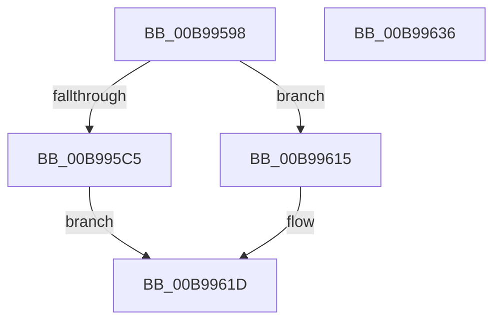

# ViInitializePadding

- RVA: `0x00B99598`–`0x00B99637` (길이 `159` bytes)
- VA: `0x0000000140B99598`
- 실행 섹션: `PAGEVRFY`
- PDB 이름 있음: `예`; PDB Function 태그: `아니요`
- unwind 정보 RVA: `0x00060300`
- 디코드: `48`개 명령, `159/159` bytes 표시
- 미해석 바이트: `0` (있으면 어셈블리에 `.byte`로 보존)

> 이 문서는 커널 이미지의 기계어와 PDB 기호를 분석해 생성했습니다. 4번과 5번은 함수 원형과 자료형을 바이너리 사용 방식에서 추정한 C 해석이며 원본 소스 복구 결과는 아닙니다.

## 1. Dependencies

- 직접 호출 지점: **4**; 고유 호출 대상: **2**
- 직접 호출자로 확인된 함수: **2**
- RIP 상대 이미지 참조: **0**

### Outgoing calls
- `0x00B995C8` → [memset](../../text/6C/memset_function_006C6C40.md) (function, `0x006C6C40`)
- `0x00B995E0` → [memset](../../text/6C/memset_function_006C6C40.md) (function, `0x006C6C40`)
- `0x00B9960E` → [ViTagBuffer](ViTagBuffer_function_00B99F04.md) (function, `0x00B99F04`)
- `0x00B99618` → [memset](../../text/6C/memset_function_006C6C40.md) (function, `0x006C6C40`)

### Direct callers
- [ViAllocateMapRegisterFile](ViAllocateMapRegisterFile_function_00B97E9C.md) at `0x00B97FA6`
- [ViSpecialAllocateCommonBuffer](ViSpecialAllocateCommonBuffer_function_00B99BB0.md) at `0x00B99CE9`

### Static image references
- 디코드된 RIP-relative 메모리 참조가 없습니다.

## 2. Other-region calls and transfers

- 다른 실행 섹션으로 향하는 call: **3**
  - `0x00B995C8` → [memset](../../text/6C/memset_function_006C6C40.md) (`PAGEVRFY` → `.text`)
  - `0x00B995E0` → [memset](../../text/6C/memset_function_006C6C40.md) (`PAGEVRFY` → `.text`)
  - `0x00B99618` → [memset](../../text/6C/memset_function_006C6C40.md) (`PAGEVRFY` → `.text`)
- 별도 외부 분기/꼬리 이동을 확인하지 못했습니다.

## 3. Assembly (complete function range)

```asm
00B99598  48 89 5C 24 08                  mov qword ptr [rsp + 8], rbx
00B9959D  48 89 6C 24 10                  mov qword ptr [rsp + 0x10], rbp
00B995A2  48 89 74 24 18                  mov qword ptr [rsp + 0x18], rsi
00B995A7  57                              push rdi
00B995A8  41 56                           push r14
00B995AA  41 57                           push r15
00B995AC  48 83 EC 20                     sub rsp, 0x20
00B995B0  33 F6                           xor esi, esi
00B995B2  8B EA                           mov ebp, edx
00B995B4  45 8B F1                        mov r14d, r9d
00B995B7  4D 8B F8                        mov r15, r8
00B995BA  48 8B F9                        mov rdi, rcx
00B995BD  8D 56 0F                        lea edx, [rsi + 0xf]
00B995C0  45 85 C9                        test r9d, r9d
00B995C3  74 50                           je 0x140b99615
00B995C5  4C 2B C1                        sub r8, rcx
00B995C8  E8 73 D6 B2 FF                  call 0x1406c6c40
00B995CD  4B 8D 1C 37                     lea rbx, [r15 + r14]
00B995D1  44 8B C5                        mov r8d, ebp
00B995D4  4C 2B C3                        sub r8, rbx
00B995D7  8D 56 0F                        lea edx, [rsi + 0xf]
00B995DA  4C 03 C7                        add r8, rdi
00B995DD  48 8B CB                        mov rcx, rbx
00B995E0  E8 5B D6 B2 FF                  call 0x1406c6c40
00B995E5  48 8D 47 08                     lea rax, [rdi + 8]
00B995E9  41 8B D6                        mov edx, r14d
00B995EC  49 3B C7                        cmp rax, r15
00B995EF  49 8B CF                        mov rcx, r15
00B995F2  40 0F 96 C6                     setbe sil
00B995F6  48 2B DF                        sub rbx, rdi
00B995F9  48 83 C3 08                     add rbx, 8
00B995FD  44 0F B7 C6                     movzx r8d, si
00B99601  66 41 83 C8 02                  or r8w, 2
00B99606  48 3B DD                        cmp rbx, rbp
00B99609  66 44 0F 47 C6                  cmova r8w, si
00B9960E  E8 F1 08 00 00                  call 0x140b99f04
00B99613  EB 08                           jmp 0x140b9961d
00B99615  4C 8B C5                        mov r8, rbp
00B99618  E8 23 D6 B2 FF                  call 0x1406c6c40
00B9961D  48 8B 5C 24 40                  mov rbx, qword ptr [rsp + 0x40]
00B99622  48 8B 6C 24 48                  mov rbp, qword ptr [rsp + 0x48]
00B99627  48 8B 74 24 50                  mov rsi, qword ptr [rsp + 0x50]
00B9962C  48 83 C4 20                     add rsp, 0x20
00B99630  41 5F                           pop r15
00B99632  41 5E                           pop r14
00B99634  5F                              pop rdi
00B99635  C3                              ret
00B99636  CC                              int3
```

## 4. C-style interpretation (structured pseudocode)

```c
__int64 __fastcall ViInitializePadding(__int64 a1, int a2, __int64 a3, int a4)
{
    __int64 result;
    __int64 v_rbx;
    __int64 v_rsi;
    __int64 v_rsp;
    unsigned __int64 v_stack_p10;
    unsigned __int64 v_stack_p18;
    unsigned __int64 v_stack_p8;

    v_stack_p8 = v_rbx;
    v_stack_p10 = v_rbp;
    v_stack_p18 = v_rsi;
    v_rsp = (v_rsp) - (32);
    v_rsi = 0;
    if (a4 == 0) goto loc_00B99615;
    a3 = (a3) - (a1);
    result = memset(a1, v_rsi + 15, a3, a4);
    a3 = ((unsigned int)((unsigned int)((unsigned int)(a2)))) - (a3 + (unsigned int)(a4) * 1);
    a3 = (a3) + (a1);
    result = memset(a3 + (unsigned int)(a4) * 1, v_rsi + 15, a3, a4);
    v_rsi = ((a1 + 8) <= a3) ? 1 : 0;
    v_rbx = (a3 + (unsigned int)(a4) * 1) - (a1);
    v_rbx = (v_rbx) + (8);
    a3 = (unsigned __int16)(((unsigned __int16)(v_rsi)) | (2));
    if (v_rbx > ((unsigned int)(a2))) { a3 = (unsigned __int16)(v_rsi); }
    result = ViTagBuffer(a3, (unsigned int)((unsigned int)((unsigned int)(a4))), a3, a4);
    goto loc_00B9961D;
loc_00B99615:
    result = memset(a3, (unsigned int)((unsigned int)((unsigned int)(a4))), (unsigned int)(a2), a4);
loc_00B9961D:
    v_rsp = (v_rsp) + (32);
    return result;
}
```

## 5. (Beta) C Style

```c
int64_t ViInitializePadding(void *Arg1, int32_t Arg2, void *Arg3, int32_t Arg4)
{
    uint8_t *arg1 = (uint8_t *)Arg1;
    uint8_t *arg3 = (uint8_t *)Arg3;

    int64_t result;
    int64_t local_rbx;
    int64_t local_rsi;
    int64_t local_rsp;
    uint64_t v_stack_p10;
    uint64_t v_stack_p18;
    uint64_t v_stack_p8;

    v_stack_p8 = local_rbx;
    v_stack_p10 = local_rbp;
    v_stack_p18 = local_rsi;
    local_rsp = (local_rsp) - (32);
    local_rsi = 0;
    if (Arg4 == 0) goto loc_00B99615;
    Arg3 = (Arg3) - (Arg1);
    result = memset(Arg1, local_rsi + 15, Arg3, Arg4);
    Arg3 = ((uint32_t)((uint32_t)((uint32_t)(Arg2)))) - (Arg3 + (uint32_t)(Arg4) * 1);
    Arg3 = (Arg3) + (Arg1);
    result = memset(Arg3 + (uint32_t)(Arg4) * 1, local_rsi + 15, Arg3, Arg4);
    local_rsi = ((Arg1 + 8) <= Arg3) ? 1 : 0;
    local_rbx = (Arg3 + (uint32_t)(Arg4) * 1) - (Arg1);
    local_rbx = (local_rbx) + (8);
    Arg3 = (uint16_t)(((uint16_t)(local_rsi)) | (2));
    if (local_rbx > ((uint32_t)(Arg2))) { Arg3 = (uint16_t)(local_rsi); }
    result = ViTagBuffer(Arg3, (uint32_t)((uint32_t)((uint32_t)(Arg4))), Arg3, Arg4);
    goto loc_00B9961D;
loc_00B99615:
    result = memset(Arg3, (uint32_t)((uint32_t)((uint32_t)(Arg4))), (uint32_t)(Arg2), Arg4);
loc_00B9961D:
    local_rsp = (local_rsp) + (32);
    return result;
}
```

### 관측된 메모리 오프셋

구조체 형식이 확인되지 않은 접근은 인자 기준의 오프셋으로만 기록했습니다.

| 기준 인자 | 오프셋 표현 | 폭 (bit) | 접근 |
|---|---:|---:|---|
| `Arg1` | `+ 0x8` | `64` | `R` |
| `Arg3` | `+ 0x0 + r14*1` | `64` | `R` |

## 6. Execution-region graph

[열기: 2D/3D 그래프와 함수 탐색 컨트롤 패널](../../../control-panel.html?section=pagevrfy&rva=0x00B99598&view=graph)

- 2D 그래프는 위에서 아래로 흐르고, 3D 그래프는 빈 공간을 드래그해 회전합니다. Shift+드래그는 이동, 휠은 확대·축소, 함수 노드 선택은 대상 보고서 이동입니다.

### Static fallback


